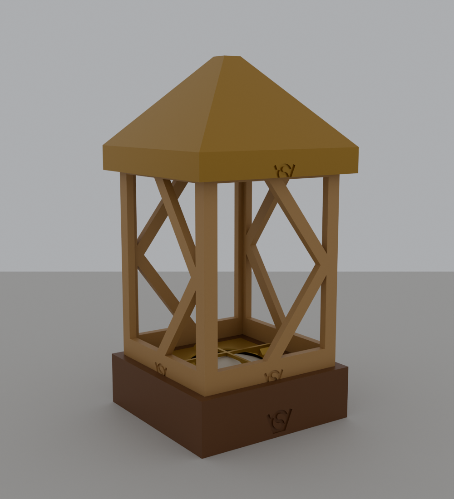

# RGBW puck light lantern

An OpenSCAD generator for a parametric lantern around a 62 mm RGBW puck
light. The light's mount is not modelled again: the top part and bottom screw
come from the existing `RGBW_pucklight_holder` project. The lantern itself is
a base, flat printed side walls that plug into it, and a roof that screws onto
the thread the walls form at the top.

The X-framed walls follow [the inspiration](inspiration/image.png).

## parts

- `base` — a plinth that receives the holder in a square collar. Its floor has
  a 72 mm hole under the holder, large enough for the bottom screw's 70.5 mm
  flange. The four (or more) wall slots are 45 degree mitres in its top.
- `wall` — a frame with an X, printed flat. The bottom 7 mm is the tenon in
  the base; the top carries one segment of the external thread and the logo is
  engraved in the bottom border. All walls are identical.
- `roof` — a square pyramid with a skirt around its underside. The skirt has
  the matching internal thread; the roof's ledge stops on the walls' top
  edges.
- holder — imported from `../RGBW_pucklight_holder/RGBW_pucklight_holderV2.scad`:
  its top part and its bottom screw. The holder's click base is **not** used.
  If the holder has to change, change it in its own project.

The default lantern is 112 mm square at the base, 140 mm tall from the base's
top to the walls' top, and 229 mm overall. The wall assembly is 100 mm square
at the walls' outer faces, the roof is 116 mm square at the eaves.

## OpenSCAD

`RGBW_pucklight_lantern.scad` is the generator. The `part` selector shows the
assembly, a section, the print layout, or a single part (the wall is shown in
its flat print orientation). The source of the holder is imported with a
relative path, so keep both project folders side by side.

The main parameters are `sides`, `wall_side`, `wall_visible_height`, the
borders of the wall frame, `base_floor`, `base_rim`, `top_plate`,
`thread_pitch`, `thread_depth`, `roof_overhang` and `roof_rise_ratio`. Every
derived dimension follows from those. `thread_clearance` (0.3 mm) and
`slot_clearance` (0.15 mm) can be increased if a printer is tight. `sides` is 4 by default; 5, 6 or more also work
(the thread has one start per wall, see below). The square puck holder needs
at least four sides (`sides >= 4` is asserted).

### thread

The pitch is 2 mm, the flanks are 45 degrees, and the ridges are 0.8 mm deep,
the same FDM-optimised profile as `fdm_optimized_screws` and the holder. The
thread is **multi-start**, with one start per wall. For four walls that is a
four-start thread: the neighbouring ridges are still 2 mm apart, but the lead
is 8 mm per revolution, and the roof is open at the skirt's bottom edge to
catch the starts.

This is what lets all walls be identical. A normal one-start thread rises a
quarter of a pitch per side on a square, so identical walls would step by
0.5 mm at every corner. With one start per wall, each wall's ridges rise by
exactly one pitch (2 mm) from one end to the other and the pattern continues
seamlessly into the next wall. The roof's grooves use the same pattern, with
0.3 mm radial clearance and matching starts below the engaged band so they are
open at the skirt's bottom.

The walls' ridges are trimmed by the offset mitre planes, so the thread is
continuous across the corners. The wall's top edge is 1.1 mm above the highest
ridge; the roof's ledge rests on that edge and closes the top.

### base

The base's top is 34.1 mm above the table: 5 mm floor (`base_floor`) plus the
holder's 29.1 mm body height. The holder drops into the collar from above and
rests on the floor. Its top face is flush with the base's top; its ribs stand
about 5 mm above it. The 72 mm hole in the floor is under the holder's bottom
screw, so the puck can still be pressed from below (or the whole holder can be
lifted out after taking off the roof).

The wall slots are open at the top and 7 mm deep, leaving 2 mm of plate under
them. Their plan follows the walls' 45 degree mitres with 0.15 mm clearance.
The base's outer shell is 3 mm, and the space between the shell and the
holder's collar is a closed cavity (it prints as an internal void).

### walls

Each wall is a 5 mm plate with a frame and an X, like the inspiration. The
bottom border is 20 mm high, of which 13 mm is visible above the base; the
side borders are 9 mm and the top border is at least 18 mm (more when `sides`
is large, to keep the thread on solid material). The bottom 7 mm is the tenon
in the base. The outer face carries the thread ridges and the logo; the inner
face is flat, which is the print bed side.

### roof

The roof is a hollow square pyramid with a 16 mm skirt and a 55 mm rise above
the eave. Its rise is 0.95 times its outer apothem, which keeps the inner
surface about 38 degrees from vertical for four walls and below 45 degrees as
`sides` grows, so it prints without support with the opening down. The ledge that stops on the wall tops has its
inner edge on the walls' inner face (45 mm apothem), and the thread grooves
are cut into the skirt from that ledge down to the skirt's bottom.

### logos

The VeryOS logo is engraved 1 mm deep in every printed part:

- base: 20 mm wide on the front of the plinth.
- wall: 15 mm wide in the middle of the bottom border (all walls).
- roof: 16 mm wide on the front of the skirt.

The holder carries its own logo.

## printing

Print the base as used (bottom plate on the bed), the roof as used (skirt
opening down), and the walls flat on their inner face, so the frame, the
thread ridges and the logo face up. Print the holder's top part and its bottom
screw from the holder project, or from `part = "holder"`. No supports are
needed: the threads have 45 degree flanks, the roof's inside is at most 45
degrees from vertical at every `sides` setting, and the base's top plate
bridges the closed cavity.

`part = "print_layout"` arranges all printed parts as a catalogue view: base,
roof, the walls, the holder's top part and the bottom screw. It is not a
single build plate. The walls are 100 x 147 mm flat, the base is 112 mm and
the roof 116 mm across, so a 350 x 350 mm printer can print each in a small
batch. A wall is 5 mm thick plus the 0.8 mm thread ridge.

The holder's own print instructions (bottom on the bed, no supports) still
apply. The click base is not needed and is not printed here.

## assembly

1. Put the puck into the holder's top part, dome first, and screw in the
   bottom screw until it is flush with the holder's bottom. The puck lies on
   the screw's floor, 0.7 mm below the ribs.
2. Drop the holder into the base from above. It passes through the 76.5 mm
   opening, the collar aligns it, and it rests on the base's floor with its
   top flush.
3. Plug the walls into the base's slots, logo and thread ridges facing out.
   The walls are identical and can go in any order. Push each one outwards
   against the slot's outer face so the roof's small clearance is shared
   evenly.
4. Screw the roof on. It stops when its ledge meets the walls' top edges. The
   four-start thread engages in any of the four rotational positions.

To change the light, press the puck upwards through the opening in the base's
floor; the puck can move 0.7 mm against the ribs, which is the click. The
click base from the holder project is not part of this lantern, so the puck is
not lifted by a disc. Alternatively, remove the roof and lift the holder out
to press the puck from below.

## design notes

- The holder is imported, not copied. Its top part is 76 mm square and 29.1 mm
  high with a 70.5 mm bottom screw; the base's 76.5 mm collar and 72 mm floor
  hole follow those dimensions. If the holder changes, the lantern's
  `holder_body_w`, `holder_body_top_z` and `holder_lip_height` must be updated
  (and the base height follows).
- The wall slots, the walls and the roof's thread are all derived from the
  same mitre functions, so the corners line up when `wall_side`, `sides` or
  `wall_thickness` change.
- The base's top plate is 9 mm thick so the 7 mm wall slots leave a 2 mm
  floor; it also carries the sealed cavity's bridge.
- A one-start thread was not used because it cannot be split into identical
  walls with a continuous ridge. The multi-start thread is the trade-off for
  printing every wall from the same file.
- The roof's height is proportional to its width (`roof_rise_ratio`) so a
  five- or six-sided lantern keeps a printable hollow roof. A fixed height
  would make the inside flatter as `sides` grows.

## files

- `RGBW_pucklight_lantern.scad` — the generator.
- `preview.png` — the assembly (the render uses different colours for the
  parts; each part prints in one filament colour).
- `section.png` — the assembly cut in half; the thread, holder and base
  cavities are visible.
- `inspiration/` — reference images.

Licensed under GPL.
