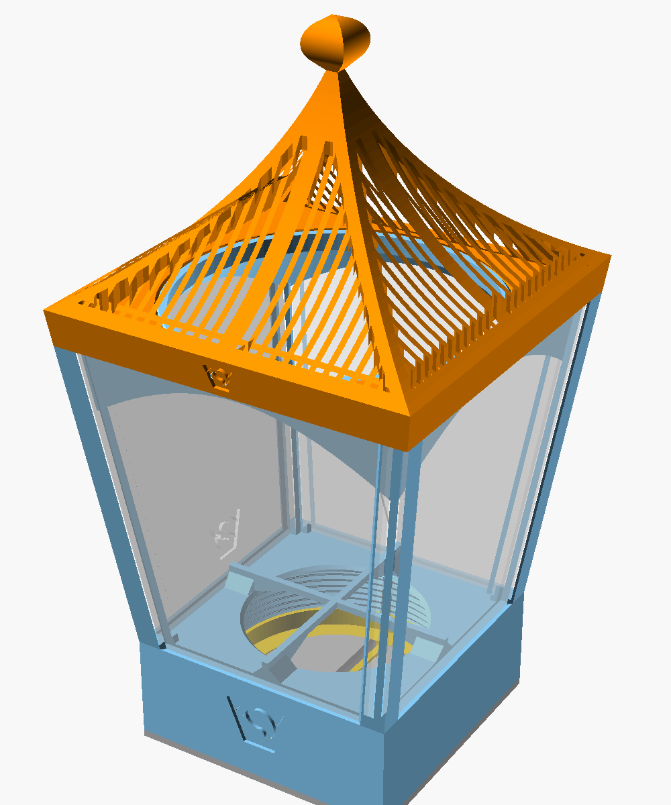
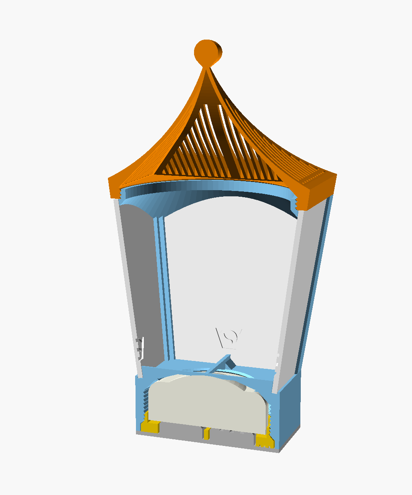

# RGBW puck light lantern 2

An OpenSCAD generator for a lantern around a 62 mm RGBW puck light, after
the Onshape model in `source/` (see `readme_hgc.md` for the brief).

The puck light's mount is the holder from `../RGBW_pucklight_holder`
(`RGBW_pucklight_holderV2.scad`), derived like the Onshape model derives its
holder:

- `frame` — the holder's top part with the frame on it. The frame widens from
  76 mm square on the holder to 100 mm at its top face, 90 mm higher. A pillar
  in each corner carries the slits that hold the side windows. On the top
  face sits the ring that the roof screws onto.
- `roof` — a band that continues the frame's taper, four concave faces that
  meet in a finial, and slots through the faces. The thread is inside the band.
- `screwin` — the holder's bottom screw. It holds the puck in the frame.
- `clickbase` — the holder's click base. Pressing the lantern down onto it
  clicks the light.
- `window` — a side window, four needed. Not in the brief, but the slits need
  them.

The lantern is 199 mm tall on its click base. The roof is 102.7 mm wide at
the eaves.

## OpenSCAD

`RGBW_pucklight_lantern2.scad` is the generator. It works on its own, also in
a browser OpenSCAD. `part` shows the assembly on the click base, the assembly
cut in half, all parts as printed, or one part.

The holder's code (its parameters, checks and modules) is copied from
`../RGBW_pucklight_holder/RGBW_pucklight_holderV2.scad`. Its parameters are
in the sections Puck light, Holder top part, Screw-in, Click base and Logo,
with the same names as in the holder project. Changes to the holder project
don't reach the lantern; copy them over.

### frame

The frame's sides lean out 7.6 degrees. Each pillar's wall is, from the
outside in, a 1.2 mm lip (`frame_lip`), the 3 mm slit (`window_slit`) and a
2 mm lip (`frame_inner_lip`). Measured along a face from the corner, the inner
lip reaches 8.6 mm (`pillar_width`), the outer lip 6.9 mm (`pillar_face`, its
edge bevelled 45 degrees), and the slit 5.6 mm (`slit_end`). So both lips
overlap the window's edge.

The slits are open at the top and go 1 mm (`window_seat`) into the holder's
top, where the windows stand. They also cut back the ends of the holder's
ribs.

Under the top face the frame is solid inside the windows, except for a funnel
that widens at 45 degrees from the ring's bore down to the pillars. That lets
the top print without support. Seen through a window, the funnel is an arch,
about 3 mm deep in the middle and 17 mm at the pillars.

The ring has the holder's thread: 90 mm (`roof_thread_d`), 2 mm pitch, 45
degree flanks, 5 mm high (`roof_thread_h`), with a 45 degree chamfer at the
top. The roof's thread has 0.3 mm radial clearance (`roof_thread_clearance`).
Both threads are in phase with the face the roof seats on, so when the roof is
screwed down its sides line up with the frame's.

### roof

The faces are circular arcs, 101.4 mm radius (`roof_curve_r`), rising 59.6 mm
(`roof_rise`) from the top of the 10 mm band (`roof_rim_h`) to the tip. The
profile is swept along a square, as in Onshape, so every horizontal section is
a square. The finial is a 12 mm ball (`finial_d`) on a 45 degree cone.

The faces are 1.8 mm thick (`roof_thickness`) where they are steeper than 45
degrees. Lower down, the inside rises at 45 degrees from the top of the thread,
so the roof prints without support. Near the eaves it is about 10 mm thick.

The slots are 2 mm wide at a 3.6 mm pitch (`slot_width`, `slot_pitch`). They
run at right angles to the eaves in plan. A 5 mm strip down the middle of each
face (`center_rib`) and 2.5 mm along the hips (`hip_rib`) stay solid. Along the
eaves a row of short slots (`eave_margin`, `dash_length`) is separated from the
long ones by a 1.4 mm bar (`bar_width`). The long slots go through. The short
ones end in the solid part near the eaves.

### windows

A window is 64.2 mm wide at the bottom, 88.4 mm at the top, 91.3 mm long and
2.6 mm thick (`window_thickness`). It has 0.15 mm clearance (`window_clearance`)
at the sides and at the top. Print it in clear or white filament, or cut it
from sheet up to 2.9 mm thick to the outline above.

## differences from the Onshape model

- the holder is the OpenSCAD holder V2 rather than the Onshape holder.
- the roof is `roof_2_with_handle` (the slotted, concave one), with its band
  continuing the frame's taper, as in the Onshape assembly. The finial sits on
  a 45 degree cone instead of a narrow neck.
- the roof is hollowed at 45 degrees near the eaves instead of a 1.8 mm shell,
  which overhung about 60 degrees there.
- under the top face, a 45 degree funnel replaces the 1 mm plate on chamfered
  corner blocks and the arched bridge over each window.
- the threads have the holder's profile (0.8 mm deep, 0.3 mm clearance). The
  roof lines up without the fine-tuning ring.
- near the tip the slots end in a straight line around the finial instead of
  an arc.
- the window is a printable plate.

## logo

The VeryOS logo is engraved 1 mm deep in every part:

- frame: 20 mm wide in the front of the holder's top part.
- roof: 9 mm wide in the front of the band (`roof_logo_width`).
- screw-in and click base: as in the holder.
- window: 16 mm wide, above the holder (`window_logo_width`).

## printing

Print the frame, the roof, the screw-in and the click base standing as they
are used, bottom on the bed, and the windows flat. None of them needs support:
the threads, the funnel under the frame's top and the inside of the roof are 45
degrees, and the holder's ribs bridge its window as in the holder project. The
frame is 124 mm tall.

## assembly

1. Put the puck into the frame from below, dome first, and screw in the
   screw-in until it is flush with the bottom and its bar runs parallel to two
   sides.
2. Slide the windows into the slits from the top, narrow end first, until they
   stand in the groove.
3. Screw the roof onto the ring until it sits on the top face.
4. Put the lantern on the click base, the bar in the slot. Pressing the
   lantern down clicks the light.

## files

- `RGBW_pucklight_lantern2.scad` — the generator.
- `readme_hgc.md` — the brief.
- `preview.png` — the assembly.
- `section.png` — the assembly cut in half.
- `source/` — the Onshape export (STEP, DXF of every sketch, feature trees,
  renders) and screenshots of the Onshape model.

Licensed under GPL.
