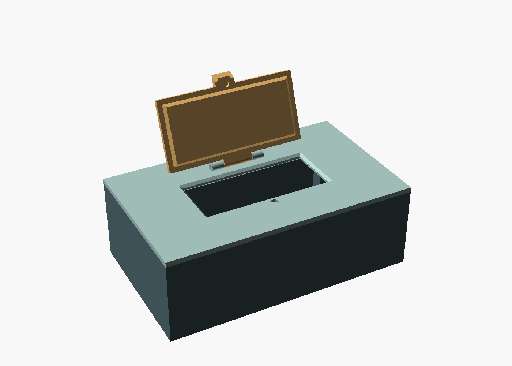
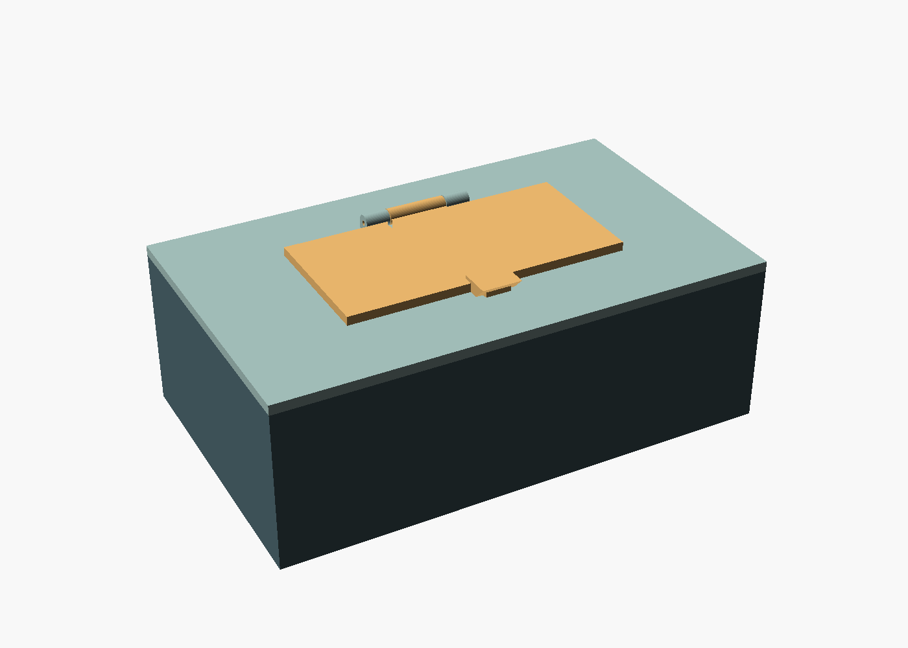
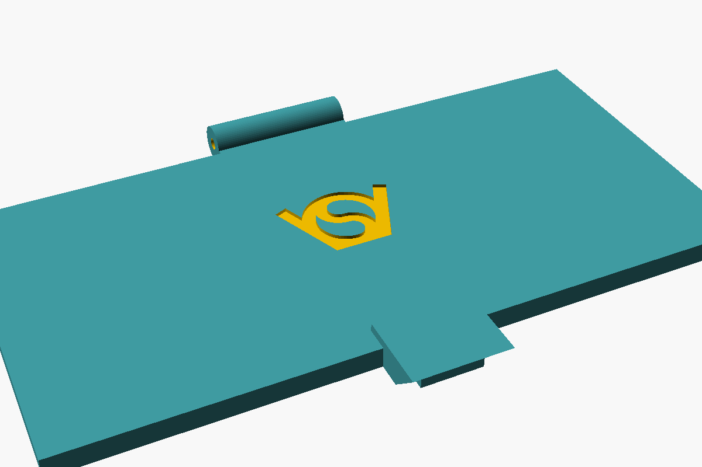

# Baby wipes box V3 — smooth cuboid with a rectangular opening

[babywipesboxV3.scad](babywipesboxV3.scad) is a standalone version of the
[V2 baby wipes box](../babywipesboxV2.scad) with a plain, rectangular look:

- **Box and cover are a sharp-edged cuboid.** There is no corner radius and no
  exterior pattern; all outer faces are smooth and flat. Rectangular relief
  decorations can be added to these faces later (see below).
- **The opening, its 45° seat and the hinged lid are rectangular.** The V2
  capsule outline is replaced by straight edges and square corners everywhere.
  The finger lip and the pad around the latch magnet are square-cornered too.
- **Square corner posts** inside the box hold the corner magnets, matching the
  square cavity corners.
- **Optional VeryOS logo**, off by default. With `engrave_logo = true` it is
  engraved in all three parts: the box underside (it reads correctly when the
  box is turned over), the cover behind the hinge, and the middle of the lid.

Everything else is carried over from V2: the 45° tapered lid seat, the 45° rim
seat between box and cover, the lowered corner posts with 2.6 mm magnet bores,
the 45° finger lip and the filament hinge. V3 parts do not fit V2 parts.







## Dimensions

The default box measures **200 × 120 × 65 mm** outside, without the cover.
The space between the walls is 195.2 × 115.2 × 62.6 mm; the four square
corner posts (12.7 × 12.7 mm, measured from the outer sides) intrude into it.
The opening is **106 × 48 mm** at the top, narrowing to a 102 × 44 mm throat
below the 45° bevel. The lid is 114 × 56 mm. The closed box is 75.65 mm tall,
including the hinge barrels.

Parameters that changed from V2:

| Parameter | Default | Meaning |
| --- | --- | --- |
| `magnet_inset` | 8 | Distance from each outer side to the corner magnet axes; replaces `corner_radius` |
| `opening_width` / `opening_depth` | 0 / 0 | Rectangular opening at the top of the seat; zero uses 53% / 40% of the box |
| `engrave_logo` | false | Engrave the VeryOS logo in the box underside, cover and lid |
| `logo_width` | 20 | Logo width on all three parts; a logo is left out where it does not fit |
| `logo_depth` | 0.6 | Engraving depth |

The exterior pattern settings and the `all_patterns` view were removed. All
other parameters keep their V2 meaning; see the [V2 readme](../readme.md).

## Adding rectangular reliefs later

The outer faces are the planes x = ±`box_width`/2 and y = ±`box_depth`/2
(box from z = 0 to `box_height`, cover from z = 0 to `cover_thickness`), and
the cover top is the plane z = `cover_thickness`. A relief can be added with
`union()` as a `cube()` placed against one of these faces. Keep reliefs on the
cover top clear of the lid (`lid_w` × `lid_d` plus the 9 mm finger lip), the
hinge and, if enabled, the logo behind it, and keep the box's top edge flat where the cover
sits on it.

## Export and assembly

Open `babywipesboxV3.scad` in OpenSCAD. The default `part = "print_layout"`
puts all three separate parts at Z=0. Render with **F6**, export as STL, then
split into objects and arrange the parts in your slicer. Use `box`,
`boxcover` or `boxcover_lid` to export a single part. Use `assembly`
(with `lid_angle`) or `exploded` to inspect; the assembled box and cover touch
and fuse if exported together.

From this directory:

```sh
mkdir -p build
openscad -o build/babywipesboxV3.stl babywipesboxV3.scad
openscad -o build/box.stl -D 'part="box"' babywipesboxV3.scad
openscad -o build/boxcover.stl -D 'part="boxcover"' babywipesboxV3.scad
openscad -o build/boxcover_lid.stl -D 'part="boxcover_lid"' babywipesboxV3.scad
```

Use the same dimension overrides for all three exports. Generated STL files
are in the ignored `build/` directory.

Assembly uses ten 6 × 2 mm disc magnets and about 47 mm of 1.75 mm filament
as the hinge pin, as in V2. Check magnet polarity in mating pairs before
gluing.

Printing notes:

- The sharp corners of the 200 × 120 mm box bottom are more likely to lift
  than the V2 rounded corners. Use a brim or corner discs if your printer
  tends to warp large parts.
- The lid prints on its tapered insert: its flange, latch pad and hinge sit
  2.25 mm above the bed. The cover's outer ledge sits 1.35 mm above the bed.
  Inspect these overhangs in the slicer and add local supports where needed,
  keeping support out of the sloped seat faces and the filament bore.
- With the logo enabled, the box logo is engraved in the bed-facing side; the
  slicer bridges over it.

## Validation

Rendered with OpenSCAD 2026.09.16 (Manifold), with the logo off and on. The
box, cover and lid each
export as one closed mesh with consistent face orientation and the lowest
point at Z=0; the print layout contains exactly three separate bodies. The
assembled box and cover meet only at their flat contact plane at the rim
(zero overlap volume). The closed and opening lid does not overlap the cover
at 0°, 0.5°, 1°, 2°, 3°, 5°, 8°, 12°, 20°, 30°, 45°, 60°, 90°, 110°, 135°,
160° and 180°. The file also evaluates without warnings in OpenSCAD 2021.01.
Physical fit and printing have not been tested yet.

Licensed under the repository's [GPL license](../../../../LICENSE).
