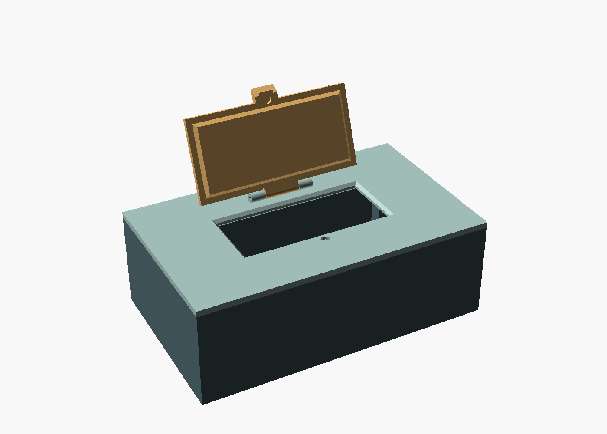
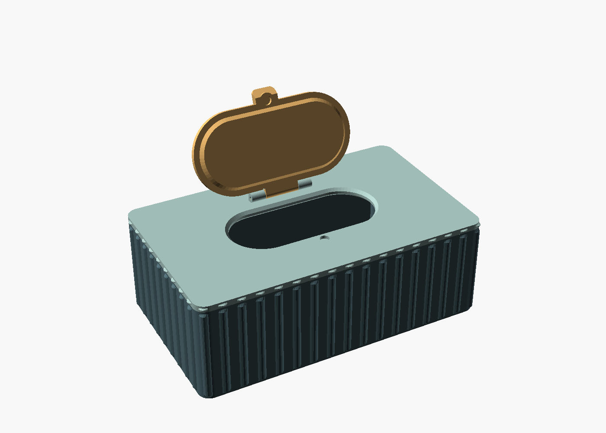
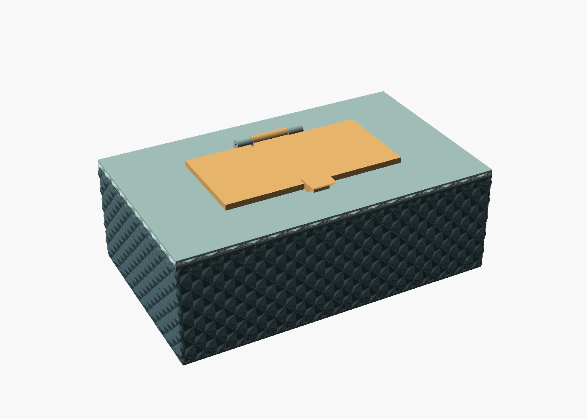
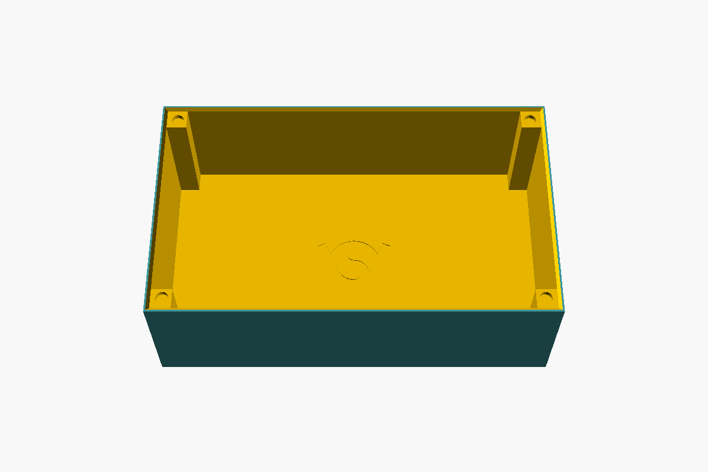

# Baby wipes box V4 — rectangular or rounded corners, optional patterns

[babywipesboxV4.scad](babywipesboxV4.scad) combines the
[V2](../babywipesboxV2.scad) and [V3](../V3/babywipesboxV3.scad) baby wipes
boxes in one file:

- **`corner_style`** chooses the look:
  - `rectangular` (default): sharp-edged cuboid with a rectangular opening,
    lid, grip lip and latch pad, and square corner posts inside (as V3).
  - `rounded`: rounded box corners (`corner_radius`) with a capsule-shaped
    opening and lid, a rounded grip lip and round corner posts (as V2).
- **Exterior patterns** work with both styles: `none` (default, smooth),
  `ribs`, `flutes`, `spiral`, `diamond`, `waves` and `chevron`, on the box and
  the cover. On rectangular corners the pattern runs over the sharp corners.
  Use `part = "all_patterns"` to preview all of them at the chosen style.
- **The VeryOS logo** is engraved only in the inside bottom of the box,
  centred and readable from above with its top toward the hinge. It is 40 mm
  wide by default, visible through the opening of an empty box, and prints
  without support. `engrave_logo = false` leaves it out. The cover and lid
  have no logo.

The seats, magnets, hinge and grip lip are unchanged. With the logo off, the
`rounded` style without pattern reproduces V2 exactly, and the `rectangular`
style reproduces V3 exactly, so their dimensions, print and assembly notes
apply: see the [V2 readme](../readme.md) and the [V3 readme](../V3/readme.md).









## Parameters

New or changed compared to V2 and V3:

| Parameter | Default | Meaning |
| --- | --- | --- |
| `corner_style` | rectangular | `rectangular` or `rounded` |
| `corner_radius` | 8 | Rounded only: outer corner radius; the corner magnets sit on the corner centres |
| `magnet_inset` | 8 | Rectangular only: distance from each outer side to the corner magnet axes |
| `exterior_pattern` | none | Surface pattern, as in V2 |
| `engrave_logo` | true | Engrave the logo in the inside bottom of the box |
| `logo_width` | 40 | Logo width; the height is 0.71 × the width |
| `logo_depth` | 0.6 | Engraving depth into the 2.4 mm floor |

All pattern settings (`pattern_depth`, `pattern_count`, `pattern_margin`,
`pattern_pitch`, `pattern_twist`, `pattern_on_box`, `pattern_on_cover`) keep
their V2 meaning. A pattern adds `2 * pattern_depth` to the outside width and
depth (203 × 123 mm at the default 1.5 mm); the cavity is unchanged. Print the
box and cover with the same pattern settings so the pattern continues across
the closed seam.

## Export

Open `babywipesboxV4.scad` in OpenSCAD. The default `part = "print_layout"`
puts all three separate parts at Z=0. Render with **F6**, export as STL, then
split into objects in your slicer. Use `box`, `boxcover` or `boxcover_lid` to
export a single part, and `assembly` or `exploded` to inspect.

From this directory, for example with rounded corners and ribs:

```sh
mkdir -p build
openscad -o build/babywipesboxV4.stl babywipesboxV4.scad
openscad -o build/box.stl -D 'part="box"' -D 'corner_style="rounded"' -D 'exterior_pattern="ribs"' babywipesboxV4.scad
openscad -o build/boxcover.stl -D 'part="boxcover"' -D 'corner_style="rounded"' -D 'exterior_pattern="ribs"' babywipesboxV4.scad
openscad -o build/boxcover_lid.stl -D 'part="boxcover_lid"' -D 'corner_style="rounded"' babywipesboxV4.scad
```

Use the same corner style and dimension overrides for all three parts.
Generated STL files are in the ignored `build/` directory.

## Validation

Rendered with OpenSCAD 2026.09.16 (Manifold). In both corner styles, the box,
cover and lid each export as one closed mesh with its lowest point at Z=0,
and the print layout contains exactly three separate bodies. All six patterns
on the box and on the cover also give single closed meshes in both styles,
203 × 123 mm wide (the diamond's peaks reach slightly less). With the logo
off, the volumes of all three parts match V2 (`rounded`, smooth and with ribs)
and V3 (`rectangular`) exactly. With the diamond pattern on, the box and cover
meet only at their flat rim contact plane in both styles, and the lid does not
overlap the cover at 0°, 1°, 3°, 10°, 45°, 110° and 180°. The file also
evaluates without warnings in OpenSCAD 2021.01. Physical fit and printing have
not been tested.

On rectangular corners, the pattern's lowest points stand 0.01 mm proud of the
flat faces, so no faces of the pattern and the box coincide.

Licensed under the repository's [GPL license](../../../../LICENSE).
