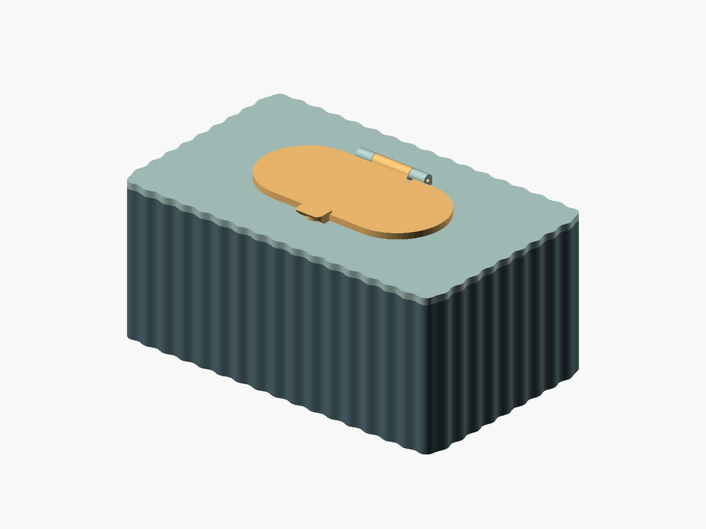
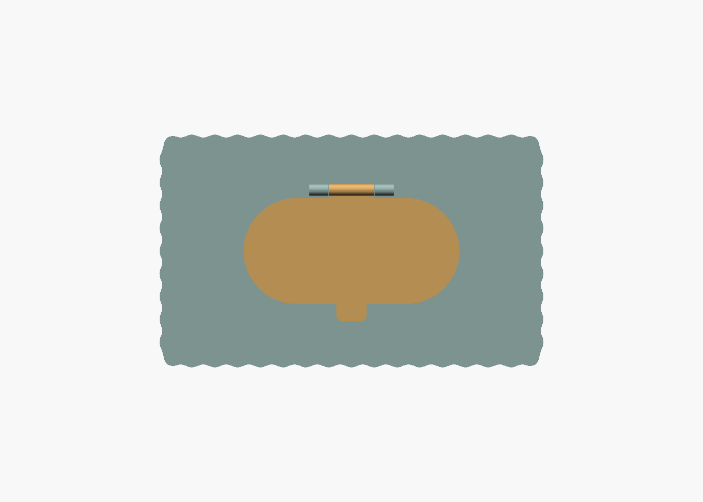
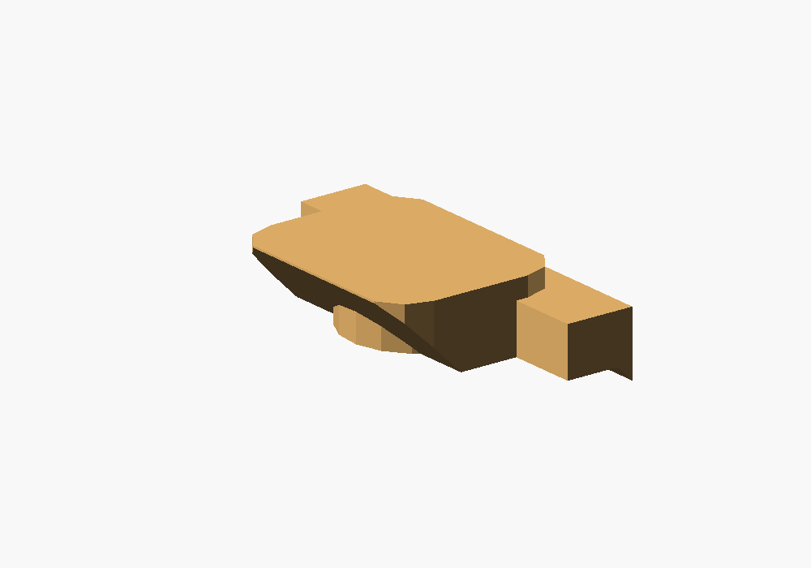
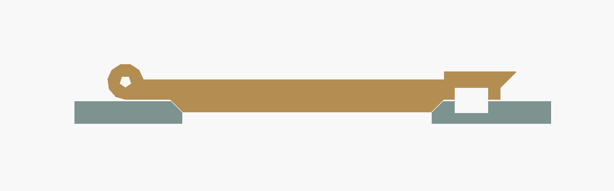

# Baby wipes box V2 — exterior patterns, 45° grip lip and lid seat

[babywipesboxV2.scad](babywipesboxV2.scad) is a standalone version of the
[original baby wipes box](../babywipesbox/babywipesbox.scad), with selectable
exterior patterns around the container and cover, a larger grip lip on the
hinged lid, and a matching tapered seat around the dispensing opening. It follows the
[final 18 October sketch](WhatsApp%20Image%202026-10-18%20at%2013.31.19.jpeg).
The [earlier grip sketch](archive/WhatsApp%20Image%202026-10-18%20at%2012.00.38.jpeg)
and [seat sketch](archive/WhatsApp%20Image%202026-10-18%20at%2013.07.20.jpeg)
are retained in `archive/`.

The exterior carries a **selectable surface pattern**, chosen with
`exterior_pattern`: `none` (smooth), `ribs`, `flutes`, `spiral`, `diamond`,
`waves` or `chevron`. The system is ported from the
[cylindrical screw container V2](../simple_cylindrical_screwing_containerV2/),
adapted to the box perimeter. The default is **`ribs`**: **52 repeats** around
the perimeter, spaced about **12 mm** apart, projecting **1.5 mm outward**. The
pattern wraps the rounded corners and, for `ribs`/`flutes`, runs vertically
between the smooth edge bands. The cover samples the same assembled Z height,
so its pattern aligns with the box across the closed seam. The pattern only adds
material outside the wall, so the original inner cavity and minimum wall
thickness are retained. Preview every pattern at once with
`part = "all_patterns"`.

Adding a pattern increases the bed-contact area; the actual effect on adhesion
and warping needs a print test. The pattern is part of the finished shape.





The cover now has a **45° tapered underside that fits the box's inner rim
chamfer**. At the default 1.5 mm rim chamfer and 0.15 mm clearance, it projects
1.35 mm below the cover plate. The outer plate rests on the box rim while the
taper centres the cover. The corner magnet mouths move down with the insert,
leaving 0.15 mm between the cover underside and the lowered box posts.

The box magnet bores now provide **2.6 mm of usable depth below the chamfered
post tops**. Previously, the 1.5 mm chamfer removed most of the nominal 2.1 mm
bores, leaving only 0.6 mm. Depth now includes compensation for that chamfer
plus `box_magnet_extra_depth` (default 0.5 mm). Cover and lid bores are 2.1 mm
deep. The extra box depth allows room for adhesive; position magnets near the
bore mouths when gluing for a smaller magnetic gap.


The dark lower part is the box; the lighter upper part is the cover. The narrow
diagonal gap follows the matching bevels, and the central void shows the two
opposing blind magnet bores.

The underside of the lid now has a solid tapered insert that fits into a
**2 mm deep, 45° recess** in the cover. Both mating faces run around the entire
capsule-shaped opening. The default horizontal clearance is **0.15 mm per
side** at the same height (about 0.11 mm normal to a 45° face). The flat lid
flange still has its separate 0.25 mm gap above the cover.

This creates a longer, narrower path through the closure and guides the lid
into position. Sealing performance depends on printed fit and surface finish;
this rigid seat has no gasket and has not been tested for airtightness.

The lip projects **9 mm** beyond the lid's capsule outline, is **5 mm** high
from the flat flange underside, and has a **45° underside** for finger purchase.
Its width is 16 mm with rounded corners. The original circular magnet pad
remains beneath the lip: the bevel blends into this reinforcement rather than
cutting through the blind magnet pocket.





The section shows the lid in gold and the cover in green, with the hinge on
the left and the grip/latch magnet pockets on the right.

## Dimensions and compatibility

**Print the box and cover with matching pattern settings** for the aligned
finish. The hinged
lid is unchanged from the preceding V2 revision with the 45° seat and can be
reused. Magnet X/Y positions, the filament hinge, and the hinged lid's tapered
seat are retained. The new cover requires the matching chamfered box rim and
lowered corner posts. For a box without that rim chamfer, set
`inner_edge_chamfer = 0` to disable the cover's locating insert.

The default box measures **203 × 123 × 65 mm including the pattern**. The
`box_width` and `box_depth` settings remain 200 × 120 mm before the pattern;
the overall width and depth each increase by `2 * pattern_depth`. Interior space
between flat walls remains 195.2 × 115.2 × 62.6 mm, with corner posts intruding
into that space. The opening remains 106 × 48 mm
at the top, narrowing to a 102 × 44 mm throat below the bevel. This keeps the
latch magnet pocket enclosed by its original surrounding wall.

The main lid plate remains 3.6 mm thick, and the finger lip is 5 mm high above
the flange underside. The insert extends 2.25 mm below that underside to
account for the 2 mm seat depth and 0.25 mm flange gap. No fourth printed part
is needed.

The V2 Customizer controls are:

| Parameter | Default | Meaning |
| --- | --- | --- |
| `exterior_pattern` | ribs | Surface pattern: none, ribs, flutes, spiral, diamond, waves or chevron |
| `pattern_depth` | 1.5 | Maximum outward projection, in mm; zero restores the smooth box |
| `pattern_count` | 52 | Whole-number rib/flute repeats around the perimeter |
| `pattern_pitch` | 12 | Vertical repeat for diamonds, waves and chevrons, in mm |
| `pattern_twist` | 90 | Total spiral rotation over the box height, in degrees |
| `seat_depth` | 2 | Cover recess depth; its radial taper has the same size, in mm |
| `seat_clearance` | 0.15 | Horizontal gap per side between mating faces at the same Z, in mm |
| `inner_edge_chamfer` | 1.5 | Matching 45° box rim / cover underside and cover throat chamfer, in mm; zero disables |
| `cover_seat_clearance` | 0.15 | Gap per side at the box/cover taper and above the box posts, in mm |
| `box_magnet_extra_depth` | 0.5 | Extra usable box magnet depth beyond magnet thickness and normal depth clearance, in mm |
| `lip_projection` | 9 | Distance beyond the front edge of the lid, in mm |
| `lip_height` | 5 | Lip height from the flat flange underside, excluding the insert, in mm |
| `lip_width` | 16 | Grip width along X, in mm |

Both angles stay at 45° when dimensions change. Reduce `seat_clearance` after
a fit test for a closer seat, or increase it if the printed lid binds. Zero
means nominal surface contact with no printing allowance. `seat_depth` must
leave at least 1.2 mm of straight opening below the bevel. All existing box,
magnet, and hinge parameters remain available.

For `ribs`, `flutes` and `spiral`, `pattern_count` sets the number of vertical
repeats around the whole perimeter; the default 52 gives about a 12 mm pitch on
the default box. `diamond`, `waves` and `chevron` also use `pattern_pitch` for
their vertical repeat, and `spiral`/`waves`/`chevron` drift the ribs with
height. `pattern_on_box` and `pattern_on_cover` toggle each part, and
`pattern_margin` keeps a smooth band at the top and bottom edges. Use the same
pattern settings for the box and cover so they align. The print layout accounts
for the larger footprint and keeps a 15 mm gap between parts.

## Export and assembly

Open `babywipesboxV2.scad` in OpenSCAD. The default `part = "print_layout"`
puts all three separate parts at Z=0, with the cover and hinged lid resting on
their respective inserts' flat bottoms. Render with **F6**, export as STL, then
split into objects and arrange the parts in your slicer.

Use `box`, `boxcover`, or `boxcover_lid` to export a single part.
Use `all_patterns` to preview every pattern on a box-and-cover pair in a grid.
Use `assembly` with `lid_angle = 0` to inspect the closed lip, or `exploded`
to inspect assembly. The assembled view is for inspection: the touching box
and cover fuse if exported together.

From this directory:

```sh
mkdir -p build
openscad -o build/babywipesboxV2.stl babywipesboxV2.scad
openscad -o build/box.stl -D 'part="box"' babywipesboxV2.scad
openscad -o build/boxcover.stl -D 'part="boxcover"' babywipesboxV2.scad
openscad -o build/boxcover_lid.stl -D 'part="boxcover_lid"' babywipesboxV2.scad
```

Use the same dimension overrides for all three exports. Generated STL files
are in the ignored `build/` directory.

Assembly uses ten 6 × 2 mm magnets and an approximately 47 mm length of
1.75 mm filament. The default hinge bore is **2.1 mm** (1.75 + 0.35 mm),
matching the current original SCAD file. See the original
[printing and assembly instructions](../babywipesbox/readme.md#print-and-assemble).
The lip and insert slope at 45° in the supplied print orientation. The lid's
flange, latch pad, and hinge now sit 2.25 mm above the bed: inspect these
overhangs and add local supports where needed. The cover's outer seating ledge
sits 1.35 mm above the bed with the default rim fit; inspect this short overhang
in the slicer too. Keep support away from the
sloped mating surface and filament bore; clean the seat and magnet-pocket
bridges before checking the fit.

## Validation

The updated rim and magnet geometry was rendered with OpenSCAD 2026.09.16
(Manifold). After discarding zero-area triangles introduced by binary STL
rounding, each default part is a connected, closed mesh with consistent face
orientation and its lowest point at Z=0. The combined layout contains exactly
three separate closed components. Measurements of the exported meshes confirm
the matching 45° rim profiles, 0.15 mm horizontal clearance, all four 2.6 mm
box bores, and all four 2.1 mm cover bores. The assembled box and cover have no
solid overlap below their intended flat contact surface, and the closed hinged
lid has no solid overlap with the cover. Layouts with the rim chamfer disabled
or reduced to 0.5 mm also retain three closed components resting at Z=0.

Earlier lid-seat validation found empty intersections at 0.25° steps
from 0° to 10°, then 1° steps through 180°, using the default clearance.
A 2.5 mm seat depth with 0.25 mm clearance also renders successfully.
All seven exterior patterns (none, ribs, flutes, spiral, diamond, waves,
chevron) render as connected, closed meshes on both the box and cover: `none`
reproduces the smooth 200 × 120 mm box, and every pattern adds exactly
`pattern_depth` outward (203 × 123 mm at the default 1.5 mm) without removing
wall material. The `all_patterns` grid also renders as a valid mesh. Physical
fit, bed adhesion, and sealing performance still need a trial print.

Licensed under the repository's [GPL license](../../LICENSE).
