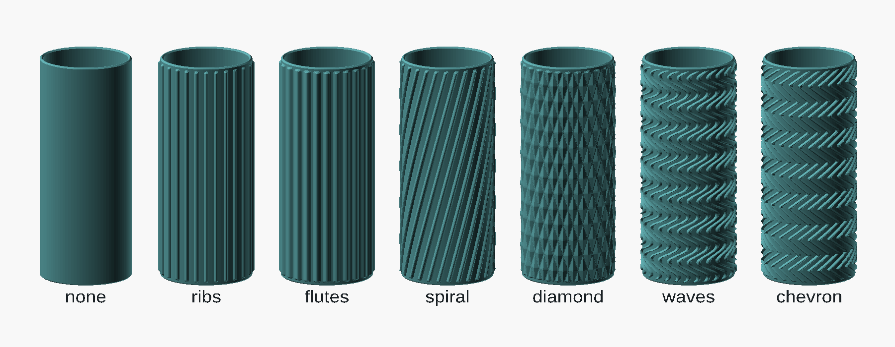

# BIC lighter case 2 — parametric exterior patterns

[bic_lighter_case.scad](bic_lighter_case.scad) is a standalone elliptical sleeve
for a BIC Maxi J26, reconstructed from `bic_sleeve_plain.stl`. The exterior
pattern system is adapted from [babywipesboxV2](../babywipesboxV2/).



Choose `exterior_pattern` in OpenSCAD's Customizer: `none`, `ribs`, `flutes`,
`spiral`, `diamond`, `waves`, or `chevron`. The default is `ribs`. Set
`part = "all_patterns"` to compare all seven cases side by side, in that order.
Use `part = "case"` to export your selected pattern.

Patterns add material outside the original case. The elliptical cavity,
lighter fit, floor, push-out hole, and mouth chamfer are preserved. Repeats are
spaced by distance around the ellipse, and relief is measured along its outward
normal, so the texture does not bunch up at the narrow ends. The pattern fades
into smooth end bands and stays clear of the outer edge chamfers.

| Control | Default | Effect |
| --- | --- | --- |
| `exterior_pattern` | `ribs` | Smooth, round ribs, broad flutes, spiral ribs, diamond knurl, waves, or chevrons |
| `pattern_depth` | 0.6 mm | Maximum outward relief; zero restores the original smooth case |
| `pattern_count` | 24 | Whole-number repeats around the perimeter, about 2.95 mm apart by default |
| `pattern_margin` | 1 mm | Smooth band at each end, automatically at least `edge_chamfer` |
| `pattern_pitch` | 10 mm | Vertical repeat for diamond, wave, and chevron patterns |
| `pattern_twist` | 90° | Spiral travel over the case height, measured in perimeter degrees; negative reverses direction |
| `$fn` | 96 | Curve resolution; higher values also refine the texture mesh |

`exterior_pattern = "none"` also restores the original smooth case. Flutes are
raised broad rounded ribs, not cuts into the thin wall. Spiral patterns with
`pattern_twist = 0` become straight ribs.

The defaults give a **25.5 × 15 mm cavity**, a **27.5 × 17 × 70.9 mm smooth
outside**, and up to **28.7 × 18.2 mm** outside dimensions with 0.6 mm relief.
The original fit controls remain available: `fit_clearance` is 0.25 mm per
side, `wall` is 1 mm, and `floor_thickness` is 2 mm. Changing pattern depth
does not alter the cavity, underlying wall, or floor.

All cases stand upright at Z=0. Render with F6, then export STL. For example,
from this directory:

```sh
mkdir -p build
openscad -o build/bic_ribs.stl bic_lighter_case.scad
openscad -o build/bic_diamond.stl -D 'exterior_pattern="diamond"' bic_lighter_case.scad
openscad -o build/bic_spiral.stl -D 'exterior_pattern="spiral"' -D 'pattern_twist=-120' bic_lighter_case.scad
openscad -o build/all_patterns.stl -D 'part="all_patterns"' bic_lighter_case.scad
```

Generated files belong in the ignored `build/` directory. The supplied
`bic_sleeve_plain.stl` remains the original reference, not a generated patterned
export. Inspect stronger relief settings in the slicer; physical fit and print
quality depend on the printer and material.

Validated with OpenSCAD 2026.09.16 (Manifold): each of the seven default
patterns exports as one closed mesh with consistent face orientation and its
bottom at Z=0; the comparison layout contains seven separate closed meshes.
The exported cavity wall is unchanged. Both `none` and zero pattern depth
produce a binary STL identical to the pre-pattern SCAD model. Zero spiral
twist reproduces straight ribs, and a reverse spiral with 13 repeats, 0.4 mm
depth, and zero requested margin also renders as a closed mesh.
