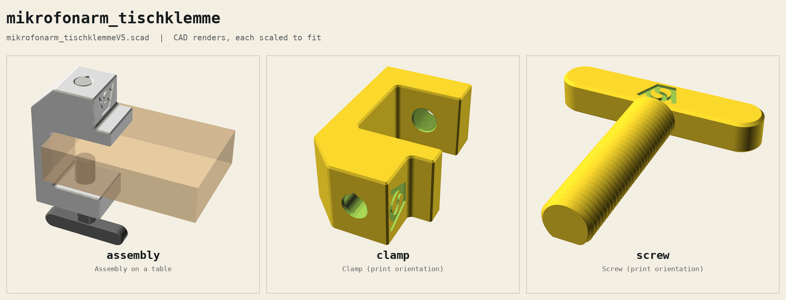

# Table clamp for the Rode PSA-1 microphone arm

Printed table clamp (Tischklemme) for the Rode PSA-1: a C over the table edge with a blind hole for the arm's pin, and a screw with a T bar. Built from the sketch `idee.jpeg` and `readme_hgc.md`. **V3 printed in PLA (2 walls, 15 % infill): tightened hard, the lower jaw split along the layer through the thread, then the screw skipped (`problem_pla_crack.png`). V3 printed in PETG-CF (4 walls): the 0.25 thread barely turns, the clamp holds the arm on a table (`real_images/`). V5, against the split, is not printed yet.**

| File | What |
|---|---|
| `mikrofonarm_tischklemmeV5.scad` | the generator, standalone, no libraries. `part`: both parts on the bed, assembly, each part in its print orientation |
| `mikrofonarm_tischklemmeV5_clamp.stl`, `_screw.stl` | the parts at the defaults, as they print |
| `archive/` | V1 to V4 scripts and STLs |
| `rendered_parts/` | every part under its name |
| `real_images/` | photos of the PETG-CF V3 in use |
| `v3_elegooPETGCF.3mf` | the user's ElegooSlicer project of the photographed print: V3 with `pin_x` 24, PETG-CF, 4 walls |
| `publish/` | publishing pack for V3 as printed: images, listing, STLs; `archive/mikrofonarm_tischklemmeV3.json` holds its presets |
| `problem_pla_crack.png` | the PLA V3's split lower jaw |
| `idee.jpeg` | the sketch |
| `readme_hgc.md` | original goal |

## V5 against V3 and V4

| | V3 (V4 only changed the screw) | V5 |
|---|---|---|
| thread's flank towards the bar, which carries the clamping force | 45 degrees: wedges the lower jaw open as hard as the screw presses; the PLA jaw split along the layer through the thread | `load_flank` 10 off square to the axis: about a fifth of that (tan 10 = 0.18); the other flank stays 45 |
| thread's depth | 0.8 | 1.19, so the clamp's thread keeps its 0.2 crest; the screw's core Ø13.6 instead of 14.4 |
| gap, radius and along the axis at each flank | 0.25 (V4: 0.15 to 0.05) | 0.25: the PETG-CF V3 barely turns at 0.25, so not less |
| `lower_jaw_thickness`, the thread's length | 16, 8 turns | 20, 10 turns; the screw 4 longer |
| `lower_jaw_wall` beyond the thread, where the PLA jaw split | 7.75 | 13.75 |
| layer area across the split, the wall beyond the thread | 124 mm² | 275 mm² |
| test screws | V4: three, with the gap engraved | none, V3's gap |

With `load_flank` 45, `lower_jaw_thickness` 16 and `lower_jaw_wall` 7.75, V5's parts are V3's (mesh compared). The screw sits in the clamp's thread without touching it, and touches it when shifted 0.3 along the axis (CGAL intersection).

## V4 against V3

| | V3 | V4 |
|---|---|---|
| screw | Ø16, 0.25 per side from the clamp's thread: skips when tightened hard (print); more likely because the jaw split | Ø16.5 − 2 × `screw_gap`: test 0.15, 0.1, 0.05 per side (Ø16.2, 16.3, 16.4), the gap engraved beside the bar's logo |
| clamp | | unchanged, its thread still 16.5: the printed V3 clamp takes the new screws |

Print all three screws, use the tightest one that still turns in by hand; then set `screw_gap` to it.

## V3 against V2

| | V2 | V3 |
|---|---|---|
| clamp's outer edges | sharp | 45 degree chamfer of `clamp_chamfer` 1, asked by the user: corners of the side view cut, the two side faces stepped in one 0.2 layer at a time |
| clamp's first layer | full side face | 0.9 in from the edge, so its squish does not bulge |
| logo on the block | | 0.5 lower, in the middle of the face the chamfer leaves |
| screw | | unchanged (mesh compared) |

## V2 against V1

| | V1 | V2 |
|---|---|---|
| `pin_x`, pin and screw from the spine | 14: the screw's axis 11 from a sharp table edge, its end 4 from it | 18, set by the user: 15 and 8 |
| top jaw | `top_jaw_length` 45 from the spine; a `pin_x` of 28 or more stopped the render | `top_jaw_reach` 13 beyond the block, so any `pin_x` renders |
| block with the pin far in | the outer slope would cut into the C's corner from `pin_x` 24 on | widens towards the spine; the slope meets it no lower than the top jaw's top |
| screw | | unchanged |

At `pin_x` 14, V2's clamp has V1's vertices (mesh compared).

## Parts

| Part | Qty | Prints | Note |
|---|---|---|---|
| clamp | 1 | lying on its side, 40 high | the layers run around the C, so the screw's force pulls along them, not across (lessons_learned: softbox clamp). Pin hole and thread lie level with the bed |
| screw | 1 | lying on its flat, the logo up | thread cut flat on the bed side, the axis 5.6 above it, as fdm_optimized_screws |

No support: no face is steeper than 45 degrees, except the 1 mm deep ceilings in the engraved logo on the clamp's block, the 0.2 and 0.4 wide flats of the clamp's thread at its top, and on the screw thin strips of the thread's root within 0.8 of the bed; the side chamfers step out 0.2 per 0.2 layer, which is 45 degrees (mesh check). Both flanks of the thread lie at most 45 degrees off vertical when printed lying.

| Slicer | Why |
|---|---|
| lower jaw 100 % infill (modifier or height range), or many walls | the split runs between layers through the thread: only solid plastic in that layer holds it |
| PETG rather than PLA; hot nozzle, little fan | bonds the layers better; PETG bends before it cracks |

## Sizes

| Parameter | Default | From |
|---|---|---|
| `pin_hole_diameter`, `pin_hole_depth` | 12.6, 32 | readme_hgc.md; the pin is 12.5 × 30, measured |
| `thread_diameter`, `thread_pitch` | 16, 2 | sketch; pitch from fdm_optimized_screws |
| `thread_clearance` | 0.25 in radius and along the axis at each flank | lessons_learned.md; the PETG-CF V3 barely turns at 0.25, the user: not less |
| `load_flank` | 10 degrees off square to the axis, the other flank 45 | my choice, as a buttress thread of a vice: little wedging, still prints lying |
| `lower_jaw_thickness`, `lower_jaw_wall` | 20, 13.75 | my choice: more layer area across the PLA split; the lower jaw reaches 40 from the table edge |
| `table_max`, `table_min` | 50, 10 | my choice: tables from 10 to 50 thick |
| `clamp_width`, `spine_thickness` | 40, 16 | my choice: about 17 MPa in the spine at 1 kN screw force and `pin_x` 18, estimate; more walls for a larger `pin_x` |
| `pin_x` | 18 | pin and screw axis from the spine's inner face, the screw under the pin as sketched; the user's value. The printed V3 has 24 (its 3mf, mesh compared) |
| `top_jaw_reach` | 13 | my choice, V1's 45 − 32 |
| `clamp_chamfer` | 1 | "chamfer slightly", the user; 1 is my choice, as the screw's bar |

## Design rules in the model

| Rule | Why |
|---|---|
| pin hole is a teardrop, its point up on the bed | prints without support; the round part and the two 45 degree flanks still hold the pin |
| pin hole's lowest line on a 0.2 layer boundary (`pin_y` 20.1, not 20) | the slicer would narrow it by half a layer |
| inner corners of the C rounded, r 3 | less stress at the corners; a sharp table edge then stands 3 off the spine |
| screw under the pin | as sketched; short reach, so less bending in the C |
| the screw's flat end presses on the table's underside | two parts only, so no swivel pad |
| logo in the block's face towards the table and in the bar's top | visible from the desk; on each part |

## Assembly

1. Screw the screw into the lower jaw from below.
2. Slide the clamp over the table edge, top jaw on the table.
3. Tighten with the T bar.
4. Drop the arm's pin into the hole.

## Open

| Question | Note |
|---|---|
| does V5's lower jaw hold, and does its thread turn? | not printed; V3 split in PLA, the PETG-CF V3 holds the arm |
| does the 12.5 pin fit the 12.6 hole? | the pin sits in the PETG-CF V3 (photos); raise `pin_hole_diameter` if too tight |
| table thickness range | 10 to 50 by default; change `table_max`, `table_min` |
