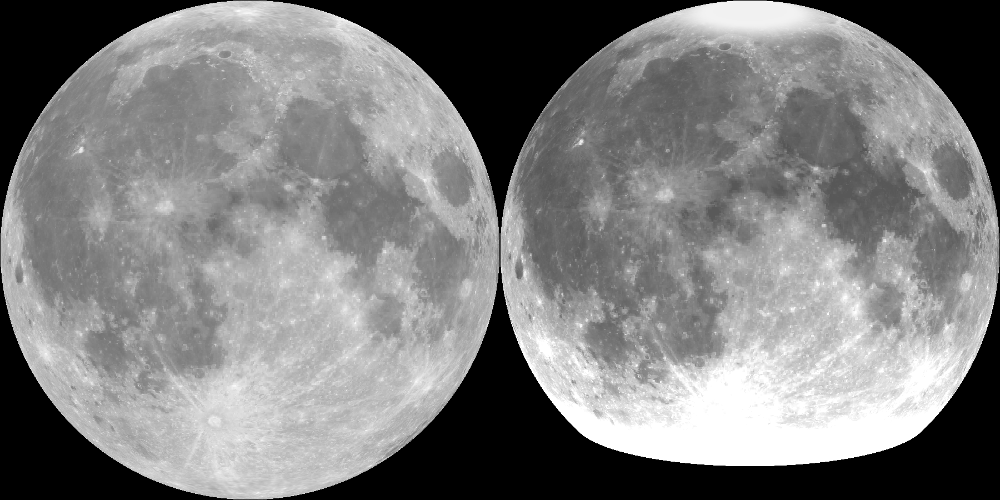

# moon_light

The Moon as it looks in the night sky, as a lamp: on V3's sphere, the wall's thickness draws NASA's picture of the Moon when the puck shines through it. A project of the webapp: pick it in the project list, see `../../readme.md`. `Moon` next to it is the elevation map, whose maria do not show dark.

| Setting | Value | Why |
|---|---|---|
| Texture | NASA's colour map, grey, 2048 x 1024 | the surface's base colour without shadows, close to a full moon; near side on the front, far side on the back |
| Height | log(v / 0.994) / log(0.451 / 0.994) | inverted, because thick is dark when lit; a logarithm, because light falls exponentially with thickness. The numbers are the picture's 99.9 and 0.1 percentile |
| Depth | 2 mm: a wall of 0.8 to 2.8 mm | 1.45 mm gives the picture's contrast exactly at exp(-1.2 x thickness). The extra allows for light spreading sideways in the wall. Hypothesis |
| `tilt`, in the shader | 18 degrees | Tycho, at -43, comes to -25.6 on the sphere, clear of the fade at the neck; and a lamp stands below the eye |
| `blur`, in the shader | 1: about 0.3 mm | a 0.42 mm line draws no finer, and the overhang halves. 0 is the sharpest |
| From lat | -43 | the most relief the app has |
| Columns | 1440: a 0.22 mm step, 163 MB `.stl` | about one layer. 2048 gives 0.15 mm, 325 MB |
| Colors | grey 254 to 115 | what the height does when lit, so the 3D view shows the lamp |

Whole sphere, solid: 44.5 cm3, 55 g of PLA.

## Overhang

As in `../../readme.md`, Overhang: the lower half, about 11800 mm2, here at 1440 columns.

| Depth, `blur` 1 | Steepest | Steeper than 45 |
|---|---|---|
| 1.5 mm | 86.8 | 251 mm2 |
| **2 mm** | **87.6** | **579 mm2** |
| 2.5 mm | 87.9 | 980 mm2 |
| 3.3 mm | 89.7 | 1637 mm2 |

| `blur`, depth 2 mm | Steepest | Steeper than 45 |
|---|---|---|
| 0 | 88.1 | 1086 mm2 |
| **1** | **87.6** | **579 mm2** |
| 1.5 | 88.5 | 343 mm2 |
| 2 | 86.2 | 221 mm2 |
| 2.5 | 79.4 | 122 mm2 |

At 720 columns this project has 436 mm2. The elevation maps from -43 at 720 columns, for comparison: `Moon` at 3.4 mm has 1563 mm2, `moon2` at 3.3 mm has 1721 mm2.

## Printing

Not sliced, not printed: these are starting points.

| Setting | Value | Why |
|---|---|---|
| Infill | 100% | the picture is the wall's thickness; air in the wall would draw the infill's pattern instead. Hypothesis |
| Filament | white | light has to pass, and no colour of its own |
| Layer height | 0.2 mm or less | near the top a layer is a visible step |
| The rest | as V3's sphere | `../../../readme.md` |

## Know before printing

- The lit picture is an estimate: brightness = light x exp(-1.2 x wall), with the light on the axis at the neck's bottom, falling with distance, nothing bounced inside. The 1.2 is not measured.
- A bright band at the neck: the app fades the relief out below -28, so the wall gets thin just where the puck is nearest. In the estimate it burns out, Tycho with it. Light bouncing inside should soften this; not seen yet.
- A bright cap at the top: the relief fades from 65, and above 80 nothing moves. It shows from above.
- Both come from the app's fade, `../../readme.md`, What moves, which all projects share.
- The picture is softer beyond about 70 degrees north and south, where NASA filled it from lower resolution data.
- Logo: none on the sphere, as in V3; the screwin and the click base carry it.

## Make it again

`python3 ../../../planets/make_moon_light.py`, after deleting `project.json`. Needs numpy, Pillow, tifffile and curl; downloads 59 MB into `planets/.gitignored/raw/`.

Picture: NASA's Scientific Visualization Studio, [CGI Moon Kit](https://svs.gsfc.nasa.gov/4720), from the LROC WAC colour mosaic, Arizona State University. Credit them; the data is not under this project's GPL. The rest is licensed under GPL.
