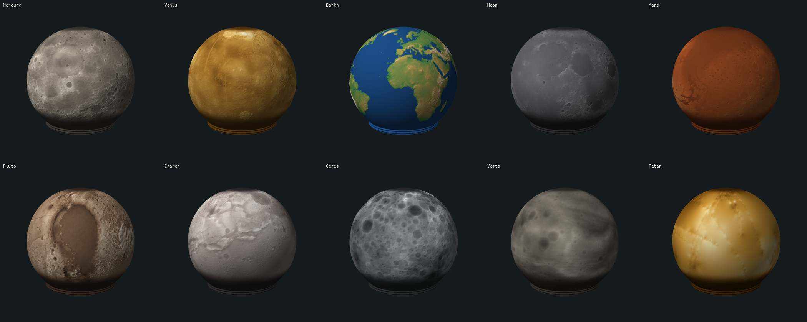

# Planets

Fifteen bodies, each a project of the webapp in `../mathematical/`: pick it in the project list. Ten from elevation maps, five from how they look, as lithophanes. Each as a sphere: see Spheres. Links: `planetary_heightmaps.md`. Original description: `readme_hgc.md`.

| Project | Source | Download | Map's middle | Known | Made with |
|---|---|---|---|---|---|
| Mercury | USGS, MESSENGER DEM 665 m | 531 MB | 180° | all | |
| Venus | USGS, Magellan topography 4641 m | 67 MB | 0° | 92% | gamma 0.5 |
| Earth | NASA, GEBCO 08 topography, 5400 x 2700 | 15 MB | 0° | land only: oceans are flat | gamma 0.45 |
| Moon | NASA SVS, CGI Moon Kit, LOLA 16 px/deg | 33 MB | 0° (no tag; seen from its maria) | all | |
| Mars | USGS, MOLA DEM 463 m | 2126 MB | 0° | all | |
| Pluto | USGS, New Horizons DEM 300 m | 620 MB | 180° | 46.5%: one hemisphere | |
| Charon | USGS, New Horizons DEM 300 m | 161 MB | 0° | 45.7%: one hemisphere | |
| Ceres | USGS, Dawn HAMO DTM 137 m | 467 MB | 180° | all | flatten |
| Vesta | USGS, Dawn HAMO DTM 93 m | 597 MB | 0° | all | flatten |
| Titan | USGS, Cassini GTDR, model `GTI` | 269 MB | 0° | interpolated: see below | |
| Jupiter | Hubble OPAL, colour map 2025a, 10 px/deg | 19 MB | 180° W | 92%: not the poles | lithophane |
| Saturn | Hubble OPAL, colour map 2025a, 5 px/deg | 5 MB | 180° W | 90%: not the poles, nor a line behind the rings, edge on | lithophane |
| Uranus | Hubble OPAL, colour map 2024a, 2 px/deg | 1 MB | 180° E | 39%: the north only | lithophane |
| Neptune | Hubble OPAL, colour map 2020a, 2 px/deg | 1 MB | 180° W | 59%: not the far north | lithophane |

Jupiter, Saturn, Uranus, Neptune have no solid surface, so no measured height exists: they show how they look, see How a light map is made.

Not an elevation map: `moon_light`, the Moon's picture, inverted, as a lamp. See `../mathematical/projects/moon_light/readme.md`, made by `make_moon_light.py`.

All projects but `moon_light`: `From lat` -43, the slider's lowest, depth 3 mm, 720 columns; `texture` template for heights, `lithophane` for light. The middle of each map faces the sphere's front, so Pluto and Charon show the side that was measured.

## How a map is made

Run `python3 make_planet_projects.py [names]`; needs numpy, Pillow and curl. Downloads 4.6 GB into `.gitignored/raw/`, out of git. An existing project stays as it is: delete it to make it again.

| Step | Why |
|---|---|
| Area average to 2048 x 1024, 8 bit, about 0.5 MB | the app's map has 2048 x 1024; at 5 mm depth a step is 0.02 mm, far below a 0.2 mm layer |
| Stretch from the 0.1 to the 99.9 percentile | a few extreme points, like the Himalaya, must not flatten the rest |
| No data: level at the median height | the edge of what was measured is no cliff |
| flatten: less each latitude's median | Ceres and Vesta are flattened bodies measured from a sphere: a broad belt around the equator drowned the craters |

## How a light map is made

Same script, `light` in its list of bodies.

| Step | Why |
|---|---|
| Brightness = 0.299 r + 0.587 g + 0.114 b, not stretched | as the app reads a map; a pale planet stays pale |
| Below 20 of 255: not seen | the black of what Hubble did not see, and of Saturn's rings, edge on |
| Cut `trim` degrees along that edge: Jupiter, Saturn 1, Uranus, Neptune 20 | the limb left coloured fringes |
| Not seen: the mean of what was seen at that latitude, or at the nearest | a giant planet's bands run along the latitudes |
| Bilinear to 2048 x 1024 | as the elevation maps |
| `lithophane` template: height = 1 - brightness | dark stands out, so it is thick and dark when lit: the lit lamp looks like the photo. Linear; `moon_light` uses a logarithm, see its readme |

| Body | Map | Why this one |
|---|---|---|
| Jupiter | 2025a | the newest; the whole globe, Great Red Spot |
| Saturn | 2025a | the rings, edge on, hide a line only; in 2018 to 2023 they hide much of the south |
| Uranus | 2024a | the newest; the 2015 to 2024 maps all show the north only |
| Neptune | 2020a | a dark spot and bright clouds; 2025b shows few, 2022a and 2023a miss longitudes |

## Differences from `planetary_heightmaps.md`

| Body | There | Here | Why |
|---|---|---|---|
| Earth | `visibleearth.nasa.gov`, 21600 x 10800 PNG | `assets.science.nasa.gov`, 5400 x 2700 TIFF | the page has moved to `science.nasa.gov`; the old image address did not answer when tried |
| Earth | Wikimedia's land and sea floor map | not used | its page says CC BY-SA 4.0, not public domain; and land alone reads well |
| Moon | USGS 8 GB | Moon Kit, 33 MB | same LOLA data; a map of 2048 is enough |
| Mars | Planet Pixel Emporium, or USGS | USGS | the measured data from a public source; that site's terms were not checked |
| Vesta, Titan | a page | its file | found on the page |
| Longitude | "Mars is centred on 180" | Mars's file says 0; Mercury, Ceres, Pluto say 180 | read from each file's GeoTIFF tags |

## Spheres

Run `node make_planet_spheres.js [names]`: writes `.gitignored/spheres/pucklight_sphere_<name>.stl`, 43 MB each, out of git, in seconds. The same as the app's .stl button, without a browser: mesh, `displace()` and .stl from `../mathematical/sphere_mesh.js`, the map as the app's shader makes it. Not `moon_light`: its own shader is no template, so its .stl comes from the app.

| Check | Result |
|---|---|
| Overhang at 0.8 mm, against the app's numbers in `../mathematical/readme.md`, Overhang: 10 projects from -36 and from -43 | the same |
| The relief read back from the .stl files | where the maps have it: Jupiter's belts and Red Spot, Earth's land; north up |

Overhang at 3 mm, measured as in `../mathematical/readme.md`, Overhang: steepest face in degrees, area steeper than 45 in mm2, of about 11400.

| Project | From -43, saved | From -36 | From -19.7 |
|---|---|---|---|
| Mercury | 89.8, 2272 | 89.3, 1093 | 74.4, 176 |
| Venus | 88.0, 1515 | 87.7, 328 | 72.6, 44 |
| Earth | 89.7, 270 | 89.7, 185 | 80.8, 78 |
| Moon | 89.6, 1749 | 82.1, 758 | 70.1, 107 |
| Mars | 81.3, 1140 | 81.3, 167 | 76.6, 71 |
| Jupiter | 71.5, 1249 | 66.8, 288 | 55.2, 6 |
| Saturn, Uranus, Neptune | none | none | none |
| Pluto | 88.6, 1808 | 89.3, 481 | 79.5, 115 |
| Charon | 65.7, 1892 | 60.8, 28 | 60.8, 2 |
| Ceres | 81.3, 1499 | 74.5, 309 | 59.3, 11 |
| Vesta | 61.7, 867 | 56.2, 117 | none |
| Titan | 61.9, 1862 | 51.3, 122 | 46.1, 0 |

## Know before printing

- Titan: the lines follow Cassini's radar tracks. Between them is interpolation, so most of what you see is not landscape.
- Pluto, Charon: the smooth part was never measured.
- Venus: the gaps are level at the median.
- Uranus is almost plain, as the planet is. Its south and Neptune's far north were never seen: level, from the nearest latitude seen.
- Saturn: the line behind the rings, just north of the equator, is filled.
- The relief starts at -43 and V3's sphere at -45. Full from -28 to 65; the top 10 degrees stay smooth, as the generator's `fade_top`.
- At 3 mm most bodies hang over up to 90 degrees, on 900 to 2300 mm2 of the lower half: supports, or a higher `From lat`, see Spheres.
- Lithophanes: up to 3.8 mm thick where dark; how much light that lets through is not tested.
- Not sliced, not printed.

Sources: NASA and USGS, with GEBCO for Earth's data, Cassini RADAR team and Lorenz et al. 2013 for Titan. Jupiter, Saturn, Uranus, Neptune: NASA/ESA Hubble, OPAL program (PI: Simon, GO13937), archived by STScI, https://dx.doi.org/10.17909/T9G593. Credit them; the data is not under this project's GPL.
