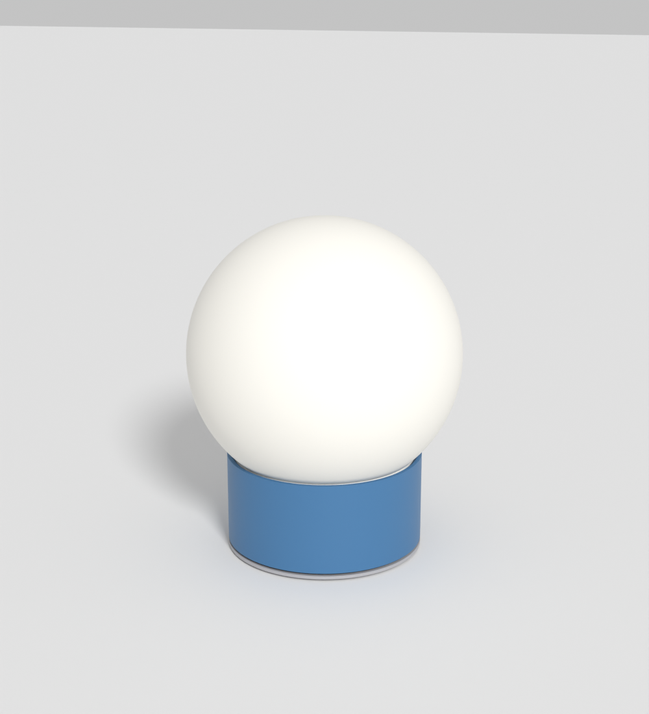
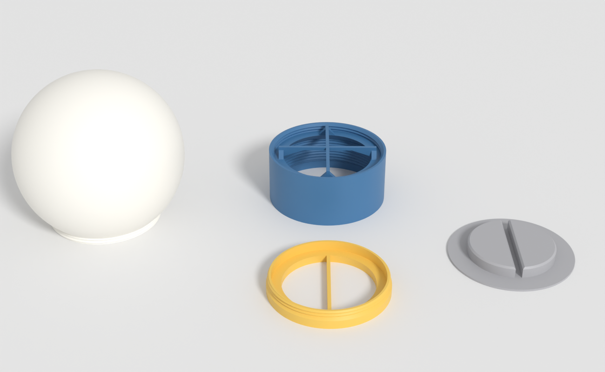
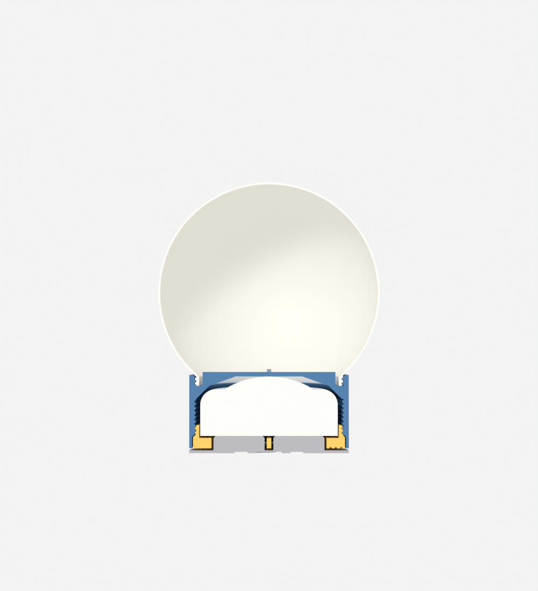
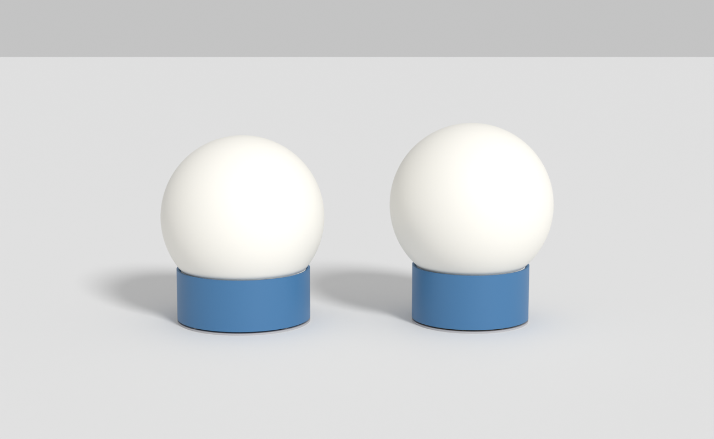
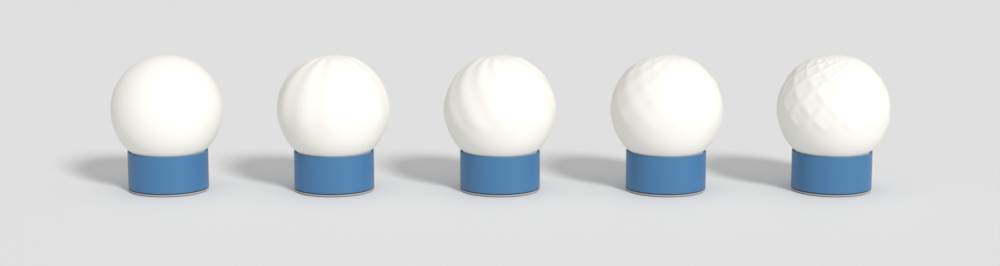
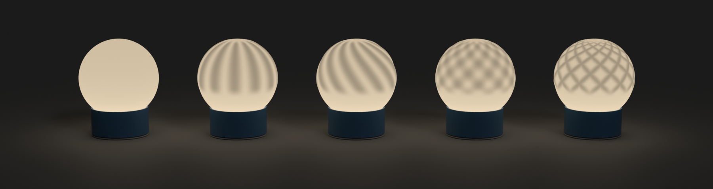
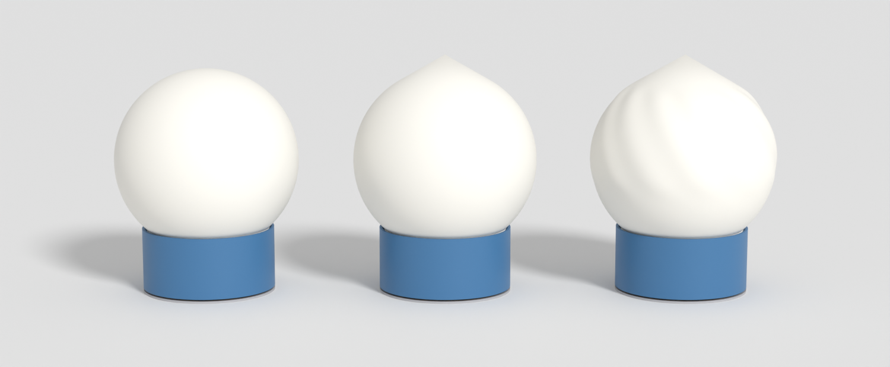
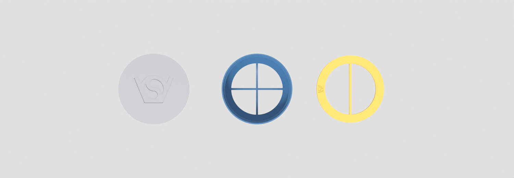

# Pucklight sphere

**Deprecated.** This project is not developed any more. The newest project is [`projects/pucklight_lamp_v2`](../../pucklight_lamp_v2): its lamp takes these spheres, and its webapp makes them, with the planets, as the kind Sphere.

Sphere lamp for the 62 mm RGBW puck light. Prints in less than half the time of `RGBW_pucklight_lantern3`; spheres screw on and off, so you can print many and swap them.

| File | What |
|---|---|
| `pucklight_sphereV3.scad` | the generator, standalone, no libraries |
| `readme_hgc.md` | original description |
| `archive/` | V1 and V2 with their readme; V3's threads do not fit them |
| `mathematical/` | webapp: patterns from a shader or a map, on V3's sphere |
| `planets/` | fifteen bodies of the solar system, as projects of the webapp, and their spheres |

## V3 against V2

Changed after printing V2. All four parts are new: V2's do not fit.

| Asked for | V2 | V3 | How |
|---|---|---|---|
| No pins on the click base | Ø3 × 4 | none | the disc in the screw's opening centres the lamp, the bar lies in its slot |
| Thinner sockel | Ø82 × 31 | Ø72 × 33 | without pins, 1.25 mm of wall around the screw's recess is enough, instead of 6.25 |
| Taller screwin, more grip | 8.4 high, bar 2.6 | 10.4 high, bar 4.6 | V1's heights; `screw_height`, `lip_height` |
| More of the sphere | starts at -37.8°, Ø79 | starts at -45°, Ø70.7: 4.7 mm more sphere | a smaller thread: Ø77 to Ø67 |

| Follows from that | V2 | V3 |
|---|---|---|
| Ribs end at radius | 34.75 | 30: inside the smaller neck |
| Floor under the puck | 2.6 | 4.6: the disc and the sockel are 2 mm higher |
| Sockel's logo | 5.9 wide | none: no room, see Logo |
| Lamp's height | 115; vase mode 122.5 | 122.4; vase mode 130.2 |
| Weight on the puck's dome | 64 g | 57 g |

What sets the sockel's Ø72:

| Radius | Is |
|---|---|
| 31.5 | the bore: puck 31 + clearance 0.5 |
| 33.5 | the screw's thread: wall 1.2 + depth 0.8 |
| 33.75 | the sockel's thread: clearance 0.25 |
| 34.25 | the screw's flange, the stop: 0.5 |
| 34.75 | the recess: 0.5 |
| **36** | **the outside: wall 1.25; below 1.2 the generator stops with an error** |

The cup for the sphere needs the same: its rim is 1.4 mm wide. The thread's wall is 2.25 mm. A thinner sockel needs a thinner screw wall or flange.

- Without pins the sockel can turn on the base. The bar stays in its slot, so the sockel turns on the screw's thread. Hold the sockel, or lift the lamp, when you turn a sphere.
- The sphere now leaves the sockel almost at its edge: Ø70.7 on Ø72.

## Parts

| Part | `part =` | Prints |
|---|---|---|
| Sphere | `sphere` | neck on the bed |
| Sphere for vase mode | `vase_sphere` | neck on the bed, see Vase mode |
| Sockel | `sockel` | bottom on the bed |
| Screwin | `screwin` | bottom on the bed |
| Click base | `clickbase` | bottom on the bed |

Also: `assembly`, `section`, `print_layout`.

| Parameter | Default | Meaning |
|---|---|---|
| `sphere_d` | 100 | outer diameter; at least `neck_d` + 10 |
| `shell` | 0.8 | thickness, 0.8 to 2; thinner glows more |
| `vase_overhang` | 60 | where the vase mode sphere ends in a cone |
| `surface` | `smooth` | formula for the outside, see below |
| `surface_depth` | 0.8 | height of the formula's peaks; the shell is `shell` + this thick there |
| `surface_count` | 12 | ribs, waves or spirals around the sphere |
| `surface_twist` | 120 | `twist`: degrees a rib turns from pole to pole |
| `sphere_columns` | 180 | mesh resolution; about 12 columns per rib |
| `neck_d` | 67 | the sphere's thread; sets how much sphere is left |
| `neck_clearance` | 0.3 | radial gap of the sphere's thread |
| `sockel_d` | 72 | also the click base |
| `front_logos` | false | true: also a logo you can see, see Logo |

## Print time

Slicer estimates: SnapmakerOrca, Snapmaker U1, no support, each part alone. As in `archive/v1_snapmaker.3mf`: the sphere in SnapSpeed PLA (min layer time 4 s, max flow 20 mm³/s), the rest apparently in Generic PETG (12 s, 12 mm³/s), brim 5 mm. `archive/v2_3mf_file.3mf` is a Bambu A1 project: other printer, other times.

| Part | V2, 0.2 mm | V3, 0.2 mm | V3, 0.28 mm prototype |
|---|---|---|---|
| Sphere, Arachne | 41 min, 26 g | 43 min, 27 g | 35 min, 26 g |
| Sockel | 58 min, 31 g | 47 min, 22 g | 39 min, 21 g |
| Click base | 22 min, 11 g | 21 min, 10 g | 19 min, 11 g |
| Screwin | 17 min, 7 g | 19 min, 8 g | 17 min, 9 g |
| **Whole lamp** | **2 h 17 min, 74 g** | **2 h 9 min, 68 g** | **1 h 50 min, 67 g** |
| All in SnapSpeed PLA | 2 h 5 min | 1 h 52 min | 1 h 34 min |

| Sphere, SnapSpeed PLA | Normal, 0.2 mm | Normal, 0.28 mm | Vase mode, 0.2 mm |
|---|---|---|---|
| Plain | 43 min, 27 g | 35 min, 26 g | 33 min, 16 g (25 min at 3 s) |
| `waves` | 1 h 16 min, 36 g | 1 h 2 min, 36 g | not sliced |
| `ribs` | 1 h 41 min, 36 g | 1 h 19 min, 36 g | not sliced |
| `twist` | 1 h 42 min, 36 g | 1 h 19 min, 36 g | 33 min, 16 g |
| `lattice` | 1 h 57 min, 36 g | 1 h 29 min, 36 g | 33 min, 16 g |

What sets the time:

- Min layer time: a thin sphere hits it. PETG's 12 s against PLA's 4 s is why the sphere goes in SnapSpeed PLA. A sockel in PETG hits it too: 47 min against 37 min in SnapSpeed PLA.
- Max flow: otherwise time follows the plastic.
- Formula spheres in normal mode are slow: walls that change width move slowly. More walls do not help.

## Made for 0.2 mm layers

The default, as in most slicers; 0.28 mm is for quick prototypes. A flat face on a layer's midpoint can round either way, so the ones that set a fit lie on multiples of 0.2 mm.

| Flat face | Height |
|---|---|
| Screw's floor and bar top | 4.6 |
| Screw's top | 10.4 |
| Ribs' underside, top | 32.4, 34.4 |
| Click base's plate, disc top | 1.2, 7.8 |
| Cup's height | 4.8 |
| Logo depth | 0.6 |

As the slicer prints it, read from the G-code, with the 26.8 mm puck:

| Layers | Floor | Ribs | Puck's play, flush | At the stop | Button push |
|---|---|---|---|---|---|
| **0.2 mm** | **4.60** | **32.40** | **1.00** | **0.40** | **0.80** |
| 0.28 mm | 4.68 | 32.40 | 0.92 | 0.32 | 0.76 |

- Thread: 2 mm pitch is 10 layers: ridge tip 1, each flank 4, root 1.
- `layer_height` (0.2): the screw's floor and the ribs stay on its multiples, also after changing `puck_height`.
- Cup's floor: 0.007 mm above a layer, which changes nothing.
- No room for the puck? Measure it. The generator uses the CAD model's 26.8 mm, the spec sheet says 27.6 mm. Then set `puck_height`. Why these numbers: `archive/readme.md`, Fixes after the first print.

## Slicer settings for the sphere

| Setting | Value | Why |
|---|---|---|
| Layer height | 0.2 mm | 0.28 mm for quick prototypes |
| Wall generator, walls | Arachne, 2 | 0.8 mm is two lines |
| Filament | SnapSpeed PLA in white or a light colour | 4 s against PETG's 12 s |
| Brim | outer, 5 mm | the neck stands on a 1.2 mm ring |
| Support | off | see Printing without support |

Sockel: keep a brim too, outer, 5 mm: it stands on a 1.25 mm ring, and it costs no time.

## Surface formulas

The inside stays a smooth sphere, so a peak is thicker and darker when lit. The pattern is faint when off and strong when on.

Left to right, `lon` and `lat` in degrees, height from 0 to 1:

| `surface` | Formula |
|---|---|
| `smooth` | 0 |
| `ribs` | 0.5 + 0.5 cos(n lon) |
| `twist` | 0.5 + 0.5 cos(n (lon + twist lat / 180)) |
| `waves` | 0.5 + 0.5 cos(n lon) cos(n lat) |
| `lattice` | crossed loxodromes: max(0.5 + 0.5 cos(n lon ± m))³, m = n ln(tan(45° + lat / 2)) in degrees |

- Your own formula: add a line to `surface_height()` and its name to the `surface` list. Return 0 to 1.
- A formula fades in from latitude -19.7, and out towards the pole, so the neck and the closed top stay smooth.
- The lit picture assumes light falling off with distance and exp(-1.2 × thickness in mm). The real contrast depends on the filament.

## Vase mode

`part = "vase_sphere"`. A solid: the slicer's vase mode prints its outline as one spiralling line, and the thread and the formulas are part of that outline. From the left: the normal sphere, the vase mode sphere, the vase mode sphere with `twist`.

| Slicer setting | Value | Why |
|---|---|---|
| Spiral vase | on | sets one wall, no top, no infill |
| **Bottom layers** | **0** | a floor closes the neck and hits the sockel's ribs: the sphere does not seat |
| Outer wall line width | 0.6 mm | a wider line overlaps the layer below more, see below |
| Layer height | 0.2 mm | at 0.28 mm the cone overlaps only 19%, see below |
| Min layer time | 3 to 4 s | at 0.2 mm in SnapSpeed PLA, 4 s: 33 min, 3 s: 25 min |
| Brim | outer, 5 mm | the first layer is one line; peel it off gently |

| Sliced with these settings | Result |
|---|---|
| Path | one line: no travel, no retraction between the first layer and the top, z never falls |
| Thread | outer edge at r = 33.50, the thread's major radius, so the fit stays as modelled |

A single wall cannot close a round top: it has no top layer and leans in only so far. So the sphere stays round up to `vase_overhang`, then ends in a straight cone to a point. Lower is safer, higher is rounder:

| `vase_overhang` | Tip above a round top | Overlap per layer, 0.6 mm line: 0.28 mm layers | 0.2 mm | 0.12 mm |
|---|---|---|---|---|
| 55° | 11.0 mm | 33% | 52% | 71% |
| **60°** | **7.7 mm** | 19% | **42%** | 65% |
| 65° | 5.2 mm | none | 29% | 57% |
| 70° | 3.2 mm | none | 8% | 45% |
| 75° | 1.8 mm | none | none | 25% |

- The wall is the same thickness everywhere, so a formula shows through its shape only. The contrast when lit should be weaker than on the normal sphere, where thickness changes. Hypothesis, not yet seen.
- No logo: the wall is one line, and the neck has no bottom.
- `shell` and `neck_wall` do not apply.
- Screw it in gently: the thread is a single line, about 0.6 mm thick.

## Printing without support

| Zone | Overhang | How it prints |
|---|---|---|
| Thread | 45° | flanks as in the holder |
| Neck to the sphere | 45° | cone |
| Lower half, outside | 45° at most | starts where the sphere overhangs 45°; with `front_logos`, the logo's edges overhang more |
| Top, inside | up to 89° | the outside stands on the layer below, so sagging stays inside |

If the top sags too much: organic support inside, removed through the neck, or thinner layers.

## Thread and fit

| | |
|---|---|
| Thread | Ø67, 2 mm pitch, 45° flanks, right-handed, 2 turns |
| Male on | the sphere's neck |
| Female in | a cup on top of the sockel; it hides the thick neck, so all you see is thin shell |
| Stop | the neck's bottom on the cup's floor; no lining up needed |
| Clearance | 0.3 mm radial |

Test the thread before a whole sphere: in the slicer, print only the sphere up to z = 10 and the sockel from z = 26.

## Assembly

1. Put the puck into the sockel from below, dome first.
2. Screw in the screwin until it is flush.
3. Stand the sockel on the click base and turn it until the bar drops into the slot.
4. Hold the sockel and screw the sphere in until it stops, about 2 turns.
5. Press the lamp down to click the light. Press near the sockel; the shell is thin.

## Logo

In the bottoms only, hidden when the lamp stands on a desk. 0.6 mm deep, reading from below.

| Part | Where | Width |
|---|---|---|
| Click base | bottom of the plate, on the desk | 40 mm |
| Screwin | bottom of the flange | 8 mm |
| Sockel | none: the bottom ring is 1.25 mm wide | |
| Sphere | none: the neck's bottom is a 1.2 mm ring | |

`front_logos = true` adds a 20 mm logo (`front_logo_width`) in the sockel's front, 0.6 mm deep, and in the sphere's lower front, half through the shell, so it glows brighter.

## Differences from the lantern's holder

| | Lantern 3 | Here | Why |
|---|---|---|---|
| Body | square, 76 mm | round, Ø72 | asked for in `readme_hgc.md` |
| Pins | in the corners | none | not needed |
| Click base | square | round, Ø72 | follows the body |
| Screw's flange | 1.5 mm | 0.5 mm | thinner sockel |
| Window | Ø50 | Ø54 | more light, lower cup |
| Ribs | end over the recess wall | end inside the neck | smaller neck |
| Puck's play | `puck_play` 0.7 | `puck_play` 0.6 + `puck_extra_play` 0.4 | too tight in the first print |

The rest is copied from `RGBW_pucklight_holderV3.scad`; copy later changes by hand.

## Checks

Boolean intersections of the exported parts, OpenSCAD 2021.01 on the command line:

| Case | Result |
|---|---|
| Sphere seated, half a turn out, 2.5 turns out | no contact |
| Vase mode sphere seated, half a turn out; outside the ribs, since the solid fills the neck in the model | no contact |
| Sockel on the click base, pressed and released | no contact |
| Puck in the sockel and on the screwin; the bar in the disc's slot; screwin flush | no contact |
| Screwin `seat_gap` deeper | touches only on the stop cone |
| Puck rising from the floor, flush | no contact at 0.99 mm, contact at 1.01 |
| Same, screwin at the stop | no contact at 0.39 mm, contact at 0.41 |
| Disc under the puck, released | no contact at 1.01 mm, contact at 0.99 |
| Meshes, `shell` 2, `sphere_d` 90 and 150, `vase_overhang` 45 and 75, `surface_depth` 5 | closed |
| `sphere_d` 70, `neck_d` 62 and 75, `sockel_d` 70 and 71.8, `window_d` 60 | stop with an error message |
| `mathematical/test_sphere_mesh.js` | the webapp's sphere is V3's, within 0.0001 mm |

## Render times (OpenSCAD 2021.01)

| Part | Time |
|---|---|
| Sphere | 1 s |
| Sockel | 17 s |
| Sphere or sockel with `front_logos` | 20 s |
| `section`, `assembly`, `print_layout` export | 1.5, 1.5, 2.5 min |

## Not tested yet

- V3 is not printed. Most open: the sockel's 1.25 mm bottom ring, the lamp's seat without pins (the disc has 1 mm of radial gap in the opening), and the thread at its new size.
- No report yet on the puck's play after the fix, V3 has the same heights as the fixed V1.
- The lamp's 57 g rests on the puck's dome. If that clicks the light by itself, stand it on something else.
- Another OpenSCAD build, such as the browser playground, was not tried on V3.

## Not included

- Multicolor stained glass: left for later, as `readme_hgc.md` asks for a plain basic version. `lattice` comes closest in one colour.

Licensed under GPL.
