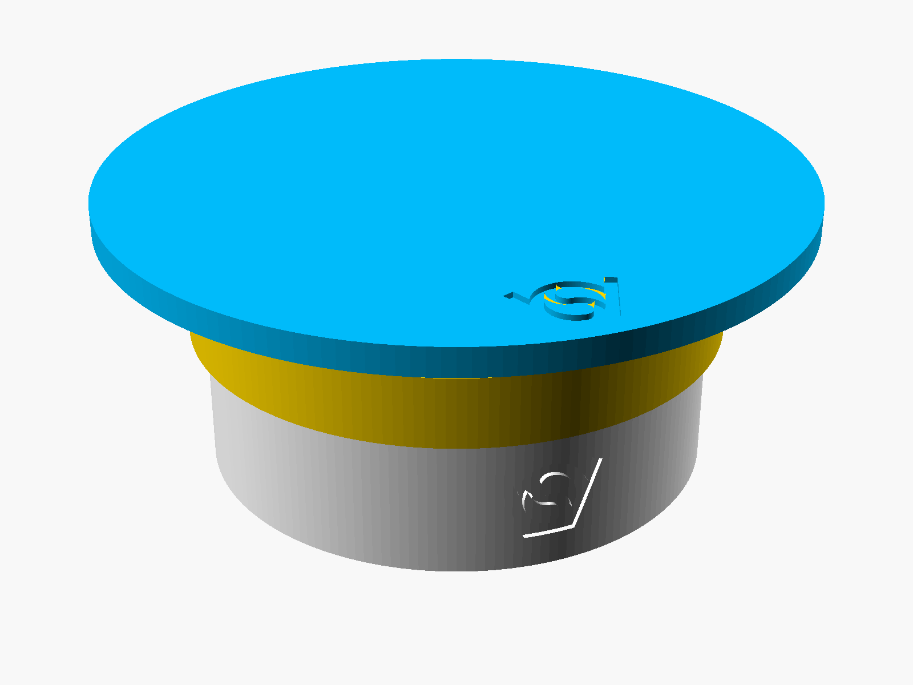
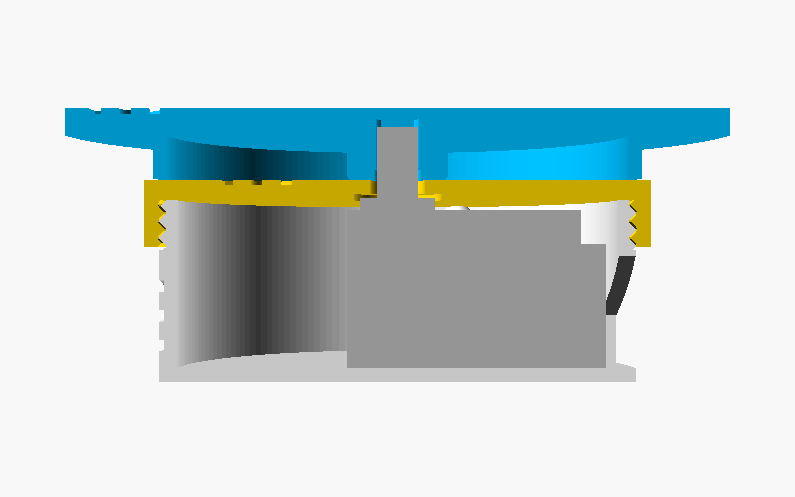
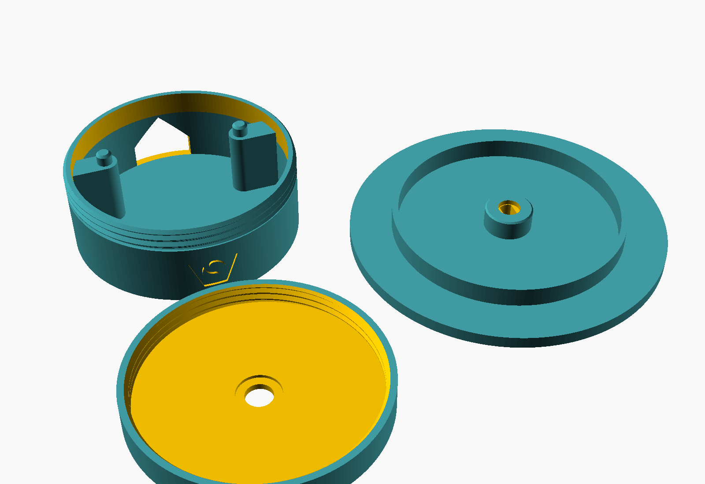
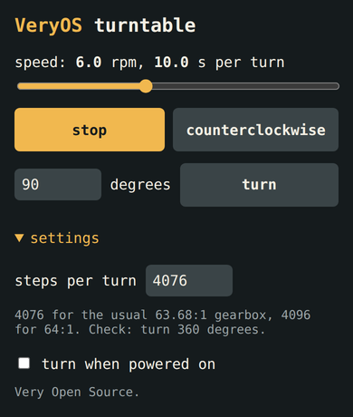

# 28BYJ minimal turntable

Turntable for the 28BYJ-48 stepper motor: the shaft turns the platform directly, no gears. Three printed parts and the motor, nothing else: no balls, no screws. An ESP32 sets the speed from a web page on its own open WiFi. V2, not printed yet.

| File | What |
|---|---|
| `28byj_minimal_turntableV2.scad` | the generator, standalone, no libraries. `part`: all parts on the bed, assembly, section, base, lid, platform |
| `28byj_minimal_turntableV2_base.stl`, `_lid.stl`, `_platform.stl` | exported at the defaults, as they print |
| `archive/` | V1, which rolls on 32 airsoft BBs. Each change to the generator makes a new version file; the old one stays |
| `firmware/turntable/turntable.ino` | ESP32 firmware: open WiFi, web page, stepper |
| `readme_hgc.md` | original goal |
| `image.png`, `image copy 2.png` | the motor and its datasheet drawing, source of the motor's numbers |

## Parts

| Part | Qty | Note |
|---|---|---|
| base, lid, platform | 1 each | printed, 12.5 / 8.9 / 18.0 cm³ solid at the defaults |
| 28BYJ-48 5 V with ULN2003 driver board | 1 | |
| ESP32 DevKit, ESP32-WROOM-32 | 1 | |
| female-female jumper wires | 6 | |
| USB cable and 5 V supply | 1 | powers the ESP32 and the motor |

## How it works

| | |
|---|---|
| motor | stands on the base's floor, shaft on the axis, and drops in from above, 0.5 around its widest point, the cable box. Its ears sit on two Ø3.8 pegs, which keep it from turning; the posts under the ears stay 1 below them |
| lid | screws onto the base until it stops on the base's rim, one layer above the pegs. The shaft comes up through a Ø6.6 hole in its middle, the shaft's boss sits in a recess underneath. It touches the motor nowhere |
| thread | 45° flanks, 2 pitch, Ø57.1, 6 long, 0.25 per side, as `fdm_optimized_screws` |
| bearing | the platform's Ø12 hub (`hub_d`) stands on the lid's flat top, the bed side of its print, and slides on it between r 3.3 and 5.6. The load goes platform → lid → wall → table; the motor carries none |
| tipping | a ring under the platform, r 27.8 to 29.4, hangs 0.2 (`tilt_gap`) above the lid. A load off centre leans the platform 0.48° onto it: 0.29 down at the platform's edge |
| drive | the hub takes the shaft's flats in a 5.2 × 3.2 double-D hole, round below where the flats start and 0.5 above the longest shaft's tip |
| cable | through a 15 wide window at the back, 45° roof; the 5 pin plug (12.4 × 5.8) passes |
| logo | engraved in the front of the base's wall and in the top faces of the lid and the platform |

## Why it turns without balls

Sliding friction brakes with coefficient × load × radius of the contact, so the contact sits right around the shaft. Estimates with a coefficient of 0.35 for PLA on PLA, not measured:

| Case | Braking torque |
|---|---|
| the motor's pull-in torque, by its datasheet | 34 mN·m |
| 1 kg centred, sliding on the hub at r 4.6 | 16 mN·m |
| load more than 6 off centre: coefficient × load × offset | 500 g 15 off centre: 26 mN·m |
| limit off centre | load × offset about 10 kg·mm, e.g. 500 g 20 off centre |
| for comparison: 1 kg sliding on V1's rim at r 31, without the balls | 106 mN·m, stalls |

## Sizes at the defaults

| | |
|---|---|
| base | Ø57.1, 21.8 high |
| lid | Ø60.8, 8 high |
| platform | Ø80 (`platform_d`, at least the lid), 3.2 plate (`platform_thickness`) |
| height | 32.8 to the platform's top |

## Assembly

1. Push the motor's plug out through the cable window from the inside.
2. Lower the motor in, cable box toward the window, ears onto the pegs.
3. Screw the lid on until it stops.
4. Set the platform on and turn it until the shaft's flats drop into the hub.

## Printing

| Part | Orientation | Overhangs |
|---|---|---|
| base | standing | the thread's flanks and the window's roof, 45° |
| lid | upside down, top face on the bed, as the STL | the thread's flanks, 45°; the boss's recess opens upward |
| platform | upside down, top face on the bed, as the STL | none: hub and ring face up |

Made for 0.2 mm layers: the base's rim, the hub's face and the ring are on multiples of 0.2.

## Tuning

| Problem | Change |
|---|---|
| lid tight or loose on the thread | `thread_clearance`, 0.25 |
| platform stalls or squeaks | a drop of oil on the hub's face; smaller `hub_d` |
| ring rubs on the lid without a load | `tilt_gap` 0.4 |
| platform tight or loose on the shaft | `shaft_clearance`, 0.2 |

## V2 against V1

| | V1 | V2 |
|---|---|---|
| bearing | 32 airsoft BBs between two V-grooves, track Ø62 | the hub's printed face on the lid, Ø12 |
| parts besides the motor | base, platform, 32 BBs | base, lid, platform |
| keeps the platform level | the balls' track | the hub; beyond 6 off centre the ring, after 0.2 |
| motor | open under the platform | closed in by the lid |
| printed screws | none | none: the ears' holes are Ø4.2, the smallest printed screw that works is 5 (`fdm_optimized_screws`), so the pegs stay. The lid is the screw, with the same thread |
| base | Ø57.1, flared to Ø74.0 at the rim | Ø57.1, lid Ø60.8 |
| height | 32.8 | 32.8 |
| solid volume | 19.2 + 18.9 cm³ | 12.5 + 8.9 + 18.0 cm³ |

## Firmware

| | |
|---|---|
| build | Arduino IDE or arduino-cli, board "ESP32 Dev Module", ESP32 core 3.x, no libraries. Compiles with core 3.3.12 for ESP32 and ESP32-S3; not run on a board yet |
| WiFi | open network `veryos-turntable`, page at http://192.168.4.1; phones show it as the network's sign-in page |
| wiring | ULN2003 IN1 IN2 IN3 IN4 → GPIO 14 27 26 25, + → VIN, − → GND, all on one side of the DevKit |
| other boards | change `PINS`; on an ESP32-S3, 25 to 27 are not free, e.g. 4 5 6 7 |
| stepping | half steps, timed apart from the web server; starts at up to 5 rpm and speeds up by 10 rpm/s; coils off when stopped |
| settings | kept in flash |

| Control | Does |
|---|---|
| speed | 0.1 to 15 rpm, also shown as seconds per turn |
| start / stop | turns until stopped |
| direction | clockwise or counterclockwise, seen from above |
| degrees, turn | turns that angle in the set direction, then stops; 15 gives 24 photos per turn |
| steps per turn | 4076 for the usual 63.68:1 gearbox, 4096 for 64:1. Check: turn 360 degrees |
| turn when powered on | starts at the saved speed, without a phone |

## Open points

| | |
|---|---|
| friction | the torques above are estimates; untested |
| ear thickness | not in the drawing; 1 assumed |
| cable box | its height and whether it is flush with the motor's back are not in the drawing; the motor must stand on its back |
| direction | the labels follow the datasheet's sequence on the usual ULN2003 board; untested |
| load | only its weight holds the platform down, and the base is Ø57: a load beyond the base's edge tips the turntable |
| speed | the 28BYJ-48 may stall above about 10 rpm at 5 V under load |
