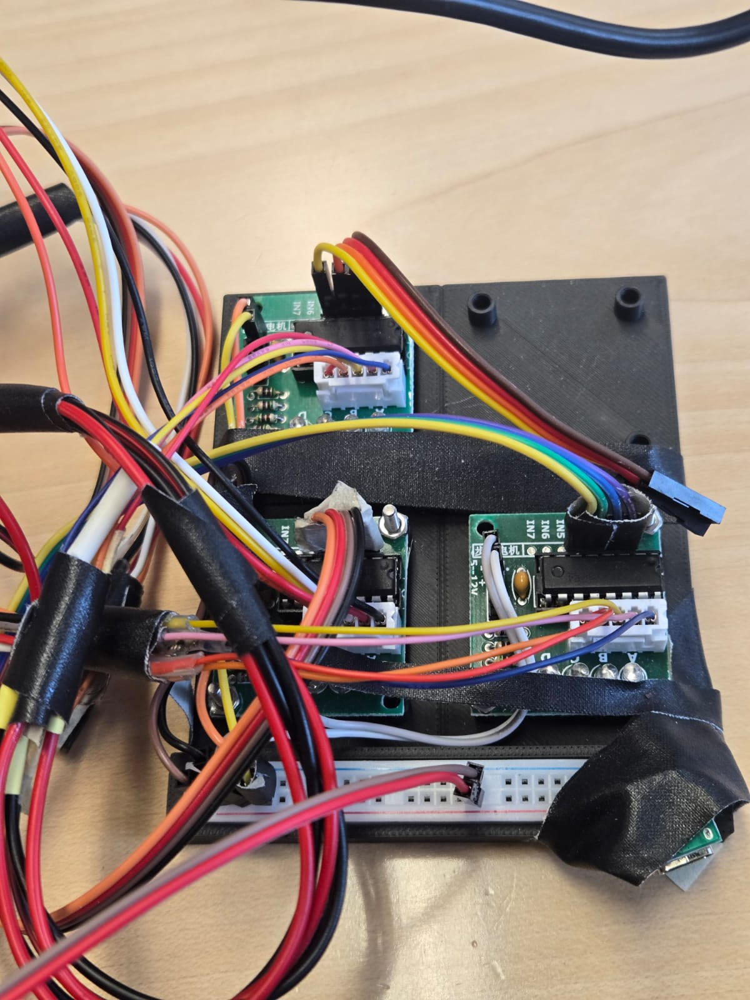
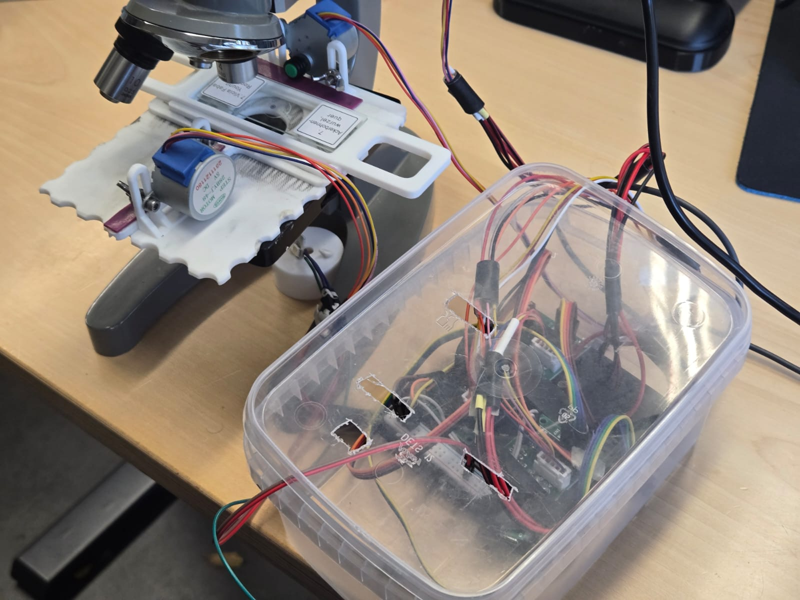
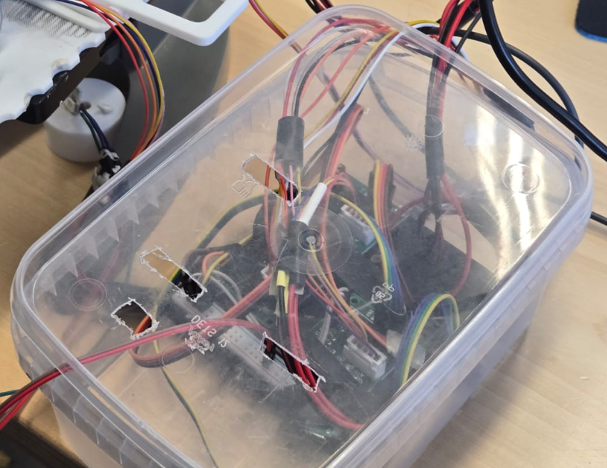

i write this down as some kind of historical documentation. 

as a first iteration , i had nothing. the uln driver boards just layed around. 

as a second step i had this 3d printed plate. i could lock down the stepper motor ULN2003 driver boards and also add a breadboard power rail to it. 

in the version seen on the image 
i tried to use a usb c female port in order to power it with a usb c cable. however this did not work. i do not know why, maybe the usb c did not deliver enough ampere.... 

because the board still was 'laying around' i took a simple jet12 container as an enclosure  using a ultrasonic cutter i cut some holes/slits for the cables 
however in this image i did not put the cables through since i was debugging the hardware and was to lazy to always feed the cables through the lid when i had to change some wiring.

