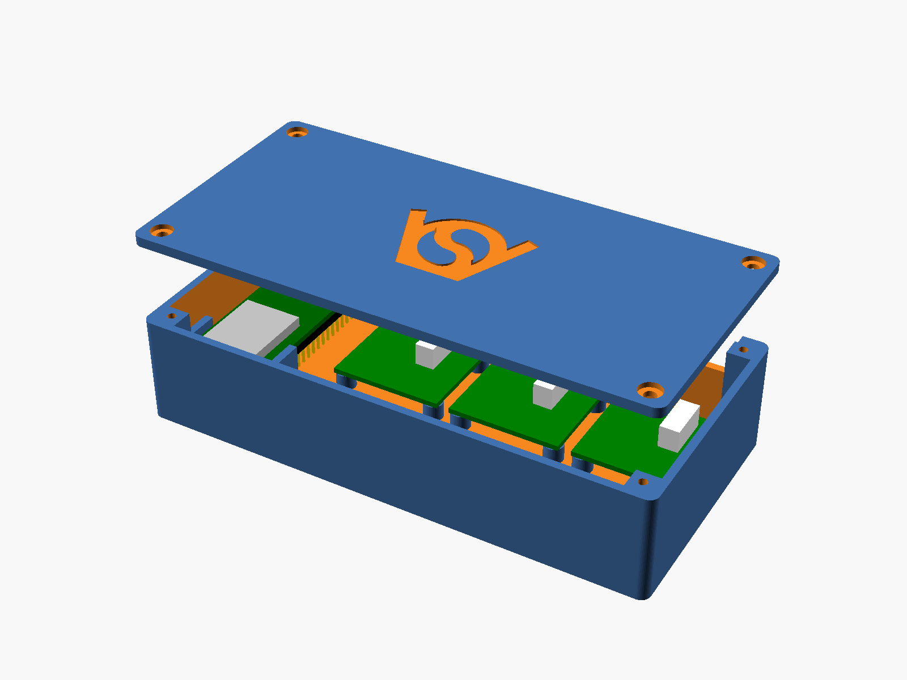
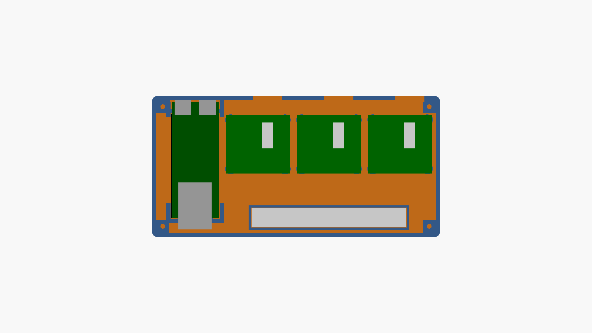
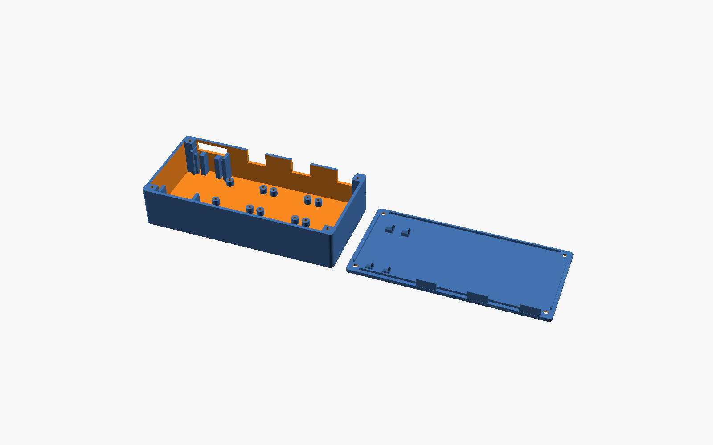

# OMM enclosure

Box for the electronics of the open microscope motorization: an ESP32-S3-DevKitC-1, three ULN2003 driver boards and a breadboard power rail. Replaces the food box in `current_setup/`. V1, not printed yet.

| File | What |
|---|---|
| `omm_enclosure.scad` | the generator, standalone, no libraries |
| `readme_hgc.md` | original goal |
| `current_setup/` | photos of the setup it replaces |
| `image*.png` | the boards, with the ULN2003 drawing |
| `DXF_ESP32-S3-DevKitC-1_V1.1_20220429.dxf` | Espressif's board drawing, source of the ESP32 numbers in the generator |

## Layout

Outer 156.45 × 76.6 × 36 mm. Front wall y = 0, cables leave through the back wall.

| Part | Where | Held by |
|---|---|---|
| ESP32-S3-DevKitC-1 | left, along the depth, USB-C ports at the back wall | lies 20 mm above the floor on a bar between its headers at the antenna end and on two pads between the USB-C legs, so the jumper wires fit on the pins below; an end stop under the module's overhang, posts against the headers' ends and beside them; the lid's four pillars press on the module's can and the USB-C shells, the only flat spots on top |
| 3 × ULN2003 | row at the right, JST plugs toward the back, IN pins toward the ESP32 | Ø6 × 5 standoffs on the 29.6 × 26.6 hole pattern, M3 × 6 thread forming |
| power rail | along the front wall, under the drivers | tray, 3 mm walls around it, adhesive back |
| lid | 4 × M3 × 10 into the corner posts | lip inside the walls, tabs in the cable slots: fits one way round only |

| Opening | Where | Size |
|---|---|---|
| USB-C window | back wall, both ports | 27 × 8: both plugs' overmoulds together span the board's width |
| motor cable slot | back wall, behind each JST plug | 16 wide, open to the top for the plug; the lid's tab closes it to 5 mm |
| feet | bottom, four corners | Ø10 × 1 recess for stick-on feet |
| logo | lid top 40 wide, floor 15 wide between the drivers and the rail | 0.6 deep |

## Print

| Part | Orientation | Why |
|---|---|---|
| base | as is | no supports; the window bridges 27 mm |
| lid | top face down | pillars and tabs point up; the logo is engraved in the bed face |

0.2 mm layers, no supports.

## Check before printing

| What | Set to | Note |
|---|---|---|
| `rail_len`, `rail_w` | 84 × 10 | measure the rail: half size breadboard rails are about 84, full size about 165 |
| `mod_h`, `usb_h` | 3.1, 3.3 | height of the module's can and of the USB-C shells above the board: the lid's pillars stop 0.2 above them, measure yours |
| `esp_under` | 20 | room under the board for the dupont housings on the pins: 2.5 header, 14 housing, wire bend |
| `screw_hole` | 2.6 | M3 thread forming, untested, see `lessons_learned.md` |

Board outline, headers, module and USB-C ports come from the DXF (62.74 × 25.4; headers 6.44 to 62.82 under both edges; module 18 wide, 6.3 past the antenna end; ports centred 6.0 and 19.4 from the left edge).
