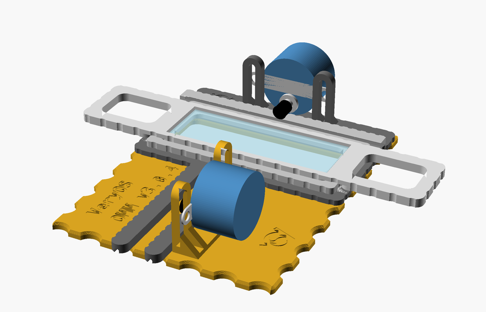
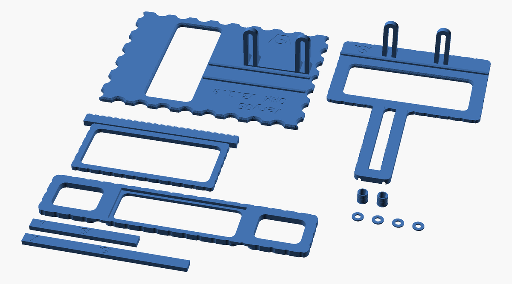
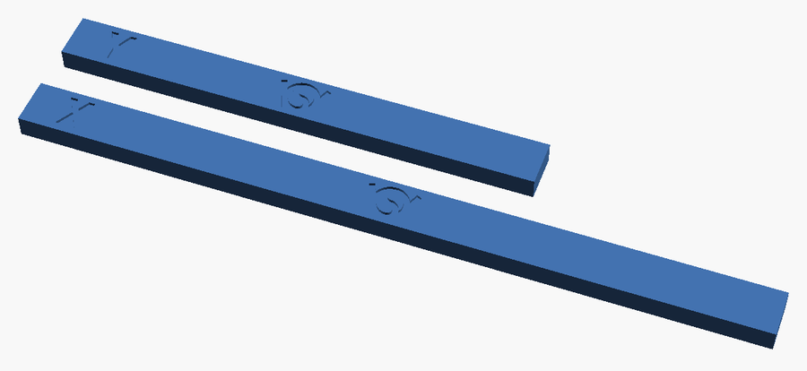

# OMM XY table

Motorised XY stage of the open microscope motorization: moves a standard 76 × 25 × 1 mm glass slide in X and Y with two 28BYJ-48 steppers. `omm_xy_table_v3p1p0.scad` rebuilds the Onshape document OMM_v2 (engraved label v2.3) in OpenSCAD, with the same parts and Onshape's variable names; where a value differs from Onshape, the tables below say so. v2.4 is printed, the later versions not yet. The Y slider's second guide rail, since v2.6, is experimental; since v3.1.0 a bar joins the two arms' tips.

| File | What |
|---|---|
| `omm_xy_table_v3p1p0.scad` | the generator, standalone, no libraries. `part` picks the assembly, the print layout or one part. `version` is engraved in the table; bump it with the file name |
| `omm_xy_table_v3p1p0_<part>.stl` | every printed part and the cutting ruler, exported from the generator in print orientation with the brand font |
| `omm_xy_table_v3p1p0.json` | four Customizer presets, one per slide format: Standard 76 x 25 (the defaults), Petrographic 46 x 27, Wide 75 x 38, Large 75 x 50. Not printed; `print_layout` fits the 256 bed for the first two only. A new version file takes this file along under its name |
| `publish/` | publishing material for v3.1.0: six images (how it works, slide formats, `tol_rail`, print), `listing.md`, the STLs, `source/build.py`. Not ready to upload: no photo and no 3mf of a v3.1.0 print |
| `archive/` | v2.4 to v3.0.4, script and STLs. Each change to the generator makes a new version file; the old one stays |
| `OMM_v2_rebuild_kit.zip` | Onshape export, source of every dimension: feature trees, sketches, variables, STEP, STL, DXF, renders and the kit's own README |
| `omm_params.scad` | the Onshape Variable Studio, 1:1 from the kit |
| `Onshape_online_CAD_version/` | Onshape print files OMM_v2p2.3mf and OMM_v2p3.3mf |

| Change | Counts, from v3.0.0 |
|---|---|
| small | the third number: v3.0.1, v3.0.2 |
| bigger | the second: v3.1.0, v3.2.0 |
| substantial | the first: v4.0.0 |

## v3.1.0 against v3.0.4

Only the Y slider and the table's label changed; the other parts print as in v3.0.4.

| Asked for | v3.0.4 | v3.1.0 |
|---|---|---|
| Connect the Y slider's two parallel arms at their tips: unconnected they are not stable (`improvements/y_slider_connection/`) | two arms, each a 70 long cantilever with a rounded tip | a bar across both tips, of the arms' section: 7.5 wide, 4 high, from the second arm's outer side to the first arm's outer side (x −18.75 to 3.75), rounded at both ends. The arms' slots run through it and stay open at its end: within the travel the table's rails come out there |
| – | 15 notches along the first arm's inner side | 14: the last one would cut into the bar. The second arm's outer side keeps its 15 |
| – | – | the bar ends at the first arm's outer side, not past it as in the sketch: the table's bracket stands 0.45 beside that side. It is as high as the arms: the Y motor's roller runs on the first arm's top |

The bar makes the arms and the frame one closed frame, so the arms cannot bend apart on their own. It does not change the play in the slots: ±0.17° yaw at Y 0 from `tol_rail` 0.2, as since v2.7. At Y 0 the bar hangs 4.7 over the table's front edge, as the arms' tips did; from Y +4.7 it lies wholly on the table.

| Checked | Result |
|---|---|
| mesh | one closed body, 14687.7 mm³: 253 more than v3.0.4: 62.3 mm² between the arms, their inner tip roundings included, × 4 high, and the notch the bar replaces. Slots open through the bar's end face |
| seated, mesh stage of `publish/source/build.py` | the four presets and `tol_rail` 0.1 and 0.4, the carriages at Y −13, 0, +25, +28 with X 0, at X +35 with Y 0, and at X ±45 with Y −13 and +28: no two parts share a volume. Travel unchanged, Y −13 to +28 |
| OpenSCAD 2021.01 against 2026.09.16 with lazy union and Manifold | all seven parts the same volume within 5 ppm; the table as two bodies in Manifold and 10 doubled edges at the Y slider's X bracket, both as in v3.0.4 |
| against v3.0.4 | X slider, slide holder, shaft adapter, washer and cutting ruler: identical facets; the table differs by its label |
| print layout | unchanged: the bar lies inside the Y slider's outline |

## v3.0.4 against v3.0.3

Only the cutting ruler, the print layout and the table's label changed; the other parts print as in v3.0.3.

| Asked for | v3.0.3 | v3.0.4 |
|---|---|---|
| The cutting ruler's references as positive shapes, to trace along their outlines with a pencil: inside the windows a pencil hardly can | a 55 × 124 × 3 plate with a 7.5 wide window per strip, for a knife | one bar per strip, 3 high, to trace around: X 99 × 6.5, Y 65.25 × 6.5, see sanding paper strips below |
| – | windows of the strips' size, without allowance | `ruler_pencil` = 0.5: the bars are 0.5 smaller than the strips all around, because a pencil's line runs outside the edge it follows. 0 gives bars of the strips' size |
| The cutting ruler in the print layout | not in it | both bars in front of the slide holder, 6.75 from it: x 5 to 104, y 14 to 33 |

| Checked | Result |
|---|---|
| mesh | two closed bodies, 99 × 6.5 × 3 and 65.25 × 6.5 × 3, letter and logo 0.4 deep in each top |
| print layout, mesh | all parts within 4.75 to 250 of the 256 bed; the bars 6 apart and 6.75 from the slide holder, no other part near them |
| OpenSCAD 2021.01 against 2026.09.16 with lazy union and Manifold | all seven parts the same volume within 2 ppm; the table as two bodies in Manifold, as before |
| against v3.0.3 | Y slider, X slider, slide holder, shaft adapter and washer: the same volume and triangle count; the table differs by its label |

## v3.0.3 against v3.0.2

Only the slide holder and the table's label changed; the other parts print as in v3.0.2.

| Asked for | v3.0.2 | v3.0.3 |
|---|---|---|
| The slide holder about 0.5 bigger: some slides do not fit in | `tol_slide_holder` = 1, Onshape's value: recess 77 × 26 | 1.5: recess 77.5 × 26.5, 0.25 more on every side. The holder grows with it, as in Onshape's variables: 163.5 × 32.5 outside, 163 × 32 before |
| – | `wall_inset_slide_holder` = 1.2, Onshape's value: a 76 × 25 slide pushed to one side still lies 0.2 on the other side's ledge. Window 74.6 × 23.6 | 1.7, so that it still does; with 1.2 it would end 0.3 before that ledge. Window 74.1 × 23.1 |

| Checked | Result |
|---|---|
| mesh | recess 77.5 × 26.5, window 74.1 × 23.1; grooves 4.8 wide and 86 apart as before; one closed body |
| seated on the X slider in the model | no overlap; 0.4 clear at the grooves and their mouths, as before; 0.85 per side between the ring's long walls, 1.1 before |
| OpenSCAD 2021.01 against 2026.09.16 with lazy union and Manifold | all seven parts the same volume within 2 ppm. Manifold gives the table as two closed bodies lying on each other at z 2.4, a step of its chamfer, as it does for v3.0.2 |
| against v3.0.2 | Y slider, X slider, shaft adapter, washer and cutting ruler: the same volume and size; the table differs by its label |

## v3.0.2 against v3.0.1

The table, the Y slider and the X slider changed. The chamfers are lead-ins: within the travel a rail's end leaves its slot and has to find it again.

| Asked for | v3.0.1 | v3.0.2 |
|---|---|---|
| The rails' edge chamfers, as Onshape's three `railchamfer` features | square ends | `rail_end_chamfer` = 0.6 on the four vertical edges at the ends of every male rail: the table's two Y rails and the Y slider's X rail taper from 2.0 to 0.8 over their last 0.6 |
| | square slot ends | `slot_end_chamfer` = 0.2 at both ends of the X slider's slot, on the walls and on the mouth's faces |

| Checked against | Result |
|---|---|
| Onshape export, Y slider's X rail | the same corners to 0.001 |
| Onshape export, X slider's slot ends | the same sections at 12 heights, within 0.002 mm² |
| `OMM_v2p2.3mf`, table's rail | 0.6 at both ends there too; in Onshape's current model that chamfer fails with the rail |
| seated in the model | no overlap at Y −13, −1, 0, +8.7, +15, +28 and at X −45, −20, −1, 0, +1, +20, +45; 0.1 per side on the rails' full width |

The table's rails now end square to their axis, at −86.15 where the front edge's scallops reach and at −16.85 at the window's chamfer: 69.3 long, 68.1 of it at full width. The Y slider's arms have no chamfer on their slots, as in Onshape.

## v3.0.1 against v3.0.0

Only the motor shaft adapter and the table's label changed.

| Asked for | v3.0.0 | v3.0.1 |
|---|---|---|
| The shaft adapter's three slight rounded grooves for the O-rings, as in Onshape | plain sleeve | three grooves around the sleeve, 1, 3 and 5 from its open end: R1 for a 2 cord, 0.05 deep, 0.62 wide, bottom Ø6.2. The same as in the Onshape export to 0.001 |

## v3.0.0 against v2.7

Only the table's label changed; the cutting ruler is new.

| Asked for | v2.7 | v3.0.0 |
|---|---|---|
| A ruler to cut the sanding paper strips for the tops of the rails | – | `cutting_ruler`, see sanding paper strips below |
| The two parallel Y guides count as a major version | label v2.7 | label v3.0.0, three numbers from here on |

## v2.7 against v2.6

Only the table and the Y slider changed; the other parts print as in v2.5.

| Asked for | v2.6 | v2.7 |
|---|---|---|
| The Y motor further from the window: it stops the Y slider early | `table_motor_y` = −57.2: Y travel −8 to +33. Moved alone, the bracket leaves the table | `table_motor_y` = −62.2: Y travel −13 to +28. The table's front edge follows the motor, `table_front_margin` = 5.75 in front of the bracket: the table is 135 long, `scl_y_table` is derived |
| Frames 9 wide, set by the user in the script | `thickness_y_slider_frame`, `thickness_table_frame` = 6: windows 88 × 37.7 | 9: windows 82 × 31.7 |
| – | both rails 61.4 long | 69.4 long, from the longer table and the wider frames: nominal yaw play ±0.17° at Y 0, ±0.27 sideways at the back edge |

## v2.6 against v2.5, experimental

Only the table and the Y slider changed; both have to be printed, the other parts print as in v2.5.

| Asked for | v2.5 | v2.6 |
|---|---|---|
| A second guide rail for the Y slider beside the first, against its sideways wiggle | one arm on one table rail | a second arm, same section and length, on a second table rail at `y_rail2_x` = −15: one arm's width between the arms, 5.3 to the label. Both rails 61.4 long, 0.1 clear per side |
| The Y slider fits its rail as in Onshape | the frame's edge scallop at the arm's root cuts a 2.7 × 0.4 slit through the 0.3 roof of the slot | the frame's edge is straight where an arm joins, as in Onshape |

Y guide against Onshape, checked in the meshes:

| What | Onshape | SCAD, v2.4 to v2.6 |
|---|---|---|
| rail profile | 2.0 × 2.0, top flat 0.42, in `OMM_v2p3.3mf` | the same to 0.001 |
| slot profile | 2.2 wide, 2.1 high, mouth 2.02 | the same to 0.001 |
| rail length | 63.0 in `OMM_v2p3.3mf`; 69.2 in `OMM_v2p2.3mf`, which has round windows | 61.4: the rail ends at the chamfers of the front edge's scallop and of the window |
| Y slider seated on the table | – | no overlap at Y −8, 0, +15, +33; 0.1 per side and 0.1 above each rail |

Wiggle to expect, from the geometry, with `tol_rail` = 0.2. Not confirmed by a print.

| Guide | Guided length | Yaw play | Sideways at the back edge |
|---|---|---|---|
| one rail, up to v2.5 | 61.4 at Y 0, 41.8 at Y +33 | ±0.19° to ±0.27° | ±0.30 to ±0.55 |
| two rails beside each other, v2.6 | the same | the same: play / guided length, whatever the rails' spacing | the same; gain only from two arms bending less than one |
| second rail behind the window in line with the first, not built | 122 at Y 0 | ±0.09° | ±0.10 at Y 0; that rail is in its slot for Y −10 to +20 |

## v2.5 against v2.4

Only the slide holder and the table's label changed; the other parts print as in v2.4.

| Asked for | v2.4 | v2.5 |
|---|---|---|
| The slide holder goes onto the X slider; the printed v2.4 one barely did | the grooves end square on the long edges: seated, each of their four inner corners overlaps the rounded inner corner of the ring by 0.85 × 1.15 | the grooves' mouths are rounded with `fillet_r` on all eight corners, as in Onshape: no overlap, 0.4 clear all round, the same as along the grooves |

## v2.4 against Onshape's v2.3

| What | Onshape v2.3 | v2.4 |
|---|---|---|
| table's Y rail | missing: the feature that trims it (Extrude 4) fails in Onshape; `OMM_v2p3.3mf` still has it | male rail from the front edge to the window, as in `OMM_v2p3.3mf` |
| windows | 88 × 37.7 in the current model, smaller in `OMM_v2p3.3mf` | 88 × 37.7, from the variables |
| fillets | curvature continuous, 5 from the corner | R4 arcs |
| edge scallops | phase set by Onshape's curve patterns; the table's are Ø10.826, a sketch literal | same depth and pitch, evenly spaced from each edge's centre; the table's are Ø10, `dia_pin_remover_table` |
| Y slider's arm | 17 notches, the first half in the frame's edge; the tip rounded on the motor's side only | 15 notches; the tip rounded on both sides |
| adapter's crush ribs | pitch 0.695, the rows 0.2 off centre | pitch 0.7, centred |
| label | Onshape font | DejaVu Sans Mono Bold, same size and place, 0.4 deep |
| VeryOS logo | none | table (16 wide) and Y slider (12 wide); no room on the X slider, slide holder, adapter and washer |
| 0.2–0.6 edge chamfers on the rails | yes | left out up to v3.0.1, in since v3.0.2 |
| three 0.05 deep grooves on the adapter | yes | left out up to v3.0.0, in since v3.0.1 |
| slide's recess | 77 × 26 on a 1.2 ledge | the same up to v3.0.2; 77.5 × 26.5 on a 1.7 ledge since v3.0.3, some slides did not fit in |

Volumes against Onshape: Y slider −0.3 %, X slider +0.1 %, slide holder +0.7 %, adapter and washer equal, table +0.2 % with its rail.

## How it works

All parts share one optical axis. Each carriage slides on the part below on a printed rail: a 2 × 2 male rail with 45° chamfers up to a top flat one extrusion width wide, in a slot 0.1 wider per side and 0.1 higher. The ends of the male rails and of the X slider's slot are chamfered as lead-ins.

| Part | Moves | Rides on |
|---|---|---|
| table | – | the bench; carries the Y motor's bracket |
| Y slider | Y | the table's two rails, with its two arms: 7.5 × 4 female rails, 70 long, 15 apart, joined at their tips by a bar of the same section, the motor drives the first; carries a male rail along X and the X motor's bracket |
| X slider | X | the Y slider's rail, with its 100 long female rail |
| slide holder | with the X slider | the ring's two short walls, in its 4.8 wide grooves; lifts off to change the slide |

Drive, as read from the geometry (the Onshape document does not describe it): a 28BYJ-48 hangs on each bracket with two M3 screws through the slotted uprights, 35 apart like the motor's ears. Its shaft is horizontal, 8 below the motor's axis. The shaft adapter rolls on the top of the moving female rail and drives it by friction; the slots set the motor's height and with it the pressure. `part = "assembly"` shows both motors in place, the motor's axis 15.15 above the sliding face. As built: O-rings in the grooves of each shaft adapter and a strip of sanding paper on the top of each driven rail; neither the rings nor the paper are in the model.

Travel in the model: Y from −13, where the fillet at the first arm's root meets the table's bracket, to about +28, where the arm's end passes the adapter. `table_motor_y` shifts this range, `y_arm_len` widens it. X about ±45 before the rail's end passes the adapter.

## Sanding paper strips

`part = "cutting_ruler"`: one bar per strip, 3 high, to trace around with a pencil. A bar is its strip, the top of a driven rail, less `ruler_pencil` = 0.5 all around: a pencil's line runs outside the edge it follows.

| Bar | Size | Strip | Strip for |
|---|---|---|---|
| X, the long one | 99 × 6.5 | 100 × 7.5 | the top of the X slider's rail |
| Y, the short one | 65.25 × 6.5 | 66.25 × 7.5 | the top of the Y slider's first arm, from the frame to the arm's rounded end; the second arm is not driven |

| Step | What |
|---|---|
| 1 | sanding paper grit down on the table |
| 2 | bar on the paper's back, held down with two fingers |
| 3 | pencil around the bar, its tip against the bar's foot |
| 4 | cut along the line, with scissors or with a knife along a steel ruler |

Expected, not tried yet: a line 0.25 to 0.5 outside the bar, so a strip 7.0 to 7.5 wide that stays inside the rail's top. A pencil whose line lies elsewhere: set `ruler_pencil` to the line's distance from the bar.

## Print

| Part | Count | Orientation |
|---|---|---|
| table | 1 | as is, plate down |
| Y slider | 1 | as is, plate down: the arms' slots are open to the bed and bridged by 0.3 under the frame's front strip |
| X slider | 1 | as is, slot open to the bed |
| slide holder | 1 | as is, grooves open to the bed |
| motor shaft adapter | 2 | closed end down |
| washer | 4 | flat |
| cutting ruler | 1 | flat, its two bars; a tool |

`part = "print_layout"` puts all parts on a 256 × 256 bed (Bambu A1, as `OMM_v2p3.3mf`). 0.2 mm layers, no supports. The table's 1 mm top chamfer is built in 0.2 steps, one per layer.

Not printed: 2 × 28BYJ-48 with their ULN2003 drivers (in the enclosure, `../enclosure/`), 4 × M3 screw and nut through the motor's ears and the slots, length not given by Onshape, a 76 × 25 × 1 glass slide, O-rings with a 2 cord for the shaft adapters' grooves, sanding paper.

## Check before printing

Onshape's values, except the slide's recess since v3.0.3. Printed: the slide holder on the X slider (v2.4) and slides in the recess of up to v3.0.2, see `lessons_learned.md`. No results yet for the other fits.

| What | Set to | Note |
|---|---|---|
| `tol_rail` | 0.2 | slot 2.2 on the 2.0 rail; for the first `rail_mouth_h` = 0.2 the mouth is only 2.02 wide (`workaround_no_space`), as in the Onshape sketch, and it prints on the bed. An Onshape print with one rail slides, but its Y slider wiggles sideways. v2.6: both arms have to go onto their rails at once, untested |
| `tol_slideh_x_slider` | 0.8 | slide holder's grooves 4.8 on the ring's 4 wall. v2.4 barely went on, because of the grooves' square mouths, not this width; v2.5's rounded mouths are untested |
| `tol_slide_holder`, `wall_inset_slide_holder` | 1.5, 1.7 | recess 77.5 × 26.5 for the 76 × 25 slide, on a 1.7 ledge. Onshape's 1 and 1.2 gave 77 × 26: some slides did not fit in. Keep the ledge 0.2 above the clearance. Untested |
| `mshaft_tol`, `rib_protrude` | 0.1, 0.4 | adapter's bore 5.2 on the Ø5 shaft, flats 4.0 apart with crush ribs 3.2 apart on its 3.0 flats |
| `dia_oring_cord`, `oring_groove` | 2, 0.05 | the adapter's three grooves for O-rings with a 2 cord, bottom Ø6.2. 0.05 is a quarter of a layer; untested in a print of this script |
| `bracket_gap` | 0.45 | between the moving female rail and the uprights |
| `upright_slot` | 3.4 | for the M3 screws |

## Customize

Every Onshape variable is a Customizer parameter with its Onshape name, grouped by part, except `scl_y_table`, which follows the Y motor. The slide's size sets the slide holder; `scl_y_slide` also sets the X slider's ring and the distance of the rails from the axis, as in Onshape. `thickness_y_slider_frame` and `thickness_table_frame` set the windows, the `[Rails]` group all rails and their clearance, `[Motor bracket]` the uprights. `y_rail2_x` places the Y slider's second arm and its table rail: keep it clear of the first arm and of the label. `table_motor_y` places the Y motor: 1 further from the window is 1 more Y travel toward the motor and 1 less away from it. The table's front edge follows; the print layout fits the 256 bed down to −68. `x_rail_end` is a measured position, not derived: check it after changing sizes. The cutting ruler's bars follow `scl_x_rail_outer`, `scl_z_rail` and `y_arm_len`, less `ruler_pencil`.
