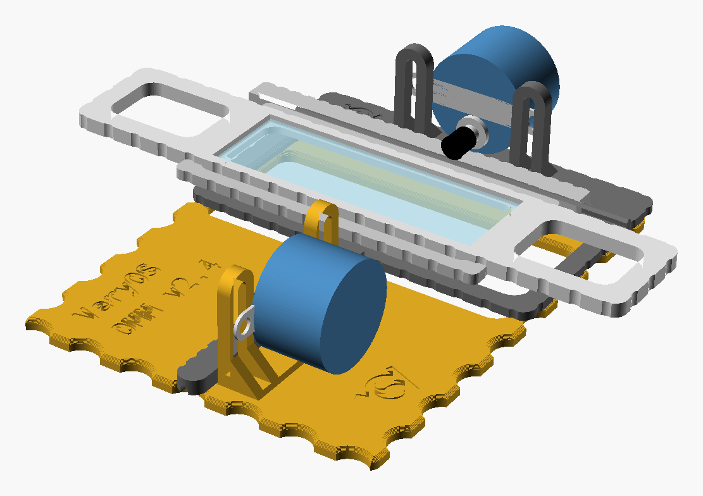
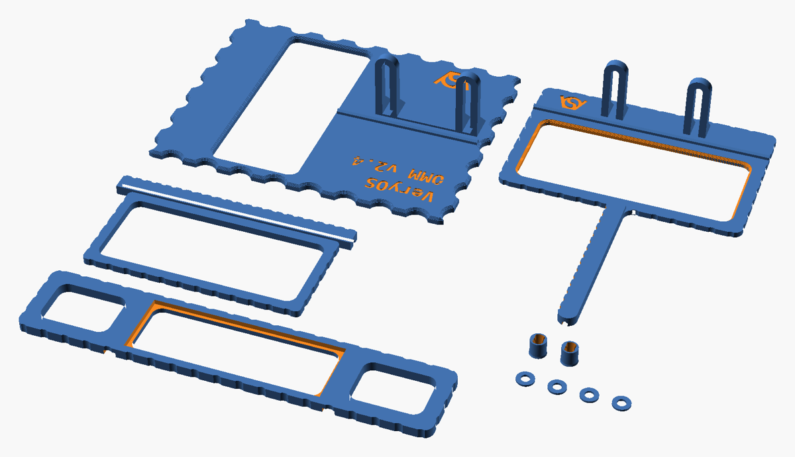

# OMM XY table

Motorised XY stage of the open microscope motorization: moves a standard 76 × 25 × 1 mm glass slide in X and Y with two 28BYJ-48 steppers. `omm_xy_table_v2p4.scad` rebuilds the Onshape document OMM_v2 (engraved label v2.3) in OpenSCAD, with the same parts and the same Onshape variable names and values. v2.4 is not printed yet.

| File | What |
|---|---|
| `omm_xy_table_v2p4.scad` | the generator, standalone, no libraries. `part` picks the assembly, the print layout or one part. `version` is engraved in the table; bump it with the file name |
| `omm_xy_table_v2p4_<part>.stl` | every printed part, exported from the generator in print orientation with the brand font |
| `OMM_v2_rebuild_kit.zip` | Onshape export, source of every dimension: feature trees, sketches, variables, STEP, STL, DXF, renders and the kit's own README |
| `omm_params.scad` | the Onshape Variable Studio, 1:1 from the kit |
| `Onshape_online_CAD_version/` | Onshape print files OMM_v2p2.3mf and OMM_v2p3.3mf |

## v2.4 against Onshape's v2.3

| What | Onshape v2.3 | v2.4 |
|---|---|---|
| table's Y rail | missing: the feature that trims it (Extrude 4) fails in Onshape; `OMM_v2p3.3mf` still has it | male rail from the front edge to the window, as in `OMM_v2p3.3mf` |
| windows | 88 × 37.7 in the current model, smaller in `OMM_v2p3.3mf` | 88 × 37.7, from the variables |
| fillets | curvature continuous, 5 from the corner | R4 arcs |
| edge scallops | phase set by Onshape's curve patterns | same diameter, depth and pitch, evenly spaced from each edge's centre |
| label | Onshape font | DejaVu Sans Mono Bold, same size and place, 0.4 deep |
| VeryOS logo | none | table (16 wide) and Y slider (12 wide); no room on the X slider, slide holder, adapter and washer |
| 0.2–0.6 edge chamfers on the rails, 0.05 deep rings on the adapter | yes | left out |

Volumes against Onshape: Y slider −0.3 %, X slider +0.1 %, slide holder +0.7 %, adapter and washer equal, table +0.2 % with its rail.

## How it works

All parts share one optical axis. Each carriage slides on the part below on a printed rail: a 2 × 2 male rail with 45° chamfers up to a top flat one extrusion width wide, in a slot 0.1 wider per side and 0.1 higher.

| Part | Moves | Rides on |
|---|---|---|
| table | – | the bench; carries the Y motor's bracket |
| Y slider | Y | the table's rail, with its arm: a 7.5 × 4 female rail, 70 long; carries a male rail along X and the X motor's bracket |
| X slider | X | the Y slider's rail, with its 100 long female rail |
| slide holder | with the X slider | the ring's two short walls, in its 4.8 wide grooves; lifts off to change the slide |

Drive, as read from the geometry (the Onshape document does not describe it): a 28BYJ-48 hangs on each bracket with two M3 screws through the slotted uprights, 35 apart like the motor's ears. Its shaft is horizontal, 8 below the motor's axis. The shaft adapter rolls on the top of the moving female rail and drives it by friction; the slots set the motor's height and with it the pressure. `part = "assembly"` shows both motors in place, the motor's axis 15.15 above the sliding face.

Travel in the model: Y from −10, where the Y slider's frame meets the table's bracket, to about +33, where the arm's end passes the adapter. X about ±45 before the rail's end passes the adapter.

## Print

| Part | Count | Orientation |
|---|---|---|
| table | 1 | as is, plate down |
| Y slider | 1 | as is, plate down: the arm's slot is open to the bed and bridged by 0.3 under the frame's front strip |
| X slider | 1 | as is, slot open to the bed |
| slide holder | 1 | as is, grooves open to the bed |
| motor shaft adapter | 2 | closed end down |
| washer | 4 | flat |

`part = "print_layout"` puts all parts on a 256 × 256 bed (Bambu A1, as `OMM_v2p3.3mf`). 0.2 mm layers, no supports. The table's 1 mm top chamfer is built in 0.2 steps, one per layer.

Not printed: 2 × 28BYJ-48 with their ULN2003 drivers (in the enclosure, `../enclosure/`), 4 × M3 screw and nut through the motor's ears and the slots, length not given by Onshape, a 76 × 25 × 1 glass slide.

## Check before printing

None of these fits is in `lessons_learned.md` yet; they are Onshape's values, untested in v2.4.

| What | Set to | Note |
|---|---|---|
| `tol_rail` | 0.2 | slot 2.2 on the 2.0 rail; for the first `rail_mouth_h` = 0.2 the mouth is only 2.02 wide (`workaround_no_space`), as in the Onshape sketch, and it prints on the bed |
| `tol_slideh_x_slider` | 0.8 | slide holder's grooves 4.8 on the ring's 4 wall |
| `tol_slide_holder` | 1 | recess 77 × 26 for the 76 × 25 slide, on a 1.2 ledge |
| `mshaft_tol`, `rib_protrude` | 0.1, 0.4 | adapter's bore 5.2 on the Ø5 shaft, flats 4.0 apart with crush ribs 3.2 apart on its 3.0 flats |
| `bracket_gap` | 0.45 | between the moving female rail and the uprights |
| `upright_slot` | 3.4 | for the M3 screws |

## Customize

Every Onshape variable is a Customizer parameter with its Onshape name, grouped by part. The slide's size sets the slide holder; `scl_y_slide` also sets the X slider's ring and the distance of the rails from the axis, as in Onshape. `thickness_y_slider_frame` and `thickness_table_frame` set the windows, the `[Rails]` group both rails and their clearance, `[Motor bracket]` the uprights. `table_motor_y` and `x_rail_end` are measured positions, not derived: check them after changing sizes.
