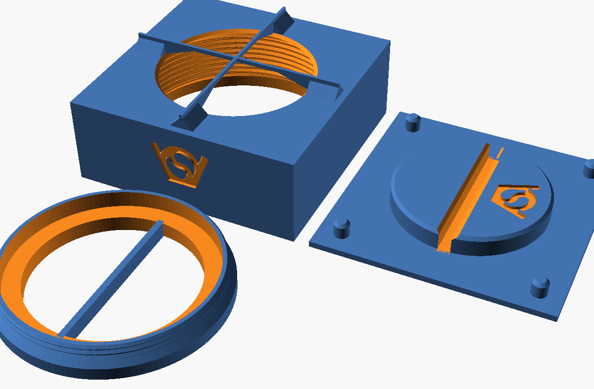
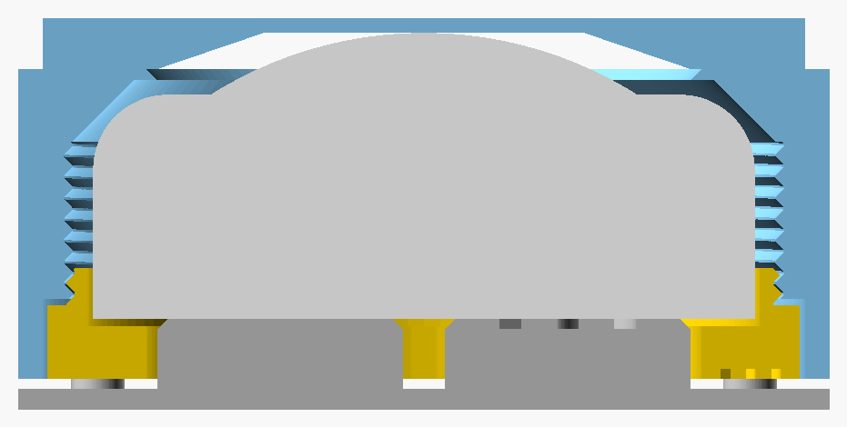

this openSCAD project can generate an enclosure for a RGBW puck light

the rgbw puck light is a round cylinder with a rounded dome on top that can be pressed/clicked to change the light . 

the enclosure should have parts: 
    - toppart
        - is the restriction for the rgb light 
        - has an internal thread on the bottom
    - bottom screw
        - screws in to lock the puck light inside the enclosure
            - the pucklight will still be able to move a tiny bit inside the enclosure. 
        - has an opening on the bottom so that the puck light can be pressed against the toppart to create the click
    - clickbase
        - the enclosure can be put on this base so that the enclosure can be pressed down onto the base 
        - the base has a area that presses onto the puck light

# OpenSCAD

`RGBW_pucklight_holderV2.scad` generates the three parts of the Onshape model
in `onshape_model`, parametric. The puck's size comes from the
manufacturer's CAD model in `rgbw_light_specs`: 62 mm wide, 26.8 mm high
(the spec sheet says 62.2 x 27.6). The Onshape model was built around the
CAD model too.

`RGBW_pucklight_holderV1.scad` is the first version. Like the Onshape model,
it has a flat step from the screw's recess to the thread, which overhangs
2.8 mm in the top part; V2 makes it 45 degrees (see below).

How it clicks:
- the puck lies loose on the floor of the bottom screw. Its dome pokes up
  through the top part's 50 mm window (`window_d`), 0.7 mm (`puck_play`)
  under a cross of 1 mm ribs. The puck can only move that far.
- the holder sits on the click base, guided by four pins in its corners.
  The base's disc reaches up through the bottom screw's opening, 1.6 mm
  (`press_height`) above the floor, and lifts the puck until the dome
  touches the ribs. So the holder floats on the dome.
- pressing the holder down onto the base pushes the dome 0.7 mm against the
  ribs: click, the light changes. The puck's bottom is 0.2 mm hollow where
  the disc pushes, so 1.6 - 0.7 - 0.2 = 0.7 mm, the same as in the Onshape
  model.

The bottom screw has a bar across its opening to turn it with, and the disc
has a slot for the bar. Both threads start at the bottom face, so the bar
lies along the slot, parallel to two sides of the body, when the screw is
flush with the bottom. It can turn 0.6 mm (`seat_gap`) deeper before its
flange stops, to line up the bar. That is less than `puck_play`, so the puck
stays loose.

## parts

- `toppart`: 76 mm square body (`wall` 2.25 mm beside the screw), the
  internal thread, the window and the ribs. The ribs' underside is flat over
  30 mm (`rib_contact_d`), where the dome touches, and slopes down to the
  window's edge. Beside the window they stand on 45 degree feet.
- `bottom_screw`: a ring, 10.4 mm high (`screw_height`), with a 3.5 mm thread
  (`screw_thread_length`) over a wider flange. The flange narrows to the
  thread in a 45 degree cone, and so does its recess in the top part, so the
  top part has no overhang there. Its floor is 5 mm high (`lip_height`), and
  so is the bar.
- `clickbase`: 2 mm plate (`base_thickness`) with 5 mm pins and the 50 mm
  disc (`press_d`).

The threads have a 2 mm pitch and 45 degree flanks, as in
`fdm_optimized_screws`, with 0.25 mm radial clearance (`thread_clearance`,
0.5 mm on the diameter, as `tol_screwin` in Onshape). The disc and the bar
have 1 mm all round (`slide_clearance`), the pins 0.3 mm (`pin_clearance`).

`part` shows all parts on the bed, the assembly, the assembly cut in half,
or one part.

## differences from the Onshape model

- the cavity's shoulder above the thread is a 45 degree cone instead of the
  rounded fillet, so it prints without support.
- the step from the screw's recess to the thread is a 45 degree cone, in the
  top part and on the screw's flange, instead of flat, which overhung 2.8 mm
  in the top part. The flange is 4 mm high instead of 6.9, so the thread
  still engages over 3.5 mm.
- the bar is flush with the floor (0.2 mm higher in Onshape).
- the threads are 0.8 mm deep (0.94 in Onshape).
- the pins sit in the middle between the sides and the recess for the screw,
  30.5 mm from the centre (31.9 in Onshape).
- the logo.

## logo

The VeryOS logo is engraved 1 mm deep (`logo_depth`) in every part:
- top part: 20 mm wide (`toppart_logo_width`) in its front.
- bottom screw: 8 mm wide (`screw_logo_width`) in the bottom of its flange,
  beside the bar. It prints on the bed; its strokes are 0.9 mm wide.
- click base: 18 mm wide (`base_logo_width`) in the top of the disc.

## printing

Print every part standing as it is used, bottom on the bed, without
support. The ribs bridge the window, as in the Onshape model.

## assembly

1. Put the puck into the top part from below, dome first.
2. Screw in the bottom screw with its bar until it is flush with the bottom
   and the bar runs parallel to two sides of the body.
3. Put the holder on the click base, the bar in the slot.
