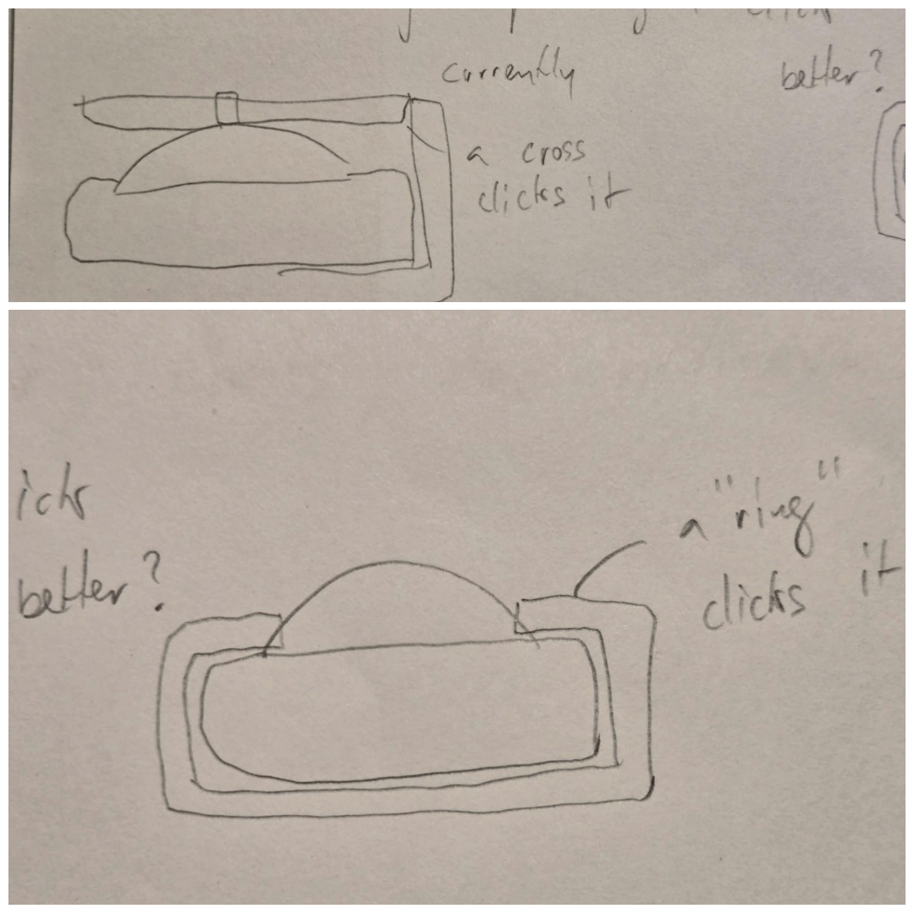
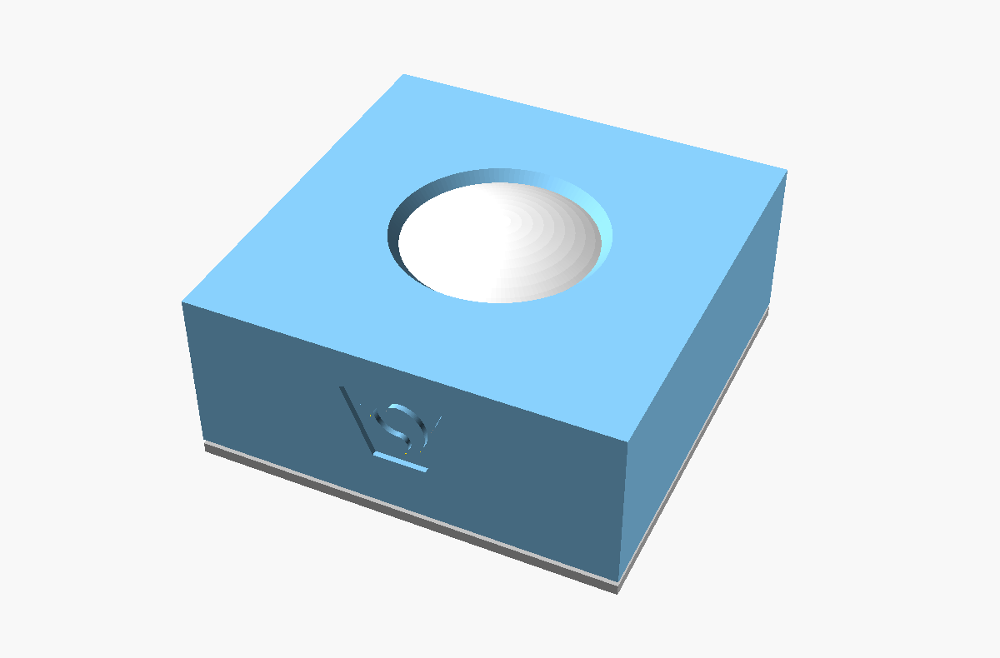
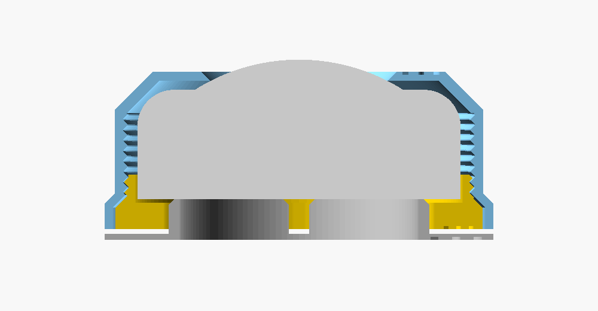
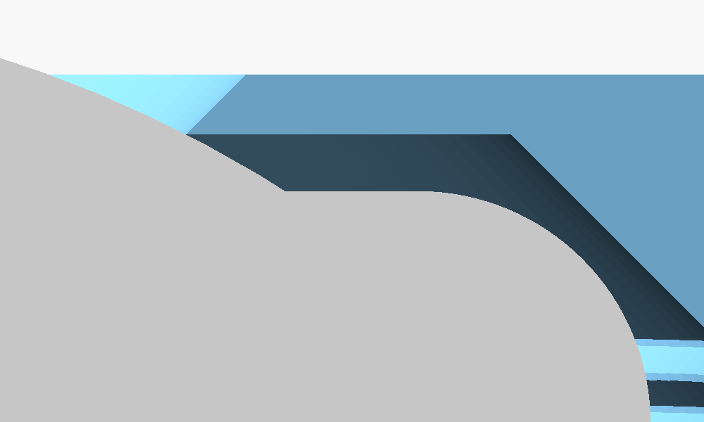
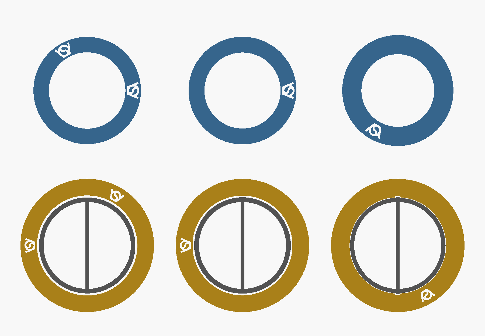
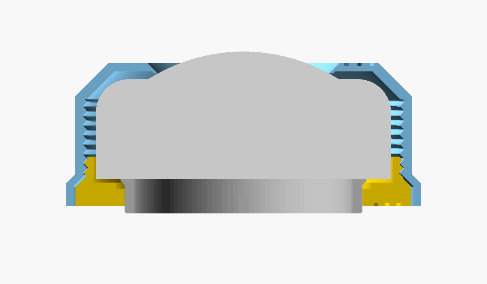
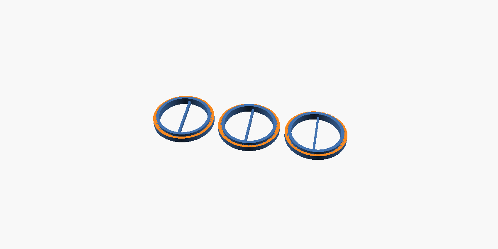

holder for the RGBW puck light (62 mm KC007), as `../RGBW_pucklight_holder`
V4, but a ring presses the lens instead of a cross of ribs, so nothing
crosses the light under a transparent lampshade. The lens clicks wherever it
is pressed, also at its edge (tested by hand, 2026-11-11).

The same holder with a cup on top for lampshades, and a test lampshade: `../pucklight_lamp_v2`.

# OpenSCAD

`RGBW_pucklight_holder_ringclickV4.scad` generates the three parts: top
part, bottom screw, click base. `part` shows all parts on the bed, the
assembly, the assembly cut in half, or one part. `RGBW_pucklight_holder_ringclickV6.scad`
puts the bottom screw and the click base into one part, see V5 and V6 below.
`RGBW_pucklight_holder_ringclickV7.scad` is V6 with a fingerprint, see V7 below.

The window's edge on the lens, cut in half:

## V7 against V6: fingerprint

Proof of where a copy of the file comes from, not copy protection. The outside of the parts is V6's.

| | V6 | V7 |
|---|---|---|
| visible logos | top part's top face, bottom of the screw's flange | the same |
| relief | | the logo once more in the same faces, a third of a turn further, 0.02 deep (`relief_depth`): in the file, not in the print |
| watermark | | the logo as a sealed void inside the solid, two thirds of a turn further, 0.4 high (`watermark_height`), 0.8 above the bed (`watermark_z`): prints as a hidden chamber |
| plunger | | no mark: it is in one file with the screw ring |
| printed | works (2026-11-12) | untested in print; sliced, see below |

Sections of the top part (blue, from above) and of the screwin (gold, from below). Left: 0.01 inside the face on the bed. Middle: 0.1 inside it, where a slicer cuts a 0.2 first layer. Right: through the watermark.

| Sliced with the settings of `v6bambu.3mf`: Bambu Studio 2.9.1, A1, 0.2 layers, 15 % infill | Result |
|---|---|
| V6 twice | plastic in the same place in all 151 layers; the G-code's text differs in 69 of them, so compare places, not text |
| V6 against V6 with the relief only | plastic in the same place in all 151 layers |
| V6 against V7 | 7 layers differ, 0.6 to 1.8 above the bed, all inside; outer walls differ only around the two voids; 32 s and 0.06 g more |

| Done to V7's `.stl`, in Blender 5.2.1 | relief | watermark |
|---|---|---|
| imported and exported again; scaled to 102 % | stays | stays |
| decimated to 50 % of the triangles | damaged: 60 % (screwin) to 94 % (top part) of its area left | stays |
| decimated to 10 % | gone | stays, coarser |
| voxel remesh, 0.2 | traces: 37 to 41 % of its area | gone: the void is filled |
| the parts made again from the `.scad` without the cuts; not tested | gone | gone |

| Check a file | Shows |
|---|---|
| slicer's layer view, 1.0 and 1.2 above the bed | the watermark: a logo shaped hole, 240 degrees from the visible logo |
| section 0.01 inside the face on the bed, or a mesh viewer that shows edges | the relief: a second logo, 120 degrees from the visible one |
| shells of the mesh | one void in the top part, one in the screw ring |

- The `.scad` is published with the model, so the marks are public: they catch copies of the `.stl` and `.3mf`, not of the source.
- GPL allows copies that keep the license and the credit; the marks show the origin where those were dropped.
- With a translucent top part the watermark may glow through when the light is on: 0.4 less plastic there. Untested.
- Other slicers are untested. One that cuts the first layer at its bottom, as Cura's slicing tolerance "exclusive", would print the relief as an engraving one layer deep.
- `part = "slide_test"` cuts the screw ring at Ø58, through its logos: the watermark shows as a slit in the test pieces' rim.

## V6 against V5

| | V5 | V6 |
|---|---|---|
| printed | works: the plunger breaks free, slides and clicks (2026-11-12); unscrewed to change the batteries, the plunger falls out through the top | works (2026-11-12, Bambu Lab A1 per `v6bambu.3mf`): the plunger stays in both ways |
| upward stop | none: only the puck | a second 45 degree lip at the plunger's bottom, 0.6 behind the opening (`lip_overlap`), under a 45 degree chamfer of the opening, `slide_gap` off it |
| plunger's bottom | chamfered 0.4, Ø49.2 on the bed | chamfered 0.4, Ø50.8 on the bed: the bottom lip |
| top part | | V4's, unchanged |

The same cuts as for V5 below: the bottom lip under the opening's chamfer.

| Checked in OpenSCAD, gaps 0.2 / 0.3 / 0.4 | Result |
|---|---|
| as printed; dropped 2.1 | no contact |
| dropped 2.6 | only the top lip on the opening's edge |
| raised 0.2 | no contact; it never goes higher than printed, when the holder's bottom and its own stand on the desk |
| raised 0.5, at gap 0.4 0.8 | only the bottom lip on the chamfer: it cannot leave upwards |

## V5 against V4, experimental

| | V4 | V5 |
|---|---|---|
| parts | top part, bottom screw, click base | top part, screwin: the screw ring with a plunger printed in place inside it |
| stands on | the click base's Ø74.7 plate | the plunger's Ø50 tube; pressed down, the holder's bottom stands on the desk |
| lifts the puck | the base's tube, 7.2 above the plate | the plunger, 7.2 high |
| keeps the plunger | | a 45 degree lip at its top, 0.6 behind the screw's opening (`lip_overlap`); it drops 2.5 (`slide`), then rests on the opening's edge in a counterbore |
| turns the screw | the screw's bar | the plunger's bar, whose ends reach into two slots in the opening |
| gap | 1 around the tube | 0.2 (`slide_gap`), one layer; the bar's ends 0.4 in their slots; a 0.4 chamfer on the plunger's bottom edge |
| solid volume, screw and base | 11.2 + 5.1 cm³ | 13.5 cm³ |
| top part | | V4's, unchanged |

The screwin cut through the plunger's tube (left two) and through the bar's end in its slot (right two), as printed and hanging at its stop. Plunger grey, screw ring gold:

| Checked in OpenSCAD, gaps 0.2 / 0.3 / 0.4 | Result |
|---|---|
| as printed | two separate bodies, no contact |
| dropped 2.1: float 1.5 plus `seat_gap` 0.6 | no contact: the holder rests on the puck, not on the lip |
| dropped 2.45 | no contact |
| dropped 2.6 | only the lip on the opening's edge: it cannot fall out |

`part = "slide_test"` prints the screwin cut to Ø58, once per gap in `slide_test_gaps` (0.2, 0.3, 0.4), side by side; 2, 3 or 4 notches in the ring's top edge tell them apart. 16.2 cm³ for all three. Print it before the screwin, then set `slide_gap` to the smallest gap that passes:

| Slide test | Passes when |
|---|---|
| after printing | the plunger breaks free with a push from above |
| sliding | it moves 2.5 down and back without catching |
| hanging | it does not fall out when shaken |
| turning | the bar turns the ring |

## V4 against V3

| | V3 | V4 |
|---|---|---|
| click base | 8.0 high: plate 1.2, tube 6.8 | 8.4: tube 7.2, `tube_raise` 0.4 |
| printed | the holder floats only a little on the base and barely clicks (2026-11-11) | untested |
| float on the base, model | 1.1 | 1.5 |
| pressed, model: ring's underside above the flat ring around the lens | 0.5 | 0.1: the real puck lifts less than its CAD model, so V3 barely clicked |
| pressed, model: puck off centre | free up to 0.5 | beyond 0.3 the rounded edge reaches the 45 degree shoulder, which centres it, as the window's edge does |
| top part, bottom screw | | V3's, unchanged: reprint only the click base |

## V3 against V2

| | V2 | V3 |
|---|---|---|
| window's edge on the lens (`contact_d`) | 34 | 36, 12 % more window |
| ring's underside | flat at the window's edge | cavity_gap 0.5 above the flat ring around the lens, pressed in; a 0.42 high, 0.87 wide lip inside the lens's rim reaches down to the edge |
| tube (`press_height`) | 1.6, button travel 0.7: did not click reliably | 1.8, travel 0.9 |
| top face | 30.2 | 30.1 |
| top part's logo | 10 wide | 9 wide, the top face is narrower |
| solid volume: top part / base | 16.0 / 5.0 cm³ | 15.8 / 5.1 cm³ |

## V2 against V1

| | V1 | V2 |
|---|---|---|
| top part | 76 mm square block, `wall` 2.25 at the thinnest | round shell, `wall` 1.6 all over, 45 degree cones outside |
| click base | 76 mm square plate, 2 thick, solid 50 mm disc | round plate, 1.2 thick (`base_thickness`), 2 mm tube (`press_wall`), open inside |
| top part's logo | 20 wide, in the front | 10 wide, in the top face |
| base's logo | 18 wide, in the top of the disc | 14 wide, in the bottom |
| `logo_depth` | 1 | 0.6 |
| solid volume: top part / screw / base | 74.7 / 11.2 / 22.9 cm³ | 16.0 / 11.2 / 5.0 cm³ |
| all, solid PLA | 135 g | 40 g, −70 % |

## against RGBW_pucklight_holderV4

| | holder V4 | ringclick V4 |
|---|---|---|
| presses the lens | cross of 1.6 × 1.6 ribs, at the centre | the window's 45 degree edge, all around at 36 (`contact_d`) |
| lens covered, seen from above | two 1.6 strips, 10 % | the outer ring from 36 to 40, 19 % |
| top face | 30.2 | 30.1, `ring_thickness` 1.8 above the flat ring around the lens |
| highest point | rib tops, 34.1 | the lens, 32.5 |
| top part prints | standing; the ribs bridge 30 | upside down; no bridges |
| guiding pins | four | none, as pucklight_sphere V2 |
| body | 76 mm square | round, 74.7 mm across at the bottom |

## how it clicks

| state | what touches |
|---|---|
| puck on the screw's floor | the lens is 0.7 (`puck_play`) under the window's edge |
| on the base, released | the tube lifts the puck until the lens touches the edge; the holder floats 1.5 above the base in the model, 1.3 with the 0.2 hollow in the puck's bottom; V3's base, 0.4 lower, left only a little |
| pressed down | the tube pushes the button by the float; in the model the ring's underside stays 0.1 (`cavity_gap` − `tube_raise`) above the flat ring around the lens |

- the ring must not reach the flat ring around the lens: that is the puck's housing, which does not move, so the click would stop there. Only the lip, inside the lens's rim, reaches below `cavity_gap` above it; the assert on `contact_d` keeps the lip two lines wide.
- the bottom screw flush or deeper: if it sticks out below the top part, the base stands on it and the holder floats that much less.
- the lens's height at 34 comes from the CAD model's 40 × 5.8 spherical cap; the real lens is unmeasured there.
- without pins the holder can turn on the base. That turns the top part against the screw, whose bar sits in the slot: lift the holder off the base to turn it.

## printing

| part | orientation | overhangs |
|---|---|---|
| `toppart` | upside down, top face on the bed (as `print_layout`) | the window's chamfer and the two outer cones, 45 degrees; the lip's outer 45 degree cone faces up; the cavity narrows from the bottom face up to the window's edge, so every other layer sits on the one below |
| `bottom_screw` | standing as used | 45 degree flange cone and thread |
| `clickbase` | standing as used | none |
| `screwin`, V5 and V6 | standing as used, the plunger inside in its pressed position, both on the bed | the lips' 45 degree cones and the opening's bottom chamfer; the counterbore's floor and the ring's floor are flat; nothing bridges |

## tuning

| problem | change |
|---|---|
| no click, or the click is weak | raise `tube_raise`, below `cavity_gap` (0.5), and reprint only the click base; `press_height` also moves the top part's cavity |
| the puck rattles in the holder | lower `puck_play` |
| the lens covers less or more than 40 in the real puck | change `puck_dome_d`: the lip follows the lens's rim |

## assembly

1. Put the puck into the top part from below, lens first.
2. Screw in the bottom screw with its bar until it is flush with the bottom.
3. Put the holder on the click base, the bar in the slot; the base turns freely to meet the bar.

V5 and V6: push the plunger down once to free it; put the puck in; screw the screwin in by the plunger's bar until it is flush, the plunger pushed up so the bar's ends sit in the slots; stand the lamp on the desk.

## logo

The VeryOS logo is engraved 0.6 mm deep (`logo_depth`) in every part: 9 wide in the top face of the top part, 8 wide in the bottom of the screw's flange, 14 wide in the bottom of the click base. From V5 the plunger takes the click base's place and has no room for one. V7 repeats the logo as a fingerprint, see V7 above.
