# RGBW puck light lantern 3

An OpenSCAD generator for a lantern around a 62 mm RGBW puck light, after
the Onshape model in `inspiration/lantern_onshape_export` and the pictures
in `inspiration`. The puck lies in the bottom of the frame, the roof screws
onto the frame's top, and the windows slide into slits in the frame's
pillars.


## V8: the simple lantern

`RGBW_pucklight_lantern3V8_simple.scad`. The first version
(`RGBW_pucklight_lantern3.scad`) without logos: smooth, with plain flat
windows instead of star windows, and the roof with its light slits. There
is no decoration envelope, keepout or hammered texture. There is no V7.

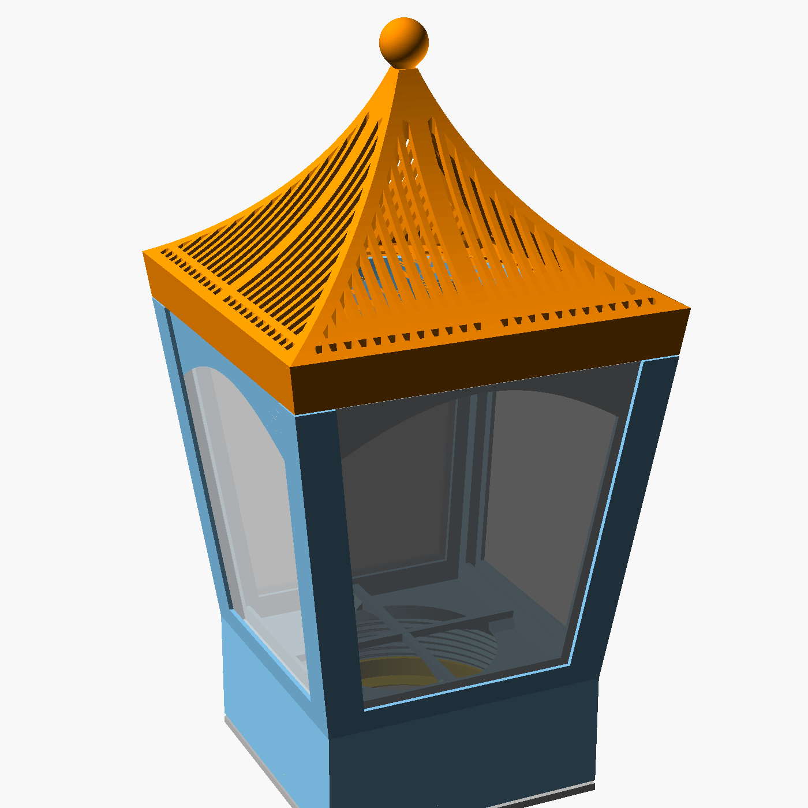

- the windows are plain plates, `window_thickness` (3 mm) thick, printed
  (`part = "window"`) or cut from acrylic, as in the first version.
- no logo in the frame, the roof, the windows, the screwin or the click
  base. The `[Logo]` parameters are gone.
- the loops in `slit_pattern()` and `half_cut()` are in `union()`, as in V2,
  so the roof keeps its slits with lazy-union in the browser playground.
  The first version still lacks this.

## V6: hammered like copper

`RGBW_pucklight_lantern3V6_hammered.scad`. V5 with the outside of the
frame and the roof hammered, as in Kupfertreiben (pictures in
`kupfertreiben_voronoi_texture`): covered with shallow round dents. The
roof has no slits, so it is closed and the dents cover all of it. The
light comes out through the windows only.

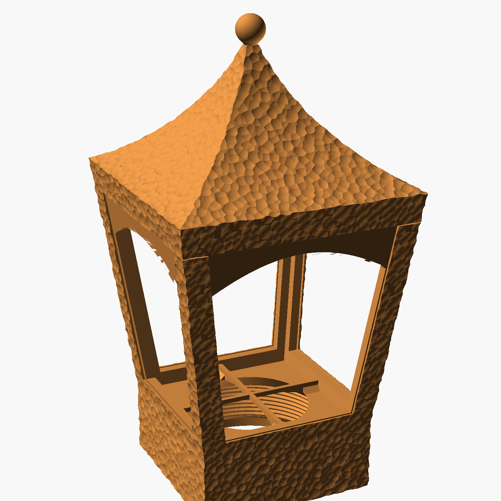

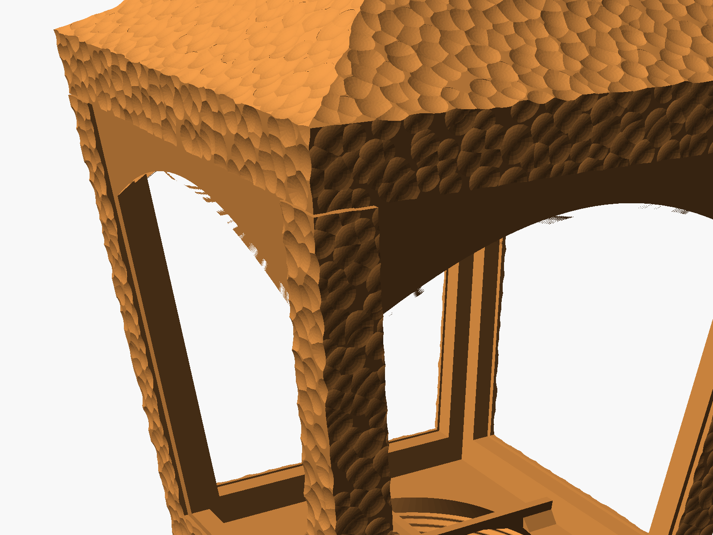

- each dent is cut by a sphere with a random radius from
  `hammer_radius_min` to `hammer_radius_max` (5 to 8 mm), reaching a random
  `hammer_depth_min` to `hammer_depth_max` (0.3 to 0.6 mm) into the
  surface. Its centre lies its radius minus that depth outside. The dents
  are 3.4 to 6 mm across; larger spheres make flatter dents.
- they lie in rows `hammer_spacing` (3.5 mm) apart along the outline, every
  other row shifted by half, and each dent lies at random in its place
  (`hammer_seed`). They overlap, so no flat surface is left between them.
  The ridges where two dents meet form a net of cells, as in a Voronoi
  diagram: for two spheres of the same size and depth the ridge lies
  halfway between their centres.
- they are on the holder's sides, the pillars, the rail, the roof's band
  and its curve up to the ball: about 1900 on the frame and 1800 on the
  roof. The ball stays smooth. None are cut where they would only cut the
  air in the window openings.
- only the outside changes. `hammer_depth_max` may be at most half of the
  1.2 mm lip in front of the slits and of the roof's 2 mm wall, so the
  slits, the windows, the thread and the light's way are as in V5. The
  dents overhang at most 36 degrees on the leaning sides, so they print
  without support.
- without the roof's slits the keepout has no columns above them either.

Each dent is a subtraction. The browser playground and current OpenSCAD
render them quickly with the Manifold backend. OpenSCAD 2021.01's CGAL is
slow with them: the frame and the roof take about 21 minutes each, and
each came out as one solid. The frame's body is rendered first
(`render()`), so the preview works with this many dents; the images above
are previews.

The roof's thread bore is cut 0.01 mm higher than before, past the top of
the ring around it. Where both ended at the same height, CGAL left a sheet
of no thickness there, and without the slits that sheet closed the roof's
inside off as a void.

## V5: a keepout to subtract instead of an envelope

`RGBW_pucklight_lantern3V5_decoration_keepout.scad`. V4 with the decoration
cut by a boolean difference instead of an intersection: `part = "keepout"`
is the space in and around the assembled lantern that a decoration must
leave free. A decoration of the whole lantern is sculpted once, as large as
you like, and what is in the way is subtracted:

1. export `part = "lantern"`, the frame, the roof and the windows as they
   are assembled, and `part = "keepout"`, to see what to leave free. Both
   are in the same place, as in V4: the frame's bottom on z = 0, the roof
   lined up `roof_seat_gap` (0.4 mm) above the frame.
2. sculpt the decoration around the lantern, inside and out. Let it reach
   into the parts, so it fuses with them; how far does not matter.
3. subtract the keepout and union the rest with the parts, in OpenSCAD:

```
include <RGBW_pucklight_lantern3V5_decoration_keepout.scad>
part = "none";
decorated_frame() import("decoration.stl");
```

and `decorated_roof() import("decoration.stl");` for the roof. Each
subtracts the keepout from the decoration, keeps what is below the gap (the
frame) or above it (the roof), unions it with the part and puts it where the
part is printed.

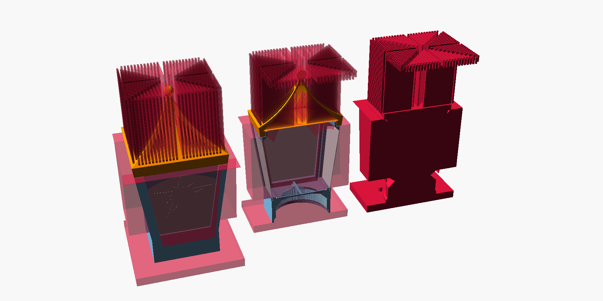

The keepout:

- the light's way, as in V4: every straight line from the holder's round
  window to the window openings between the pillars and to the neck's bore;
  in front of the openings, straight out; in the roof, the columns straight
  up from the slits, inside and out.
- the windows' slits, from the rail's floor up through the frame's top. The
  windows lie in them, their stars in the openings, and they slide in
  through both.
- the holder's cavity for the puck and the screwin, with its thread, and
  the click base's pin holes.
- the bed: everything below the frame's bottom.
- the gap between the frame and the roof, in which the roof turns, and the
  roof's thread: a cylinder around the neck, 45.1 mm in radius, up to the
  top of the thread.

It reaches 500 mm out (`far`), so a decoration may be as large as you like;
`part = "keepout"` shows it 10 mm out (`view_margin`). The parts' material
is not in it: where a decoration reaches into a part, it fuses with it.
That is why V5 needs neither `envelope_thickness` nor `envelope_overlap`.
Apart from V4's limit of 10 mm outside the parts, the same space is free as
in V4. V4's envelope was a box minus the keepout and minus the parts.

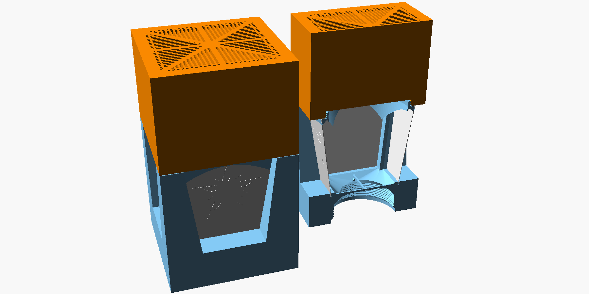

Checked with a decoration that fills a block around the whole lantern
(above), so the frame and the roof take all the space the keepout leaves:

- the windows, in place and slid halfway in, touch the filled frame only
  where they touch the frame itself.
- the screwin, the puck and the click base, pressed down, do not reach into
  the filled frame.
- the filled roof, lined up or turned on to its stop, does not touch the
  filled frame.
- in the light's way the filled frame has only what the frame has there,
  the holder's ribs. The roof's slit columns are empty.
- each filled part is one solid.

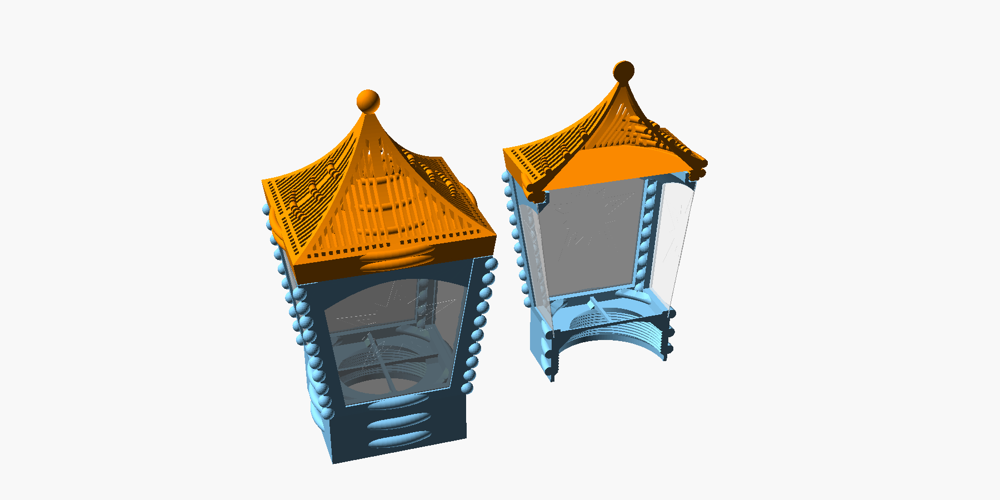

With V4's test decoration, the frame and the roof each came out as one
solid again. In OpenSCAD 2021.01 the keepout renders in 10 s, the filled
parts in a minute each, and the decorated frame and roof in about 5 and 8
minutes, with other renders running alongside.

## V4: one envelope for the whole lantern

`RGBW_pucklight_lantern3V4_lantern_envelope.scad`. V3 with one decoration
envelope for the assembled lantern, inside and out, instead of one outside
each part: `part = "envelope"`, and with windows whose star stands out more
(see below). A decoration of the whole lantern is sculpted once and cut to
what fits:

1. export `part = "lantern"`, the frame, the roof and the windows as they
   are assembled, and `part = "envelope"`. Both are in the same place: the
   frame's bottom on z = 0, the roof lined up `roof_seat_gap` (0.4 mm) above
   the frame, without the click base.
2. sculpt the decoration around the lantern, inside and out.
3. cut it to the envelope and union it with the parts, in OpenSCAD:

```
include <RGBW_pucklight_lantern3V4_lantern_envelope.scad>
part = "none";
decorated_frame() import("decoration.stl");
```

and `decorated_roof() import("decoration.stl");` for the roof. Each takes
the decoration's piece in its part of the envelope, unions it with the part
and puts it where the part is printed.

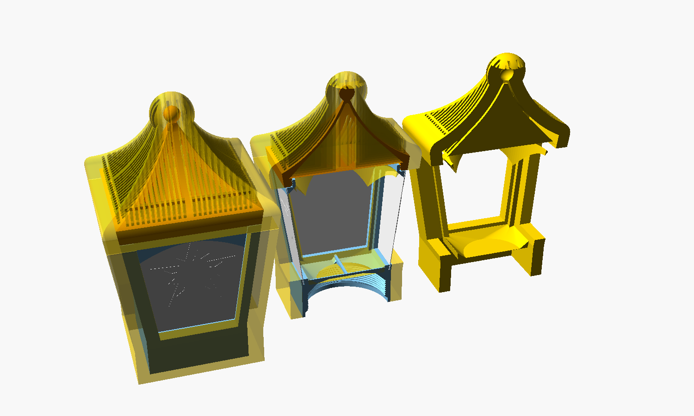

- outside it is as in V3: `envelope_thickness` (10 mm) out from the frame's
  and the roof's sides, from the frame's bottom up.
- inside it also takes the pillars' inner faces and the corners behind
  them, the holder's top in its corners, the band's underside in the
  corners and the roof's inside between the slits.
- it reaches `envelope_overlap` (0.2 mm) into the parts' faces, inside and
  out, so a decoration fuses with them. It is for adding a decoration, not
  for cutting one in: the parts' material is not in it.
- free, so the lantern still works:
  - the light's way: every straight line from the holder's round window
    (50 mm) to the window openings between the pillars above the rail, and
    to the neck's 82.4 mm bore, which lets the light into the roof; in front
    of the openings, straight out, as in V3; in the roof, the columns
    straight up from the slits, inside and out.
  - the windows and their slits. A window and its star slide in through the
    slits and the opening.
  - the holder, with the puck, the screwin and the click base's pins; the
    envelope starts at the frame's bottom.
  - the roof's thread: a cylinder around the neck, 45.1 mm in radius, up to
    the top of the thread.
  - the gap between the frame and the roof: below it the envelope is the
    frame's, above it the roof's, so a decoration falls apart into a piece
    for each there, and the roof still turns. At the roof's stop the two only
    meet in the plane between them.
- checked: the envelope does not touch the windows, the slits, the light's
  way, the roof's thread or the frame's neck, and with the roof at its stop
  the roof's part does not touch the frame, nor the frame's part the roof.
- it is in five pieces: outside the frame, inside it low in the corners,
  inside it under the band's corners, outside the roof and inside it.
- the holder's ribs, where they stand out of the light's way, are in the
  envelope; a union does not change them.

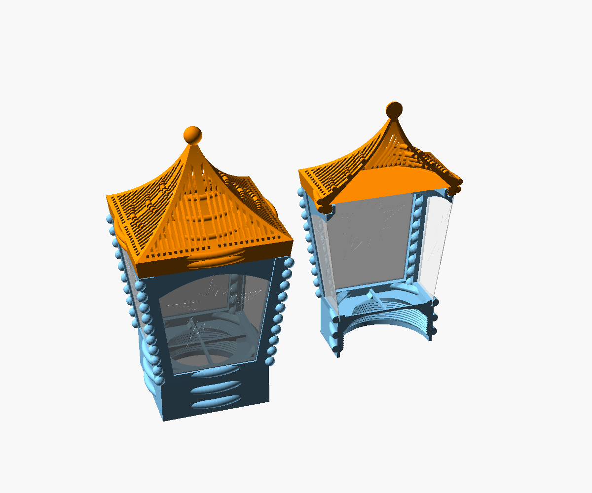

A test decoration: beads along the pillars' outer and inner corners, rings
around the holder, the roof's band and its curve. Inside, the beads stop
where the light's way begins. The rings on the curve are round, the roof is
square, so they pass through the roof's inside at the hips. The frame and the
roof with it each came out as one solid.

In OpenSCAD 2021.01 the envelope renders in 45 s, the decorated frame and
roof with this decoration in 5 and 6 minutes.

### V4: stars with more contrast

A printed V2 window's star stood out too little
(`problem_star_recognizability`): it stood a random 1 to 7 layers on a 0.4
mm plate, and its lines were cut one layer apart, so neighbouring areas
differed by 0.2 mm. In V4:

- the plate is 0.2 mm (`window_thickness`), one layer. The slits follow at
  0.8 mm.
- the window has only a few thicknesses, `level_step` (0.6 mm) apart: the
  plate (0.2 mm), the level half the lines are cut down to (0.8 mm), and the
  star's top, `star_levels` (2) levels above the plate (1.4 mm). The other
  half of the lines and the holes near the points go through to the plate.
  The star is always as high as that.
- the lines are thinner: 0.42 to 1.2 mm (`line_width_max`) instead of 0.42
  to 3 mm.
- a seed still gives the same points and lines as before.

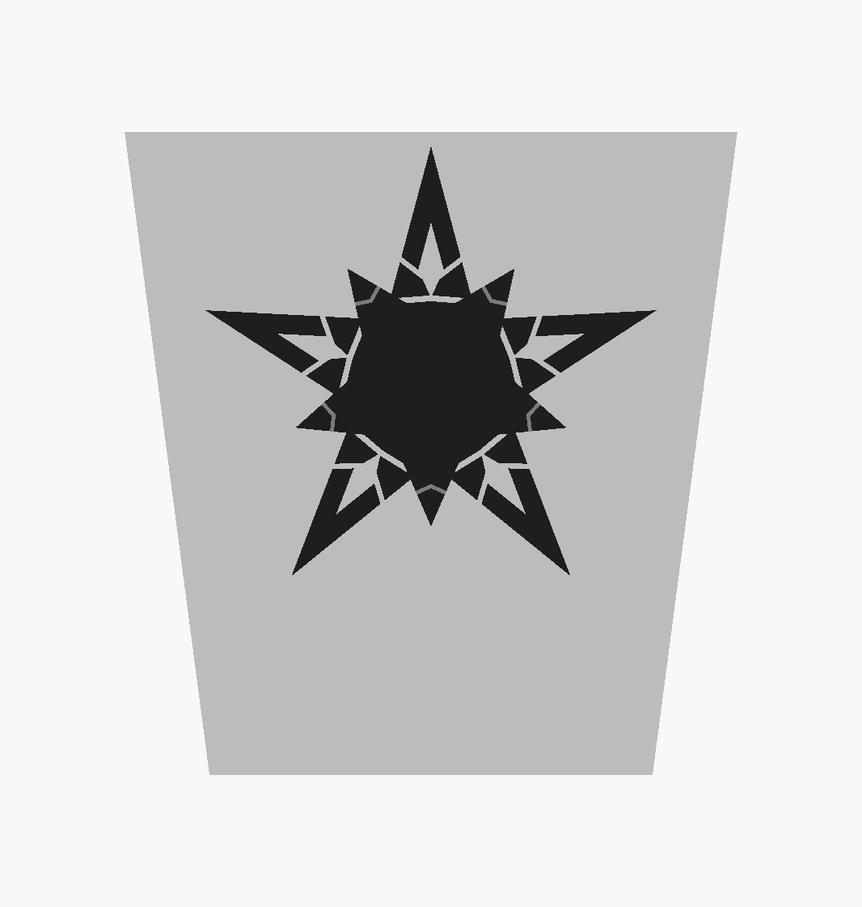

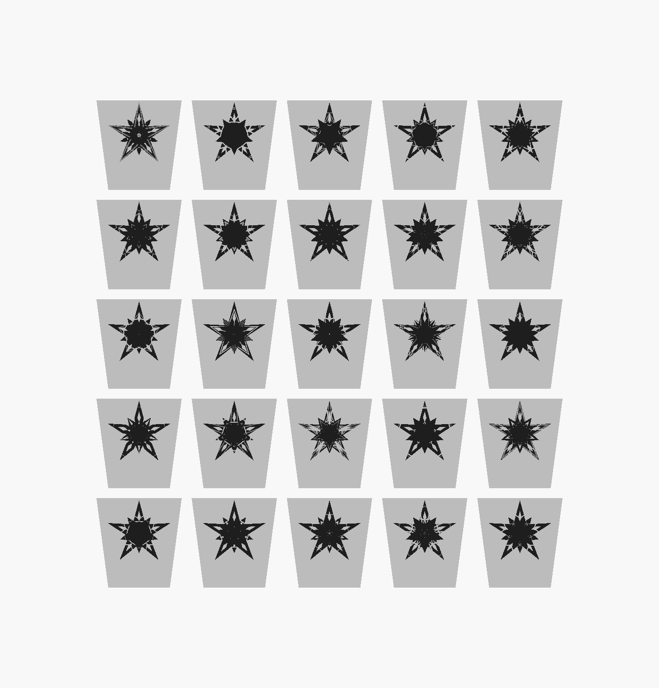

Thickness maps as for V2: the plate (0.2 mm) light, the lines' level (0.8
mm) grey, the star's top (1.4 mm) dark. Not printed yet: a one-layer plate
is fragile, bends more than the 0.4 mm one and may sit loosely in its
slits. If it does, raise `window_thickness`, and the slits follow.

## V3: decoration envelopes

`RGBW_pucklight_lantern3V3_decoration_envelope.scad`. V2 with two more
views for decorating the lantern: `frame_envelope` and `roof_envelope`, the
space outside the frame and the roof that a decoration may fill. With them,
a decoration is sculpted freely, then cut to what fits:

1. export a part (`part = "frame"` or `"roof"`) and its envelope
   (`"frame_envelope"` or `"roof_envelope"`). Both are in the position the
   part is printed in, so they line up.
2. sculpt the decoration around the part.
3. intersect the decoration with the envelope.
4. union the result with the part.

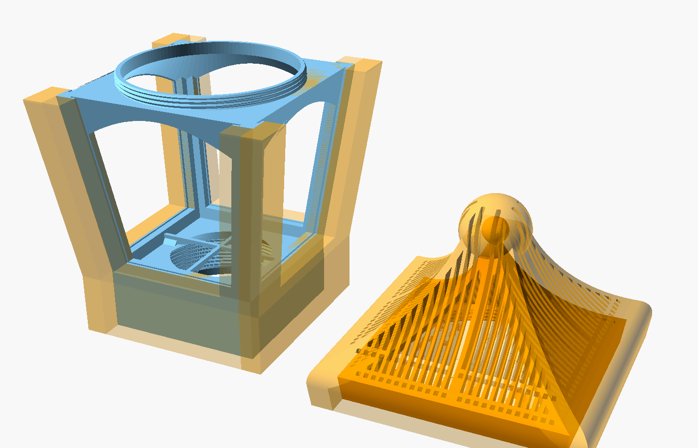

- each envelope reaches `envelope_thickness` (10 mm) out from the part's
  sides, measured square to each side, with sharp corners, and
  `envelope_overlap` (0.2 mm) into them, so the decoration fuses with the
  part instead of only touching it.
- the frame's envelope runs from the frame's bottom, which stands on the
  bed and the click base, to its top, above which the roof turns as it is
  screwed on. The window openings between the pillars above the rail are
  free, so the windows and their stars stay clear.
- the roof's envelope runs from the roof's bottom up, round around the ball.
  The columns above the slits and the squares at the eaves are free, so the
  light still comes out.
- checked: neither envelope touches the windows, the window slits, the
  threads or the other part; with the roof screwed down to its stop, the
  two envelopes only meet in the plane between them.

In OpenSCAD, steps 3 and 4 for the frame are:

```
include <RGBW_pucklight_lantern3V3_decoration_envelope.scad>
part = "none";
union() {
    frame();
    intersection() { import("frame_decoration.stl"); frame_envelope(); }
}
```

`part = "none"` keeps the included file from drawing its own view.
`include` instead of `use` keeps the file's `$fn`, which the threads need.

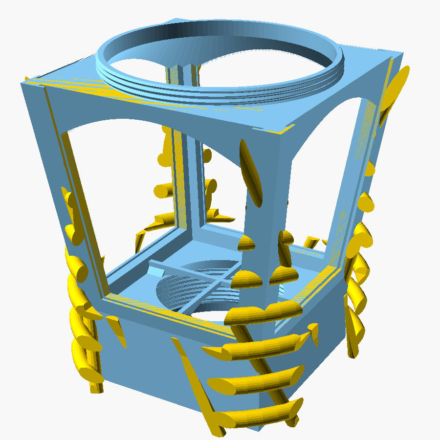

A test decoration, rings and diagonal bars, cut by the frame's envelope and
unioned with the frame. A piece of a decoration that lies in the envelope
without touching the part comes out loose, like the short bars in front of
the rail here: the rest of each bar is in front of a window opening. Leave
such pieces out of the sculpt, or delete them in the slicer.

V3 has no logos: none in the frame, the roof, the windows, the screwin or
the click base. Without the window's logo the star fills the window above
the rail and is 66 mm across instead of 63.

## V2: star windows

`RGBW_pucklight_lantern3V2_decorative_window.scad`. The lantern of V1 with
thin windows, each with a star on its outside as in
`../published_christmas_star`. Printed in a translucent filament, the light
shines through the plate brightly and through the star in shades. The frame
and the slits are as below, only thinner.

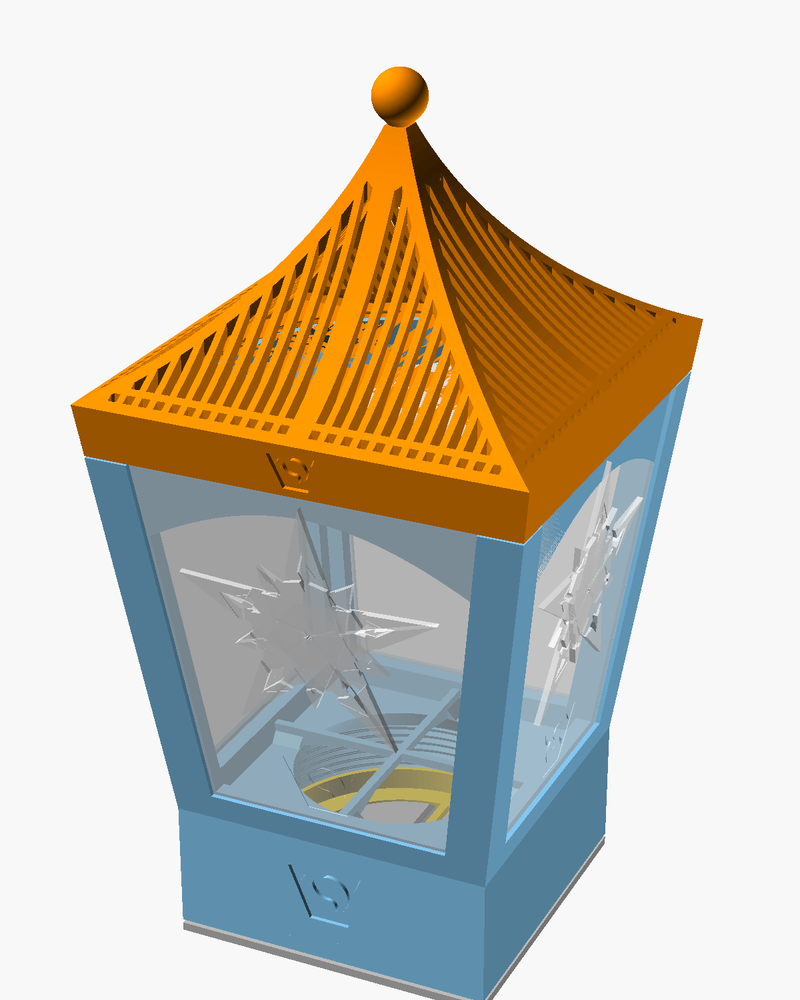

- the plate is `window_thickness` (0.4 mm) thick, with the logo engraved
  half through it. The slits follow it: 1.0 mm wide, `slot_clearance` (0.3
  mm) on each side. The star stays `decoration_border` (2 mm) inside the
  part of the window you see between the pillars, so it never goes into a
  slit; slide the window in with the star outside.
- the star is the Christmas star's: `star_points` (5) points, each a sector
  moved `star_sector_shift` (0.375) of its length past the middle, so the
  sectors overlap in a smaller star there, with a hole near each point.
  `star_inner_factor` and `star_angle_bias` shape the valleys and the
  points as in `star.scad`; `random_points` picks 3 to 8 points at random.
- it is as large as fits above the logo, 63 mm across, and stands a random
  number of layers on the plate, between `star_height_min` (0.2 mm) and
  `star_height_max` (1.4 mm). So the window is 0.6 to 1.8 mm thick at the
  star. Set `layer_step` (0.2 mm) to the layer height you print with.
- `lines_per_sector` (6) random lines go through each half sector, at
  random angles and widths between `line_width_min` (0.42 mm) and
  `line_width_max` (3 mm). Line j is cut down to 1 + j × (layers - 1) / 6
  layers, rounded down: 1 to 6 layers in a 7 layer star, as in `star.scad`.
  A star one layer high has no lines. Every half sector has the same lines,
  so the star is symmetric.
- `decoration_seed` picks the star. `part = "window"` makes one window
  with it; change the seed between exports for four different windows. The
  assembly and the print layout show four windows with the same star.
- `part = "random_windows"` makes 25 windows, lying flat in a 5 x 5 grid,
  each with its own star: the bottom left one with `decoration_seed`, the
  others with seeds 1000 apart. Export them as one file and split it into
  objects in the slicer to pick the ones you print. The grid is 467 x 488
  mm.

The pictures below are thickness maps seen from above: the darker, the
thicker, from the logo (0.2 mm) and the plate (0.4 mm) to 1.8 mm.

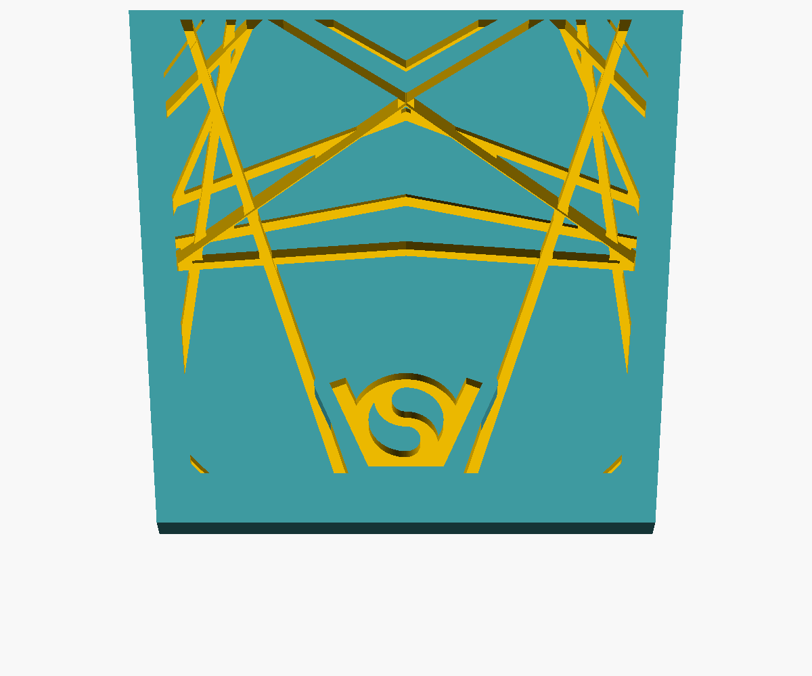

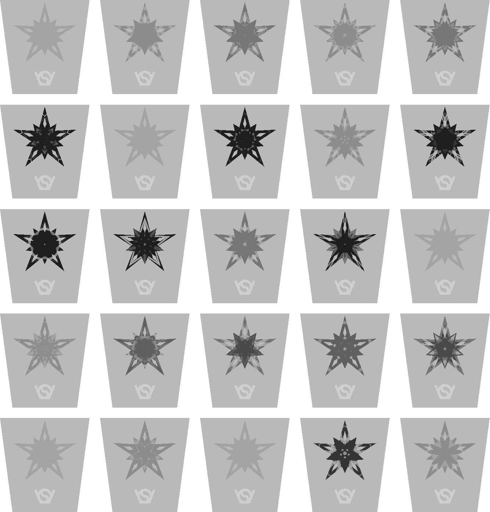

Print the window flat, the star and the logo up. Each level is flat, so it
needs no support. Not printed yet: the 0.4 mm plate is thin and bends
easily, so the window may sit loosely in its 1.0 mm slits.

## parts

- `frame`: the holder's top part at the bottom, then four corner pillars
  that lean out from 76 mm to 100 mm (`top_width`) over 90 mm
  (`frame_height`), with a rail between them on the holder. At the top, a
  band carries the neck the roof screws onto. Each pillar has a slit on
  both sides for the windows.
- `roof`: a 12 mm band that continues the frame's sides, then curved sides
  up to a ball, as a 2 mm shell. It has the female thread inside the band.
- `screwin`: the holder's bottom screw. It holds the puck in the frame.
- `clickbase`: the holder's click base.
- `window` (4x): a flat 3 mm plate, 61.7 mm wide at the bottom, 85.3 mm at
  the top and 89.5 mm long. Print it in a translucent filament, or cut it
  from 3 mm acrylic.

`part` shows the assembly on the click base, the assembly cut in half, all
parts, or one part. The lantern is 200 mm high on the click base.


## the holder

The puck's mount is the holder project's. Its parameters, `toppart()`,
`bottom_screw()`, `clickbase()`, `puck()`, `threaded_rod()` and the logo
are copied unchanged from
`../RGBW_pucklight_holder/RGBW_pucklight_holderV3.scad`, so the generator
needs no other file and runs in a browser OpenSCAD playground too. The
holder's parameters are in the Customizer under Puck light, Holder top
part, Screwin and Click base, and the frame follows the top part's size.
If the holder project changes, copy the change over by hand.

In V3 the cavity's 45 degree shoulder runs up to the window's edge, instead
of ending on a flat ceiling that overhung 2.1 mm over the puck. So the top
part, where the frame starts, is 30.2 mm high instead of 29.1, and the
lantern is 1.1 mm higher.

It clicks as in the holder (see its readme): the lantern stands on the
click base and floats on the puck's dome; pressing the lantern down clicks
the light.

## windows and slits

The slits are 3.6 mm wide (`window_thickness` plus 0.3 mm `slot_clearance`
on each side), behind a 1.2 mm lip (`slot_lip`), and reach 3 mm
(`window_overlap`) into each pillar. The pillars are 10 mm wide
(`pillar_width`) to hold two slits. They run from 1 mm above the holder up
through the frame's top. A window slides in from above and stands on the
slits' floor in the rail; its top ends 0.3 mm under the frame's top, and
the roof covers the slits.

Between the pillars, at the top, there is no lip: the window lies in front
of the band. For thinner windows, such as film or paper, set
`window_thickness` to their thickness and the slits follow.

## the frame's top

The band is the frame's top behind the slits. Its underside is a 45
degree funnel that narrows to the neck's 82.4 mm bore, so it prints
without support. Behind each window the funnel shows as an arch, 4 mm deep
in the middle and about 19 mm at the pillars. In the corners it becomes 45
degree gussets.

The neck has the roof's thread outside: 88 mm (`neck_d`), 6 mm high, 2 mm
pitch and 45 degree flanks (the holder's `threaded_rod()`), with a
chamfered top. Its bore lets the light into the roof.

## the roof

- band: 12 mm (`roof_band_height`), leaning like the frame's sides; the
  eaves are 103.2 mm wide.
- curved sides: an arc of radius 100 mm (`roof_curve_r`) from the eave to
  the axis 60 mm (`roof_rise`) higher, 26 degrees steep at the eaves and
  steeper towards the top. It ends 5 mm wide under a 12 mm ball, which
  stands on a 45 degree cone.
- thread: female, with 0.3 mm radial clearance (`roof_thread_clearance`)
  and a 45 degree lead-in, up to 7 mm, in a ring that meets the band's
  walls in the middle of each face.
- shell: around it the roof is a shell, 2 mm (`roof_wall`) thick square to
  its surface, on a 2 mm floor; in the band's corners it is hollow down to
  the floor. The lower 18 mm of the curve, above the eaves, is flatter than
  45 degrees. There the inside stays a 45 degree plane, so it prints
  without support, and the shell gets thicker towards the eaves: 4.6 mm at
  the eaves in the middle of a face, more along the hips. The hollow ends
  in a 2.7 mm wide flat ceiling under the tip of the ball's cone.
- slits: vertical, 2 mm wide (`slit_width`) and 1.6 mm apart
  (`slit_spacing`), along each face, kept 2.5 mm (`slit_margin`) from the
  hips, the eaves, the middle of the face and the ball, with a row of 2 mm
  squares along the eaves. They are cut from the thread's top up and go
  through the shell, except the squares at the eaves, which end blind in
  the band.

The roof is 76.9 mm high and takes 53 cm³ of material (88 cm³ when it was
hollow only in a 45 degree cone above the thread). A 2 mm shell all the way
to the eaves would be 40 cm³, but it would need support under the eaves.

### lining the roof up

Both threads are in phase: the roof is square to the frame when it is 0.4
mm (`roof_seat_gap`) above the frame's top. From there it can turn 72 degrees
further before it stops on the frame. So screw it on until it stops, then
turn it back until its sides line up with the frame's. The thread is fine
enough that it stays there. Without the gap, 0.1 mm of print tolerance
would turn the stop 18 degrees.

## logo

The VeryOS logo is engraved in every part:
- frame: the holder's, 20 mm wide, in the front of the holder part.
- screwin and clickbase: the holder's.
- roof: 12 mm wide (`roof_logo_width`), 1 mm deep, in the front of the
  band, following its lean.
- window: 20 mm wide (`window_logo_width`), half through the window (1.5
  mm), on its outside, 3 mm above the rail. It shows brighter when the light is on.

## printing

Print the frame standing (126 mm high with the neck), the roof standing on
its band, the screwin and the click base as in the holder, and the windows
flat with the logo up. Nothing needs support: the frame's funnel and the
ball's cone are 45 degrees, the roof's inside is no flatter than 45
degrees, its ceiling under the ball bridges 2.7 mm, the threads have 45
degree flanks, the pillars lean out 7.6 degrees, and the holder's ribs
bridge its window as in the holder. For the windows, a translucent or white filament
diffuses the light; at 3 mm it lets less light through than a thinner
window.

## assembly

1. Put the puck into the frame from below, dome first, and screw in the
   screwin until it is flush and its bar is parallel to two sides.
2. Slide the windows into the slits from above, logo outside, until they
   stand on the rail.
3. Screw the roof on until it stops, then turn it back until it lines up.
4. Stand the lantern on the click base, the bar in its slot. Press the
   lantern down to click the light.

## differences from the Onshape model

- in Onshape the frame's top has the female thread and the roof a male
  ring. Here it is the other way round, so the roof prints standing on its
  band without support.
- the frame's top band sits behind the windows, with a 45 degree funnel
  under it, instead of a plate with a lip in front of the windows all
  around.
- the roof is a 2 mm shell instead of 1.8 mm, and thicker near the eaves:
  a shell of constant thickness would overhang more than 60 degrees there.
- the slits are 3.6 mm wide instead of 3 mm: a 3 mm window and 0.3 mm
  clearance on each side. They follow `window_thickness`.
- the pillars are 10 mm wide, to hold two such slits.
- the roof lines up through `roof_seat_gap` instead of the fine-tuning ring.
- the ball stands on a 45 degree cone instead of a rounded neck.
- the holder (top part, screw and click base) is the V3 holder project's,
  with its pins and slot, instead of the plain click base.
- the star cutouts in the roof (`cutout_star`) are not included.

## untested

Nothing here has been printed yet. The lantern's weight rests on the
puck's dome while it stands on the click base; if that is enough to click
the light, stand it on something else. In the roof's upper part the bars
between the slits are 1.6 mm wide and only as deep as the 2 mm shell; if
they are too weak, raise `roof_wall`.

## files

- `RGBW_pucklight_lantern3.scad`: the generator.
- `RGBW_pucklight_lantern3V2_decorative_window.scad`: the generator with
  star windows.
- `RGBW_pucklight_lantern3V3_decoration_envelope.scad`: the generator with
  star windows and decoration envelopes, without logos.
- `RGBW_pucklight_lantern3V4_lantern_envelope.scad`: the generator with
  star windows and one decoration envelope for the whole lantern, without
  logos.
- `RGBW_pucklight_lantern3V5_decoration_keepout.scad`: the generator with
  V4's star windows and a decoration keepout to subtract, without logos.
- `RGBW_pucklight_lantern3V6_hammered.scad`: V5 with the frame's and the
  roof's outside hammered.
- `RGBW_pucklight_lantern3V8_simple.scad`: the first version without logos,
  with plain windows.
- `preview.png`: the assembly. `section.png`: the assembly cut in half.
- `preview_v2.png`: the V2 assembly. `window_v2.png`: a V2 window's
  thickness map. `random_windows.png`: the 25 random windows' thickness map.
- `envelope_v3.png`: the frame and the roof in their envelopes.
  `decoration_example_v3.png`: a test decoration on the frame.
- `envelope_v4.png`: the lantern in the V4 envelope.
  `decoration_example_v4.png`: a test decoration on the frame and the roof.
  `window_v4.png`, `random_windows_v4.png`: thickness maps of the V4 windows.
- `keepout_v5.png`: the lantern in the V5 keepout. `fill_v5.png`: the frame
  and the roof filled wherever a decoration may go.
  `decoration_example_v5.png`: the test decoration on the frame and the roof.
- `preview_v6.png`: the V6 frame and roof. `hammered_v6.png`: the hammered
  texture close up.
- `preview_v8.png`: the V8 assembly.
- `kupfertreiben_voronoi_texture/`: pictures of hammered copper and a
  Voronoi texture, as models for V6.
- `problem_star_recognizability/`: a printed V2 window whose star stood out
  too little.
- `readme_hgc.md`: the original description.
- `inspiration/`: pictures and the Onshape export.

Licensed under GPL.
