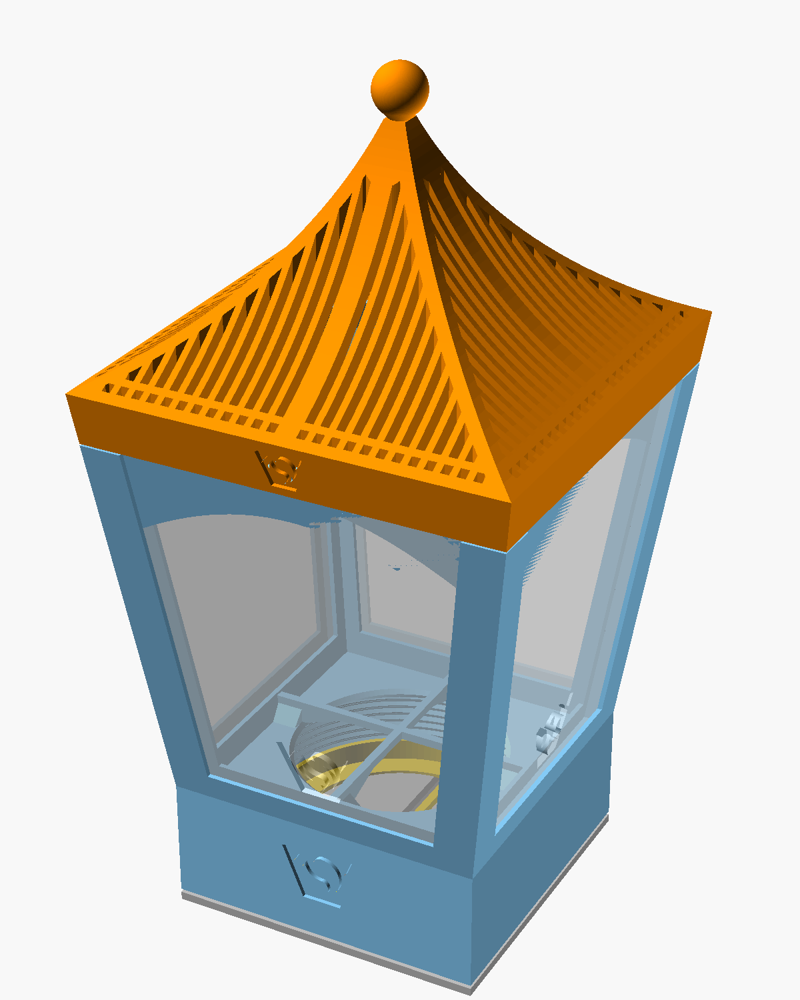
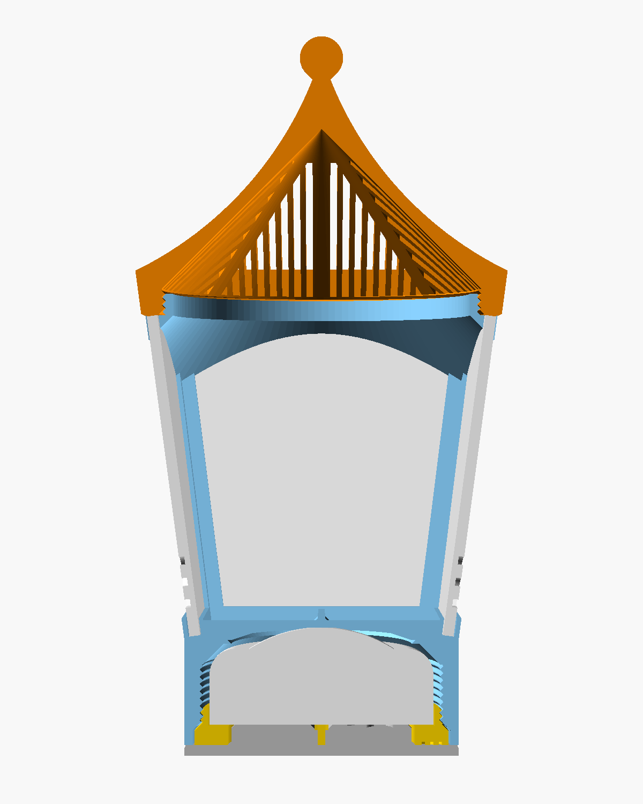

# RGBW puck light lantern 3

An OpenSCAD generator for a lantern around a 62 mm RGBW puck light, after
the Onshape model in `inspiration/lantern_onshape_export` and the pictures
in `inspiration`. The puck lies in the bottom of the frame, the roof screws
onto the frame's top, and the windows slide into slits in the frame's
pillars.

## parts

- `frame`: the holder's top part at the bottom, then four corner pillars
  that lean out from 76 mm to 100 mm (`top_width`) over 90 mm
  (`frame_height`), with a rail between them on the holder. At the top, a
  band carries the neck the roof screws onto. Each pillar has a slit on
  both sides for the windows.
- `roof`: a 12 mm band that continues the frame's sides, then curved sides
  up to a ball. It has the female thread inside the band.
- `screwin`: the holder's bottom screw. It holds the puck in the frame.
- `clickbase`: the holder's click base.
- `window` (4x): a flat 3 mm plate, 61.7 mm wide at the bottom, 85.3 mm at
  the top and 89.5 mm long. Print it in a translucent filament, or cut it
  from 3 mm acrylic.

`part` shows the assembly on the click base, the assembly cut in half, all
parts, or one part. The lantern is 199 mm high on the click base.

## the holder

The puck's mount is the holder project's. Its parameters, `toppart()`,
`bottom_screw()`, `clickbase()`, `puck()`, `threaded_rod()` and the logo
are copied unchanged from
`../RGBW_pucklight_holder/RGBW_pucklight_holderV2.scad`, so the generator
needs no other file and runs in a browser OpenSCAD playground too. The
holder's parameters are in the Customizer under Puck light, Holder top
part, Screwin and Click base, and the frame follows the top part's size.
If the holder project changes, copy the change over by hand.

It clicks as in the holder (see its readme): the lantern stands on the
click base and floats on the puck's dome; pressing the lantern down clicks
the light.

## windows and slits

The slits are 3.6 mm wide (`window_thickness` plus 0.3 mm `slot_clearance`
on each side), behind a 1.2 mm lip (`slot_lip`), and reach 3 mm
(`window_overlap`) into each pillar. The pillars are 10 mm wide
(`pillar_width`) to hold two slits. They run from 1 mm above the holder up
through the frame's top. A window slides in from above and stands on the
slits' floor in the rail; its top ends 0.3 mm under the frame's top, and
the roof covers the slits.

Between the pillars, at the top, there is no lip: the window lies in front
of the band. For thinner windows, such as film or paper, set
`window_thickness` to their thickness and the slits follow.

## the frame's top

The band is the frame's top behind the slits. Its underside is a 45
degree funnel that narrows to the neck's 82.4 mm bore, so it prints
without support. Behind each window the funnel shows as an arch, 4 mm deep
in the middle and about 19 mm at the pillars. In the corners it becomes 45
degree gussets.

The neck has the roof's thread outside: 88 mm (`neck_d`), 6 mm high, 2 mm
pitch and 45 degree flanks (the holder's `threaded_rod()`), with a
chamfered top. Its bore lets the light into the roof.

## the roof

- band: 12 mm (`roof_band_height`), leaning like the frame's sides; the
  eaves are 103.2 mm wide.
- curved sides: an arc of radius 100 mm (`roof_curve_r`) from the eave to
  the axis 60 mm (`roof_rise`) higher, 26 degrees steep at the eaves and
  steeper towards the top. It ends 5 mm wide under a 12 mm ball, which
  stands on a 45 degree cone.
- inside: the female thread, with 0.3 mm radial clearance
  (`roof_thread_clearance`) and a 45 degree lead-in, up to 7 mm, then a hollow
  45 degree cone. So the roof is thicker towards the eaves; at its thinnest,
  in the middle of a face, it is 4.6 mm (measured horizontally).
- slits: vertical, 2 mm wide (`slit_width`) and 1.6 mm apart
  (`slit_spacing`), along each face, kept 2.5 mm (`slit_margin`) from the
  hips, the eaves, the middle of the face and the ball, with a row of 2 mm
  squares along the eaves. They are cut from the thread's top up: over the
  cone they go through and let the light out; outside it, near the eaves
  and in the corners, they end blind in the band.

The roof is 76.9 mm high.

### lining the roof up

Both threads are in phase: the roof is square to the frame when it is 0.4
mm (`roof_seat_gap`) above the frame's top. From there it can turn 72 degrees
further before it stops on the frame. So screw it on until it stops, then
turn it back until its sides line up with the frame's. The thread is fine
enough that it stays there. Without the gap, 0.1 mm of print tolerance
would turn the stop 18 degrees.

## logo

The VeryOS logo is engraved in every part:
- frame: the holder's, 20 mm wide, in the front of the holder part.
- screwin and clickbase: the holder's.
- roof: 12 mm wide (`roof_logo_width`), 1 mm deep, in the front of the
  band, following its lean.
- window: 20 mm wide (`window_logo_width`), half through the window (1.5
  mm), on its outside, 3 mm above the rail. It shows brighter when the light is on.

## printing

Print the frame standing (125 mm high with the neck), the roof standing on
its band, the screwin and the click base as in the holder, and the windows
flat with the logo up. Nothing needs support: the frame's funnel, the
roof's cone and the ball's cone are 45 degrees, the threads have 45 degree
flanks, the pillars lean out 7.6 degrees, and the holder's ribs bridge its
window as in the holder. For the windows, a translucent or white filament
diffuses the light; at 3 mm it lets less light through than a thinner
window.

## assembly

1. Put the puck into the frame from below, dome first, and screw in the
   screwin until it is flush and its bar is parallel to two sides.
2. Slide the windows into the slits from above, logo outside, until they
   stand on the rail.
3. Screw the roof on until it stops, then turn it back until it lines up.
4. Stand the lantern on the click base, the bar in its slot. Press the
   lantern down to click the light.

## differences from the Onshape model

- in Onshape the frame's top has the female thread and the roof a male
  ring. Here it is the other way round, so the roof prints standing on its
  band without support.
- the frame's top band sits behind the windows, with a 45 degree funnel
  under it, instead of a plate with a lip in front of the windows all
  around.
- the roof is hollow in a 45 degree cone instead of a 1.8 mm shell, whose
  underside would overhang more than 60 degrees at the eaves.
- the slits are 3.6 mm wide instead of 3 mm: a 3 mm window and 0.3 mm
  clearance on each side. They follow `window_thickness`.
- the pillars are 10 mm wide, to hold two such slits.
- the roof lines up through `roof_seat_gap` instead of the fine-tuning ring.
- the ball stands on a 45 degree cone instead of a rounded neck.
- the holder (top part, screw and click base) is the V2 holder project's,
  with its pins and slot, instead of the plain click base.
- the star cutouts in the roof (`cutout_star`) are not included.

## untested

Nothing here has been printed yet. The lantern's weight rests on the
puck's dome while it stands on the click base; if that is enough to click
the light, stand it on something else.

## files

- `RGBW_pucklight_lantern3.scad`: the generator.
- `preview.png`: the assembly. `section.png`: the assembly cut in half.
- `readme_hgc.md`: the original description.
- `inspiration/`: pictures and the Onshape export.

Licensed under GPL.
