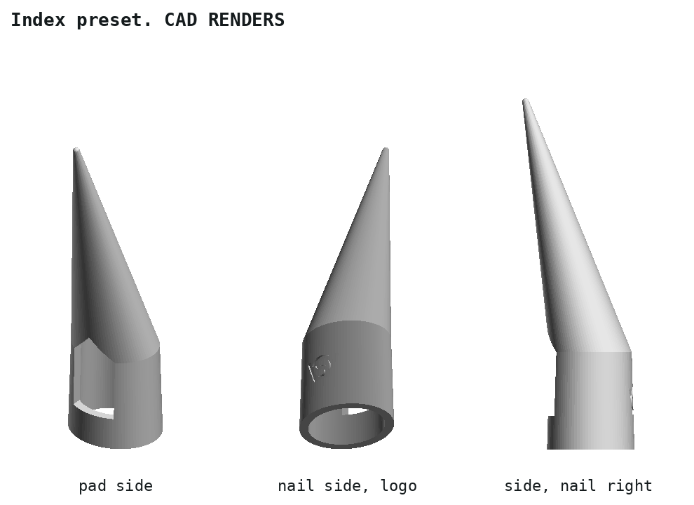
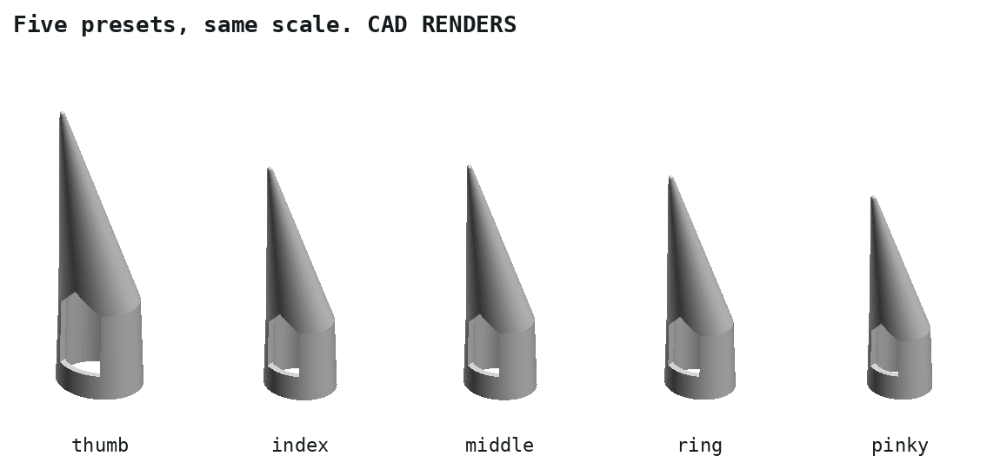
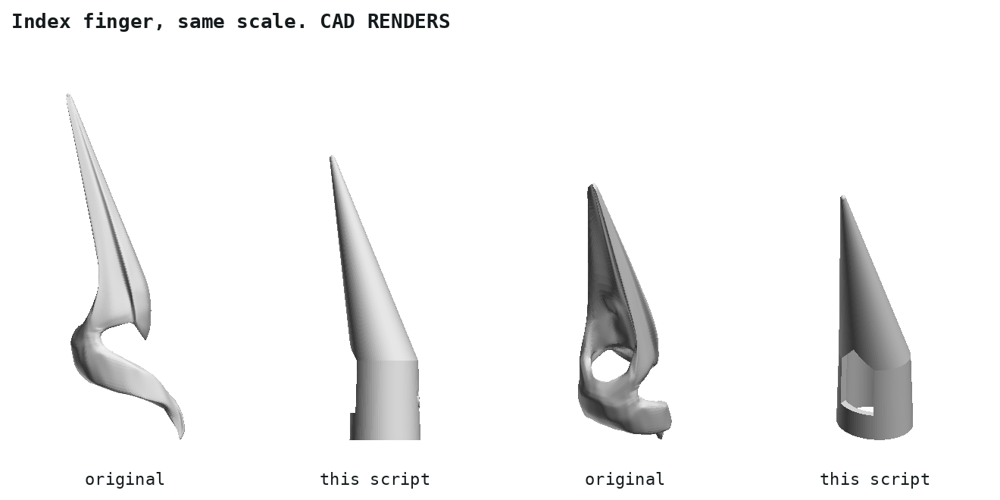

# Artificial fingernail

A claw that slides onto a fingertip, built from OpenSCAD primitives. It is a base model: functional, deliberately plain, made to be decorated in a sculpting program.

| File | What |
|---|---|
| `artificial_fingernail.scad` | the generator, standalone, no libraries |
| `artificial_fingernail.json` | Customizer presets: thumb, index, middle, ring, pinky |
| `stl/` | one STL per preset, the starting point for sculpting |
| `readme_hgc.md` | original description |
| `inspiration/` | the demon nails this is modelled after: their STLs and photos of a print |

## Parts

| Part | Does | Made of |
|---|---|---|
| ring | holds the nail on; closed, at the open end | elliptic frustum, `ring_length` long |
| hood | sleeve over the last phalanx; open on the pad side, grips the fingertip like a C | elliptic frustum, narrows by `fingertip_scale` |
| cavity top | the fingertip's room; 45° cone, prints without support | scaled `cylinder(r1, r2 = 0)` |
| claw | `claw_length` past the fingertip, bent `claw_angle` towards the pad | `hull()` of the hood's top and a sphere |
| logo | VeryOS logo, 0.4 deep on the nail side of the hood | `linear_extrude()` minus an inset frustum |

## Against the original

Measured on `inspiration/…/obj_3_demon nails INDEX.stl`. The original's five files are one mesh, scaled: thumb 1.24, index 1, middle 1.01, ring 0.965, pinky 0.875. The presets follow these factors.

| | Original, index | This script, index preset |
|---|---|---|
| ring | tilted about 35°; inner width 13.6 | square to the finger; inner 14.4 × 12.4 |
| hood | C, open on the pad side; inner width 12.5, wall 1.4 | C, open on the pad side; inner 13.3 × 11.4 at its top, wall 1.6 |
| claw | hollow shell, open underneath; 38 past the fingertip, 17° down | solid; 38 past the fingertip, 17° down |
| between ring and hood | a window on the nail side | closed, the logo is there |
| size, w × d × h | 18.4 × 26.2 × 76.3 | 17.6 × 20.0 × 62.6 |
| supports | tree supports everywhere | none |

## Fit

Not printed yet. All fits are untested.

| Parameter | Measure |
|---|---|
| `finger_length` | fingertip to the crease of the last joint, along the finger |
| `finger_w` | finger's width at that crease |
| `finger_h` | finger's thickness, nail to pad, at that crease |
| `fingertip_scale` | finger's width about 7 mm from the tip ÷ `finger_w` |
| `clearance` | added to width and thickness; default 0.4 |
| `pad_window_w` | narrower grips harder; must stay below the fingertip's width |

## Print

- Standing as worn: ring on the bed, claw up. No supports: nothing overhangs more than 45°.
- 0.2 mm layers.
- The thin claw tip prints slowly at minimum layer time; a second part on the bed gives each layer time to cool.

## Sculpting

- Import the STL, voxel remesh it first: OpenSCAD's long thin triangles do not sculpt.
- Keep the cavity, the ring and the pad window as they are: they set the fit.
- Keep the walls 1.2 mm or more.
- Keep 45° or less on overhangs, or plan supports.
