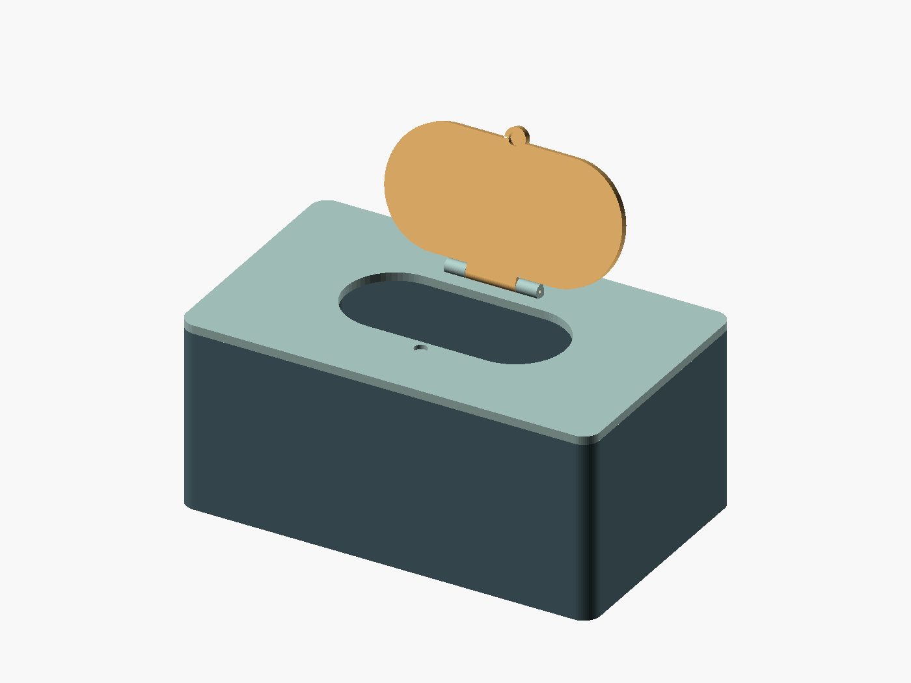

# Parametric baby-wipe box

[babywipesbox.scad](babywipesbox.scad) generates three separate printable parts,
using only built-in OpenSCAD geometry:

- **Box:** rounded open container with four blind magnet pockets in reinforced corners.
- **Boxcover:** removable flat cover, with four matching underside magnet pockets,
  a capsule-shaped dispensing opening, two hinge knuckles, and an upward-facing latch magnet pocket.
- **Boxcover lid:** overlapping flip lid with a finger tab, an underside latch
  magnet pocket, and the middle hinge knuckle.

The hinge knuckles share a circular **1.95 mm bore** (1.75 mm filament + 0.2 mm
diametral tolerance). A piece of filament joins them; no fourth printed part is needed.



## Customize

Open `babywipesbox.scad` in OpenSCAD and use the Customizer or edit the parameters
at the top of the file. Dimensions are in millimetres.

| Parameter | Default | Meaning |
| --- | --- | --- |
| `box_width` | 200 | Outside size along X |
| `box_depth` | 120 | Outside size along Y |
| `box_height` | 85 | Outside box height, excluding cover and lid |
| `wall_thickness` / `bottom_thickness` | 2.4 / 2.4 | Container walls and floor |
| `corner_radius` | 8 | Outside corner radius |
| `cover_thickness` / `lid_thickness` | 4 / 3.6 | Cover plate and lid thickness |
| `opening_width` / `opening_depth` | 0 / 0 | Zero uses 53% of box width / 40% of depth |
| `lid_overlap` | 4 | Lid overlap beyond the dispensing opening |
| `lid_clearance` | 0.25 | Gap under the closed lid |
| `magnet_diameter` / `magnet_thickness` | 6 / 2 | Disc magnet size, shared by all ten pockets |
| `magnet_diameter_clearance` | 0.2 | Added to pocket diameter, total |
| `magnet_depth_clearance` | 0.1 | Added to pocket depth |
| `filament_diameter` / `hinge_tolerance` | 1.75 / 0.2 | Bore = their sum |
| `hinge_axial_clearance` | 0.3 | Gap between adjacent hinge knuckles |

The default opening is 106 × 48 mm. Interior space between the flat walls is
195.2 × 115.2 × 82.6 mm; rounded corners and magnet posts intrude into that space.
Measure the wipe packet with clearance before choosing box dimensions. The
closed assembly is 95.65 mm tall, including the hinge barrels.

Increasing the magnet thickness may also require increasing `cover_thickness`
and `lid_thickness`; a thicker lid may need a larger `hinge_outer_diameter`.
Assertions explain incompatible dimensions, including openings that leave too
little space for magnets or hinges.

## Views and STL export

Set `part` to one of:

| Value | Result |
| --- | --- |
| `assembly` | Assembled preview; `lid_angle` controls opening from 0° to 180° |
| `exploded` | Separated assembly; spacing controlled by `exploded_distance` |
| `print_layout` | All three parts separated, each resting at Z=0 |
| `box` | Container only, ready to export |
| `boxcover` | Cover only, underside on the bed |
| `boxcover_lid` | Lid only, closed underside on the bed |

For each individual part, press **F6** to render, then **File → Export → Export as STL**.
Export the three parts individually: the default print layout is larger than
many printer beds, and assembly views are for inspection.

Alternatively, from this directory, with `openscad` on your PATH:

```sh
mkdir -p build
openscad -o build/box.stl -D 'part="box"' babywipesbox.scad
openscad -o build/boxcover.stl -D 'part="boxcover"' babywipesbox.scad
openscad -o build/boxcover_lid.stl -D 'part="boxcover_lid"' babywipesbox.scad
```

Supply the **same dimension overrides** to all three exports, for example
`-D 'box_width=220' -D 'box_depth=130' -D 'box_height=90'`.
Generated STL files live in the ignored `build/` directory.

## Print and assemble

1. Print one of each part in its exported orientation. A starting setup is
   0.2 mm layers and 3–4 perimeters. The box needs no supports. Inspect the
   slicer's hinge overhangs on the cover and lid; use local supports if needed
   and keep support out of the small pin bore. The underside magnet pockets
   have short bridge roofs.
2. Use **ten 6 × 2 mm disc magnets** for the default model. Dry-fit them and check
   polarity in mating pairs before gluing. Four pairs join the box and cover;
   the fifth pair closes the small lid. Seat magnets flush or slightly recessed.
   The cover sits directly on the box rim and is located by its four magnet pairs.
3. Place the lid's middle knuckle between the cover's outer knuckles. Thread a
   straight piece of **1.75 mm filament, approximately 47 mm long**, through all
   three. The console reports the required length when hinge dimensions change.
   Clean up or gently ream the bore if your printer closes up small horizontal holes.
4. Retain the filament by flattening its protruding ends or gluing one end to
   an outer knuckle, keeping glue away from the moving middle knuckle.

This is an overlapping lid without a gasket; it is not an airtight seal. Keep
wipes in their original packet inside the box. Secure the magnets with suitable
adhesive and check their retention before use around children.

## Validation

The default three STLs were rendered with OpenSCAD 2026.09.16 and checked for
closed, connected meshes. The hinge was checked for solid intersections with
the cover at 2° intervals from 0° through 180°, including the closed position.
Alternate box sizes and magnet dimensions were also rendered. These are
geometry checks; physical print fit and magnetic holding force still need a trial print.

## References

The supplied photographs are retained as design references:
[open](image.png), [closed](image%20copy.png),
[separated](image%20copy%202.png), [hinge detail](image%20copy%203.png).

Licensed under the repository's [GPL license](../../LICENSE).
