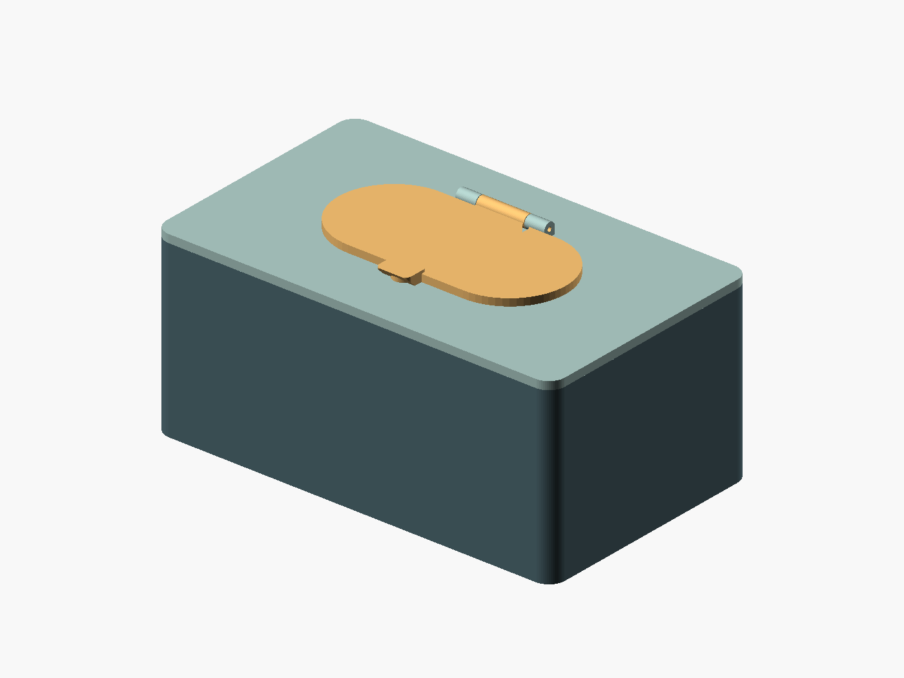
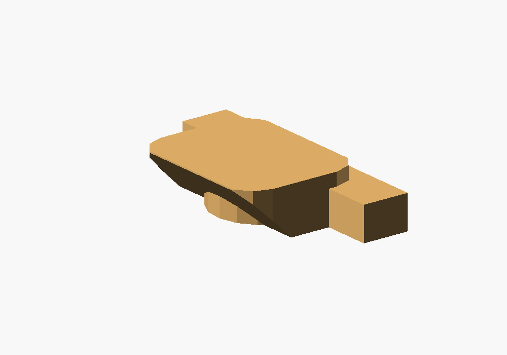

# Baby wipes box V2 — 45° grip lip

[babywipesboxV2.scad](babywipesboxV2.scad) is a standalone version of the
[original baby wipes box](../babywipesbox/babywipesbox.scad), with a larger grip
lip on the front of the small hinged lid, following the
[18 October sketch](WhatsApp%20Image%202026-10-18%20at%2012.00.38.jpeg).

The lip projects **9 mm** beyond the lid's capsule outline, is **5 mm** high
from the lid underside, and has a **45° underside** for finger purchase.
Its width is 16 mm with rounded corners. The original circular magnet pad
remains beneath the lip: the bevel blends into this reinforcement rather than
cutting through the blind magnet pocket.





## Dimensions and compatibility

The box, removable cover, dispensing opening, magnet positions, and filament
hinge match the original SCAD model. With matching parameters, the V2 lid fits
the original cover. The default box measures 200 × 120 × 85 mm; the opening
is 106 × 48 mm. The main lid plate remains 3.6 mm thick; only the lip rises
to 5 mm. No fourth printed part is needed.

The three new Customizer controls are:

| Parameter | Default | Meaning |
| --- | --- | --- |
| `lip_projection` | 9 | Distance beyond the front edge of the lid, in mm |
| `lip_height` | 5 | Total lip height from the lid underside, in mm |
| `lip_width` | 16 | Grip width along X, in mm |

The angle stays at 45° when these dimensions change. Assertions check that
the lip extends beyond the magnet pad, fits on the cover, and clears the cover
when the lid is fully open. All existing box, magnet, and hinge parameters
remain available.

## Export and assembly

Open `babywipesboxV2.scad` in OpenSCAD. The default `part = "print_layout"`
puts all three separate parts at Z=0. Render with **F6**, export as STL, then
split into objects and arrange the parts in your slicer.

Use `box`, `boxcover`, or `boxcover_lid` to export a single part.
Use `assembly` with `lid_angle = 0` to inspect the closed lip, or `exploded`
to inspect assembly. The assembled view is for inspection: the touching box
and cover fuse if exported together.

From this directory:

```sh
mkdir -p build
openscad -o build/babywipesboxV2.stl babywipesboxV2.scad
openscad -o build/box.stl -D 'part="box"' babywipesboxV2.scad
openscad -o build/boxcover.stl -D 'part="boxcover"' babywipesboxV2.scad
openscad -o build/boxcover_lid.stl -D 'part="boxcover_lid"' babywipesboxV2.scad
```

Use the same dimension overrides for all three exports. Generated STL files
are in the ignored `build/` directory.

Assembly uses ten 6 × 2 mm magnets and an approximately 47 mm length of
1.75 mm filament. The default hinge bore is **2.1 mm** (1.75 + 0.35 mm),
matching the current original SCAD file. See the original
[printing and assembly instructions](../babywipesbox/readme.md#print-and-assemble).
The lip's underside slopes at 45° in the supplied print orientation; inspect
the hinge overhangs and magnet-pocket bridges in the slicer.

## Validation

Rendered with OpenSCAD 2026.09.16. Each default part is a connected, closed
mesh with consistent face orientation and its lowest point at Z=0. The
combined layout contains exactly three separate closed components. The
exported lid mesh confirms the 9 mm projection, 5 mm lip height, and 45°
front underside. Solid intersection checks between lid and cover are empty
at every 2° from 0° through 180°. Physical fit still needs a trial print.

Licensed under the repository's [GPL license](../../LICENSE).
