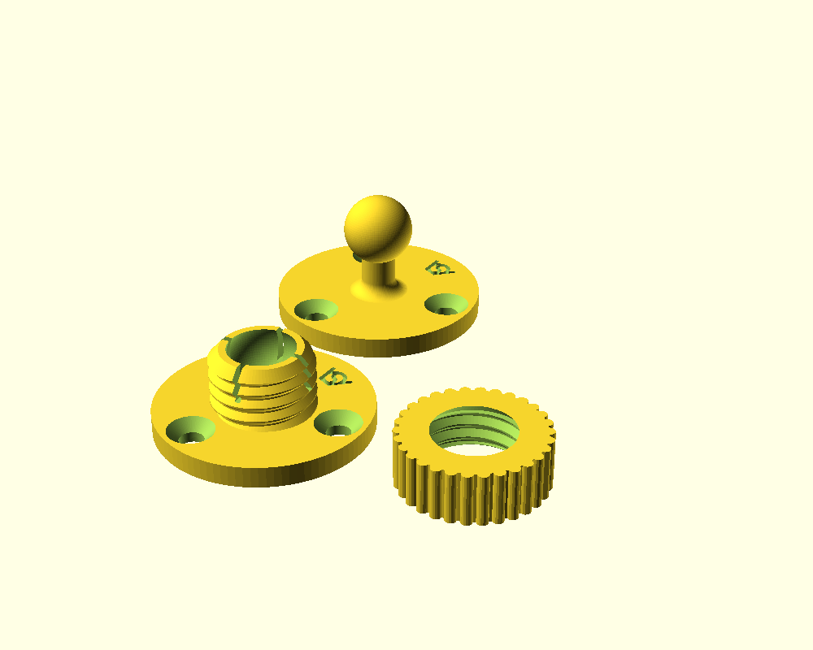
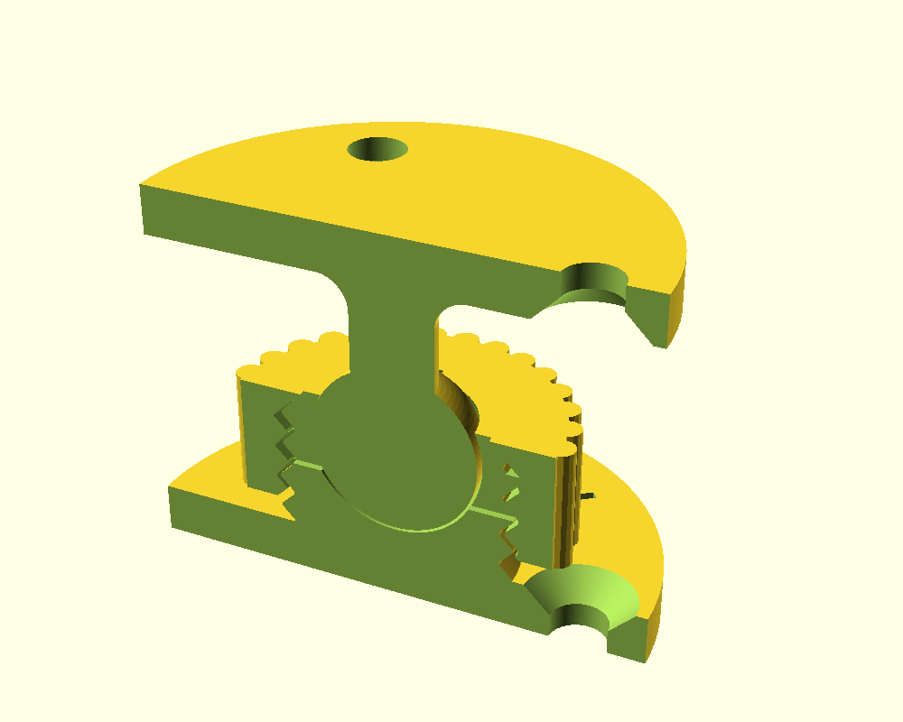
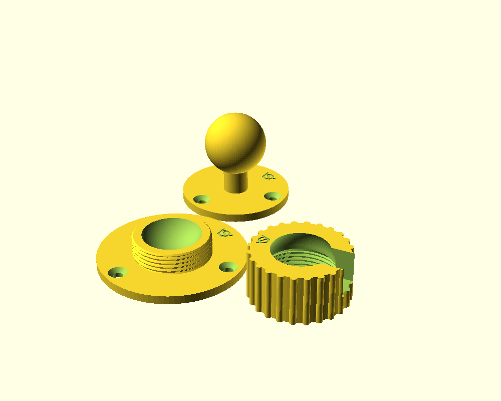
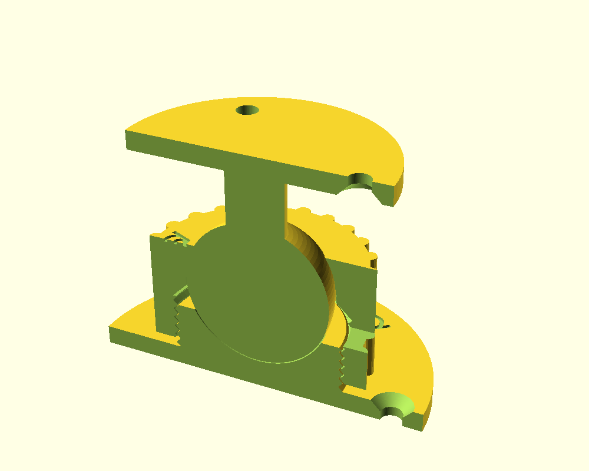

# ball and socket joint / ball head

## V2: snap-fit with locking nut

`ball_and_socket_joint_ball_headV2.scad`, after the new pictures and STLs
in `inspiration` (spherical snap-fit ball joint with locking nut). The ball
snaps into a slit cup, and a knurled nut screws over the cup. The nut's
45 degree inner cone presses on the cup's chamfered top and squeezes the
fingers onto the ball, which locks the joint.

- `ball`: a 10 mm ball (`ball_d`) on a 5 mm neck (`neck_d`) that flares
  into the plate with a 2 mm fillet.
- `socket`: a cup whose inside sphere reaches 25 degrees (`cup_angle`)
  above the ball's equator, so the ball snaps in past a 0.3 mm undercut.
  4 slits (`slit_count`) split its top into fingers. It has the external
  thread and a 45 degree chamfer at the top.
- `screw`: the knurled locking nut, 19 mm across. When its cone touches
  the cup it is still `screw_travel` (1.5 mm) above the plate, so it can
  turn further to lock. The ball passes through it, so slide it over the
  ball before snapping the ball in.
- Plates: 30 mm round (`plate_d`), 3 mm thick, `hole_count` (3)
  countersunk M3 holes. The holes sit on a circle midway between the cup
  and the edge, the same on both plates. The nut covers the socket's
  screws, so screw the socket down first.

All parameters can be changed freely. A value that does not fit is changed
to the nearest one that does, with a `WARNING` line in the console: the
plate grows to fit the screw heads, the neck thins to pass the cup's
opening, the cup's floor rises to give the nut a full turn of thread, and
the logo shrinks to fit between the holes. `neck_length` is the free neck
between the fillet and the ball, so it never conflicts with the ball's
size.

The neck tilts about 35 degrees each way. The thread is the same 45 degree,
2 mm pitch thread as V1. Print every part standing, without support. The
VeryOS logo is engraved in both plates. The nut's top ring is only about
4 mm wide, too narrow for a readable logo, so it has none.

## V1: clamping ring

`ball_and_socket_joint_ball_head.scad`, after `inspiration/image.png`. A
ball sits in a threaded cup and a knurled ring
screws over it; turning the ring down presses its lip onto the ball and
locks the joint.

### parts

- `ball`: a 30 mm ball (`ball_d`) on a 12 mm neck (`neck_d`) on a round
  plate with 3 countersunk M4 holes.
- `socket`: a round plate with 3 countersunk M4 holes and a cup that holds
  the ball's lower half. The cup has the external thread.
- `screw`: the knurled ring. The female thread is below. Above it a lip
  covers the ball from its equator up to 30 degrees (`lip_angle`). A slot in
  the lip (`tilt_slot`) lets the neck tilt to 90 degrees in one direction.
  Elsewhere it tilts about 36 degrees.

`part` shows the assembly, the assembly cut in half, all parts, or one part.

### thread

Single-start, right-hand, with 45 degree flanks and a 2 mm pitch
(`thread_pitch`), as in `../fdm_optimized_screws`, so it prints without
support. `thread_clearance` (0.3 mm) is the radial gap. The cup's thread
diameter follows from the ball, `ball_clearance` and `cup_wall`. When the
ring touches the ball it still has `screw_travel` (2 mm) of room above the
plate to turn down and lock.

### printing

Print every part standing, plate or ring bottom on the bed, without support.
The lip's inside is no flatter than 45 degrees while `lip_angle` is at most
45. The ball's underside overhangs a little where it meets the neck. Set
`ball_cone` to fill it with a 45 degree cone; this lowers the tilt to about
15 degrees outside the slot.

The VeryOS logo is engraved in the top of both plates, between the holes,
and in the top of the ring, opposite the slot.

The generator needs no other file and also runs in a browser OpenSCAD
playground.
