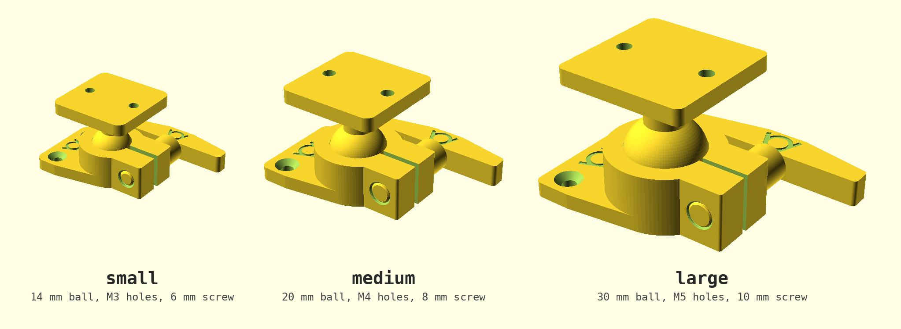

# ball socket bracket: print files

Three sizes, ready to print. Each has three STL files, one per part, already
in print orientation. All three are shown at the same scale.



| | small | medium | large |
| --- | --- | --- | --- |
| ball | 14 mm | 20 mm | 30 mm |
| neck | 7 mm | 10 mm | 15 mm |
| mounting holes | 2 x M3, countersunk | 2 x M4, countersunk | 2 x M5, countersunk |
| hole spacing | 18 mm | 24 mm | 34 mm |
| ball plate | 28 x 28 x 4 mm | 36 x 36 x 5 mm | 50 x 50 x 6 mm |
| socket | 40 x 28 x 12 mm | 53 x 36 x 16 mm | 73 x 50 x 22 mm |
| clamp screw | 6 mm, 40 mm lever | 8 mm, 50 mm lever | 10 mm, 70 mm lever |
| tilt | 42 degrees | 45 degrees | 47 degrees |

Files: `ball_socket_bracket_<size>_ball.stl`, `_socket.stl` and `_screw.stl`.

## printing

- socket: flat, as exported. No support.
- ball: standing on an edge of its plate, so the neck lies level and the
  extrusion lines run along it. Turn on the slicer's supports, on the build
  plate only, for the neck and the ball. The plate stands on a 4 to 6 mm
  edge; add a brim if it does not stay put.
- screw: lying, as exported. The underside is cut flat. No support.

## assembly

1. Screw the socket's plate down.
2. Push the ball into the ring, with the clamp screw out or loose. It snaps
   in and stays in while the screw is loose.
3. Put the clamp screw in, set the angle and tighten the lever.

## making another size

The sizes are presets in `../ball_socket_bracket.json`, named `small`,
`medium` and `large`. OpenSCAD's Customizer shows them for
`ball_socket_bracket.scad`. To export one part from the command line:

```sh
openscad --export-format binstl -o socket.stl -p ball_socket_bracket.json -P small \
    -D 'part="socket"' -D '$fn=96' ball_socket_bracket.scad
```

`medium` is the script's defaults. These files were exported with
`$fn = 96`.

An earlier version of these files, with a 2 mm slot in the ring, was
printed: only the large size held the ball. These files have a 4 mm slot
(see the [project readme](../readme.md) for why). They are checked
digitally (closed solids, on the bed, no collisions within the tilt), but
not printed yet.
