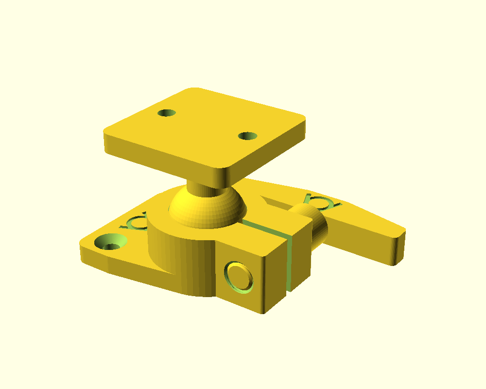
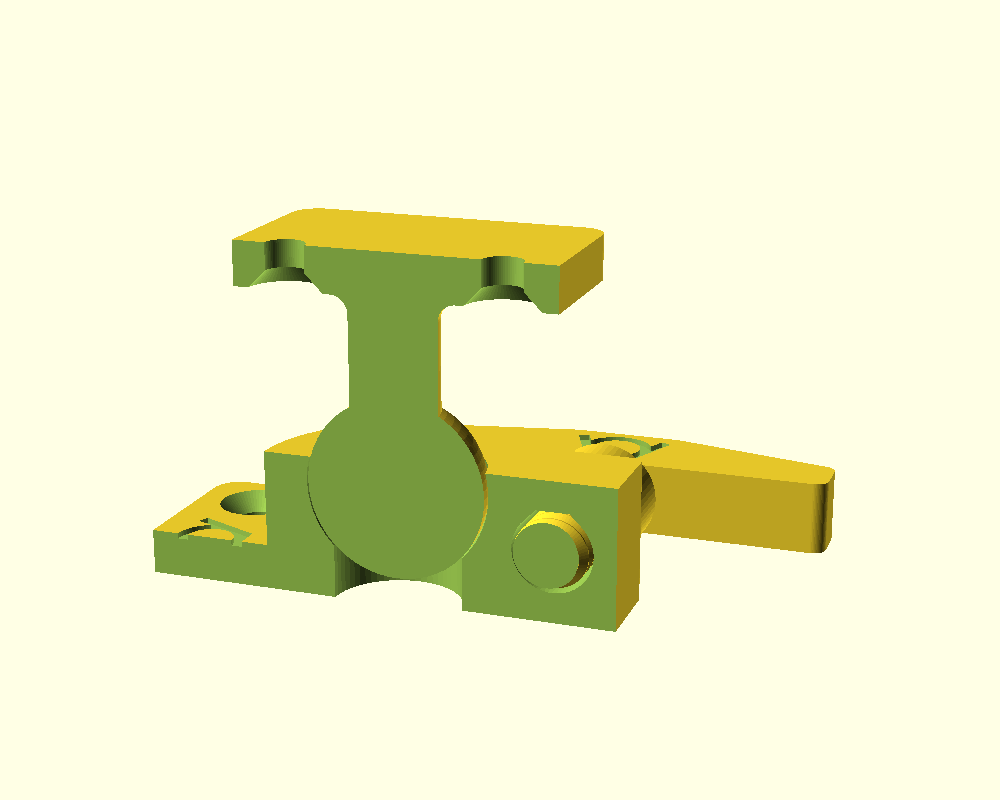
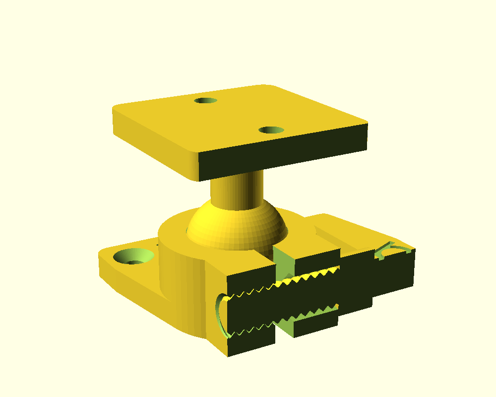
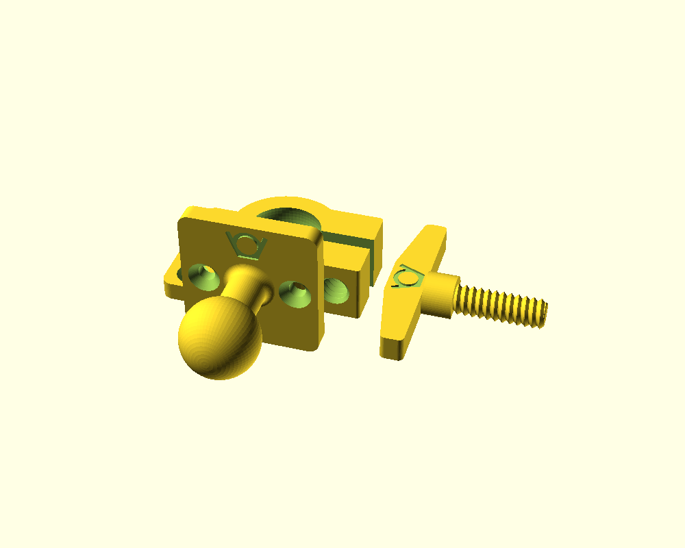

# ball socket bracket

`ball_socket_bracket.scad` generates a ball joint that locks with a clamp
screw, after the sketch in `image.png`. The ball and the socket both have
a mounting plate with two countersunk M4 holes. The generator needs no
other file.

## parts

- `ball`: a 20 mm ball (`ball_d`) on a 10 mm neck (`neck_d`) on a square
  36 mm plate (`plate_width`). The neck flares into the plate with a 2 mm
  fillet.
- `socket`: a ring round the ball, with a plate on one side and two ears on
  the other. A 2 mm slot (`slot_width`) splits the ring between the ears.
  The upper ear has a clearance hole, the lower ear the thread.
- `screw`: an 8 mm screw (`thread_d`) with a tall post and a 50 mm lever
  (`lever_length`) on top. The post lifts the lever at least 2 mm above
  the ring and the plates, so it swings over them.

Tightening the screw pulls the ears together. The slot closes and the ring
squeezes the ball. The slot has to close by about 1 mm before the ring
touches the ball (`ball_clearance` 0.15 mm), which leaves another 1 mm to
clamp it.

## snap-in and tilt

The ring's inside is a sphere that reaches 15 degrees (`cup_angle`) above
the ball's equator. Its opening's radius is 0.2 mm less than the ball's, so
the ball snaps in and stays in while the screw is loose. Under the ball the
ring is open: a solid floor would be a disc that the slot cuts only to its
centre, and the slot could not close. With `cup_angle` 0 the ball drops in,
but it also falls out when the screw is loose.

The ball tilts 45 degrees in every direction before the neck meets the
ring's rim.

To assemble:

1. Screw the socket's plate down.
2. Push the ball into the ring, with the screw out or loose. The ring
   opens by about 1.2 mm to let the ball pass.
3. Put the screw in, set the angle and tighten the lever.

## screw

The thread is the 45 degree, 2 mm pitch thread of
`../01_published_or_archived/fdm_optimized_screws`, with the clearance
those tests found safest: 0.25 mm radial (`thread_clearance`), all of it in
the socket. 8 mm is the default; 5 mm is the smallest that worked in the
tests.

## printing

`part = "print_layout"` lays out all three parts in their print
orientation.

- socket: flat, plate on the bed, without support. The screw holes run
  level. The clearance hole is a teardrop with a short flat roof, and the
  thread prints sideways, as the nuts in the screw tests did.
- ball: standing on an edge of its plate, the neck level, so the extrusion
  lines run along the neck instead of across it. Use the slicer's supports
  (on the build plate only) under the neck and the ball.
- screw: lying, the lever flat on the bed. 0.15 of the thread diameter
  (`screw_cut`) is cut off its underside, through the shank, post and lever,
  so all three stand on the bed, as in the screw tests.

## sizes

All parameters can be changed. A value that does not fit is changed to the
nearest one that does, with a `WARNING` line in the console. The socket's
floor rises to leave `ear_wall` (2.5 mm) above and below the screw holes.
The neck thins to pass the ring's opening. The logo shrinks to fit its
place. Some values follow from others: the screw's position, the ears, the
post's height and the screw's length.

The VeryOS logo is engraved in both plates and in the lever: between the
socket's holes, beside the ball's neck, and in the face of the lever.

`part` also shows the assembly, the two cuts, or one part.

Three sizes are presets in `ball_socket_bracket.json`, which the Customizer
offers: `small` (14 mm ball, M3), `medium` (the defaults) and `large`
(30 mm ball, M5). Their STL files are in `publish/`, with
[a readme](publish/readme.md) and a picture of all three.

Not printed yet: the clamping force and the snap-in still need a test print.
