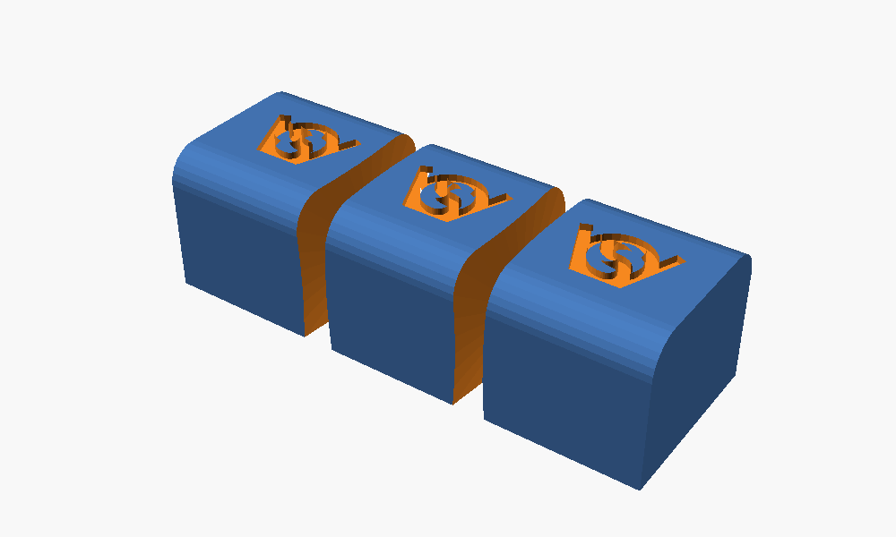
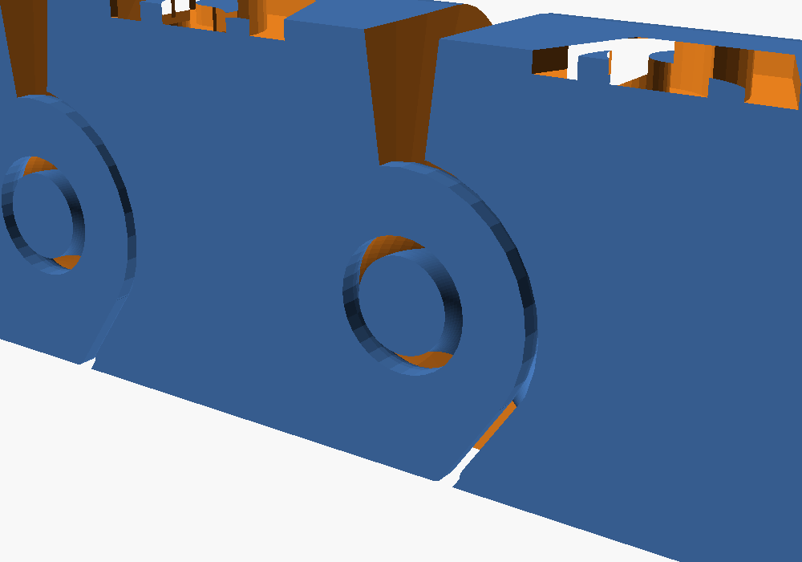

# Basic FDM printable articulation link

Print-in-place joint for FDM, as a chain and as a cutter: `model − cutter` turns any model lying on the bed into an articulated model, like the Flexi-Cutter does with ball joints. The joint is the chain's ring and loop.

| File | What |
|---|---|
| `articulated_chain.scad` | the chain: one link = ring, foot, loop; `n_links` in a row |
| `articulation_cutter.scad` | the cutter, `part = demo / cutter / keep`; standalone, the link is copied from the chain |
| `most_simple_and_robust_spec.md` | the chain's geometry, from the Onshape original |
| `readme_hgc.md` | original description |
| `inspiration/` | Flexi-Cutter by 3Dcrabi, for the idea; its ball joint is not used |

## Use

| Step | How |
|---|---|
| 1 | Lay the model on the bed: bottom on z = 0, spine along X, joints at y = 0 |
| 2 | Set `cutter_width`, `cutter_height` so the cutter covers the model's cross-section, `joints` and `joint_spacing` (≥ 8.591) along X |
| 3a | OpenSCAD: `difference() { import("model.stl"); cutters(); }` with `include <articulation_cutter.scad>` and `part = "none"` |
| 3b | Slicer: export `part = "cutter"` as STL, add it to the model as a negative part |
| 3c | `part = "keep"` is a box minus the cutter: intersect the model with it instead |

## Joint

| Element | Value |
|---|---|
| pivot | ring centre, 5.231 above the bed, axis Y |
| segment on +X | keeps the ring link; `link_clearance` 0.4 around it, `side_clearance` 1 beside it |
| segment on −X | keeps the loop; `loop_clearance` 1 around it where it reaches into +X |
| gap | `gap` 0.4 at the pivot, opening `bend_angle` 15 (both faces together) |
| free rotation | about Y, up and down: a chain link in a ring |
| sideways, twist | limited by the loop's play in the ring hole, about ±15°, not by the gap |
| print | flat, no supports, 0.2 mm layers; untested as of 2026-11-07 |

## Checks

| Check | Result |
|---|---|
| `demo`, 2 joints | 3 separate bodies, all on the bed |
| `keep`, 2 joints, 20 × 15 box | 3 separate bodies |
| chain vs Onshape | volume within 0.2 %, same bounding box, 0.23 mm minimum gap (see spec) |
