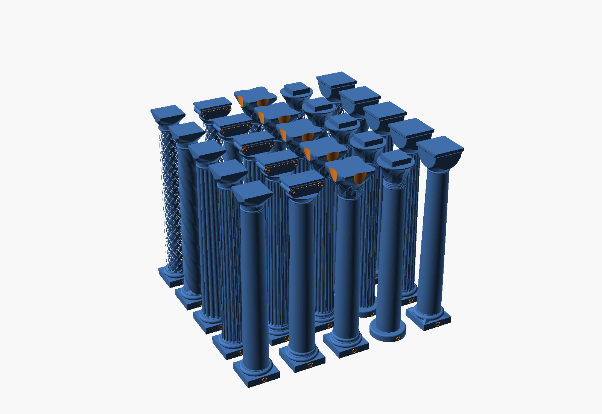
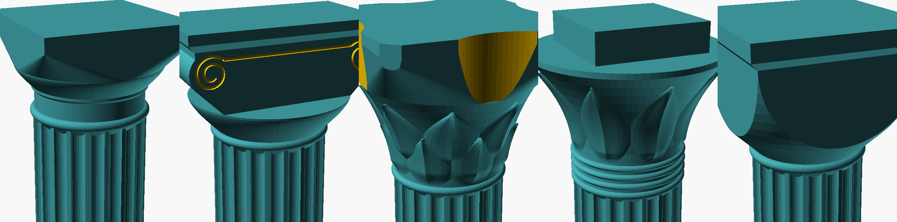

# Decorative pillars

An OpenSCAD generator for decorative pillars, after the pictures in
`inspiration`. A pillar is a base, a shaft and a capital. There are five
shafts and five orders (a base with its capital), so 25 pillars.

The grid in OpenSCAD's preview (F5); the white specks on the lattice
shafts are a preview artifact, not in the rendered solid.

## V1

`decorative_pillarsV1.scad`.

### views

- `view = "grid"` (the default): all 25 pillars in a 5 x 5 grid, each
  `length` high on a shaft `diameter` wide. The shafts are the rows, from
  the front: plain, fluted, reeded, twisted, lattice. The orders are the
  columns, from the left: tuscan, ionic, corinthian, egyptian, romanesque.

  The pillars stand 2 diameters (50 mm) apart, centre to centre; the grid
  is about 235 x 235 mm.
- `view = "single"`: one pillar, picked with `shaft` and `order`. Its
  details are in the Customizer tabs Shaft and Capital. They are the same
  for the grid, so a change there shows in every pillar with that shaft or
  that order.

Use F5 for the grid. A full render (F6) of all 25 takes a long time and
much memory (on a 32 GB machine it was stopped for lack of memory); render
and export one pillar at a time.

### size

- `length` (200 mm): from the bottom of the base to the top of the capital.
- `diameter` (25 mm): the shaft's diameter at its bottom.

Base and capital grow with the diameter; the shaft takes the rest of the
length. At 200 x 25 mm:

| order      | base    | capital | shaft    |
|------------|---------|---------|----------|
| tuscan     | 13.3 mm | 18.1 mm | 168.7 mm |
| ionic      | 16.8 mm | 21.6 mm | 161.7 mm |
| corinthian | 16.8 mm | 30.2 mm | 153.0 mm |
| egyptian   | 7.5 mm  | 31.0 mm | 161.5 mm |
| romanesque | 13.8 mm | 26.0 mm | 160.3 mm |

The square plinths are 1.36 diameters (34 mm) wide, the egyptian drum 1.5
(37.5 mm), the ionic and corinthian abacus 1.44 (36 mm). The shaft must be
at least half a diameter long; for the corinthian pillar that is a length of
at least 2.4 diameters, and OpenSCAD stops with a message if it is shorter.

### shafts

Every shaft narrows from `diameter` at the bottom to `taper` (0.85) of it at
the top.

- `plain`: smooth, with an entasis: it bulges out by `entasis` (0.015) of the
  diameter a third of the way up, as on a Greek column.
- `fluted`: `flutes` (20) round flutes, with a narrow fillet between them.
- `reeded`: `reeds` (12) round reeds around a core, like a bundle of papyrus
  stems.
- `twisted`: `strands` (4) round strands, twisted like a rope. With 1 strand
  the shaft winds as a wave, with 2 it is a barley twist.
- `lattice`: `grooves` (10) round grooves twisted one way, and as many,
  0.85 as wide and deep, twisted the other way. Where they cross they leave
  diamonds. With both sets alike, their bottoms and the shaft's outside
  would touch where they cross, and the solid would not be clean.

The twisted and lattice spirals stand `helix_angle` (40 degrees) from
vertical at the bottom of the shaft, and steeper higher up, where the shaft
is narrower. So they look the same at any length and diameter; at 200 x 25
mm that is 1.6 to 1.8 turns, depending on the order. Up to 45 degrees they print without support.

Where a grooved shaft meets its base and its capital, a 45 degree cone fills
the grooves, so the flutes and strands end in slopes.

### orders

- `tuscan`: a square plinth and a torus; astragal, neck, echinus and a
  square abacus.
- `ionic`: a square plinth and an attic base (torus, scotia, torus);
  astragal and echinus, then a block with a volute on each side, front and
  back, under a thin abacus. A spiral groove runs into each volute from a
  line under the abacus.
- `corinthian`: the attic base; astragal, then a bell with two rows of
  `leaves` (8) leaves, under an abacus with concave sides and cut corners.
- `egyptian`: a round drum as the base; four bands, a bell with `leaves` (8)
  leaves, and a square block on top, narrower than the bell.
- `romanesque`: a square plinth, a torus and a leaf (spur) from each corner
  of the plinth up onto the torus; astragal and a cushion capital (a cube cut
  round by a sphere), with an abacus.

## printing

Print a pillar standing, on its base. It needs no support: nothing
overhangs more than 45 degrees. Where a classical form would, it is cut to
45 degrees:

- the underside of each torus and band goes on along its 45 degree tangent
  down to what it stands on.
- an echinus or a bell flares out at most 45 degrees.
- where a square abacus reaches out over a round capital (tuscan,
  corinthian), its underside rises 45 degrees from the capital's rim to the
  corners. On the corinthian this stands in for the corner volutes.
- the ionic volutes stand on a 45 degree slope from the echinus, instead of
  hanging free beside it.
- the leaves start flat on the bell and grow out over 2.5 times their
  thickness.

The only overhangs are the tops of the engravings: the logo (0.6 mm deep)
and the ionic grooves (0.5 mm wide and deep). They bridge.

Checked on STLs of eight pillars at 200 x 25 mm, every shaft and every
order among them: each is one closed solid, and apart from those engravings
and a few facets of under 1 mm² together, no face overhangs more than 46
degrees. A full render of one pillar took 6 s (plain, tuscan) to about 2
minutes (lattice).

## logo

The VeryOS logo is engraved `logo_depth` (0.6 mm) deep in the front of the
base: in the middle of the plinth, 0.65 of its height (4.9 mm high at a
diameter of 25 mm), or in the egyptian drum (3.9 mm high). It is left out
if it would be less than `logo_min_height` (3 mm) high: below a diameter of
15.4 mm (egyptian: 19.2 mm). At 25 mm its strokes are 0.8 mm wide; for a
crisper logo, print the pillar larger.

## untested

Nothing has been printed yet. The ionic volute grooves are 0.5 mm wide at a
diameter of 25 mm, near what a 0.4 mm nozzle can make on a wall.

## files

- `decorative_pillarsV1.scad`: the generator.
- `preview.png`: the grid (preview). `capitals.png`: the five capitals, on
  fluted shafts (render).
- `readme_hgc.md`: the original description.
- `inspiration/`: pictures.

Licensed under GPL.
