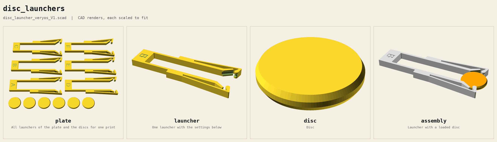

# Disc launcher

A small disc and a one-piece launcher that shoots it when its two rails are squeezed, as OpenSCAD script. Goal and inspiration: `readme_hgc.md`, `inspiration/`. **V2's `c34 t1.7` is printed and works fine. Every force, speed and friction range below comes from the script's model, none is measured.** Both prints: see below.

| File | What |
|---|---|
| `disc_launcher_veryos_V2.scad` | the generator, standalone, no libraries. `part`: `plate` (default), `launcher`, `disc`, `assembly` |
| `disc_launcher_veryos_V2_plate.3mf` | the default plate: six launchers and 6 discs, 138 × 100 × 7, 12 bodies in one object, 29.2 cm³ |
| `rendered_parts/` | every part under its name |
| `archive/` | V1: script and plate |
| `inspiration/`, `readme_hgc.md` | the two launchers looked at, the goal |

## Use

- Push a disc in from the front until it sits behind the two noses.
- Hold the launcher at the two rails, thumb and finger, and squeeze quickly until the arms touch.
- A disc that stays stuck between the noses was not squeezed far enough: the lips only fling it at the end of the travel.

## Names

| Name | Where | Job |
|---|---|---|
| bar | across the rear, 1.8 thick | joins the two sides and bends: the hinge |
| block | on each end of the bar, settings on top, logo and version below | arm, lip and rail start from it |
| rail | outer prong of each side, 12 long | where the fingers squeeze; keeps them off the lip |
| arm | inner prong | carries the cam |
| cam | angled end of each arm, behind the disc's widest point | closes in on the disc and pushes it forward |
| lip | middle prong, tapering to the nose | spring: bends open, then flings |
| nose | round end of each lip, in front of the disc's widest point | holds the disc, later pushes it |
| groove | in both cams and both noses | keeps the disc's edge in the launcher's plane |
| band, slope | the disc's edge: upright band between two slopes | the band is what cams and noses touch |

## Labels

Engraved 0.4 deep, read from the rear. The plate's launchers are named by the first two: `c38 t1.7`.

| Label | Where | Setting |
|---|---|---|
| `c38` | left block, top | `cam_angle` |
| `t1.7` | left block, top | `lip_thickness`, at the block |
| `L30` | right block, top | `lip_length` |
| `h0.6` | right block, top | `hold` |
| `V2` | right block, below | version of the script |
| logo | left block, below; disc, below | |

## V1's print

2026-11-23, Elegoo Centauri Carbon 2, 0.2 mm layers, 2 walls, 15 % infill; the slicer file (`disc_launcher_veryos_V1_plate_elegoo_printed.3mf`, the user's, not committed) has Elegoo PLA Silk on the plate's filament.

| Launcher | Result |
|---|---|
| F, cam 38, lip 1.2 | the best |
| A to E | too loose |
| all | the mechanism way too loose, the launcher too long |

By V2's model F has the most fling of the six, which fits the print, and all six hold the disc with less than 0.03 N.

## V2's print

2026-11-23, the same printer and settings, Elegoo PLA Silk, by the user probably a bit less friction than plain PLA; the slicer file (`disc_launcher_veryos_V2_plate_elegoo_test.3mf`, the user's, not committed) has one launcher on its second plate.

| Launcher | Result |
|---|---|
| `c34 t1.7` | the mechanism works fine |
| its size, 43.4 × 36.9 × 7 | still a bit big |
| the other five | not reported |

## Size, by the model

Only the first row is printed. Cam 34, friction 0.35, one try for each row, not tuned further. For scale: the original's disc is Ø40 and its launcher 71 × 50 × 9.5 by the Printables copy, 1.8 × 1.25 discs; V2's is 2.4 × 2.05 discs.

| Change | Launcher | Squeeze per finger | Speed m/s | Strain lip / bar % | Hold, × disc's weight |
|---|---|---|---|---|---|
| none, as printed: Ø18 of 0.91 g, lip 30 × 1.7 | 43.4 × 36.9 | 16.4 N | 3.7 | 0.90 / 0.91 | 14 × |
| lip 26 × 1.4 | 39.4 × 36.6 | 16.6 N | 3.7 | 1.13 / 1.04 | 16 × |
| lip 24 × 1.2 | 37.4 × 36.4 | 15.6 N | 3.5 | 1.27 / 1.11: above `strain_max` | 16 × |
| `rail_reach` 0.3 | 43.4 × 35.4 | 18.3 N | 3.7 | 0.90 / 0.97 | 15 × |
| Ø20 of 1.1 g | 43.4 × 39.0 | 17.5 N | 3.4 | 0.92 / 0.89 | 11 × |
| Ø25 of 1.8 g, lip 36 × 2.0 | 49.4 × 44.5 | 17.0 N | 2.6 | 0.76 / 0.74 | 4.9 × |
| Ø30 of 2.6 g, lip 40 × 2.2 | 53.4 × 49.9 | 17.6 N | 2.3 | 0.72 / 0.69 | 2.6 × |
| Ø40 of 4.6 g, lip 50 × 2.6 | 63.4 × 60.5 | 16.7 N | 1.7 | 0.63 / 0.60 | 0.9 ×: too little, needs more `hold` |

- The width follows the disc 1 : 1, the length is the lips'.
- A shorter lip has to be thinner: 4 shorter costs the strain's margin, not force or speed.
- A disc's mass goes with its diameter squared: at the same finger force its speed falls with 1 / diameter.

## V2 against V1

| | V1, F | V2, `c38 t1.7` |
|---|---|---|
| size | 77 × 31 × 5 | 43.4 × 37 × 7: 44 % shorter, 6 wider, 2 higher |
| hinge | end block and two flexures 1.6 × 20, 30 of length | bar 1.8 across the rear, 3 of length |
| fingers | pads behind the lips | rails beside the lips |
| lever | fingers 16, noses 54 from the hinge | fingers 16, noses 40 |
| lips | 1.2 constant, 32 long, 5 high: 0.22 N/mm | 1.7 tapering to 0.8, 30 long, 7 high: 0.62 N/mm |
| disc in the launcher | play 0.1 | each nose 0.2 into the disc: it does not rattle |
| hold | 0.027 N, 3 × the disc's weight | 0.128 N, 14 × |
| squeeze per finger | 7.4 N over 1.8 mm | 17.4 N over 2.4 mm |
| lips' bend, strain | 5.9 mm, 1.03 % | 6.1 mm, 1.01 % |
| fling | 2.8 mJ, 2.5 m/s | 8.0 mJ, 4.2 m/s |
| told apart by | a letter | the settings, engraved |
| disc | Ø18 × 3 | the same mesh: V1's discs fit |

V1's numbers here are V2's model applied to V1, its hinge taken as a pivot in the middle of each flexure. V1's own model gave F a hold of 0.09 N: it left out that the arms spread when the disc pulls on the noses.

## Research

| Source | Says | Read |
|---|---|---|
| [Inclined-plane test of printed PLA on PLA](https://api.crossref.org/works/10.1177/1464420720978997) | static friction 0.12 to 0.38, by the angle between the two parts' lines | search summary |
| [Pin-on-disc test of printed PLA](https://yadda.icm.edu.pl/baztech/element/bwmeta1.element.baztech-8fe00cc3-68fd-45bf-be4c-e0712e79c308/c/PAWLAKWIELEBA.pdf) | sliding friction 0.35 to 0.55 | search summary |
| [Printed PLA at 18 N, by infill](https://www.emerald.com/insight/content/doi/10.1108/RPJ-03-2022-0081/full/html) | sliding friction 0.57 falling to 0.38 within an hour | search summary |
| Snap-fit design: [Fictiv](https://www.fictiv.com/articles/how-to-design-snap-fit-components), [guide at MIT](https://fab.cba.mit.edu/classes/S62.12/people/vernelle.noel/Plastic_Snap_fit_design.pdf) | force to push a part past a spring's ramp: `P (μ + tan α) / (1 − μ tan α)`; strain of a beam bent by `y`: `1.5 t y / L²` | search summary |
| [Kanoka disk launcher](https://en.brickimedia.org/wiki/Kanoka_disk_launcher) | fired by squeezing its two sides together | search summary |
| [LDraw part 32533](https://library.ldraw.org/library/official/parts/32533.dat), "Technic Disc 5 x 5 Projectile", keywords Kanoka, Slizer, Throwbot | the original disc: 40.0 across (5 studs), 6.8 high, a domed shell, not a flat plate | the file's points, measured; a fan-made model |
| [Brick Owl, 32171 / 32533](https://brickowl.com/catalog/lego-transparent-red-technic-bionicle-weapon-throwing-disc-32533) | the element is named "Disc Ø39,84", 5 × 5 × 0.67 studs; the Kanoka discs are prints on this part | search summary |
| `inspiration/bionicle/Lego_Disk_Singer_v4.stl` | 71 × 50 × 9.5 measured; by eye from its top view: arms 10 apart, claws opening like a V of about 45 degrees | mesh |
| `inspiration/printables_disc_launcher/` | U spring, the disc in two slots at its ends; comments: shoots for some, not for others, "squeezing hard launched it", two broke | all |

## What holds, what launches

`φ = atan(μ)` is the friction angle. Angles of a contact are measured around the disc from its widest point, backwards positive. `N` is the force of a part square onto the disc's edge.

| Rule | Formula |
|---|---|
| a part the disc slides past pushes it forward only where it touches more than φ behind the widest point | force along the launcher: `N (sin a − μ cos a)` |
| in front of the widest point, or less than φ behind it, it holds: squeezing harder only clamps | the same, negative |
| so the hold must be a shape in front of the widest point, and the push a wedge steeper than φ | noses in front, cams at `cam_angle` behind |
| the cams push as hard as the noses hold back | `N_cam (sin β − μ cos β) = N_nose (μ cos a − sin a)`, β the cam's angle as the side has turned |
| noses and cams sit on the same side: closing the cams drives the noses into the disc's way | the lips bend by about the cams' travel, 5 to 6 mm at Ø18 |
| a bent lip turns its end about a point behind the nose: the nose moves forward too, δ = atan of that drift | `N = k u cos δ cos φ / cos(a + δ − φ)` |
| the bent lips are the launch spring: they push once the noses are φ behind the widest point | work `∫ 2 N (sin a − μ cos a) dx`, about a third of the stored `k u²` |
| before that point the cams must carry the disc: if the arms touch first, the disc stays clamped | room left between each arm and the middle must be positive |
| tapered lip, `a` = tip / root, force at the nose | `k = E h t³ / (12 J L³)`, `J = (2a − a²/2 − ln a − 1.5) / (1 − a)³`, 1/3 without taper; strain `t u / (2 J L²)` |
| a lip tapering to half bends 1.64 × as far as a constant one at the same strain | at the same bend and strain it is 1.64 × as thick: 2.7 × the force |
| bar as hinge: it bends evenly, each side turns about the middle of its half ℓ of the bar | `K = E h t³ / (12 ℓ)` per side; strain `t θ / (2 ℓ)`, more by `1 + F ℓ / (2 K)` for the squeeze `F` along the bowed bar |
| the noses give way with the lips and with the bar, one behind the other | hold stiffness `1 / (1/k + arm² / K)`, arm from the bar to the noses |
| squeeze per finger | `(K θ + moments of the cam's and the nose's force about the pivot) / arm from the bar to the fingers` |
| speed | `√(2 × work / mass)`, the fingers' own speed comes on top |

Friction μ 0.2, 0.35, 0.5 gives φ 11.3, 19.3, 26.6 degrees.

## The plate, by the model

Friction 0.35, PLA with E 3300 N/mm², disc Ø18 × 3 of 0.91 g. All six: 43.4 long, 36.6 to 37.3 wide, 7 high, lips 30 long, hold 0.6, each nose 0.2 into the disc.

| | cam angle | lip | hold, × disc's weight | squeeze per finger | rail travel | room left to the middle | lips bend | strain lip / bar % | lips store → fling mJ | speed m/s | launches at friction |
|---|---|---|---|---|---|---|---|---|---|---|---|
| `c34 t1.4` | 34 | 1.4 | 0.10 N, 12 × | 11.7 N | 2.1 | 2.5 | 5.3 | 0.82 / 0.88 | 11.0 → 3.8 | 2.9 | 0.1 to 0.5 |
| `c38 t1.4` | 38 | 1.4 | 0.10 N, 12 × | 13.0 N | 2.4 | 1.7 | 5.9 | 0.92 / 0.99 | 13.7 → 4.8 | 3.3 | 0.1 to 0.45 |
| `c34 t1.7` | 34 | 1.7 | 0.13 N, 14 × | 16.4 N | 2.2 | 2.4 | 5.4 | 0.90 / 0.91 | 18.2 → 6.3 | 3.7 | 0.1 to 0.5 |
| `c38 t1.7` | 38 | 1.7 | 0.13 N, 14 × | 17.4 N | 2.4 | 1.6 | 6.1 | 1.01 / 1.04 | 23.0 → 8.0 | 4.2 | 0.1 to 0.45 |
| `c34 t2` | 34 | 2.0 | 0.15 N, 17 × | 22.4 N | 2.2 | 2.2 | 5.6 | 1.02 / 0.96 | 28.6 → 9.8 | 4.6 | 0.1 to 0.45 |
| `c38 t2` | 38 | 2.0 | 0.15 N, 16 × | 23.5 N | 2.5 | 1.4 | 6.3 | 1.15 / 1.09 | 36.1 → 12.3 | 5.2 | 0.1 to 0.45 |

| Friction | `c38 t1.7`: squeeze, strain lip / bar, speed | `c38 t2` |
|---|---|---|
| 0.2 | 13.3 N, 0.83 / 0.77 %, 4.2 m/s | 17.2 N, 0.92 / 0.79 %, 5.1 m/s |
| 0.35 | 17.4 N, 1.01 / 1.04 %, 4.2 m/s | 23.5 N, 1.15 / 1.09 %, 5.2 m/s |
| 0.45 | 24.8 N, 1.20 / 1.32 %, 4.4 m/s | 34.6 N, 1.39 / 1.42 %, 5.5 m/s |

V1's plate by the same model, friction 0.35:

| | cam angle | lip | hold | squeeze per finger | fling mJ | speed m/s |
|---|---|---|---|---|---|---|
| A | 30 | 1.0 | 0.022 N | 4.7 N | 1.0 | 1.5 |
| B | 34 | 1.0 | 0.022 N | 4.6 N | 1.2 | 1.7 |
| C | 38 | 1.0 | 0.022 N | 4.9 N | 1.6 | 1.9 |
| D | 30 | 1.2 | 0.027 N | 7.5 N | 1.7 | 1.9 |
| E | 34 | 1.2 | 0.027 N | 7.1 N | 2.1 | 2.2 |
| F | 38 | 1.2 | 0.027 N | 7.4 N | 2.8 | 2.5 |

| Limit | Which launcher |
|---|---|
| high friction: the arms touch before the lips take over | cam 38 and `c34 t2` from 0.5 on, the others from 0.55 |
| cam 34 near the friction angle: the squeeze grows steeply | `c34 t1.7` 16 N at 0.35, 28 N at 0.45, 48 N at 0.5 |
| strain above `strain_max` 1.2 % | at friction 0.45 all but `c34 t1.4` and `c34 t1.7`: up to 1.4 % |
| small disc: the cams' V is narrower, the arms touch earlier | Ø15 launches to friction 0.35 with 0.3 room left, Ø12 only to 0.25: lower `hold` or `cam_angle` |
| fingers on the blocks instead of the rails | 2.6 × the force: the lever is 6 instead of 16 |

Not in the model: the arms' own bending (about 0.3 mm at 4 N on a cam), the fingers' speed and their force after the peak, friction changing with speed and wear, the lips' mass, the parts' tolerances, air. 1.2 % as limit for PLA springs is my choice, about 60 % of its yield strain. The script's model was checked against a second one written in Python, not kept here: both gave the table's numbers.

## Settings

| Parameter | Default | Does |
|---|---|---|
| `cam_angle` | 38 | steeper: more squeeze travel and lip bend, more fling, less room left; shallower: nearer to the friction angle |
| `lip_thickness` | 1.7 | at the block; squeeze force, hold and stored energy go with its cube, strain with it |
| `hold` | 0.6 | each nose's reach over the disc's edge: the mouth is 1.2 narrower than the disc |
| `preload` | 0.2 | each nose's press into the loaded disc; 0: the disc just touches |
| `plate_cam_angles`, `plate_lip_thicknesses` | 34, 38 and 1.4, 1.7, 2.0 | one launcher for each pair |
| `height` | 7 | force, hold and fling go with it, strain does not |
| `lip_length`, `lip_tip` | 30, 0.8 | longer: softer, less strain, a longer launcher |
| `block_length` | 8 | room for the labels; longer: lighter squeeze |
| `rail_reach`, `rail_thickness` | 0.4, 3.5 | part of the lip the rail covers: more is a lighter squeeze and a wider launcher |
| `bar_thickness` | 1.8 | the hinge: thicker is a harder squeeze and a firmer hold, no more fling |
| `disc_diameter`, `disc_thickness` | 18, 3 | the launcher follows, except `lip_length` and `height`: the script warns or stops |
| `rim_land`, `rim_angle` | 1, 60 | the disc's band and slopes; the grooves follow |
| `friction`, `e_modulus`, `strain_max`, `density` | 0.35, 3300, 1.2, 1.24 | the model only: the script echoes the table above for the current settings and warns |
| `z_clearance` | 0.2 | band in the grooves, above and below |
| `labels`, `logo` | on | engravings |

## Print

| | |
|---|---|
| orientation | as exported, flat, no support; the grooves' roofs are 60 degrees from the bed |
| layers | 0.2: the band, the grooves and the disc's faces lie on multiples of it |
| walls | lips 1.4 to 2.0 at the block, 0.8 at the nose; bar 1.8; slots 1.0 and 1.2; the user's print: 2 walls, 15 % infill |
| disc | solid, or enough top and bottom layers to fill its 3 mm |
| engravings | 0.4 deep: settings on top 3.0 high, version and logo below |
| mesh | each part closed, one body, the same volume from OpenSCAD 2021.01 and from 2026.09.16 with lazy union and Manifold; 29 other settings too |

## Still open after V2's print

| Question | Look at |
|---|---|
| the other five launchers against `c34 t1.7`: squeeze and flight | the three lips: 12, 17, 23 N by the model |
| how far and how fast the disc flies | 3.7 m/s for `c34 t1.7` is the model's, unchecked |
| does the disc stay in when the launcher is shaken | `hold`, 0.10 to 0.15 N by the model |
| do lips and bar survive many full squeezes, also without a disc | `c38 t2` bends most |
| does the disc sit without rattle and slide in the grooves | `preload`, `z_clearance` |
| a disc stuck between the noses after a full squeeze | the arms touched first: friction above the launcher's range, lower `cam_angle` or `hold` |
| plain PLA instead of Silk | more friction: a harder squeeze by the model, 28 N at 0.45 |
