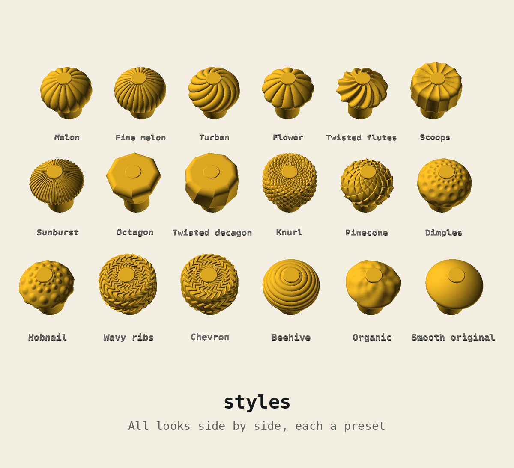
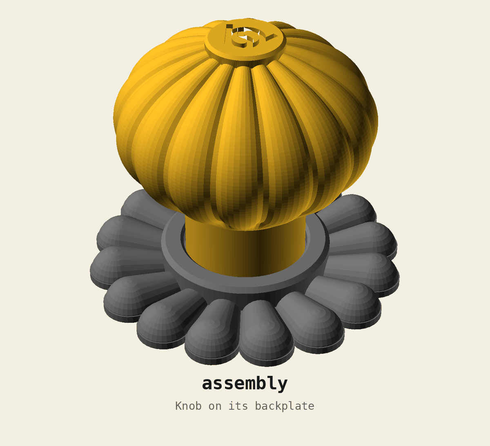
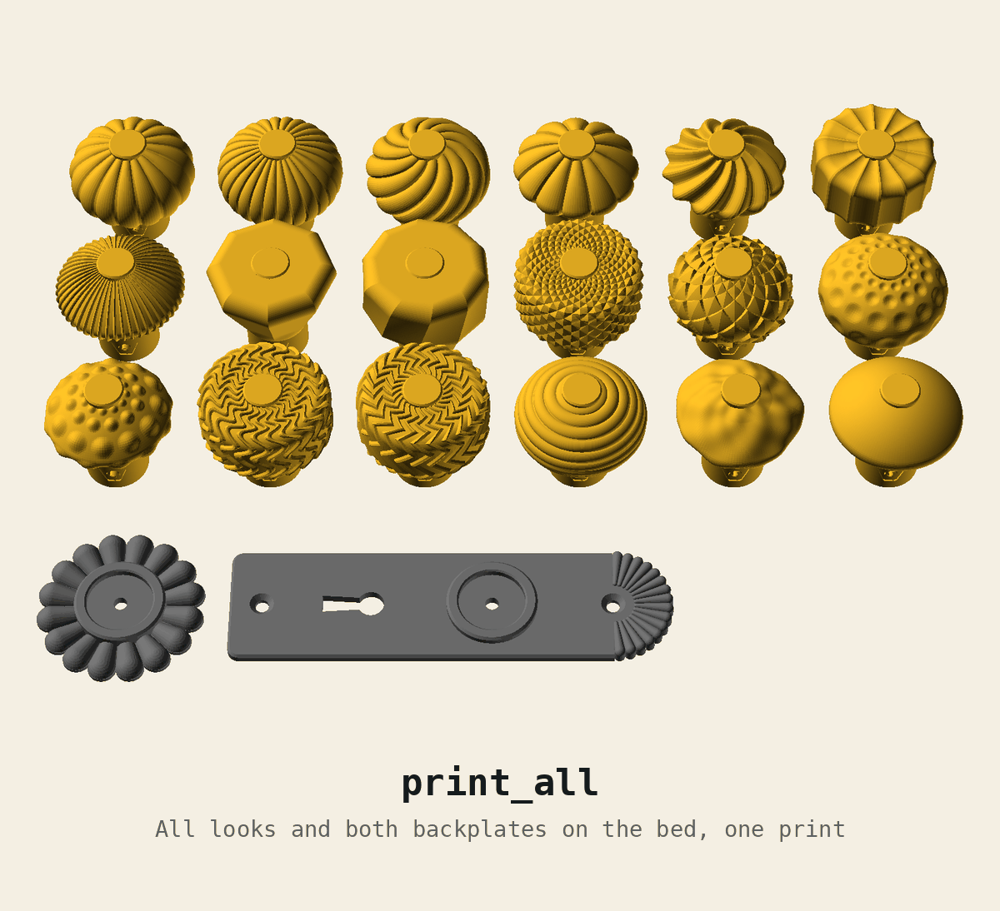

# Decorative door knob and backplate

`door_knob_decorativeV3.scad`: the door knob in 4 head shapes and 13 surface styles, and a backplate that takes its shaft. Standalone, no libraries. Screw hole and slots are those of `door_knob.scad`, see `USAGE.md`. **V3; nothing of it is printed yet.**







| File | What |
|---|---|
| `door_knob_decorativeV3.scad` | the generator. `part`: knob, backplate, print_all, assembly, styles, section, body, cutter, hole_profile |
| `door_knob_decorativeV3.json` | 18 Customizer presets, the looks of `part` = styles |
| `door_knob_decorativeV3_knob.stl`, `_backplate_rosette.stl`, `_backplate_arch.stl` | the parts at the defaults, as they print |
| `door_knob_decorativeV3_print_all.3mf` | `part` = print_all exported: the 18 looks and both backplates as one object of 20 bodies |
| `rendered_parts/` | every part under its name |
| `archive/` | V1 `door_knob_decorative.scad`, V2 with its presets |
| `inspiration/` | the knobs and backplates this is modelled after |

## Parts

| `part` | What | Size at the defaults | Print |
|---|---|---|---|
| `knob` | head, shaft, blind screw hole with slots, logo in the crown button | Ø33.5 × 32.6 | standing on the mounting face |
| `backplate` | `backplate` = rosette or arch, a ring for the shaft's foot, logo in the back | rosette Ø42 × 4.4; arch 30 × 110 × 4.4 | on its back |
| `print_all` | every look as a finished knob, six in a row in the order of `styles`, and both backplates in front, the tall one lying across | 231 × 160.5 on the bed, 6 between the parts | as the parts: knobs standing, plates on their backs |
| `assembly`, `styles`, `section`, `body`, `cutter`, `hole_profile` | views, not for printing | | |

## Head shapes

| `head_shape` | Outline | Own parameters |
|---|---|---|
| `mushroom` | the original's arcs (neck R8.04, R20, rim R3, R20), scaled to `head_diameter` and `head_height` | |
| `ball` (default) | an ellipsoid on a cone that leaves the shaft at `overhang_angle`; `head_height` 30 makes it nearly round | `overhang_angle` 40 |
| `drum` | cone at `overhang_angle`, straight wall, flat top | `overhang_angle`, `edge_radius` 4 |
| `cone` | cone from the shaft up to the rounded top edge, flat top | `edge_radius` |

## Styles

| `style` | Relief | `pattern_count` counts | `invert_pattern` gives |
|---|---|---|---|
| `smooth` | none | | |
| `melon` (default) | round lobes, sharp grooves between them | lobes | scoops with sharp ridges |
| `flutes` | a sine wave around the head | waves | the same, shifted |
| `ribs` | narrow ribs, flat valleys | ribs | narrow grooves |
| `facets` | flat sides: every level cut is a polygon | sides | nothing; `pattern_depth` is not used either |
| `diamond` | pyramids, a knurl | pyramids around | pits |
| `scales` | scales pointing up, as on a pinecone | scales around | pockets |
| `dimples` | round dimples in staggered rows | dimples around | hobnail bumps |
| `waves` | ribs swinging left and right | ribs | grooves |
| `chevron` | ribs in a zigzag | ribs | grooves |
| `rings` | round rings, sharp grooves, a beehive | rings from shaft to crown | grooved rings |
| `organic` | a sum of sines, changed by `noise_seed` | | its negative |
| `custom` | `custom_relief(angle, t)` in the file | | its negative |

- The relief is cut into the head along the surface normal, `pattern_depth` deep: `head_diameter` stays the largest diameter.
- It fades in over `shoulder_fade` of the outline above the shaft, is full from half the head's radius outwards and shrinks with the radius inside that, so the pattern runs into the button or the pole.
- `twist_turns` turns every style; `reverse_twist` the other way.
- `diamond`, `scales`, `dimples`, `waves`, `chevron`: the cells shrink with the head's radius, towards shaft and crown; `pattern_stretch` is their height against their width.
- `button_diameter` 0: no button, the pattern meets in the pole.
- Keep `pattern_depth` below the rounding of the edge it crosses: `edge_radius` (checked), the mushroom's rim, 3 at the default size (not checked).

## Looks

The presets of the JSON, in the order of `part` = styles. All at the default sizes.

| Preset | `head_shape` | `style` | `pattern_count` | `pattern_depth` | `twist_turns` | `invert_pattern` |
|---|---|---|---|---|---|---|
| 01 - Melon (the defaults) | ball | melon | 16 | 1.2 | 0 | |
| 02 - Fine melon | ball | melon | 26 | 0.8 | 0 | |
| 03 - Turban | ball | melon | 12 | 1.4 | 0.3 | |
| 04 - Flower | mushroom | melon | 12 | 1.6 | 0 | |
| 05 - Twisted flutes | mushroom | flutes | 12 | 2 | 0.2 | |
| 06 - Scoops | drum | melon | 14 | 1.2 | 0 | yes |
| 07 - Sunburst | mushroom | ribs | 48 | 0.6 | 0 | |
| 08 - Octagon | cone | facets | 8 | | 0 | |
| 09 - Twisted decagon | drum | facets | 10 | | 0.1 | |
| 10 - Knurl | drum | diamond | 24 | 0.8 | 0 | |
| 11 - Pinecone | ball | scales | 12 | 1.2 | 0 | |
| 12 - Dimples | ball | dimples | 14 | 0.8 | 0 | |
| 13 - Hobnail | mushroom | dimples | 12 | 1 | 0 | yes |
| 14 - Wavy ribs | drum | waves | 24 | 0.8 | 0 | |
| 15 - Chevron | drum | chevron | 24 | 0.8 | 0 | |
| 16 - Beehive | ball | rings | 10 | 0.8 | 0 | |
| 17 - Organic | mushroom | organic | | 1.6 | 0 | |
| 18 - Smooth original | mushroom | smooth | | | 0 | |

## Backplates

| `backplate` | What | After | Held by |
|---|---|---|---|
| `rosette` (default) | `backplate_count` 16 petals around the ring, lying on the door, 4 high at their ends | `inspiration/image.png` | the knob's screw |
| `arch` | tall plate, a fan of 16 flutes on its round top, `keyhole` cut through | `inspiration/inspo.png` | the knob's screw and two countersunk `plate_screw_diameter` 3 wood screws, in the fan and at the bottom |

| Fit | Value | Result |
|---|---|---|
| shaft Ø16 in the ring, `shaft_clearance` per side | 0.3: Ø16.6, 2 deep, 0.4 lead-in | untested |
| knob's 2.8 screw through the plate | Ø3.4 | untested |
| screw length | 2.4 more than without a backplate: the plate's thickness | |
| logo | button: 7 wide; back of the plate: 11.4 wide, inside the ring; both 0.6 deep | |

- Not built: the pierced scrollwork plate of `inspiration/image copy 2.png`. It needs a drawing of the scrolls (SVG or DXF) to extrude.

## Printing

- Not printed. Layer 0.2, no support intended.
- Under the head: `ball` and `drum` start as a cone 40 degrees from flat (`overhang_angle`), `cone` at 64, `mushroom` at 35 as the original.
- A relief under the head makes the overhang locally flatter than that; raise `shoulder_fade` to keep it away from there.
- Check the slots around the screw hole in the slicer, as for `door_knob.scad`.

## Custom formula

`style` = custom, then edit in the file:

```scad
function custom_relief(angle,t) =
    (1 + sin(5*angle + 360*t)*cos(720*t))/2;
```

| | |
|---|---|
| `angle` | around the head, 0 to 360 degrees; OpenSCAD's trigonometry takes degrees |
| `t` | 0 at the shaft, 1 at the crown, along the outline |
| result | 1: on the head's surface, 0: `pattern_depth` deep |
| seam | whole numbers of repeats in `angle` |

## Mesh

| Rule | Value |
|---|---|
| columns around | `pattern_count` × at least 8, at least `radial_segments`; grooves lie on columns |
| rows along the head | evenly spaced on a map of the head that keeps shapes (rows get closer as the head gets narrower), at least `profile_segments` |
| diamonds, scales, dimples | every mesh quad is split along the diagonal that follows the relief |
| checked | all 18 looks and 26 other variants export closed, every edge on two triangles (OpenSCAD 2021.01, CGAL); knob and both backplates are one body each |
| render time | 13 s for the default knob, 31 000 triangles; 72 ribs make 118 000 and take minutes |
| `print_all` | F5 preview at once; F6 or an export 13 minutes and over 4 GB of memory: use the 3MF |
| the 3MF | 20 bodies, every edge on two triangles, 631 084 triangles, 231 × 160.2 × 32.6, 270 cm³ solid; not sliced, not opened in a slicer |

## V3 against V2

| | V2 | V3 |
|---|---|---|
| `part` = print_all | | the 18 looks as finished knobs and both backplates laid out for one print |
| knob, rosette | | unchanged (meshes compared: the same triangles) |
| arch backplate | the fan stood exactly on the plate and exported as a second body | the fan is sunk 0.01 into the plate: one body |

## V2 against V1

| | V1 `door_knob_decorative.scad` | V2 |
|---|---|---|
| head shapes | mushroom | mushroom, ball, drum, cone |
| styles | 5: twisted_flutes, waves, organic, plain, custom | 13, each also inverted and twisted |
| relief | pushed out and in around the surface, level, by ± `decoration_depth`; faded out before the crown | cut in along the normal by `pattern_depth`; runs into the crown |
| largest diameter | `head_diameter` + 2 × depth | `head_diameter` |
| crown | plain | button with the logo, or the pattern meeting in the pole |
| backplate | none | rosette or tall plate with fan and keyhole |
| presets, overview | none | 18 in the JSON, `part` = styles |
| `decoration`, `wave_count`, `decoration_depth` | | renamed `style`, `pattern_count`, `pattern_depth` |
| `vertical_waves` | ripples of V1's waves | gone; `waves` now means wavy ribs, `pattern_stretch` sets their length |
| `custom_displacement(angle,t)`, mm in and out | | `custom_relief(angle,t)`, 0 to 1 |
| mesh rows | level, evenly spaced in height: coarse on the crown | along the outline, see Mesh |
