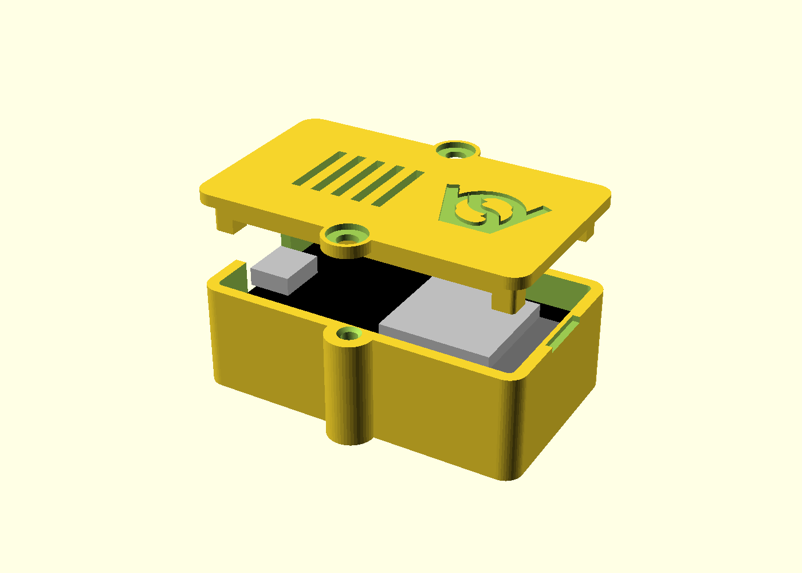
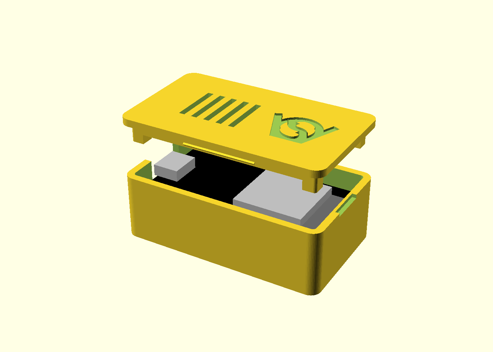

# ESP32 unofficial board enclosure

A small FDM printable case for an unofficial ESP32 dev board (ESP32-WROOM-32,
USB-C, 2 x 15 pins). No drawing of the board was found, so it was measured by
hand, see `dimensions.png`.

`esp32_unofficial_enclosureV1.scad` makes a base and a lid.

- The board lies in the base with the pins down, on a block in each corner.
  The walls locate it, four legs under the lid hold it down.
- USB-C window in one short wall, sized for the plug's overmould.
- A notch in the wall opposite the USB port lets a fingernail under the lid.
- Vent slots and the VeryOS logo in the lid, logo and version in the bottom.

## lid fixing

`lid_fix` chooses how the lid is held.

| `lid_fix` | Lid held by | Outer size | Extra parts |
|---|---|---|---|
| `printed` (default) | two printed 5 mm screws | 56.6 x 45.8 x 20 | 2 printed screws |
| `m3` | two M3 x 10 screws, forming their thread in 2.7 mm holes | 56.6 x 41.5 x 20 | 2 M3 x 10 |
| `push` | a bead on each long side of the lid's lip, snapping into the wall | 56.6 x 33.2 x 20 | none |

The board fills the box, so the screws sit outside it: a boss on the middle
of each long wall, an ear on the lid.

| m3 | push |
|---|---|
|  |  |

The printed screws follow `01_published_or_archived/fdm_optimized_screws` and
its print tests: 5 mm (the smallest that works), 2 mm pitch, 45 degree flanks,
0.25 mm clearance per side in the hole, 1 mm tip chamfer, printed lying with
the underside cut off, so the layers run along the shank. Hex head 9 mm across
flats with a slot for a coin or screwdriver.

## measures used

| Measure | Value |
|---|---|
| Board | 52 x 28.6 |
| USB-C beyond the board's edge | 1 |
| Height, pin tips to top of the parts | 13 |
| Mounting holes | 2.8, 47 apart along the board; not used, the distance across is not measured |

## printing

Base as is, lid top face down, printed screws lying on their cut. No support.
`part = "print_layout"` puts all parts on the bed. Exports:
`esp32_unofficial_enclosureV1_<lid_fix>_base.stl`, `_lid.stl` and
`esp32_unofficial_enclosureV1_printed_screw.stl` (print two).

## not in V1

- The pins are closed in, as in the inspiration: the case is for a board
  running on USB alone.
- EN and BOOT cannot be pressed with the lid on; their positions are not
  measured.
