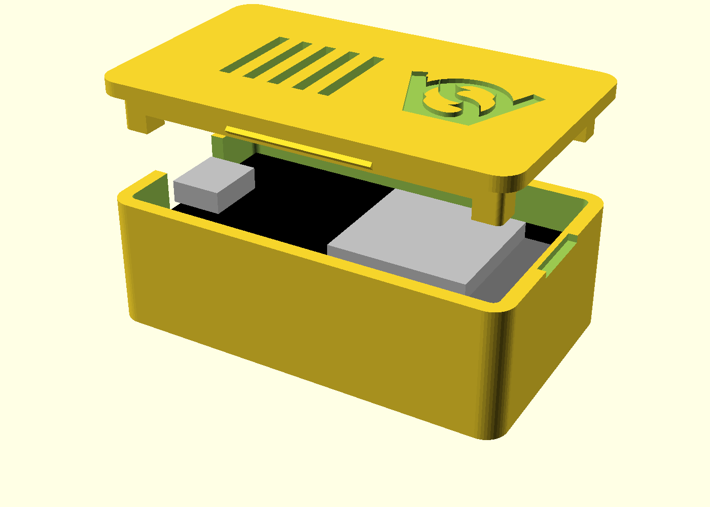

# ESP32 unofficial board enclosure

A small FDM printable case for an unofficial ESP32 dev board (ESP32-WROOM-32,
USB-C, 2 x 15 pins). No drawing of the board was found, so it was measured by
hand, see `dimensions.png`.

`esp32_unofficial_enclosureV1.scad` makes two parts, base and snap-on lid, no
screws. Outer size 56.6 x 33.2 x 20 mm.

- The board lies in the base with the pins down, on a block in each corner.
  The walls locate it, four legs under the lid hold it down.
- USB-C window in one short wall, sized for the plug's overmould.
- The lid snaps in with a bead on each long side. A notch in the wall opposite
  the USB port lets a fingernail under it.
- Vent slots and the VeryOS logo in the lid, logo and version in the bottom.

## measures used

| Measure | Value |
|---|---|
| Board | 52 x 28.6 |
| USB-C beyond the board's edge | 1 |
| Height, pin tips to top of the parts | 13 |
| Mounting holes | 2.8, 47 apart along the board; not used, the distance across is not measured |

## printing

Base as is, lid top face down. No support. `part = "print_layout"` puts both on
the bed; `esp32_unofficial_enclosureV1_base.stl` and `_lid.stl` are the exports.

## not in V1

- The pins are closed in, as in the inspiration: the case is for a board
  running on USB alone.
- EN and BOOT cannot be pressed with the lid on; their positions are not
  measured.
