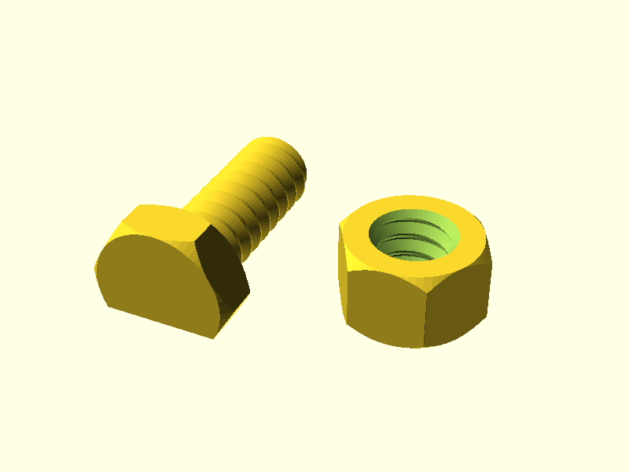
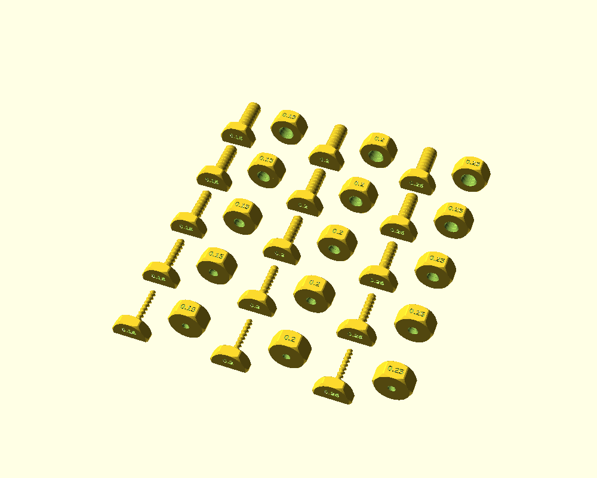
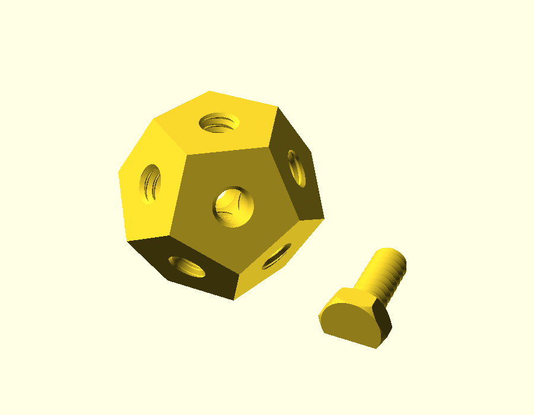

the goal is to create a usable fdm printable screw with no supports. 

so far i found out: 
    - a 45 degrees angled thread works best for fmd printing
    - a pitch of 2mm is best
    - when the screw diameter gets smaller, some parameters may need to change.
    - the smallest screw i could make is 5mm diameter
    - if the screw cylinder is printed upwards, the screw easily breaks when screwed in , because the extruded plastic lines are short and extrusion sausages between layers have not much contact and no strong bonds
    - it would be better to print the screws with the screw cylinder horizontally layed on the printbed 
        - to prevent support, it is required to cut off a part of the screw

    

`fdm_optimized_screws.scad` generates a hex head screw and a matching nut that
print without support. The thread is the 45 degree thread of the softbox screws
(`cuboid_video_light_softbox`).

## printing

Set `part = "print_layout"` to get the screw and the nut in their print
orientation.
- screw: lying on a flat of its head. `screw_cut` (default 0.1) is the share of
  the thread diameter cut off its underside, through the shank and the head, so
  both stand on the bed.
- nut: flat on the bed. Both ends of the hole have a 45 degree lead-in.

## sizes

The defaults are an 8 mm thread with a 2 mm pitch, a 20 mm shank and a 13 mm
head and nut (across flats). Change `thread_diameter`, `thread_pitch`,
`screw_length`, `screw_head_width`, `screw_head_height`, `nut_width` and
`nut_height` for other sizes.

## thread fit

`thread_clearance` (default 0.15 mm) is the radial gap between the screw and
the nut. Raise it if the nut is tight, lower it if it is loose.
`part = "assembly"` shows the nut on the screw.

## testing

`part = "testing"` lays out a screw and a nut for every diameter in
`test_diameters` (3, 4, 5, 6, 7 mm) and every clearance in `test_clearances`
(0.15, 0.2, 0.25 mm), 15 pairs in all. The clearance is engraved on the end
face of the screw head and on one side of the nut. All of it is in the nut, as
with `thread_clearance`, so screws of the same diameter are the same and the
number tells which nut they belong to. All parts have the 2 mm pitch and a
15 mm head and nut (`test_width`), wide enough for the numbers.

The nuts lie on a side, with the number on top, so their holes run parallel to
the bed. That leaves an overhang inside the thread, which is what this set
tests: how well the thread prints sideways.

Screw each screw into its nut and set `thread_clearance` to the smallest
clearance that runs smoothly.

The set takes about 130 x 145 mm of the bed. Rendering it (F6) can take 20
minutes in OpenSCAD 2021.01.

## dodecahedron test

`part = "dodecahedron"` is a nut shaped like a regular dodecahedron (pentagon
faces), with a threaded hole from each face to the opposite one, and a screw
to test them. It uses the thread settings above (`thread_diameter`,
`thread_pitch`, `thread_clearance`).

It prints on a face without support. That gives the six holes two directions
to the bed: one stands upright and the other five rise at 26.6 degrees. Each
hole can be tested from both ends.

The holes cross in the middle, so each one has whole thread only from about
1.1 x `thread_diameter` out from the centre to the face. `dodecahedron_size`
(default 36 mm) is the distance between opposite faces; with the default 8 mm
thread that leaves about 4 turns at each end of a hole.
