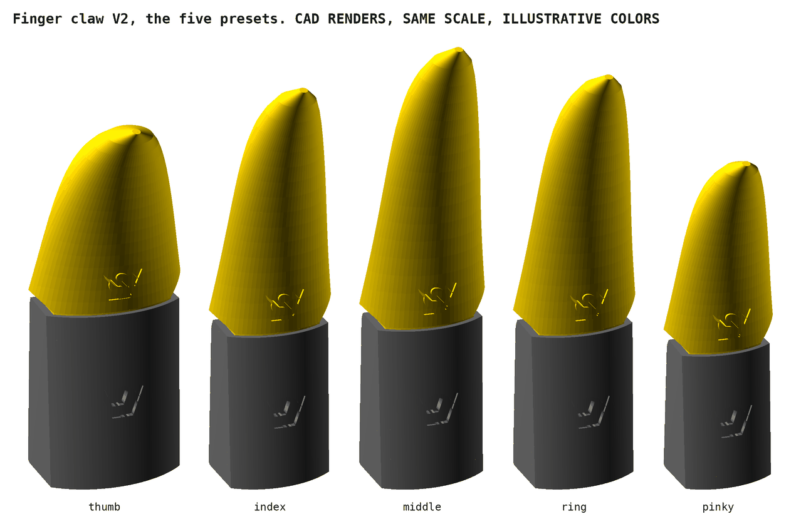

# Finger claws

A long claw that slides onto a fingertip, built from OpenSCAD primitives: a flexible sleeve on the finger, a hard claw in it. It is a base model: functional, deliberately plain, made to be decorated in a sculpting program. V2; not printed yet. Until 2026-11-12 the project was `articial_fingernails`.

| File | What |
|---|---|
| `finger_clawsV2.scad` | the generator, standalone, no libraries. `part`: assembly, section, sleeve, claw |
| `finger_clawsV2.json` | Customizer presets: thumb, index, middle, ring, pinky |
| `stl/` | sleeve and claw of each preset, both in the sleeve's coordinates |
| `rendered_parts/` | every part under its name |
| `archive/` | V1, `artificial_fingernail.scad`: one hard part |
| `readme_hgc.md`, `readme_hgc_2026_11_12.md` | original goal; the notes behind V2 |
| `image.png`, `inspiration/` | claws this is modelled after; photos of a printed demon nail |

## Parts

| Part | Of | Does | Made of |
|---|---|---|---|
| sleeve | TPU | all that touches the finger: a tube over the last phalanx, `wall` 1.2, narrowing as the finger does. No slit: it stretches | cone of ellipses |
| pocket | sleeve | holds the tongue, on the nail side under a `cover` 0.8 thick; closed 2 above the open end | the tongue plus `joint_clearance` |
| pad opening | sleeve | the fingertip's pad is free `tip_free` from the tip down | slope at 55° |
| lead-in | sleeve | open end's inner edge, chamfered 0.6 | cone |
| claw | PLA | tongue and blade, one piece | |
| tongue | claw | sits in the pocket: as wide as the fingertip, `tongue_t` 3 thick, its end chamfered | strip of a shell around the finger |
| blade | claw | continues the nail `claw_length` past the tip, bends `claw_bend`° towards the nail side in an arc, leans back `claw_lean` on top. Above the sleeve it stands 1.3 off the finger | ellipses across a spine, narrowing as √(1 − t), hulled segment by segment |
| shoulders | claw | the blade widens from the tongue's width at 45° | cut along two slopes |
| scoop | claw | hollows the blade's underside up to ¾ of its length; closes at 45° at most | smaller ellipses on the same spine, swept towards the pad |
| facets | claw | `facets` = 6…16 makes the blade a prism, flat on the nail side; 0 is smooth | `$fn` of the blade's sections |
| logo | both | VeryOS logo, 0.4 deep on the nail side: in the sleeve's cover and in the blade above it | `linear_extrude()` minus the inset surface |

## Two materials

| Way | `joint_clearance` | How |
|---|---|---|
| two prints | 0.1 per side, as exported | print sleeve and claw apart, push the tongue into the pocket until it stands on the pocket's floor |
| one print | 0, or as exported | load both STLs of a finger as one object with two parts: they share their origin. Sleeve TPU, claw PLA |

- Friction holds the claw: the cover and the finger in the sleeve press on the tongue. A hard pull takes the claw out of the sleeve; there is no catch.
- The sleeve ends 0.2 below the blade's shoulders: the tongue's end on the pocket's floor stops the claw, nothing else.

## V2 against V1

| | V1 | V2 |
|---|---|---|
| name | `articial_fingernails`, `artificial_fingernail.scad` | `finger_claws`, `finger_clawsV2.scad` |
| parts | 1, hard | 2: sleeve of TPU, claw of PLA |
| finger's section | 14 × 12, one `fingertip_scale` for width and thickness | flat oval: 15 × 11 at the crease, 14 × 9.5 at the nail's middle, each measured |
| on the finger | hard plastic; slit 2 wide, knuckle notch | TPU only; no slit, no notch, inner edge chamfered |
| blade starts | where the pad gets free | at the fingertip |
| blade's thickness | 1.6 at the base, 2.5 at the scoop's end | 3 throughout, as the tongue |
| scoop's end | closes as steep as the numbers make it | closes at 45° at most |
| facets | sleeve and blade; skewed: x from −4.92 to 4.76 at z = 50 with `facets` = 8 | blade only, symmetric |
| preview | cutting shapes 200 large: it breaks when the camera is inside one | cutting shapes as large as the claw; `section` rendered in full |
| size, index, w × d × h | 17.2 × 25.1 × 64.4 | 19.7 × 24.4 × 64.6; the sleeve 17.4 × 17.4 × 24.8 |

## Fit

Not printed yet. All fits are untested.

| Parameter | Measure |
|---|---|
| `finger_w`, `finger_h` | width and thickness, nail to pad, at the crease of the last joint |
| `fingertip_w`, `fingertip_h` | width and thickness at the middle of the nail, 7 mm from the tip |
| `finger_length` | fingertip to the crease of the last joint, along the finger |
| `clearance` | added to widths and thicknesses; default 0. Below 0 the sleeve has to stretch and grips |
| `tip_free` | how much of the pad is free; longer frees more, grips less |

| Preset | Crease, w × h | Nail, w × h | `finger_length` | `tip_free` | `claw_length` |
|---|---|---|---|---|---|
| thumb | 20 × 14 | 19 × 12 | 28 | 10 | 30 |
| index | 15 × 11 | 14 × 9.5 | 25 | 9 | 40 |
| middle | 15.5 × 11.5 | 14.5 × 10 | 26 | 9 | 45 |
| ring | 15 × 11 | 14 × 9.5 | 25 | 9 | 42 |
| pinky | 13 × 9.5 | 12 × 8 | 22 | 8 | 32 |

- The presets are not measured fingers: V1's presets with the same circumference, pressed flat to ¾. Measure the finger.

## Strength

From the exported meshes, at 25 MPa across the layers. Not from a print.

| Preset | Weakest section | Tip force to the nail side | To the pad side |
|---|---|---|---|
| index | the tongue where it leaves the sleeve, 13.6 × 3 | 10 N | 16 N |
| thumb | same, 18.7 × 3 | 21 N | 34 N |
| middle, ring, pinky | same | 10 N | 15 N |

- `tongue_t` 2 gives 5.5 N on the index: the reason for 3.
- The tongue is only as wide as the fingertip, so that the sleeve's sides stay `wall` thick between the fingers. A tongue down to the finger's widest place would be 3 to 5 times as strong and make the sleeve 4 thicker per side.

## Print

| | Sleeve | Claw |
|---|---|---|
| material | TPU; 95A assumed | PLA |
| on the bed | open end | tongue's end, tip up |
| support | none | none; a brim: it stands on 22 to 38 mm² |
| overhangs beyond 45° | the logo's strokes | the scoop's end, a bridge 2 wide, and the logo's strokes |
| volume, index | 1.9 cm³ | 2.6 cm³ |

- 0.2 mm layers.
- The claw's centre of mass is above its foot in all five presets. With more `claw_bend` or `claw_length` it is not (`claw_bend` 45, `claw_length` 80: about 5 beside it).
- The thin blade prints slowly at minimum layer time; a second part on the bed gives each layer time to cool.

## Sculpting

- Sculpt the blade only. Import the claw's STL, voxel remesh it first: OpenSCAD's long thin triangles do not sculpt.
- Keep the tongue as it is: it sets the fit in the pocket. The sleeve needs no sculpting.
- Keep the blade 2 thick or more where it leaves the sleeve, see Strength.
- Keep 45° or less on overhangs, or plan supports.

## Open

| | |
|---|---|
| fits | sleeve on the finger, tongue in the pocket: both untested |
| pull-out | friction only. If the claw comes off too easily: `joint_clearance` 0, glue, or a catch in V3 |
| TPU | hardness and wall for comfort unknown; `wall` 1.2 and `cover` 0.8 are first guesses |
