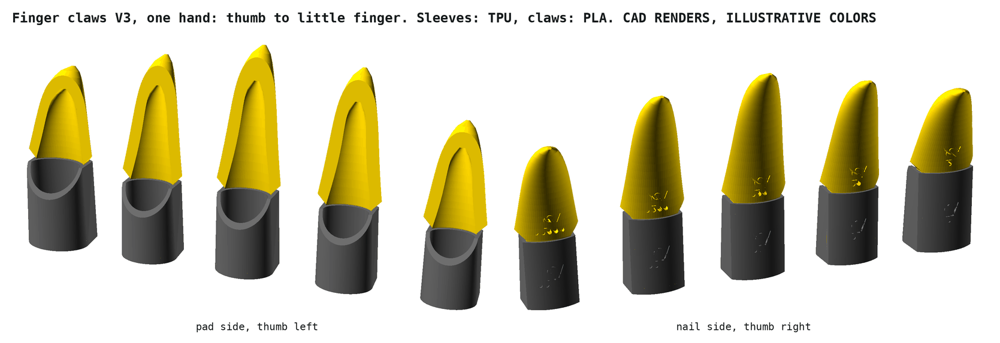
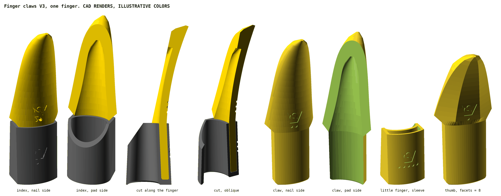

# Finger claws

Long claws that slide onto the fingertips, built in OpenSCAD: a flexible sleeve on each finger, a hard claw in it. The script makes all five fingers of one hand at once. It is a base model: functional, deliberately plain, made to be decorated in a sculpting program. V3; not printed yet. Until 2026-11-12 the project was `articial_fingernails`.

| File | What |
|---|---|
| `finger_clawsV3.scad` | the generator, standalone, no libraries. `part`: assembly, section, sleeve, claw. `finger`: hand, or one finger |
| `stl/finger_clawsV3_hand_sleeves.stl`, `_hand_claws.stl` | the five sleeves and the five claws at the defaults, both in the same coordinates |
| `rendered_parts/` | every part under its name |
| `archive/` | V2: one finger per run, presets in a JSON. V1, `artificial_fingernail.scad`: one hard part |
| `readme_hgc.md`, `readme_hgc_2026_11_12.md` | original goal; the notes behind V2 |
| `image.png`, `inspiration/` | claws this is modelled after; photos of a printed demon nail |

## The hand

| Finger | Dots | Width at the crease | Thickness there | Nail's middle, w × h | Length | Claw |
|---|---|---|---|---|---|---|
| thumb | 1 | 19, measured | 13.5 | 18 × 11.5 | 28 | 30 |
| index | 2 | 16.5, measured | 12 | 15.5 × 10.5 | 25 | 40 |
| middle | 3 | 17, measured | 12.5 | 16 × 11 | 26 | 45 |
| ring | 4 | 16, measured | 11.5 | 15 × 10 | 25 | 42 |
| little | 5 | 15, measured | 11 | 14 × 9 | 22 | 32 |

- Only the widths are measured (2026-11-12), and taken as the width at the last joint's crease. Thickness and nail are V2's presets scaled to these widths, length and claw are V2's: estimates. Measure them too, see Fit.
- Each finger has its tab in the Customizer: `thumb_w`, `thumb_h`, `thumb_tip_w`, `thumb_tip_h`, `thumb_length`, `thumb_claw`, and the same for `index_`, `middle_`, `ring_`, `pinky_`.
- `finger` = hand: the five stand in a row along x, 33.4 apart, the thumb on the origin: 155 × 27 × 70.5. `finger` = thumb … pinky: that finger alone, on the origin.
- Sleeve and claw of a finger carry its number as dots under the logo: the index and the ring finger's sleeves differ by 0.5.

## Parts

Per finger.

| Part | Of | Does | Made of |
|---|---|---|---|
| sleeve | TPU | all that touches the finger: a tube over the last phalanx, `wall` 1.2, narrowing as the finger does. No slit: it stretches | cone of ellipses |
| pocket | sleeve | holds the tongue, on the nail side under a `cover` 0.8 thick; closed 2 above the open end | the tongue plus `joint_clearance` |
| pad opening | sleeve | the fingertip's pad is free `pad_free` of the finger's length from the tip down | slope at 55° |
| lead-in | sleeve | open end's inner edge, chamfered 0.6 | cone |
| claw | PLA | tongue and blade, one piece | two skins: its outside, its hollow |
| tongue | claw | sits in the pocket: as wide as the fingertip, `tongue_t` 3 thick, its end chamfered | the outside's first sections, the finger's |
| blade | claw | continues the nail by the finger's claw length past the tip, bends `claw_bend`° towards the nail side in an arc, leans back `claw_lean` on top. Above the sleeve it stands 1.3 off the finger | ellipses across a spine, narrowing as √(1 − t) |
| shoulders | claw | the blade widens from the tongue's width at 45° | cut along two slopes |
| scoop | claw | hollows the blade's underside up to ¾ of its length; closes at 45° at most | smaller ellipses on the same spine, open towards the pad |
| facets | claw | `facets` = 6…16 makes the blade a prism with a flat on the nail side; 0 is smooth | the sections as polygons |
| logo, dots | both | VeryOS logo with the finger's number in dots under it, 0.4 deep on the nail side: in the sleeve's cover and in the blade above it | `linear_extrude()` minus the inset surface |

## Two materials

| Way | `joint_clearance` | How |
|---|---|---|
| two prints | 0.1 per side, as exported | print the sleeves in TPU and the claws in PLA, push each tongue into the pocket with the same dots until it stands on the pocket's floor |
| one print | 0, or as exported | load both STLs as one object with two parts: they share their origin. Sleeves TPU, claws PLA |

- Friction holds the claw: the cover and the finger in the sleeve press on the tongue. A hard pull takes the claw out of the sleeve; there is no catch.
- The sleeve ends 0.2 below the blade's shoulders: the tongue's end on the pocket's floor stops the claw, nothing else.

## V3 against V2

| | V2 | V3 |
|---|---|---|
| fingers | one per run; five presets in a JSON | the hand at once, or one finger; each finger's measures are parameters |
| sizes | presets, estimated | widths as measured: 19, 16.5, 17, 16, 15 |
| marks | logo | logo and the finger's number in dots |
| free pad | `tip_free`, mm | `pad_free`, part of the finger's length: 0.36 |
| claw | hulled segments and cones, unioned | two skins, each one polyhedron. Same shape: 2.604 cm³ at V2's index measures, V2 2.605 |
| full render | claw 39 s, sleeve 3 s | claw 2.5 s, sleeve 2.5 s; hand: claws 25 s, sleeves 30 s |
| facets | a flat on the nail side only with 8, 12, 16; a corner with 6 | always a flat on the nail side |
| preview | logo's cut shows in the scoop and in the sleeve | starts inside the wall |
| files | 10 STLs, one finger each | 2 STLs, the hand |

V2 against V1: see `archive/` and the git history of this file.

## Fit

Not printed yet. All fits are untested.

| Parameter | Measure |
|---|---|
| `…_w`, `…_h` | width and thickness, nail to pad, at the crease of the last joint |
| `…_tip_w`, `…_tip_h` | width and thickness at the middle of the nail, 7 mm from the tip |
| `…_length` | fingertip to the crease of the last joint, along the finger |
| `…_claw` | how far the blade reaches past the fingertip |
| `clearance` | added to all widths and thicknesses; default 0. Below 0 the sleeve has to stretch and grips |
| `pad_free` | how much of the pad is free; more frees more, grips less |

## Strength

From the exported meshes, at 25 MPa across the layers. Not from a print. The weakest section is the tongue where it leaves the sleeve.

| Finger | Tongue | Tip force to the nail side | To the pad side |
|---|---|---|---|
| thumb | 17.7 × 3 | 19 N | 31 N |
| index | 15.1 × 3 | 12 N | 19 N |
| middle | 15.6 × 3 | 11 N | 18 N |
| ring | 14.6 × 3 | 11 N | 17 N |
| little | 13.5 × 3 | 13 N | 19 N |

- `tongue_t` 2 gave 5.5 N on V2's index: the reason for 3.
- The tongue is only as wide as the fingertip, so that the sleeve's sides stay `wall` thick between the fingers. A tongue down to the finger's widest place would be 3 to 5 times as strong and make the sleeve 4 thicker per side.

## Print

| | Sleeves | Claws |
|---|---|---|
| material | TPU; 95A assumed | PLA |
| on the bed | open end | tongue's end, tip up |
| plate | 153 × 20, 27.8 high | 155 × 16, 68.4 high |
| support | none | none; a brim: each stands on 26 to 36 mm² |
| overhangs beyond 45° | the logo's strokes and the dots | the scoop's end, a bridge 2 wide, the logo's strokes and the dots |
| volume | 10.3 cm³ | 14.3 cm³ |

- 0.2 mm layers.
- The two STLs hold five separate bodies each; the slicer can split them to move or reprint one. One finger alone: `finger` = its name, then export.
- Each claw's centre of mass is above its foot. With more `claw_bend` or a longer claw it is not (`claw_bend` 45, 80 long: about 5 beside it).
- The thin blades print slowly at minimum layer time; five on the bed give each layer time to cool.

## Sculpting

- Sculpt the blade only. Export the claw of one finger, voxel remesh it first: OpenSCAD's long thin triangles do not sculpt.
- Keep the tongue as it is: it sets the fit in the pocket. The sleeve needs no sculpting.
- Keep the blade 2 thick or more where it leaves the sleeve, see Strength.
- Keep 45° or less on overhangs, or plan supports.

## Open

| | |
|---|---|
| measures | only the five widths are measured; thickness, nail and length are estimates |
| fits | sleeve on the finger, tongue in the pocket: both untested |
| pull-out | friction only. If a claw comes off too easily: `joint_clearance` 0, glue, or a catch in V4 |
| TPU | hardness and wall for comfort unknown; `wall` 1.2 and `cover` 0.8 are first guesses |
| straight blade | with `claw_bend` 0 the blade's lower edges cut its tip off: 3 of 40 at `claw_lean` 2, 16 of 45 at `claw_lean` 0. From 5° on it is whole. So since V1 |
