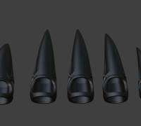

lessons learned. 

when looking at a finger from the front i saw that the finger is actually a rather flat pressed circle , so a elipse that is more wide than high. 

knowing this we can create a better 'finger claws'

i talked to an agent machine and got this : 
---
me:
is there a name for kind of fingernail extensions. but not only small ones that are glued ontop of the real nail, but rather 'aufsaetze' that canbe sticked on the fingers
---
machine: 
Yes! What you're describing is usually called finger claws, fingertip caps, or nail rings — extensions that fit around the fingertip rather than being glued directly onto the natural nail.

Nail Ring Claws, Finger Armor Set Wudu Nails Rings, Metal Fingertip Ring, Goth Jewel Claws Hand Armor Glove (SET OF 10): Silver / Gold Color - Etsy

Finger claws / fingertip caps

Slip over the fingertips, often with elongated, pointed ends.

Wudu Nail Rings 10pcs - Gold
    
    
    
      – Irresistible Cosmetics

Nail rings / Wudu nail rings

Artificial nails attached to rings that wrap around the fingers, without gluing them to your natural nails.

Other useful search terms are finger extensions, finger armor, and wearable nail claws.

Are you looking for something that resembles normal long acrylic nails, just attached to the fingers instead of the nails, or something more like the decorative claws shown above?
---
yes  the project should be renamed to 'finger_claws'

here is some more inspiration

also somethign that is absolutely essential is to tinker around with the part that sits on the finger being TPU flexible material , but the claws being hard plastic like PLA.

