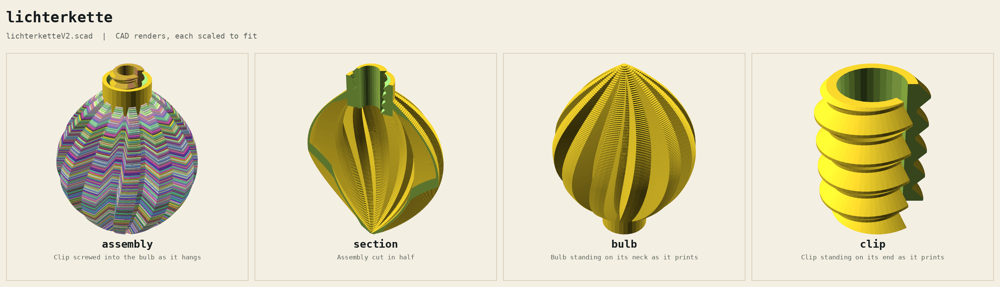

# Lichterkette

Printed bulbs for an LED string light (Landi Schweiz). A clip snaps onto the socket behind each LED and screws into the bulb's neck. V3, unprinted; V2 is printed and works, a bit tight.

| File | What |
|---|---|
| `lichterketteV3.scad` | the generator, standalone, no libraries. `part`: bulb and clip on the bed, assembly, section, bulb, clip |
| `lichterketteV3_bulb.stl`, `_clip.stl` | exported at the defaults, as they print |
| `rendered_parts/` | every part under its name |
| `archive/` | V2 and its STLs |
| `lichterketten_standards/landi_schweiz/` | `v1.scad`, the published push-in version (needs BOSL2 and an OpenSCAD newer than 2021.01), and its pictures |
| `webapp/` | any 3D object as a bulb: placed with the mouse, hollowed, on this neck, OBJ colours painted into a 3MF for Bambu Studio, a slice view; `deno task start`, port 8770, see `webapp/readme.md` |
| `deno.json` | the webapp's tasks: start, test, part |
| `readme_hgc.md` | original goal |

## Parts

| Part | Qty | Print |
|---|---|---|
| bulb | 1 per LED | standing on its neck, as v1; its wall is one line, 0.5 |
| clip | 1 per LED | standing on its end, tip up; no support |

1. Snap the clip onto the LED's socket, its tip towards the LED.
2. Hold the clip, screw the bulb on until it is tight: the neck's thread closes the clip's C on the socket.

## V3 against V2

| | V2 | V3 |
|---|---|---|
| print | printed 2026-11-14: works, a bit tight | unprinted |
| thread | clip straight, Ø7; the neck narrows from Ø7.5 at the entry to Ø6.4 at its end | both cones, 1.2 wider in diameter per 7 along the axis (`thread_taper`): neck Ø7.6 at the entry to Ø6.4 at its end, clip Ø6.8 at its tip to Ø8.3 at its other end |
| first turn | 0.25 loose per side | 0.4 loose per side |
| tightens | from halfway in, more and more towards the tip | over the last 2.3 (about one turn), evenly along the whole thread |
| all the way in | the C closes by 0.6 at the tip, 0 at the entry | the C closes by `clamp` 0.4 all along |
| clip's wall under the thread | 0.6 | 0.5 at the tip to 1.27 at the other end |
| LED's way through the neck | Ø4.8 | Ø4.8 |
| to print | | bulb and clip |

## V2 against v1

| | v1 | V2 |
|---|---|---|
| print | printed, published | printed 2026-11-14: works, a bit tight |
| clip in the bulb | pushed in: six ribs in the neck squeeze the clip from Ø6.0 at the entry to Ø4.8 at the end | screwed in: Ø7 thread, 2 mm pitch, 45° flanks, as fdm_optimized_screws |
| squeeze on the LED | clip Ø5.8 in Ø4.8: its C closes up to 1.0 | the neck's thread narrows from Ø7.5 to Ø6.4: 0.25 gap per side at the entry, the C closes by 0.6 at the end |
| clip | C, bore Ø4.2, wall 0.8, 50° open, 9 long, a brim ring Ø7 × 2 at its end | C, bore Ø4.2, wall 0.6 under the thread, 50° open (1.8 at the bore), 9 long, no brim ring |
| neck | Ø10 × 7 | Ø10 × 7 |
| bulb's shape | | unchanged |
| libraries | BOSL2 | none |

## Tune

All by reprinting the clip only.

| Problem | Change |
|---|---|
| bulb loose on the LED | raise `clamp` or lower `clip_bore` |
| too tight | lower `clamp` or raise `clip_bore` |
| clip cracks when snapped on | raise `clip_gap_angle` |

## Open

- The LED's socket is not measured: the clip keeps v1's bore Ø4.2.
- V3's clip is thicker towards its end than V2's (1.27 against 0.6 under the thread): untested whether it still snaps onto the socket.
- No VeryOS logo: the bulb's wall is one line, its neck (Ø10 × 7) is covered by the ribs above 3.7, the clip is Ø7 to Ø8.3.
