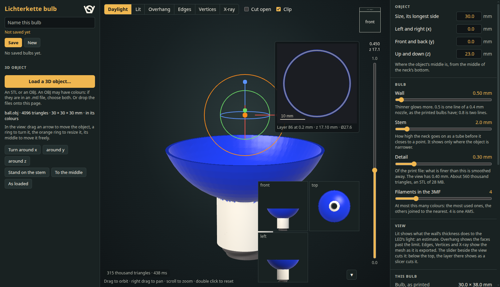

# Lichterkette bulb webapp

Makes a string light's bulb of any loaded 3D object: placed with the mouse, hollowed to a wall, joined to the neck that the clip of `../lichterketteV3.scad` screws into, in the colours of an OBJ. Bulbs are kept under names; the print files are STL, OBJ and 3MF, the 3MF painted with filaments for Bambu Studio. Built from the Object kind of `../../pucklight_lamp_v2/webapp`, copied.

| Start | |
|---|---|
| `deno task start` in `lichterkette/`, then http://127.0.0.1:8770 | everything; reachable from this computer only |
| `deno task start 8771` | on another port |
| `deno task test` | the tests, see Checks |
| `deno task part` | `part/bulb.json` and `part/clip.stl` again, after a change to `../lichterketteV3.scad`; needs `openscad` |

Needs [Deno](https://deno.com) and a browser with WebGL2.

## Bulbs

| | Control | On disk |
|---|---|---|
| Create | type a name, Save or Enter | `project/<name>/project.json` |
| Read | the list; the address `#<name>` opens it again after a reload | |
| Update | Save, or Ctrl+S; the line under the name says what is unsaved | `project.json`; the object in `object.stl`, its colours in `object_color.bin` |
| Copy, rename, delete | Save copy; another name and Save; × on its row, asks first | |

- API: `GET /api/project`; `GET`, `POST`, `PUT`, `PATCH`, `DELETE /api/project/<name>`; `GET`, `PUT`, `DELETE /api/project/<name>/object` and `/color`. Listens on 127.0.0.1 only, writes to `project/` only, refuses other web pages.

## Object

| Control | Does |
|---|---|
| Load a 3D object…, or files dropped onto the page | STL or OBJ; with an OBJ its `.mtl`, if its colours are there |
| at loading | its numbers are mm; below 10 or above 200 mm it becomes 40 mm; it stands in the middle, 2 mm into the stem |
| arrows, rings, orange ring, orange point in the view | move, turn, resize, move across the screen |
| Turn around x, y, z; Stand on the stem, To the middle, As loaded | a quarter turn; lowest point 2 mm into the stem; x and y to 0; as it came |
| Size; x, y, z | the longest side and the middle's place, in mm |
| Wall | 0.4 to 3 mm, 0.5 by default: one line of a 0.4 mm nozzle, as the printed bulbs |
| Stem | 0 to 20 mm, 2 by default: the neck goes on as a tube, closed by a 45° cone; shows only where the object is narrower |
| Detail | the print file's grid, 0.15 to 1 mm, 0.3 by default; the view builds at 0.8, then 0.4 |
| Filaments in the 3MF | 1 to 16, 4 by default; shows only for an object in colours |

| Step | How |
|---|---|
| 1. Sample | grid lines along x, y and z through the triangles; inside by their vote; the object lifted by 1.37 % of a step, so a flat face never lies on a grid plane |
| 2. Join | with the stem; what does not hang together with it is left out, and told |
| 3. Surfaces | outside where the distance to the surface is 0, inside where it is the wall, both on the same grid |
| 4. Neck | both end on circles 1 mm above the neck's top and are sewn to it |

## Neck and clip

| Is | From `../lichterketteV3.scad` |
|---|---|
| Neck | Ø10 × 7, a conical thread inside: Ø7.6 at the bed to Ø6.4 at its top, 2 mm pitch, 45° flanks, 0.4 lead-in |
| Clip | the `.scad` file's own, `part/clip.stl`; shown in the neck, its end on the desk |
| Fit | the clip's first turn 0.4 loose per side, tight over its last 2.3, then the C closes by 0.4 |
| LED | the Lit view's light, 3 above the neck's top; it passes the neck's Ø4.8 |

## View

| Control | Does |
|---|---|
| Daylight, Lit, Overhang, Edges, Vertices, X-ray, Cut open | as in the pucklight app; Lit with the LED's colour |
| Clip | shows the clip in the neck |
| slider on the right | hides what is above its height; below 1.0 the slice shows that layer from above, as a slicer cuts it: the wall filled, its outlines in the bulb's colours, its number at 0.2 mm layers, a 10 mm scale |

## Print files

| Button | File |
|---|---|
| Download bulb and clip (3MF) | `<name>_bulb_and_clip.3mf`: the bulb on its neck and the clip on its end, side by side |
| Download bulb (3MF) | `<name>_bulb.3mf` |
| Download bulb (STL) | `<name>_bulb.stl`, no colours |
| Download bulb (OBJ) | an object in colours: a colour per point |
| clip | `part/clip.stl` |

| Colours in a 3MF | How |
|---|---|
| filaments | the colours covering the most of the bulb, up to Filaments in the 3MF; the others joined to the nearest; the most used is filament 1 |
| a triangle | the colour two of its corners share, else their mean: on the line between two materials no blend |
| painted | each triangle of filament 2 and up, with Bambu Studio's `paint_color`: 2 is `8`, 3 is `0C`, 4 is `1C` |
| unpainted | filament 1, the neck and the stem: they print with the object's filament, 1 unless changed |
| in Bambu Studio | put the colours the page lists into the filament slots in that order, then open the file |
| the file | a plain 3MF: Bambu Studio crashed on one that called itself its own |

## Files

| File | What |
|---|---|
| `index.html`, `style.css`, `client.module.js` | the page: the bulb, the worker, the view, the slice, the print files |
| `kind_object.module.js`, `gizmo.module.js`, `mesh_file.module.js` | the object's controls, its place and handles, its file |
| `object.module.js`, `neck.module.js` | the bulb's mesh; the neck's thread and the mesh's numbers |
| `color.module.js`, `export.module.js` | colours and filaments; STL, OBJ, 3MF |
| `worker.module.js`, `viewer.module.js` | builds and exports away from the page; the 3D view |
| `project.module.js`, `control.module.js`, `dom.module.js`, `serve.js` | the bulbs' panel, sliders, the server |
| `make_part.py`, `part/` | `bulb.json` and `clip.stl` from the `.scad` file |
| `project/` | the bulbs, tracked by git |
| `test/` | the tests |

## Checks

| Check | Result |
|---|---|
| `test/bulb.test.js`: the bore against the `.scad` file's `neck_thread()`, in OpenSCAD | worst point 0.010 mm off |
| Same: the clip of `part/clip.stl` in the bore, all the way in; 2.33 out | 0.195 to 0.210 too wide per side, the C closes; touching, −0.010 to 0.004 |
| Same: STL, OBJ, 3MF with painted filaments; the filaments of a box in three colours; the worker: build, colours, both 3MFs | hold the mesh; exactly the three colours, the stem unpainted; two objects on the bed |
| `test/object.test.js`: ball, box, ring, inside-out, holed, overlapping, loose, thin, beside the neck, at 0.8 and 0.4 | closed, right way out; a ball's wall within 0.12 of 0.5; a box's top on a grid plane within 0.01 |
| `test/server.test.js`, `gizmo.test.js`, `viewer.test.js` (Mesa) | the API, refusals; the handles; the bulb in every look, on its clip, red right and blue left |
| A 3MF of the app, read by Bambu Studio 2.3.5's command line and saved as its own project | the 261 924 painted triangles kept, the clip a second object |
| The painted bulb sliced in a 2 filament A1 project | filament 2 from z 10.6 to 25.2, where the object's blue half is |
| The app in headless Chrome: an OBJ with its MTL, slice, 3MF download, save | works, console clean |

## Not tested yet

- Not printed. A 0.5 mm wall on the neck's top and on the stem: by the model only.
- Only test shapes and generated OBJs; no model from the internet; not opened in the Bambu Studio window, only its command line.
- The Lit view's LED position, 3 above the neck's top: a guess.

Licensed under GPL.
