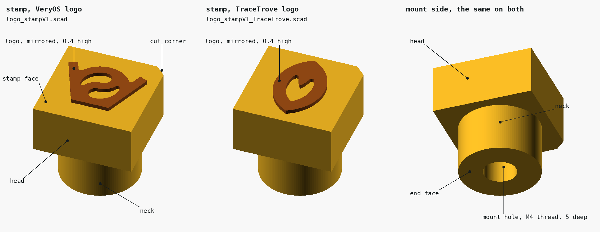
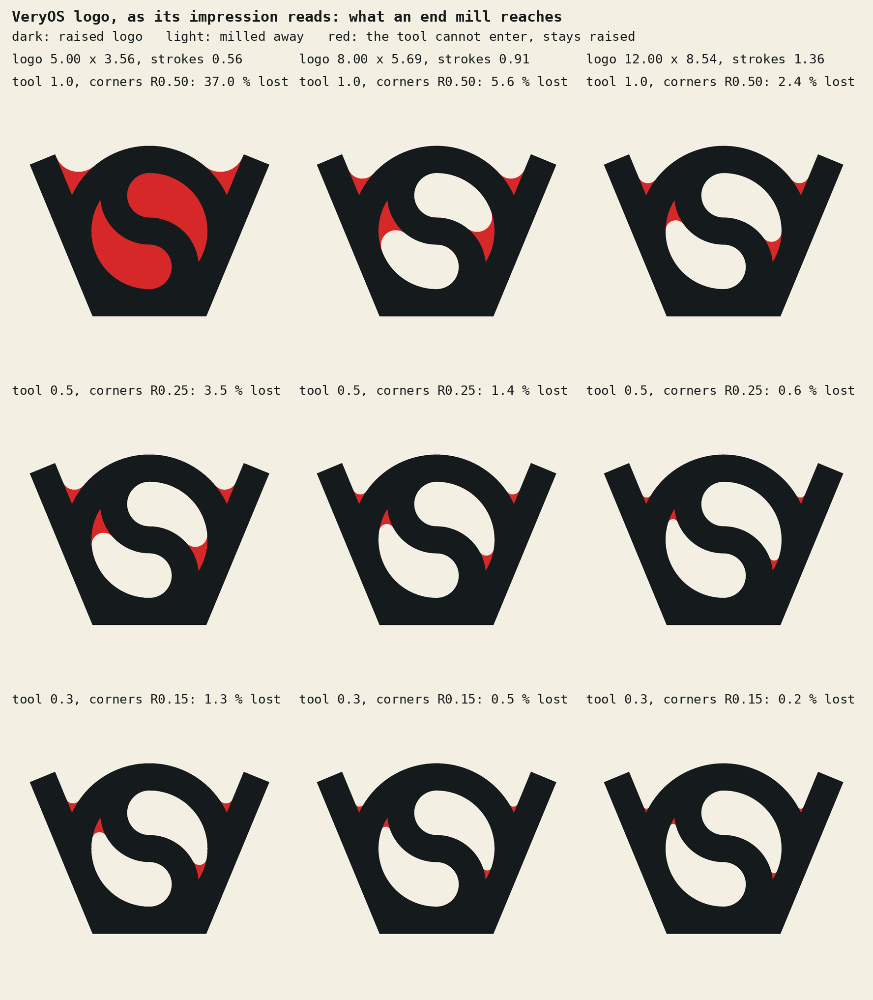
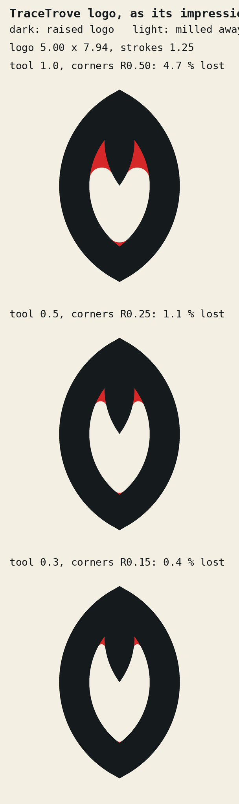

# Logo branding stamp

A brass stamp that screws onto a temperature controlled soldering iron, like a
tip for heat-set inserts, and presses the logo into FDM prints (PLA, PETG).
Made for CNC milling at JLCCNC. One stamp with the VeryOS logo, one with the
TraceTrove logo. The task is in [readme_hgc.md](readme_hgc.md).



| Status | |
|---|---|
| V1 | modelled and checked; not quoted, not ordered, not machined, not used |
| ready to order | no: the stud's length and JLCCNC's answer to R0.25 are open, see [open points](#open-points) |

## Parts

| Name | What | Picture |
|---|---|---|
| stamp, VeryOS logo | `logo_stampV1` | [stamp_veryos.png](stamp_veryos.png) |
| stamp, TraceTrove logo | `logo_stampV1_TraceTrove` | [stamp_tracetrove.png](stamp_tracetrove.png) |

| Feature | What |
|---|---|
| logo | raised 0.4 on the stamp face, mirrored |
| stamp face | the head's face around the logo; must not touch the print |
| head | 10 × 10 × 5 block |
| cut corner | 1 × 45° on one edge of the head; it is the impression's top left corner |
| neck | Ø8 × 5 on the back of the head, around the mount hole |
| end face | the neck's end; seats on the iron |
| mount hole | blind hole for the M4 thread, in the end face |

## Files

| File | What |
|---|---|
| `logo_stampV1.scad` | the generator, VeryOS logo; no libraries |
| `logo_stampV1_TraceTrove.scad` | includes `logo_stampV1.scad` and replaces the logo's four values |
| `logo_stampV1.step`, `logo_stampV1_TraceTrove.step` | for the quotation: B-Rep solids of planes, cylinders and one cone, AP214, mm |
| `logo_stampV1.stl`, `logo_stampV1_TraceTrove.stl` | OpenSCAD's meshes, to look at |
| `veryos_logo.dxf` | `../../veryos_logo.dxf` without its doubled entities: 7 lines, 7 arcs |
| `tracetrove_logo.dxf` | `region2d()` of TraceTrove's `branding/LOGO_V3/tracetrove_logo.scad` as 4 lines, 6 arcs |
| `build.py` | writes the DXFs, the analysis, the STL and STEP files, the checks, the pictures |
| `analysis_veryos.png`, `analysis_tracetrove.png` | what an end mill of 1.0, 0.5 and 0.3 reaches |

## Dimensions

| | VeryOS | TraceTrove |
|---|---|---|
| material | brass H59 | brass H59 |
| overall | 10 × 10 × 10.4 | 10 × 10 × 10.4 |
| mass at 8.5 g/cm³ | 5.9 g | 5.9 g |
| head | 10 × 10 × 5, one corner cut 1 × 45° | the same |
| neck | Ø8 × 5 | the same |
| logo | 8.00 × 5.69 | 5.00 × 7.94 |
| logo above the stamp face | 0.4 | 0.4 |
| logo's strokes | 0.91 | 1.25 |
| logo to the head's edge | 1.00 | 1.03 |
| inner corners of the logo | 4, R0.25 | 3, R0.25 |
| raised area against the DXF | +1.3 % | +1.1 % |
| mount | M4 × 0.7-6H, full thread 5 deep | the same |
| hole as modelled | Ø3.3 × 7.0, then a 118° point 0.99 deep | the same |
| brass between hole and stamp face | 2.01 | the same |

## Decided and assumed

| Point | Value | From |
|---|---|---|
| mount | M4 stud on the iron, the stamp has the thread | the user, 2026-11-12 |
| VeryOS logo | 8 wide instead of the task's 5 | the user, 2026-11-12, after the analysis below |
| TraceTrove logo | 5 wide, the task's value | the task |
| inner corners | R0.25, a 0.5 end mill | chosen with the 8 mm logo; below JLCCNC's stated R0.5 |
| thread pitch | 0.7, M4 coarse | assumed: measure the stud, M4 fine is 0.5 |
| stud length | at most 5 | assumed: not measured |
| neck | Ø8 × 5, not in the task | added: in the 5 thick head alone only 1 mm of thread fits above the unthreaded 2 mm JLCCNC asks for |
| cut corner | 1 × 45°, not in the task | added: tells the logo's top with the face down; `orientation_chamfer = 0` removes it |
| thread in the model | none, a hole of the tap drill's diameter | JLCCNC: thread parameters go into the order |

## The logos

`build.py analyze`, sizes on the stamp. A round tool cannot reach into the
logo's inner corners; what it leaves stays raised.

| | VeryOS 5 wide | VeryOS 8 wide | VeryOS 12 wide | TraceTrove 5 wide |
|---|---|---|---|---|
| size | 5.00 × 3.56 | 8.00 × 5.69 | 12.00 × 8.54 | 5.00 × 7.94 |
| on a 10 × 10 head with 1 clearance | fits | fits, largest | no: 14 × 11 head | fits |
| strokes | 0.56 | 0.91 | 1.36 | 1.25 |
| widest disc in a hole of the logo | 0.93 | 1.48 | 2.23 | 2.00 |
| lost with a 1.0 tool (R0.5) | 37 %: the holes stay closed | 5.6 % | 2.4 % | 4.7 % |
| lost with a 0.5 tool (R0.25) | 3.5 % | 1.4 % | 0.6 % | 1.1 % |
| lost with a 0.3 tool (R0.15) | 1.3 % | 0.5 % | 0.2 % | 0.4 % |

| Logo | Contours | Outer corners, sharp on the stamp | Inner corners, rounded |
|---|---|---|---|
| VeryOS | outline, 2 holes beside the S | 6: 90° at the arms' ends, 112.5° at the bottom | 2 between arm and ring (47° gap), 2 tails of the holes (38° gap) |
| TraceTrove | outline, 1 window | 2 tips of 120°, the rib's tip of 74° | 2 beside the rib (37° gap), the window's bottom (106° gap) |

| Finding | |
|---|---|
| doubled entities | `../../veryos_logo.dxf` holds 8 of its 22 entities twice (Onshape export); OpenSCAD 2021.01 then imports only the ring's hole, without a warning |
| R0.25 on VeryOS 8 wide | the corners stay filled up to 0.33 (arm and ring) and 0.50 (tails) from the drawn corner |
| R0.25 on TraceTrove 5 wide | filled up to 0.54 beside the rib, 0.07 at the window's bottom |
| not millable as drawn | every inner corner is sharp in the DXF; sharp needs EDM, which JLCCNC offers at a higher price with a 2D drawing |
| TraceTrove relief | the logo's V-grooved 3D form is not used: its grooves would be 0.5 wide at this size |





## JLCCNC's limits

Read on 2026-11-12 from the [design guideline](https://jlccnc.com/help/article/CNC-Machining-Design-Guideline)
(updated 2025-08-20), the [threaded hole guideline](https://jlccnc.com/help/article/Threaded-Hole-Guideline)
(updated 2025-06-14) and the [blog on design limitations](https://jlccnc.com/blog/cnc-machining-design-limitations).
Tables that are pictures on those pages were not read.

| Limit | JLCCNC | Stamp | |
|---|---|---|---|
| metal wall | 0.8 recommended, 0.5 at least | strokes 0.91 and 1.25, neck wall 2 | ok |
| inner radius | R0.5 at a depth up to 3; smaller needs smaller tools and costs more | R0.25 at a depth of 0.4 | **ask** |
| sharp inner corners | 2D drawing; EDM or radii in the model | radii in the model | ok |
| pocket depth | best at 2 to 3 tool diameters, trouble from 5 | 0.4 with a 0.5 tool: 0.8 diameters | ok |
| thread depth | at most 3 diameters | 5 = 1.25 diameters | ok |
| blind thread | half a diameter unthreaded at the bottom | 2.0 | ok |
| thread's hole | standard tap drill; M3 is Ø2.5 | Ø3.3 for M4 × 0.7, the usual table value; JLCCNC's own table is a picture | ok |
| thread near an edge | inside the part, no number | 2 of brass around it | ok |
| tolerance | ±0.1 without a drawing | logo 0.3 to 0.5 high | ok |
| upload | STEP or IGES | STEP | ok |
| smallest part, engraving rules, deburring | not stated on the pages read | | **ask** |

## Order

| Field | Value |
|---|---|
| file | `logo_stampV1.step`, `logo_stampV1_TraceTrove.step` |
| material | brass H59 |
| surface | as machined |
| threads | 1 per part |
| setups | 2: logo side; neck and hole from the back |

Note for the order, or for a drawing if JLCCNC asks for one:

```
1 x M4x0.7-6H in the round neck's end face, full thread 5 deep. The hole is modelled with the tap drill's diameter, 3.3 x 7 deep.
Raised logo on the opposite face, 0.4 high. Its inner corners are R0.25 as modelled (0.5 end mill).
Keep the logo's edges sharp: do not deburr, tumble or blast that face. Break all other edges 0.1 to 0.2.
Surface as machined, no coating. General tolerance +-0.1.
```

## Open points

| Point | Why | If it fails |
|---|---|---|
| R0.25 | half of JLCCNC's stated R0.5 | `logo_inner_radius = 0.5`: 5.6 % (VeryOS) and 4.7 % (TraceTrove) of the logo fill in; or VeryOS 12 wide on a 14 × 11 head |
| stud's length and pitch | not measured | a stud longer than 5 keeps the end face off the iron: raise `thread_depth` and `neck_length` by the same amount |
| logo's edges | deburring rounds a 0.4 high logo | the note above |
| small part | 10 × 10 × 10.4 has little to clamp; no minimum size on the pages read | the quote decides |
| temperature at the logo | below the iron's setting, by the thread's and the brass's resistance | set by the test below, not by the display |
| STEP | read back with OpenCascade only, the kernel that wrote it | open it in JLCCNC's viewer before ordering |

## Mounting and use

Not tried yet.

| Step | |
|---|---|
| mount | cold iron; screw the stamp onto the stud by hand until the end face seats |
| orient | the cut corner is the impression's top left corner, seen from the iron's side |
| heat | wait 2 minutes after the iron shows its temperature |
| press | straight down, lightly, 0.2 to 0.3 deep, 1 to 3 s; the stamp face stays off the print |
| lift | straight up; let the print cool before touching the impression |
| clean | brass brush while warm |
| change | let it cool, unscrew by hand |

## First tests

Starting values from the plastics' softening ranges, not tested.

| | PLA | PETG |
|---|---|---|
| iron's setting | 150, 160 … 200 °C | 180, 190 … 240 °C |
| dwell | 1, 2, 3 s | 1, 2, 3 s |
| coupon | flat, 4 top layers of 0.2, 3 walls | the same |
| where | top face, a side wall | the same |
| too cold | shallow, needs force, shiny edge only | the same |
| too hot | a rim around the logo, strings when lifting, plastic on the brass | the same |
| keep | the lowest setting that gives a full impression in 2 s | the same |

## Parameters

| Parameter | VeryOS | TraceTrove | |
|---|---|---|---|
| `logo_dxf` | `veryos_logo.dxf` | `tracetrove_logo.dxf` | lines and arcs, closed, no doubles |
| `logo_dxf_size`, `logo_dxf_center` | 43.9095 × 31.2528, 0 / 0 | 20 × 31.7543, 7.5 / 0 | from `build.py analyze` |
| `logo_width` | 8 | 5 | the height follows |
| `logo_relief` | 0.4 | | height above the stamp face |
| `logo_edge_clearance` | 1 | | least distance to the head's edge, checked |
| `logo_inner_radius` | 0.25 | | the end mill's radius; 0 = as drawn |
| `logo_mirror` | true | | false shows the impression |
| `head_width`, `head_depth`, `head_thickness` | 10, 10, 5 | | |
| `orientation_chamfer` | 1 | | 0 = no cut corner |
| `mount` | `thread` | | `bore`: slips over a round tip |
| `neck_length`, `neck_wall` | 5, 2 | | neck = hole + 2 walls |
| `thread_diameter`, `thread_pitch`, `thread_depth` | 4, 0.7, 5 | | M5: 5, 0.8 |
| `bore_diameter`, `bore_clearance`, `bore_depth` | 6, 0.05, 8 | | placeholders: measure the tip |
| `set_screw_diameter`, `set_screw_pitch` | 3, 0.5 | | tap hole in the neck's side, a third setup; 0 = none |

## Checks

`build.py check`, 2026-11-12, both stamps pass.

| Check | VeryOS | TraceTrove |
|---|---|---|
| OpenSCAD's mesh | closed, one body | closed, one body |
| size | 10.000 × 10.000 × 10.400 | 10.000 × 10.000 × 10.400 |
| logo on the stamp | 8.000 × 5.693, centre 0.000 / 0.000 | 4.998 × 7.938, centre 0.000 / 0.000 |
| logo to the head's edge | 1.000 | 1.031 |
| raised area: mesh, STEP's contours, DXF | 23.283, 23.284, 22.974 mm² | 21.870, 21.882, 21.649 mm² |
| overlap with the DXF, mirrored back / as it lies | 0.982 / 0.780 | 0.985 / 0.985: the flat logo is symmetric |
| STEP | 1 valid solid: 18 planes, 13 cylinders, 1 cone | 1 valid solid: 14 planes, 11 cylinders, 1 cone |
| STEP's edges | 100 lines, 53 circles, no splines | 78 lines, 45 circles, no splines |
| volume: STEP, mesh | 695.444, 695.423 mm³ | 694.883, 694.858 mm³ |

| Also checked | Result |
|---|---|
| DXF import in OpenSCAD | VeryOS 43.910 × 31.252, area 692.11 (contours 692.117); TraceTrove 20.000 × 31.754, area 346.35 (contours 346.380, the logo's own script 346.339 with 96 segment arcs) |
| mesh against STEP for 10 other parameter sets, once, script not kept | volumes within 0.02 %: `bore` with and without set screw, M5, no neck, no cut corner, not mirrored, radius 0 / 0.15 / 0.5, VeryOS 5 and 12 wide, TraceTrove 3.15 wide |

## Rebuild

```sh
python3 -m venv venv && venv/bin/pip install cadquery-ocp numpy pillow   # once
venv/bin/python build.py dxf       # the two DXFs
venv/bin/python build.py analyze   # analysis_*.png
venv/bin/python build.py step      # .stl and .step
venv/bin/python build.py check
venv/bin/python build.py images    # needs a display
```
