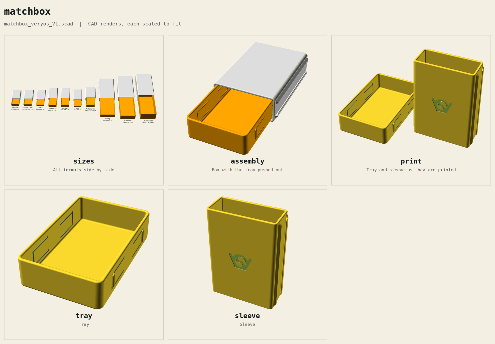

# Matchbox

A tray and a sleeve for matches as OpenSCAD script, in any size, reverse engineered from the MakerWorld model "Match Box" (2369521). Goal: `readme_hgc.md`. **Not printed. Forces come from a beam model, none is measured.**

| File | What |
|---|---|
| `matchbox_veryos_V1.scad` | the generator, standalone, no libraries. `part`: `print` (default), `tray`, `sleeve`, `assembly`, `sizes` |
| `matchbox_veryos_V1_pocket.3mf` | `print` of the default format `pocket`: tray and sleeve, 2 bodies, 9.8 cm³ |
| `matchbox_veryos_V1_reference.3mf` | `print` of the format `reference`, the MakerWorld box's size, 23.3 cm³ |
| `rendered_parts/` | every part under its name; `sizes.png` is the view with all formats |
| `Match+Box_stls (1)/` | the original's two meshes, not committed |

## Names

| Name | Where | Job |
|---|---|---|
| tray | inner part, printed as it lies | holds the matches |
| sleeve | outer part, printed standing on an end | the tray slides in it, from either end |
| tab | two in each long wall of the tray, cut free by a slit, root towards the middle | spring |
| slit | U around each tab, one layer high, 0.2 wide, mouths widened on both faces | lets the tab move; breaks free after the print |
| bump | half round bar at each tab's end, outside | clicks into a pocket |
| pocket | four in the sleeve's narrow walls, inside | closed: all four bumps rest in them. Open: the rear bumps in the front pockets |
| rail, lip | two rails on each narrow side of the sleeve, a lip on each | hold the striker strip |
| strip | striking surface cut from a box, or striker paper | pushed in under the lips from an end |
| room | inside of the tray | what the matches get |

## Formats

Outer size of the closed box, length (the way the tray slides) × width × height, as the sources give it. Forces: the script's model.

| `format` | Box | Wall | Room | Opens by | Strip | To open | Original's matches |
|---|---|---|---|---|---|---|---|
| `pocket` | 50 × 35 × 15 | 1.2 | 47.6 × 29.8 × 11 | 30 | 7.7 | 11 N | 43, 2 square |
| `gost` | 50.5 × 37.5 × 14.5 | 1.2 | 48.1 × 32.3 × 10.4 | 30.3 | 7.2 | 10 N | 42.5 |
| `india` | 51 × 35 × 13 | 1.2 | 48.6 × 29.8 × 9 | 30.6 | 5.7 | 9 N | 38 to 42 |
| `nordic` | 58 × 36 × 17 | 1.2 | 55.6 × 30.8 × 13 | 36 | 9.7 | 7 N | 47 to 48 |
| `japan` | 56 × 37 × 17 | 1.2 | 53.6 × 31.8 × 13 | 34 | 9.7 | 9 N | 2.2 square, length not found |
| `flat` | 56 × 35 × 9 | 1.2 | 53.6 × 29.8 × 5 | 34 | no rails | 4 N | 48 |
| `long` | 110 × 65 × 20 | 1.6 | 106.8 × 58.2 × 14.8 | 88 | 11.4 | 26 N | 94 to 95 |
| `kitchen` | 120 × 66 × 26 | 1.6 | 116.8 × 59.2 × 20.8 | 98 | 17.4 | 26 N | 47 |
| `kitchen_us` | 120.7 × 66 × 38.1 | 1.2 | 118.3 × 60.8 × 34 | 98.7 | 30.8 | 8 N | 60.3, across |
| `reference` | 59 × 41.4 × 21.4 | 2 | 55 × 33 × 15 | 37 | 11.5 | 66 N | the MakerWorld box |
| `custom` | `length`, `width`, `height` | `wall` | | | | | `size_is`: `outside` or `inside` (the room) |

- Walls are my choice: the reference's 2.0 leaves a 50 × 35 × 15 box a room of 46 × 26.6 × 8.6, two thirds of what 1.2 leaves.
- `kitchen_us` has 1.2 so that 60.3 long matches lie across: 0.5 to spare.
- `flat`: its narrow sides are too low for rails.
- Too flat or too narrow for the wall: the script stops with a message.

## Sources of the sizes

Web research, 2026-11-24. No worldwide standard fixes box sizes; GOST 1820-2001 is the only standard found with a table of them. The sizes used were read on the page, but for `kitchen_us`; of the others found, the museum boxes, Redheads, the blank boxes and two of the Indian listings were seen in search snippets only.

| `format` | Size from | Kind | Others found |
|---|---|---|---|
| `pocket` | [en.wikipedia Matchbox](https://en.wikipedia.org/wiki/Matchbox), [de.wikipedia Streichholzschachtel](https://de.wikipedia.org/wiki/Streichholzschachtel): 5 × 3.5 × 1.5 cm | encyclopedia | German museum boxes 52 × 36 × 15, 53 × 35 × 15; Australian Redheads 53 × 36 × 16; blank craft boxes 53 × 36 × 15, 53 × 37 × 16 |
| `gost` | [GOST 1820-2001](https://dnaop.com/html/69555_1.html), format 4, ±1.0 / ±0.5 / ±1.0 | standard | format 3: 50.5 × 37.5 × 16.5; formats 1 and 2: 56.5 × 37.5 × 18.5 and 16.5, for 47.5 matches |
| `india` | [seller's listing](https://www.tradeindia.com/products/safety-matches-28336.html), box of 45 | retailer | 46 × 34 × 12 (35), 48 × 35 × 12 (40), 50 × 35 × 15 |
| `nordic` | [sv.wikipedia Tändsticka](https://sv.wikipedia.org/wiki/Tändsticka), Solstickan's small box | encyclopedia | maker's pocket match 47 × 2.25, [Swedish Match Industries](https://www.swedishmatchindustries.com/products/matches) |
| `japan` | [Japan Match Manufacturers Association](https://match.or.jp/museum/variety/), 並型: 56, 37, 17 | association | a maker's blank box 56 × 35 × 16 |
| `flat` | [maker's blank box](https://item.rakuten.co.jp/nakamuramatch/nak-903/), 寸二 | maker's listing | German printer 56 × 36 × 8; promotion supplier 57.9 × 36.1 × 7.9 (from inches) |
| `long` | Solstickan's design box, 11 × 6.5 × 2 cm, [retailer](https://www.ahlens.se/produkter/inredning/tandstickor-svart-97be6b10-99e5-427f-8ae9-bee0b8639ff4) | retailer | printer 114 × 60 × 20; promotion supplier 110 × 64 × 19.6; blank box 110 × 60 × 20 |
| `kitchen` | sv.wikipedia, Solstickan's big box, about 240 matches | encyclopedia | Cook's Matches 120 × 67 × 26, seen in a search snippet only |
| `kitchen_us` | Diamond 250 / 300, [retailer](https://rei.com/product/407243/diamond-safety-kitchen-matches): 4.75 × 2.6 × 1.5 in | retailer, search snippet only | match length 2-3/8 in in one listing, 2 in in another |

Found, not in the script:

| Size | What |
|---|---|
| 110 × 74 × 37, 102 × 69 × 34, 92 × 81 × 46 | GOST 1820 household boxes, 500 to 1000 matches |
| 290 × 80 × 20 | fireplace matches 280 long, one retailer's listing |
| 41.3 × 27 × 12.7, 35.6 × 27.9 × 10.2 | US promotion "mini" boxes, from inches |
| 87.9 × 36.1 × 7.9, 110 × 18 × 18 | slim promotion boxes, from inches |
| 80 × 47 × 15 | Swan Vestas, museum box of about 1935 |

Not found: sizes of EN 1783, BS 3795, JIS, GB/T 393 (texts not open); which GOST format sells most; how the matches lie in the big boxes; a fixed size of the striking surface.

## Measured on the original

From sections of the two meshes. Every radius is a multiple of the 2.0 wall, the script keeps the multiples.

| What | Original | Script |
|---|---|---|
| sleeve | 59 × 41.4 × 21.4, wall 2.0, 43.6 over the rails | `reference` |
| tray | 59 × 37 × 17, 39 over the bumps, wall and floor 2.0, room 55 × 33 × 15 | sleeve less wall and clearance |
| tray in sleeve | 0.2 per side | `clearance` |
| tray's corners from above | 4.0 outside, 2.0 inside | 2 walls |
| tray's bottom edge, floor fillet, rim | 1.6, 1.0, 0.8 on both sides | 0.8, 0.5, 0.4 walls |
| sleeve's corners, ends | 2.8 outside, 0.8 inside, ends rounded 0.7 | 1.4, 0.4, 0.35 walls |
| tabs | 4, 13.5 long, 8.0 high, the wall's thickness; root 6 from the middle | `tab_arm` 12.5 to the bump, `tab_height` |
| slits | 0.2, edges rounded 0.6 on both faces | `slit`, 0.3 walls |
| bumps | half round, radius 1.0, 8 high, round ends, 11 from the tray's end | 0.4 walls + clearance, `detent_inset` |
| pockets | the bump's own circle, 0.8 deep, mouth rounded 0.75, 0.2 longer at each end | the same, by the bump |
| rails | 1.1 high, from 1.7 to 57.3; channel 11.57 wide and 0.4 high; lips 0.7 thick, 1.0 over it | `strip_gap`, `lip_overhang` |
| volume | tray 9542, sleeve 13829 mm³ | 9493, 13798, with logo and version engraved |

Changed against the original, all else within 0.2 of its mesh:

| What | Original | Script | Why |
|---|---|---|---|
| level slits | 4.3 to 4.5, 12.5 to 12.7 | 4.4 to 4.6, 12.6 to 12.8 | on the layers of a 0.2 print |
| bump's foot | fillet 0.6 | none | simpler |
| pocket's ends | round | square | simpler |
| rails' edges | rounded | plain | simpler |
| lips' ends | from 2.3, rounded | from 2.8, rising at 45 degrees from the rail | no overhang standing |
| logo, version | none | sleeve's back; tray's underside | |

## Sizes that follow

| Size | Rule |
|---|---|
| tray | length as the box; width and height less 2 × (wall + clearance), height down to a layer |
| bump from the end | `detent_inset`, at most 0.2 × length |
| tab's root | `tab_arm` from the bump, at least 0.1 × length from the middle |
| tab's height | `tab_height`, at most 0.47 × tray height, on the layers |
| press: how far a bump bends its tab, and the pocket's depth | 0.4 walls, less if the strain would pass `tab_strain` |
| opens by | length less 2 × the bump's distance from the end |
| strip | height less 3.2 walls less 3.4; below 3: no rails |

## Print

| | |
|---|---|
| tray | as it lies, no support |
| sleeve | standing on an end, no support. It stands on a ring 0.9 to 1.3 wide: a brim for the tall ones |
| layers | 0.2. Other height: set `layer`, and `slit` not above it |
| after the print | push each bump in once: the tab breaks free of the slits |
| `pocket`, sliced | tray 5.4 g, 14 min; sleeve 7.8 g, 42 min |

## Model

| | |
|---|---|
| strain of a tab | 1.5 × wall × press / arm² |
| force of a tab between the clicks | modulus × tab height × wall³ × press / (4 × arm³) |
| to open | four bumps ride up the rounded mouths of their pockets: the highest of force × tan(slope + friction angle) on the way |
| to slide on | 4 × friction × force; 2 once the front bumps are out |
| `reference` | strain 1.54 %, 21.6 N a tab, 66 N to open: hard. Whether the original is that stiff is not known |
| not in it | how round the bumps print, spots where a slit stays fused, the walls' give |

## Checks

| What | Result |
|---|---|
| tray and sleeve of all 10 formats and 10 custom boxes, 30 × 20 × 10 to 290 × 80 × 20 | closed, one body, the same volume in OpenSCAD 2021.01 and in 2026.09.16 with lazy union and Manifold |
| tray in the sleeve, closed and open, `reference` and `pocket` | no overlap (CGAL) |
| `reference` against the original's meshes, 16 and 15 sections | within 0.2 but for the changes above |
| `pocket` tray and sleeve, `reference` and `flat` tray, sliced with the 0.2 mm settings of the disc launcher's Elegoo project (2 walls, classic) | the slit layers stay empty, the tab's first layer is an overhang wall, the upright slit stays open; rails, lips and pockets come out |

## Open

- Not printed: clearance, slits, click and strip are the original's values, untested here.
- The original's page refuses automated requests: its description, comments and licence are unread. Check the licence before publishing.
- A test print: `pocket`, 13 g.
