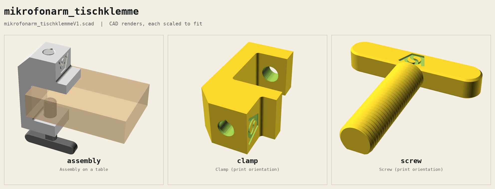

# Table clamp for the Rode PSA-1 microphone arm

Printed table clamp (Tischklemme) for the Rode PSA-1: a C over the table edge with a blind hole for the arm's pin, and a screw with a T bar. Built from the sketch `idee.jpeg` and `readme_hgc.md`. **Not printed yet.**

| File | What |
|---|---|
| `mikrofonarm_tischklemmeV1.scad` | the generator, standalone, no libraries. `part`: both parts on the bed, assembly, each part in its print orientation |
| `mikrofonarm_tischklemmeV1_clamp.stl`, `_screw.stl` | the parts at the defaults, as they print |
| `rendered_parts/` | every part under its name |
| `idee.jpeg` | the sketch |
| `readme_hgc.md` | original goal |

## Parts

| Part | Qty | Prints | Note |
|---|---|---|---|
| clamp | 1 | lying on its side, 40 high | the layers run around the C, so the screw's force pulls along them, not across (lessons_learned: softbox clamp). Pin hole and thread lie level with the bed |
| screw | 1 | lying on its flat, the logo up | thread cut 2.4 flat on the bed side, as fdm_optimized_screws |

No support: no face is steeper than 45 degrees, except the 1 mm deep ceilings in the engraved logo on the clamp's block (mesh check). More walls and infill make the C stiffer.

## Sizes

| Parameter | Default | From |
|---|---|---|
| `pin_hole_diameter`, `pin_hole_depth` | 12.6, 32 | readme_hgc.md; the pin is 12.5 × 30, measured |
| `thread_diameter`, `thread_pitch` | 16, 2, 45 degree flanks | sketch; pitch from fdm_optimized_screws |
| `thread_clearance` | 0.25 per side | lessons_learned.md |
| `table_max`, `table_min` | 50, 10 | my choice: tables from 10 to 50 thick |
| `clamp_width`, `spine_thickness` | 40, 16 | my choice: about 14 MPa in the spine at 1 kN screw force, estimate |
| `pin_x` | 14 | pin and screw axis from the spine's inner face, as sketched |
| `top_jaw_length` | 45 | my choice |

## Design rules in the model

| Rule | Why |
|---|---|
| pin hole is a teardrop, its point up on the bed | prints without support; the round part and the two 45 degree flanks still hold the pin |
| pin hole's lowest line on a 0.2 layer boundary (`pin_y` 20.1, not 20) | the slicer would narrow it by half a layer |
| inner corners of the C rounded, r 3 | less stress at the corners; a sharp table edge then stands 3 off the spine |
| screw under the pin | as sketched; short reach, so less bending in the C |
| the screw's flat end presses on the table's underside | two parts only, so no swivel pad |
| logo in the block's face towards the table and in the bar's top | visible from the desk; on each part |

## Assembly

1. Screw the screw into the lower jaw from below.
2. Slide the clamp over the table edge, top jaw on the table.
3. Tighten with the T bar.
4. Drop the arm's pin into the hole.

## Open

| Question | Note |
|---|---|
| does the 12.5 pin fit the 12.6 hole? | printed holes come out smaller; raise `pin_hole_diameter` if too tight |
| table thickness range | 10 to 50 by default; change `table_max`, `table_min` |
