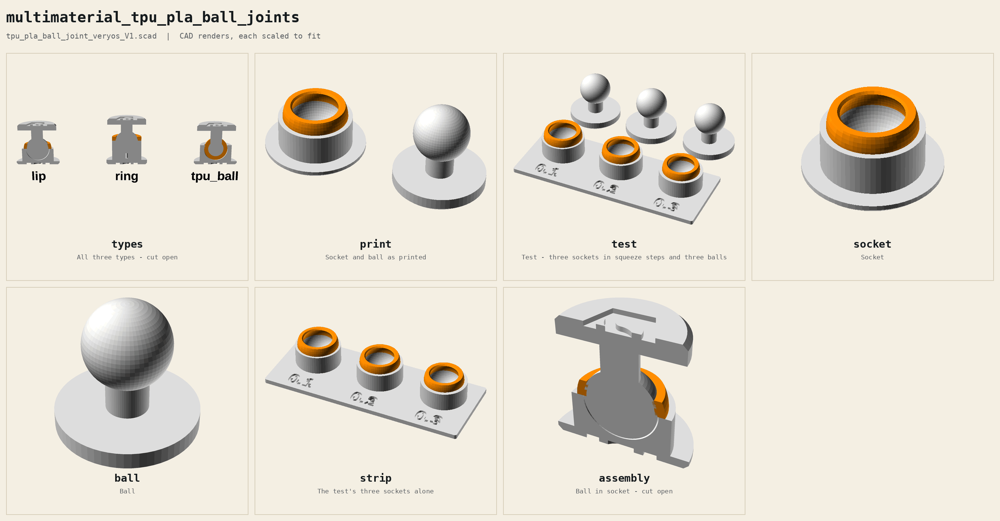

# TPU + PLA ball joints

Small ball joints for multi-material FDM printing, PLA and TPU in one print, for figures put together from parts. OpenSCAD script plus a webapp that exports a 3MF with every part on its filament. Goal: `readme_hgc.md`. **Not printed. Fits and forces are not measured; numbers are the script's geometry.**

| File | What |
|---|---|
| `tpu_pla_ball_joint_veryos_V1.scad` | the generator, standalone, no libraries. `type`: `lip`, `ring`, `tpu_ball`. `part`: `print` (default), `test`, `socket`, `ball`, `strip`, `assembly`, `types`. `material`: `both`, `pla`, `tpu` |
| `tpu_pla_ball_joint_veryos_V1_test_<type>.3mf` | `test` of each type at 6 mm, from the webapp: PLA on filament 1, TPU on filament 2 |
| `webapp/` | the app, see below |
| `rendered_parts/` | every part under its `part` name, PLA grey, TPU orange |
| `research/` | the user's notes, a photo and an example figure (zip), not committed: third-party content |

## Types

The ball and its seat are PLA, so a pose stays put; TPU is the spring that holds the ball. TPU stretches and bends easily but hardly gets smaller (nearly incompressible): a thin TPU layer squeezed between two hard parts would act almost rigid. So every TPU part here has a free side. My design choice, from that reasoning; untested.

| `type` | Socket | Ball | TPU does | 6 mm by the script |
|---|---|---|---|---|
| `lip` | PLA cup up to the equator, `clearance` 0.1; TPU lip on its rim up to `lip_wrap` 30°, inside `lip_squeeze` 0.2 smaller than the ball | PLA | stretches like a band, pulls the ball into the cup | socket Ø8.2 × 5.6, mouth 5.06, tilt ±32°; lip stretched 7.1 % at rest, 18.7 % to let the ball in |
| `ring` | PLA cup split by `slits` 4 into fingers, cup `ring_squeeze` 0.1 smaller than the ball; TPU ring on the finger tips, keyed 0.8 into the slits | PLA | holds the fingers together, as a rubber band | socket Ø7.6 × 7.45, mouth 5.23, tilt ±33°; fingers 4.8 long, 0.52 % strain at rest, 0.67 % to let in; ring stretches 14.7 % |
| `tpu_ball` | all PLA; above the equator `tpu_ball_squeeze` 0.15 smaller than the ball, up to `tpu_ball_wrap` 20° | PLA core, TPU `skin` 1.0 | gives way at the mouth | socket Ø8.2 × 5.17, mouth 5.5, tilt ±43°; skin squeezed 0.15 at rest, 0.25 (25 %) to let in |

- Tilt: 90° − latitude of the mouth's edge − asin(neck radius / ball radius). A wider wrap holds better and tilts less.
- `tpu_ball`: only the ball needs TPU, sockets can be built into any PLA part. Large balls squeeze the skin more at the same wrap: 16 mm 55 %; lower `tpu_ball_wrap` for them.
- `ring` with `material = pla` alone is a slit PLA socket as in the research photo, for comparison.

## Test

| Step | What |
|---|---|
| 1 | print a `test` 3MF: three sockets with the type's squeeze − `test_step`, squeeze, + `test_step` (value engraved in front), three balls |
| 2 | push a ball into each socket; note which one goes in, holds a pose, still turns |
| 3 | report the best value per type; it goes to `lessons_learned.md` |

## Print

| Rule | Why |
|---|---|
| sockets mouth up, balls standing on their foot, no support | the cup's overhang above the equator is at most the wrap, 30°; the ball's first layers above the neck step out 0.2 to 0.3 |
| filament 1 PLA, filament 2 TPU in the slicer | the 3MF sets the parts' filaments by number; the filament types come from the slicer's own list |
| a printer that feeds TPU: toolchanger (Snapmaker U1), or TPU outside the AMS | the A1's AMS lite takes no TPU |
| faces between PLA and TPU on layers of `layer` 0.2 | the cup's rim, the ring's start |

## Webapp

`deno task start` in this folder, then http://127.0.0.1:8774/ (another port: `deno task start 8775`). `deno task test` runs the tests (6) offline.

| Part | What |
|---|---|
| settings | read from the script's Customizer comments: the form follows the script |
| plate | `print` (socket and ball) or `test` (strip and three balls) |
| geometry | `serve.js` runs OpenSCAD on the script, one part in one material per run: `$OPENSCAD`, else `../../.gitignored/tools/OpenSCAD-nightly.AppImage` (Manifold, under a second), else `openscad` on the PATH (2021.01, about a second a part) |
| view | WebGL, cut open along the parts' axes to see the TPU |
| 3MF | one object per piece, one part per material; `Metadata/model_settings.config` gives each part its `extruder`; the 3MF's base materials carry the colours |

3MF checked with the slicers' command lines:

| Slicer | Import | Sliced |
|---|---|---|
| Bambu Studio 2.9.1 | each part keeps its filament | with the A1 project's 2-filament settings: TPU (T1) only at z 4.4 to 5.6, the lip's 7 layers |
| SnapmakerOrca 01.10.01.50 | each part keeps its filament | with the U1 project's settings: T1 at z 4.45 to 5.65 |

Both read a 3MF's own `project_settings.config` only when its `Application` names the slicer, so the app's 3MF brings no printer or filament settings.

## In other models

`use <tpu_pla_ball_joint_veryos_V1.scad>`, then, centred on the ball's centre:

| Module | What |
|---|---|
| `joint_ball(type, d, neck_l)` | ball, neck down to `neck_l` below it |
| `joint_socket(type, d)` | socket, mouth up |
| `joint_socket_space(type, d)` | room to subtract from the part first: housing, free space around the lip, cone for the neck's swing |

`$material = "pla"` or `"tpu"` in the calling file picks one filament for export.

## Research

| Finding | Source |
|---|---|
| LEGO's Bionicle / Technic ball (32474) is listed as Ø10.2 | [Brick Owl](https://www.brickowl.com/catalog/lego-technic-ball-32474), [Brick Architect](https://brickarchitect.com/parts/32474) |
| PETG CCBS sockets got looser within 6 months; the author suggests ABS or ASA (creep) | Printables 358751 comments, in `research/readme_hgc.md` |
| PLA-only figure joints loosen in days; a TPU 95A insert pressed into a PLA socket, tight on purpose, holds | search summaries of [MakerWorld 3028868](https://makerworld.com/models/3028868); the page itself refuses scripts (403) |
| Printed sockets rub smooth, the figure ragdolls | [Formlabs forum](https://forum.formlabs.com/t/action-figures-methods-to-stop-rag-doll-effect/28524) |
| 0.2 to 0.3 clearance for a tight PLA friction joint, 0.4 to 0.5 for sliding | [Flashforge](https://www.flashforge.com/blogs/news/how-to-3d-print-action-figures) |
| NinjaFlex sockets need the ball 1 mm smaller to press in | [Adafruit](https://learn.adafruit.com/3d-printed-action-figure-selfie) |
| A snap socket should not close all round, so it can open | [Shapeways](https://shapeways.com/blog/how-to-design-snap-fit-ball-joints-for-3d-printing-with-shapeways) |
| PLA and TPU bond; the bond depends on layer height, temperatures and print order | [Brancewicz-Steinmetz 2021](https://www.ncbi.nlm.nih.gov/pmc/articles/PMC8585249/), [Springer 2025](https://link.springer.com/10.1007/s00170-025-17099-x) |
| `research/` zip: a print-in-place creature, legs end in balls of about Ø8 to Ø10 printed inside cavities of the torso, loose joints | its meshes, sectioned |

Considered, not built: a slit PLA ball around a TPU core (the TPU core cannot get smaller, the petals could not close); a TPU liner over the whole cup (squeezed thin, nearly rigid); a notch in the cup for 90° in one direction, as LEGO's sockets have.

## Checks

| Check | Result |
|---|---|
| every part, type and material, in OpenSCAD 2021.01 and 2026.09.16 with lazy union and Manifold, balls 3, 4, 6, 10, 16 | one closed body per piece and material, same volume in both to 0.01 mm³ |
| PLA + TPU against both together | the same volume: no overlap |
| zero-area triangles | none in Manifold; 2021.01's STL of the 3 mm `tpu_ball` skin keeps 16 at its pole (six digits) |
| printed | no |
