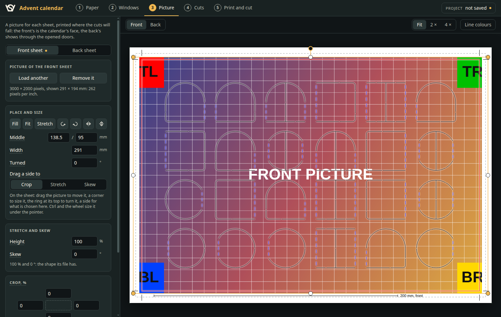
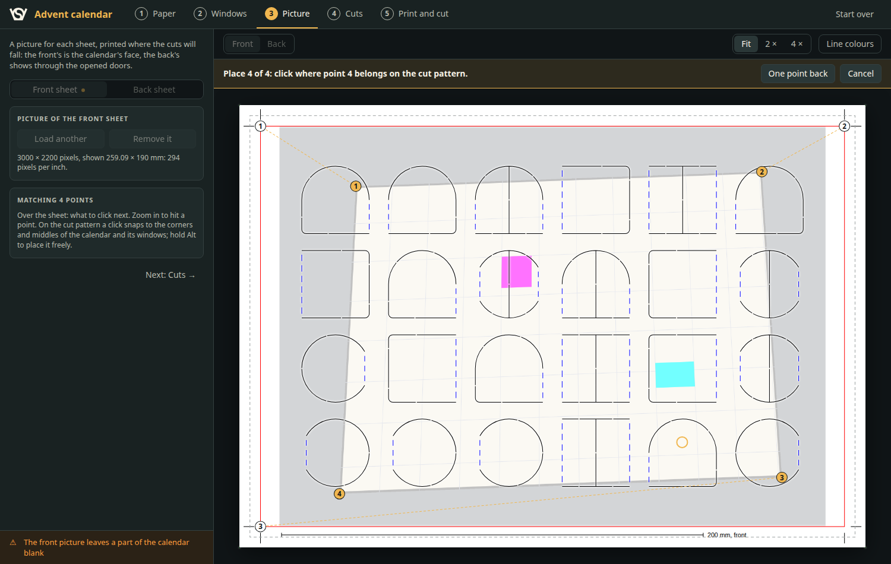

# Paper advent calendar

A webapp for a paper advent calendar of two sheets of card: it makes the cutting files, a front sheet with the windows' doors and a back sheet behind it, and prints pictures on each sheet at the very place the cuts will fall. Goals: `readme_hgc.md` with the sketch `idea_veryos.jpeg`, and `software_improvements_decoration_drawing/readme_hgc.md` for print and cut. **Nothing is printed on paper or cut yet: bridge, fold and mark sizes and the fit of print and cut are untried.**

| Start | |
|---|---|
| `deno task start` in `paper_advent_calendar/`, then http://127.0.0.1:8778 | the app; reachable from this computer only. A server started before projects came has to be stopped and started again |
| `deno task start 8779` | on another port |
| `deno task test` | the checks of the geometry, see Checks |
| `deno task check` | the checks of the page in headless Chrome, on port 8779; needs `google-chrome` and `pdftoppm`. `deno task check .` also saves `preview.png` and `match.png` anew |

Needs [Deno](https://deno.com) and a browser. The page does all the work itself but for the saved projects, which the app's server keeps as folders in `webapp/project/`; from any other static web server `webapp/` runs without them. What is on screen stays in the browser as well (local storage, IndexedDB): a reload keeps it, saved or not.

## Page

| Part | Shows |
|---|---|
| Bar on top | the five steps; any step opens at any time, `Next` at a step's end leads on; a step with a field that is wrong is marked orange. `Project`: the open project's name, and the saved projects, see Projects |
| Left | the settings of the open step alone; under them, always in view, what is wrong |
| Right | one sheet, as large as fits. Above it: `Front` / `Back`; zoom `Fit`, `2 ×`, `4 ×`, what was in the middle stays there; `Line colours`, the legend |

| Step | Settings | The pointer on the sheet |
|---|---|---|
| 1 Paper | the sheet of paper, the calendar's size and place on it | moves nothing |
| 2 Windows | grid, shapes and doors, one window's own values | chooses and moves windows |
| 3 Picture | the pictures of the sheet shown: load one or many, split one into pieces; the chosen one's place, size, turn, stretch, skew, crop, order, match | chooses a picture; moves, sizes, stretches, skews, turns or crops the chosen one |
| 4 Cuts | bridges, folds, marks, logo, calendar's edge, paper's corners | moves nothing |
| 5 Print and cut | what is printed, bleed, guides, shift; `Print front and back`; the print's pages as PDF and PNG files; `Front SVG`, `Back SVG` | moves nothing |

- The step and the sheet shown are kept over a reload, like the settings.
- A name with a dotted line under it says more when the pointer rests on it.
- A window narrower than 760 pixels: the sheet on top, the settings under it.

## Projects

A project is the calendar as it is on screen, saved under a name: all settings, the windows' own values, the pictures' places and the pictures' files. `Project`, at the right of the bar, shows the open project's name, `new` or `not saved`, with a dot while there are unsaved changes; a click opens the panel.

| In the panel | Does |
|---|---|
| The name | letters, digits, spaces, `_` and `-`, 64 at most |
| `Save`, Enter in the name, Ctrl + S anywhere | what is on screen is saved under the name: the open project again, or a new project under a name that is new, and the open one stays as it was saved. Another saved project's name is refused |
| `New` | the settings of the first start, no pictures, step 1 |
| A saved project in the list | opens it; under its name its windows, the calendar's size and how many pictures each sheet has. The open one is framed: a click on it brings back what was saved |
| `×` | deletes it with its folder, after `Delete`. The open one stays on screen, and `Save` brings it back |
| With unsaved changes | opening another and `New` ask first: `Save first`, `Discard`, `Cancel` |

| Kept | Where |
|---|---|
| A project | `webapp/project/<name>/`: `project.json` with the settings, and each picture file once, under the name the settings have for it, as `p3jyccdo.png`, `pk2l81xa.jpg` and the like: the files as they were loaded, or as a match laid them anew. A save removes the files no picture shows any more. PNG, JPEG, WebP, GIF, AVIF, SVG, BMP; 100 MB a file at most. For git to track, or not |
| What is on screen | in the browser as before, saved or not, with the open project's name: a reload shows the same, and says `Unsaved changes` if there are some |

- The list is the server's of the moment the panel opens: a project saved or deleted in another window shows then.
- While a picture is matched by four points, the panel is closed.
- Another web server, or the app's own started before projects came: the panel says so, the rest of the app works.
- Not there: a new name for a saved project (save it under the new name, delete the old), a project as one file to send.

## Calendar

| Sheet | Printed on it | Cut into it | For |
|---|---|---|---|
| Front | its picture: the calendar's face | each window's free edge, cut through but for bridges; each hinge as a row of cut dashes; the calendar's edge | the doors: a bridge is a tiny uncut place that holds a door shut until it is torn open, the dashes are the fold it turns on |
| Back | its picture: what shows through the opened doors | the calendar's edge; the logo in dots; if asked for, marks along each window's opening, for pictures drawn by hand | glued behind the front |

- Both sheets are drawn as seen from the front, at the same size and place: one lies on the other as cut, nothing is mirrored but the logo.
- Numbers are not made: they belong to the picture, or are drawn by hand.
- Material: 250 g card, per the brief; not a setting.

## Print, then cut

Print and cut meet if both put the calendar at the same place of the sheet of paper, measured from its bottom left corner.

1. Step 1, Paper: the sheet of paper, the calendar's size and its distance from the sheet's left and bottom edge. The calendar lies inside the printer's margin, the dashed frame.
2. Step 3, Picture: load the front's picture, and the back's: one over the whole calendar, or one for each window. Move the pictures under the windows there, the windows onto a picture in step 2, or lay a picture by four points, see Match by four points.
3. Step 5, Print and cut. Trial: print `Cut lines only` on plain paper. Lay a ruler on the ruler line under the calendar: 200 mm must be 200 mm.
4. In the cutter's software lay `Front SVG` on the sheet corner on corner: with a dot in each corner of the paper the file is as large as the sheet, 297 × 210 by default, and the calendar lies in it where the print has it. Lay the trial sheet on the mat where the software has the sheet, and cut. Without the dots, place the file at the distances the app names under the two SVG buttons.
5. Where the knife runs beside the printed lines, measure how far and enter it as `Shift right` and `Shift up`; print and cut again until it fits.
6. Print `The pictures` on card: page 1 the front, page 2 the back. Cut each with its file, at the same distances.
7. Glue the front on the back, edge on edge; no glue behind the doors.

| Print dialog | |
|---|---|
| Paper size | the sheet's, as set in the app |
| Scale | 100 %, not "fit to page"; nor in the printer's own settings |
| Margins | none |

## Settings

| 1 Paper | Default | Range | Does |
|---|---|---|---|
| Format | A4 landscape | A4, A3 and Letter, landscape and portrait | sets the sheet's size and nothing else; `Own size` where the size is none of them |
| Size, of the sheet of paper | 297 × 210 mm | 50 to 1500 | the paper a sheet of the calendar is printed on and cut from, width × height |
| Printer's margin | 5 mm | 0 to 50 | the border a printer leaves blank, drawn dashed; said when the calendar lies in it |
| Size, of the calendar | 277 × 190 mm | 50 to 1000 | both sheets of the calendar; 10 mm less than A4 all around |
| From the sheet's left, from its bottom | 10, 10 mm | 0 to 1500 | where the calendar lies on the sheet; below them what that leaves to the sheet's right edge and to its top |

| 2 Windows | Default | Range | Does |
|---|---|---|---|
| Number | 24 | 1 to 100 | windows |
| Columns | 6 | 1 to 20 | windows in a row; rows = number / columns, rounded up; a last row that is not full stands in the middle |
| Margin | 15 mm | 0 to about half the calendar's shorter side | from the calendar's edge to the field the windows are spread over; each window in the middle of its cell |
| Size | 32 × 32 mm | 5 to 300 | every window's width × height; below the grid's fields the number of rows and the distance from one window to the next |
| Corner radius | 2 mm | 0 to 50 | a rectangle's corners and an arch's foot; a corner a hinge ends in stays sharp |
| Shapes | all three | one at least | which shapes occur, each about as often as the others |
| Doors | left, right, double | one at least | which hinge sides occur, likewise |
| Shuffle | | | deals them out anew |

| 4 Cuts | Default | Range | Does |
|---|---|---|---|
| Bridge | 0.5 mm | 0 to 5 | width of a bridge; 0: none |
| A bridge every | 25 mm | 2 to 500 | per stretch of a free edge between two corners: length / this, rounded, one at least, spread evenly; none on a stretch under 4 bridges long |
| Fold dash | 3 mm | 0.2 to 50 | cut dashes of a hinge; fitted to the hinge's length, so they come out a little longer or shorter |
| Fold gap | 2 mm | 0.2 to 50 | uncut between the dashes and at both ends of a hinge; below it the number of bridges in all |
| Marks on the back | off | | short cuts in the back sheet that show where the windows open, for pictures drawn by hand. Off: the back's file cuts the calendar's edge and not the windows. Under a printed back they would cut into the picture (said when both are there) |
| Mark's length | 3 mm | 0.5 to 20 | length of the marks; grey without them |
| VeryOS logo on the back | on | | see Logo |
| Calendar's edge in the files | on | | a red rectangle of the calendar's size in both SVGs: the cut that takes the calendar out of the sheet |
| Paper's corners in the files | on | | a dot in each corner of the sheet of paper, a slanted cut of 0.2 mm into the sheet. With them a file is the sheet: as large, the calendar at its place in it, and laid on the sheet corner on corner in the cutter's software. Without them a file is the calendar with its edge, or as large as its cuts without, and placed by the distances the app names in step 5 |

| 5 Print and cut | Default | Range | Does |
|---|---|---|---|
| What is printed | The pictures | Pictures with cut lines, Cut lines only | what a sheet with a picture shows; a sheet without one always shows its cut lines |
| Bleed | 2 mm | 0 to 20 | the picture is printed this far over the calendar's edge: a cut a little beside the edge shows no white |
| Crop marks and ruler line | on | | outside the calendar, see Print |
| Shift right, shift up | 0, 0 mm | -20 to 20 | moves the whole print on its page, to make up for where printer and cutter put it |
| `Print front and back` | | | see Print; below it what to set in the print dialog, with the sheet's size |
| `Front PDF`, `Back PDF`, `Front PNG`, `Back PNG` | | | see Print files; below them the files' size in mm and pixels |
| `Front SVG`, `Back SVG` | | | see SVG; below them each file's size and place for the cutter's software |

Step 3, Picture: see Windows and pictures on the sheet. `New`, under `Project` in the bar on top: all settings as at the first start, the pictures removed, step 1.

Default calendar: cells 41.2 × 40 mm, 9.2 and 8 mm of card between windows; 99 bridges, 123 fold dashes; without the edge the lines add up to 2.6 m on the front. The back: the calendar's edge, the logo's dots and the paper's corners; with `Marks on the back` 192 marks more, 0.8 m of lines without the edge.

## Windows

| Shape | Is |
|---|---|
| Rectangle | corners rounded by the corner radius |
| Arch | a half circle on a rectangle; lower than half its width: two quarter circles of its height with a straight top between |
| Round | a circle where width = height, else a rectangle with half circles for its short sides |

| Door | Cut | Fold |
|---|---|---|
| Left, right, top, bottom | the free edge in one run from the hinge's one end to the other | one hinge on that side |
| Double | top and bottom edge, and down the middle: two leaves | hinges left and right |

| Rule | |
|---|---|
| Hinge | straight, along its side. On a round side it lies further in, where the window is half the side wide: a 32 circle's hinge is 16 long, 2.1 inside, and the opening is flat there |
| Bridges | never on a corner or where cuts meet: a double door's top and bottom cuts end at the middle cut |
| Marks on the back | at a sharp corner an L, 3 along both edges (a third of an edge at most); a rounded corner between straight edges whole; along a curve dashes of 3, about 6 apart; none touches the next, so nothing falls out |
| 32 × 32 by default | rectangle, hinge left: 4 bridges, 6 fold dashes, 4 marks. Circle, hinge left: 3, 3, 12. Arch, double: 5, 6, 8 |

## Windows and pictures on the sheet

What the pointer moves follows the step that is open: windows in step 2, the picture of the sheet shown in step 3, nothing in the others.

| Step 2, Windows | Result |
|---|---|
| Click a window, on the front or the back sheet | chosen: its fields come into view, with it close up in the lines' real width and its middle, size, shape and door |
| Drag it | moved, in steps of 0.5 mm; the other sheet has it there too |
| Change a field | that window alone gets the value |
| `Back to the grid` | it drops what it has of its own |
| Change a setting of the grid | windows keep what they have of their own; the rest follows the grid |

| Step 3, Picture | Result |
|---|---|
| `Front sheet`, `Back sheet` | the sheet whose pictures are worked on; the same choice as `Front` / `Back` above the sheet. A dot marks a sheet that has pictures |
| `Load pictures`, `Add pictures` | picture files the browser shows, one or many at once. A sheet's first picture fills the calendar and its bleed. One more comes into the calendar's middle, a third of the calendar at most. Several at once come to lie on the windows, the first on window 1, each as large as fits into its window and 2 mm around it. A file that is no picture is said |
| Click a picture on the sheet | chosen, the uppermost under the pointer: its frame and handles show, and the panel shows its fields. A click beside all pictures: none chosen. A sheet's only picture is always the chosen one |
| Under the two buttons | how many pictures; of the chosen one what is left of its file in pixels, the size shown, pixels per inch; below 150 it says coarse. Stretched: `at least`, the number of the way it is stretched more |
| Drag a picture | moved |
| Drag a corner | sized, the corner across stays, and its shape as it is. With Shift: both the corner's sides follow the pointer, out of its shape |
| Drag a side | stretched: the side follows the pointer, the side across stays, nothing cut off. With Ctrl: skewed, the side slides along itself. Top or bottom: the upright sides lean, which is `Skew`. Left or right: top and bottom lean, which in the fields is a turn, a skew against it and another size |
| Drag the ring at its top | turned around its middle, by as much as the pointer goes around the middle: the further from it, the finer. With Shift: in steps of 15° |
| `Crop` | a switch. On: the frame is dashed and the handles cut the picture off, a side's at its side, a corner's at both its sides; the rest stays in its place; pulled out, what was cut off comes back. A handle says what it does when the pointer rests on it |
| A handle that sits out of view | drawn where the view ends: a corner's as near to the corner as that is, a side's on the part of its side that is in view. Taken there it does the same, by what the pointer moves. So with a picture larger than the sheet, and with a zoomed sheet |
| Ctrl and the wheel | the chosen picture sized under the pointer |
| `Fill`, `Fit` | as small as covers calendar and bleed, as large as fits into the calendar; in the middle, in the shape it has |
| `Stretch` | stretched over calendar and bleed: all of it shows, out of its shape. A turned or skewed picture is stretched along its own two directions until it covers them |
| The four buttons beside them | a quarter turn against and with the clock; mirrored left for right, top for bottom |
| `To front`, `To back` | over or under all other pictures of the sheet: the later in the sheet's order, the further on top |
| `Middle`, `Width`, `Turned` | the picture's middle from the calendar's left and top edge, its width, its turn in degrees: any number, 0.5 for a slight turn |
| `Height`, `Skew` | its height in % of what its width and its file's shape give, 5 to 2000, the width stays; the lean of its upright sides in degrees, to the right at the top, -80 to 80. 100 % and 0 °: the shape its file has |
| `Crop, %` | how much of the file is cut off at its top, left, right and bottom, the four fields laid out as the sides lie |
| `Split`, with `Pieces` across × down | the chosen picture becomes that many pictures, row by row from its top left as it lies: each shows its part of the file where that part lay, and is a picture like any other, to drag away, size and crop. For one picture with many small ones on it. No piece smaller than 5 mm: fewer then. All pieces show the one file, which is kept once |
| `Match 4 points to the cut pattern` | see Match by four points |
| `Remove it` | the chosen picture leaves the sheet; its file too, if no other picture shows it |

- The back sheet shows where every window opens, dashed; these lines are not cut and not printed.
- A picture file that says it lies turned (a phone's photo) is shown as it is meant.
- Pictures kept by the browser before a sheet could have several are there as their sheet's one picture.

Under the settings: what is wrong, e.g. `The calendar lies in the printer's margin, where a print stays blank: right`, `The front pictures leave a part of the calendar blank` or `do not reach 2 mm over the calendar's edge all around`, `The back pictures leave windows 5, 6 blank in part`, `Windows 8 and 9 overlap`, `Window 24 lies on the logo`; printing and the files still work. The front's pictures are the calendar's face: together they have to cover it and its bleed. Of the back only what the windows show is seen: its pictures have to cover every window's box. Several pictures are looked up at points 2 mm apart.

## Match by four points

Four points of the picture are laid on four places of the cut pattern, and the rest of the picture follows as a flat sheet seen at a slant does: straight lines stay straight. A photo of a drawing taken at a slant is put right that way.

| Step | |
|---|---|
| `Match 4 points to the cut pattern` | the chosen picture is fitted into the calendar, all of it in view, and is the only one of its sheet to be seen meanwhile; a bar over the sheet says what to click; the sheet shown stays until the match is done or left |
| 4 clicks on the picture | its points, numbered in gold; the cut lines step back. A click beside the picture is no point |
| 4 clicks on the cut pattern | the place of point 1, then of 2, 3 and 4, numbered in white, a dashed line from each point to its place; the picture steps back |
| With the fourth place | the picture is laid anew, the mode is left |
| `One point back`, `Cancel` in that bar, or Esc | the last click undone; the picture as it was before the mode |
| `Undo the match` | afterwards, with the matched picture chosen: the picture and its place as before; until that picture is removed or split, another is matched, or the page is left |

| Rule | |
|---|---|
| Snap | a place within 8 pixels of the screen of one of the pattern's places goes there: the calendar's corners and middle, every window's middle, the corners of its box, and where its opening's edge goes from one line or curve to the next. Alt: just where it is clicked |
| Ring | where the next click would land |
| Order | the places in the order of the points. Else the picture would fold over on the calendar: said, nothing laid |
| Three on a line | of the points or of the places: said, nothing laid |
| Result | a new picture file over the calendar and its bleed, in place of the old one: as fine as the old picture comes to lie in the calendar's middle, between 100 and 300 pixels per inch; clear where the old picture ends, which is said. It is a picture like any other: moved, sized, printed, matched again |
| What is cut off, turned, mirrored before | stays so: the points are taken from the picture as it is shown |

- Zoom in before clicking: a point is as exact as the click.
- Every match lays the pixels anew once; a second match of the result softens it a little more than one match of the first file would.

## Print

`Print front and back`: two pages, each the sheet of paper itself, its top left corner the page's; front, then back.

| On a page | Where | When |
|---|---|---|
| The sheet's pictures | at their places, one over the other in their order, cut off bleed beyond the calendar's edge | `The pictures`, `Pictures with cut lines` |
| The cutting file's lines | at the calendar's place, 0.2 wide in the files' colours | `Cut lines only`, `Pictures with cut lines`, and always on a sheet without a picture |
| Crop marks | 8 lines of 5 mm on the lines of the calendar's edges, starting 1 mm outside the bleed | `Crop marks and ruler line` |
| Ruler line | 200, 100, 50 or 20 mm, the longest the calendar has room for, 2 mm under the bleed, with its length and `front` or `back` beside it | the same |

- All of these lie outside the calendar or under the cuts, but for the picture: nothing of them stays on the calendar.
- Crop marks reach into the printer's margin where the calendar lies close to it; what the printer leaves out there is no loss.

## Print files

`Front PDF`, `Back PDF`, `Front PNG`, `Back PNG` → `advent_calendar_front_veryos.pdf` and so on: one sheet's page of the print as a file, to print from another program or to send on.

| | |
|---|---|
| Shows | what the print shows of that sheet: as chosen under `What is printed`, with bleed, guides and shift; a sheet without a picture its cut lines |
| Size | the sheet of paper, as one picture at 300 pixels per inch: A4 is 3508 × 2480. A sheet longer than 693 mm: 8192 pixels along its longer side, fewer per inch; the note under the buttons says the numbers |
| PDF | one page of the sheet's size, the picture on all of it, packed without loss; print it at 100 %, without margins |
| PNG | the same pixels; the file says its pixels per metre (`pHYs`), which a program may read or not: where it does not, set 300 per inch or the sheet's size there |
| The pictures | laid anew in pixels as they lie on the sheet: turned, stretched, skewed, cropped, one over the other; their own files are not in the PDF |

## SVG

`Front SVG` → `advent_calendar_front_veryos.svg`, `Back SVG` → `advent_calendar_back_veryos.svg`. They hold cut lines only, no picture and no guides.

| id | Colour | Is | Do |
|---|---|---|---|
| `front_cut` | black | the doors' free edges, a line per piece between two bridges | cut |
| `front_fold` | blue | the hinges' dashes, a line each | cut |
| `back_mark` | black | the marks at the windows | cut; there with `Marks on the back` only, which is off by default |
| `back_logo` | grey | the logo's dots | cut, or delete |
| `front_outline`, `back_outline` | red | the calendar's edge, last in the file | cut |
| `front_sheet`, `back_sheet` | green | the dots in the paper's corners, first in the file: from each corner 0.2 mm along x and y into the sheet | cut: a nick in the corner of what is cut off anyway |

- Size in mm at 1 : 1, with the paper's corners the sheet's (`width="297mm"`, viewBox in mm, the calendar's lines moved to its place), without them the calendar's; lines 0.2 wide, no fills; every path carries its own `fill="none"`, and no group moves anything.
- Bridges, dashes and dots are real gaps between lines, not a `stroke-dasharray`: a cutter cuts the lines as drawn.
- All of a colour is one path: up to 4 paths per file.
- With the paper's corners both files have the same box, the sheet: in the cutter's software they must measure the sheet's size, 297 × 210 by default. If not, type that size there for both. The dots end exactly in the corners, nothing reaches over the sheet.
- `<desc>` holds the settings as JSON: the calendar's place on the sheet, the windows' own values, the pictures' places.

## Cutter's software

The cutter's software is Bambu Suite, per the second brief. The app was not tried with it. From Bambu Lab's forum, users' reports and not checked:

| Report | Means here |
|---|---|
| An SVG square of 80 mm came in as 106.7 mm; the cause was not found ([forum](https://forum.bambulab.com/t/dimmension-error-bambu-suite/170615)) | check the file's size after import, before placing it |
| Objects were moved on the way to the "Prepare" stage unless attached ([forum](https://forum.bambulab.com/t/cutter-module-bambu-suite-frustration/191089)) | check the place again before cutting |
| "Print Then Cut": Suite makes a PDF with four marks to print, and the machine finds them on the mat; the cut area is 260 mm then instead of 300; a user printed outside Suite and lined up by hand, for the colours ([forum](https://forum.bambulab.com/t/any-way-to-use-registration-marks-without-using-print-then-cut/198886)) | another way to the same end; this app goes by distances instead |
| The paper's thickness is not used for the knife, the pressure is; a material's test cut sets it ([forum](https://forum.bambulab.com/t/cutter-module-bambu-suite-frustration/191089)) | 250 g card needs its own test |

Not found: where Suite's zero lies and which point of a file its X and Y mean. The app therefore names all four distances.

## Logo

| | |
|---|---|
| Where | back sheet, bottom right as seen from the front, 4 mm from both edges, 12 × 8.5 mm |
| How | the outlines as 40 dots of 1 mm, 0.6 apart: nothing falls out. Mirrored, so it reads from behind |
| Front sheet | none: its only free face is the show face |

## Checks

| Check | How | Result |
|---|---|---|
| Doors, grid, logo, cutting files | `deno task test`, 176 in all; `calendar.test.js`: every shape with every door in 6 sizes and 4 cut settings; grid, mix, a window's own values; the logo; both SVGs read back by a path reader written after the SVG specification; the box around a file's lines, which with the paper's corners is the sheet to the last digit; the back's file by default holds the paper's corners, the logo and the calendar's edge, with the marks asked for one path more with a mark for each the windows have, and the front's file is the same either way | 139 pass |
| Pictures | same, `picture.test.js`: fitted into and over boxes, stretched over them, sized by every corner and around a point, cut off at every side by number and by the pointer, stretched and skewed by every side, lying straight, turned, mirrored, stretched and skewed: a pixel of the file that stays in the picture stays where it is, and the SVG puts it there too; a side stretched or slid leaves the side across and what the file shows there in place, a slid side's ends go as far as the pointer, and no further than leaves the sides 10° apart; the handles of a picture in view only in part lie in the view, eight apart; turned by the pointer, every pixel goes around the middle by as much as the pointer; a point lies in a picture where its own frame has it, and where the file's pixel under it is left; split into pieces, every piece's pixels lie where the whole had them, the pieces share no pixel and are all that was left, row by row as the picture lies, mirrored or not | 18 pass |
| Match | same, `match.test.js`: the mapping takes each of four points to its place within 0.000000001 mm, and a known slant is found again from four of its points; fours that cannot be matched; the pattern's places and the snap; pixels laid anew show the colour of the place they come from, to a step of 255, straight and at a slant, and a clear pixel gives no colour | 7 pass |
| Sheet | same, `sheet.test.js`: the calendar's place from the bottom left corner; the print's lines are the cutting file's own, at the place the file's box has for the cutter; crop marks, ruler line, what is said; several pictures: two halves cover the calendar, 3 mm apart they do not, 1.5 mm lower they miss the bleed; of the back each window, covered by one picture or by two between them, not by one moved 3 mm or turned; a sheet's pictures in their order, a file two of them show once; a page of the print as an SVG of its own shows what the print shows for each of the three choices, with and without a picture | 9 pass |
| Print files | same, `file.test.js`: the PNG's check sum against known ones and against one counted bit by bit; the chunk with the size sits behind the first, every chunk's sum is right, the rest is unchanged; the PDF's table names where each part starts, A4 is 841.89 × 595.276 points, the pixels unpack to what went in | 3 pass |
| Tests notice faults | 42 faults put into copies of the four modules one at a time (a sign, a swapped side, a missing clamp, the place measured from the top, a mapping put together the wrong way round, ...); 12 more in the first version's module. Done before the paper's corners came into the files, not since | each failed a test |
| Page | `deno task check`, `test/page_check.js`: headless Chrome, 1500 × 950, clicked and dragged with Chrome's own pointer, 246 checks in all with the projects', the print's, the files' and the match's below. Every step shows its settings alone and `Next` leads on; every setting has a field; the sheet fits its place, 20 pixels and more around it, at 1500 × 950, 1100 × 700, 800 × 600, A4 portrait and under the bar of a match; zoom 2 and 4 keep the view's middle; 400 wide: the sheet over the settings, nothing wider than the window; step and sheet kept over a reload; the legend; a field that is wrong in another step is said with its step and marks it, no print and no files meanwhile; shapes and doors by their chips | pass, no errors in the page |
| | windows: none to take hold of in step 1; chosen, dragged in steps of 0.5 mm, its fields brought into view in a low window, chosen on the back sheet too, own size, shape and door, `Back to the grid`; Chrome's box of the close-up's lines is the window's, of the back's opening the module's | pass |
| | one picture: loaded, dragged, sized by a corner; `Crop` on: cropped by a side and by a corner at both its sides, off again; a corner with Shift stretches along both its sides; sized by Ctrl and wheel, turned, mirrored, fitted, set by fields; the ring at its top dragged 6 pixels turns it as far as the pointer went around its middle, between 0.5 and 3°, with Shift to the nearest step of 15°; Chrome's box of the drawn picture; the nine handles of a picture of 900 × 600 mm, and of a sheet at zoom 4 moved in its place, each whole in the view, apart from the others and the thing under the pointer there, and a corner taken at such a place sizes by what the pointer moves; `Stretch` makes it 281 × 194 mm; a side dragged moves that side alone, with Ctrl slides it, top and right, and Chrome's box of the picture is the one reckoned from its place; a skew of 85° is said and not taken; `Height` 100 and `Skew` 0 bring the file's shape back; a file that is no picture; a drag in step 2 leaves the picture alone; the back's picture by the panel's choice of sheet; both pictures and their files after a reload; pictures as the browser kept them before a sheet could have several, and before stretch and skew, come back as each sheet's one picture; `Marks on the back` off at first with the back's file and sheet without them, switched on they are in both and said to cut into the back's picture, off again; the logo switched off; remove; both downloads are the files the module makes of the page's settings | pass |
| | several pictures: three files loaded at once lie on windows 1 to 3, 36 wide, none chosen, each file once in the page, and the windows the back's pictures do not cover are named; a click chooses one, a drag moves it alone, a click beside all chooses none; one more comes into the calendar's middle and is chosen; where two lie on each other a click takes the upper one, `To back` and `To front` change which; `Remove it` takes the chosen one and its file out of the browser's database; a reload keeps pictures, order and files; `Split` 3 × 2 makes six pictures of the one file, each with its sixth where that lay, Chrome's box of what each draws is the whole file's where the unsplit picture had it, a piece dragged away moves alone; 100 pieces across is said as a field that is wrong | pass |
| Projects | the same run, with a folder of its own for the server, looked into after every step: saved under a name, `project.json` holds the settings as the page has them, the folder one file for each of the four pictures, and the front's is the file that was loaded, byte for byte; a changed setting says `Unsaved changes`, Ctrl + S saves it; a reload keeps the open project and its state; another picture file at the same place counts as a change though the settings are the saved ones; a second name makes a second folder with both pictures' files; a sheet's three pictures replaced by one: their files leave the folder with the save; a picture split in two: two pictures in the settings, one file in the folder, and both pieces back on screen from it; opening over changes asks, `Cancel`, `Save first`, `Discard`; an opened project puts its settings and both its files on screen; the open one opened again goes back to what was saved; a name with a slash and another project's name are refused, nothing written; `×` asks, `Keep`, `Delete` removes the folder; the open one deleted stays on screen and is saved again; one deleted behind the page's back is said; `New` gives the settings of the first start and no pictures, and asks over changes; closed while a picture is matched | pass |
| | the server alone, by requests of the check: the list; a request from another address 403; five names that could leave the folder or are too long 400; POST keeps the settings and nothing else; a second POST 409, PUT of a missing one 404, a body without settings 400; a save answers with the picture files its settings name and the folder has not got; a picture by PUT and GET is the same bytes, one of another kind takes its place, a text file 415, a file's name that could leave the folder 400; saved with settings that name a file no longer, the file is gone; a project's files are not served as pages | pass |
| Print, measured | the same run: Chrome's PDF at 300 dots per inch, one-coloured test picture on the front. A4 landscape, calendar 277 × 190 at 10 / 10: picture with 2 of bleed expected 8 to 289 and 8 to 202 mm from the page's top left | 8.04 to 288.97, 7.96 to 202.01 |
| | the calendar's edge, 0.2 wide, on page 2 without a picture and with `Pictures with cut lines` on page 1, expected 9.9 to 287.1 and 9.9 to 200.1 | 9.91 to 287.1, 9.91 to 200.07 |
| | shift 1.5 right, 2.5 up: expected 9.5 to 290.5, 5.5 to 199.5 | 9.48 to 290.49, 5.42 to 199.56 |
| | A4 portrait, calendar 150 × 200 at 12.5 / 30: edge expected 12.4 to 162.6, 66.9 to 267.1 | 12.36 to 162.56, 66.89 to 267.12 |
| | a picture 100 wide, `Height` 150 %, `Skew` 20°, around 148.5 / 105 of the sheet: expected 80.3 to 216.7 and 55 to 155; in the row 60 from the top 114.9 to 214.9, in the row at 150 82.1 to 182.1: it leans to the right at the top | 80.35 to 216.66, 55.03 to 154.94; 114.89 to 214.8; 82.13 to 182.03 |
| | what is on a page: no cut lines on a picture, no picture with `Cut lines only`, crop marks from 2 to 295 mm, nothing but the picture without guides and bleed; always 2 pages of the sheet's size | as expected |
| Print files, measured | the same run, the files the buttons hand over: the PDF read by `pdftoppm` at 300 dots per inch, the PNG by a reader written after the PNG specification. Both 3508 × 2480, the PDF one page of A4, the PNG says 11811 pixels per metre. The picture expected 8 to 289 and 8 to 202 | PDF 8.04 to 288.97, 8.04 to 202.01; PNG 8.04 to 288.97, 8.04 to 201.93; each within 0.1 of the print's |
| | the back without a picture: its cut lines, the edge expected 9.9 to 287.1 and 9.9 to 200.1 | PDF 9.91 to 287.1, 9.91 to 200.15; PNG 9.91 to 287.1, 9.91 to 200.07 |
| | `Pictures with cut lines` and a shift of 1.5 / 2.5: picture and edge moved as in the print; `Cut lines only`: no picture | as expected |
| | a JPEG of 1200 × 600 that says it lies turned (Exif orientation 6): taken as 600 × 1200, its first corner top right in the print, in the PDF and in the PNG | as expected, within 0.5 mm |
| | a sheet of 1500 × 1000 mm: the PNG is 8192 × 5461 and says 5461 pixels per metre | as expected |
| | six pieces of the picture, left where they lay, and a second picture on them: in the print, the PDF and the PNG the pieces reach from 8 to 289 and 8 to 202 as the whole did, the second picture lies 102.3 to 194.7 and 74.2 to 135.8 | as expected; where two pieces meet, 4370 dots of the page, a line about half a dot wide, show paper through the picture |
| Match, measured | the same run: a drawing of the calendar, 277 × 190 mm with two coloured squares, as a "photo" of 3000 × 2200 pixels taken at a slant; its four corners clicked, then the calendar's corners, each 1.5 mm beside it. The magenta square, drawn from 100 to 120 and 50 to 70 mm | in the new picture 99.94 to 120 and 49.96 to 70.02; in the print's PDF, 10 mm further on the sheet, 109.98 to 129.96 and 59.94 to 80.01 |
| | the bar over the sheet, the sheet's choice locked; a click beside the picture, one point back, the ring on the corner and with Alt beside it, places in the wrong order, three points on a line, cancel by button and Esc, undo | as described above |
| Before the page was laid out in steps, not since | a match laid with Alt; a matched picture after a reload; a picture that ends on the calendar; the box Chrome draws around all of a file's lines | passed then, 72 and 24 checks by scripts that are not kept |
| Not checked | a print on paper; a cut; the files in Bambu Suite; Firefox; a touch screen; a picture of 20 megapixels and more; the print files made in another browser than Chrome, printed, or opened in Bambu Suite | |

- Chrome's PDF of an A4 page is 297.01 × 209.89 mm, 0.11 short in height; places are reckoned from the top left corner, so a sheet's bottom edge may be off by that much.

## Open

| | |
|---|---|
| Printer | how exactly it places a page on the sheet, and whether it keeps the size along the paper's way, is not known: the trial of step 3 to 5 shows it. A printer that stretches the page is not made up for, only shifted |
| Cutter | where the sheet's corner lies for it, how it reads the SVG's size, and how well a sheet is laid on the mat by hand: see Cutter's software |
| Paper's corners | whether the cutter takes a cut that starts in the very corner of the sheet, at the edge of what it reaches, is untried; if not, switch them off and place the files by distances |
| Bridge 0.5, a bridge every 25 | guessed from the photo in `reference/` (4 bridges on a door of about 35); a drag knife may cut them shorter or longer than drawn. Try one window first: number 1, calendar 60 × 60 |
| Fold dash 3 / gap 2 | read off the same photo; untried in 250 g card |
| Sheet on sheet | both sheets get the calendar's edge cut, so they are the same size; how well the back's pictures sit behind the doors depends on print and cut of both sheets |
| Glue | where not to glue is not in the files |
| Projects | a project is a folder on this computer, not one file: to pass one on, pass its folder into the other `webapp/project/`. Two windows with the same project open do not know of each other: the one that saves last wins. The SVGs hold the settings in `<desc>`, but the app cannot open them |
| Print files | the browser draws the page from an SVG with the picture inside it; Chrome does, other browsers are untried. Whether the program a PNG goes to reads its size is not known for any |
| Picture by handles | nothing is taken back but by hand: `Height` 100 and `Skew` 0 for the file's shape, `Turned` 0, `Crop` 0; a split is not taken back at all, the pieces are removed and the file loaded again. Cropping a skewed picture cuts along its leaning sides |
| Pieces side by side | where two pieces of a split picture meet as they lay, print and files show a hairline of paper, measured, see Checks: each piece's edge is drawn soft. Pieces are made to be moved apart; whether a small overlap is enough against the line is not tried |
| Many pictures | chosen on the sheet only, there is no list of them: one that lies wholly under another is reached by `To back` on the upper one. Not tried with more than 24 pictures on a sheet |
| Match | the points are clicked once and not dragged afterwards: one point back, or match the result again. The old file is gone with the page, the four points with the match |
| Calendar's size | the first brief said "A4 290x210mm"; the second asks for less than the printer prints: 277 × 190 now |
| `idea_veryos.jpeg`, `reference/`, `software_improvements_decoration_drawing/image.png` | the two sketches and a photo of a bought calendar, not in git |

## Decisions

| Chosen | Instead of |
|---|---|
| One step's settings at a time, five steps in the order of the work | all settings in one long list, print and files at its end |
| Projects are folders the app's server keeps, as in the pucklight lamp and paper light box apps, with the pictures as files beside the settings | projects in the browser's own storage: gone with the browser's data, and in no other browser |
| What is on screen stays in the browser too, and `Save` is a press | a page that forgets unsaved work on a reload, or one that saves every change into the project |
| `New` in the projects' panel | `Start over` beside it in the bar: the same thing twice, and under an open project a `Save` away from writing an empty calendar over it |
| The projects' panel opens from the bar | a sixth step, or a part of every step's settings |
| What the pointer moves follows the step: windows in step 2, the picture in step 3 | a switch above the sheets |
| One sheet at a time, as large as fits, `Front` / `Back` above it | both sheets one under the other |
| What is wrong under the settings, always in view | at the end of the list; nor under the sheet, where words coming and going would move the sheet under a drag |
| A match's next click named in a bar over the sheet | in the panel, away from where the clicks go |
| Print and cut meet by the sheet's corners: the print's page and the cutting file are both the sheet | printed marks a camera finds, Bambu Suite's own Print Then Cut |
| A dot in each corner of the paper makes a file the sheet's size | a file of the calendar's size placed by typed distances: still there with the dots off |
| The dots run from the corners into the sheet | a round dot on each corner: half of it would lie beside the paper and make the file larger than the sheet |
| The print's page is the sheet of paper, the picture at its place on it | a picture file of the calendar's size, placed by the print dialog |
| A trial print of the cut lines and a shift in mm | trust in printer and cutter |
| A print file is the print's page: the sheet of paper with the picture at its place | the picture alone, as large as the calendar: it would have to be placed by hand again where it is printed |
| A print file is one picture of the page at 300 pixels per inch, PDF and PNG the same pixels, without loss | a PDF with the picture's own file and drawn lines, which the browser's print dialog already gives as "Save as PDF" |
| A file per sheet | front and back as two pages of one PDF: the two are printed on two sheets of card |
| Bleed, crop marks and a ruler line outside the calendar | a picture that ends at the edge, and no way to see a scaled print |
| A picture per sheet, front and back | the front alone |
| Several pictures a sheet, each with its own place, in an order | one picture a sheet: 24 small pictures behind 24 windows had to be one file made elsewhere |
| A piece of a split picture is a picture with its part of the file left, the rest cut off | new files cut out of the old one: the file is kept once, and a piece's crop can be pulled out again |
| Split by a number across and down | parts drawn by hand on the picture, or found by looking for what is on it: not built |
| Pictures loaded together land on the windows, in the order of the files | all in the calendar's middle on each other, to be pulled apart by hand |
| One gizmo: corner sizes, side stretches, ring turns; Shift and Ctrl for out of shape, skew and steps; `Crop` a switch | a choice in the panel of what a side's handle does, as it was for a day |
| No Alt with a drag | Linux Mint moves the window with Alt and a drag; the match's Alt with a click is from before |
| Of the back's pictures the windows are looked at, not the calendar | "leaves a part of the calendar blank" for a back with a picture behind each window, which is as it should be |
| Stretch and skew are two numbers of the picture's place, drawn by the browser | pixels laid anew, as a match does: the numbers can be taken back, and the file stays as sharp as it is |
| One skew, of the upright sides; a left or right side slid becomes a turn, a skew and a size | a second skew for top and bottom: the two together can press a picture flat to a line |
| The ring turns freely, to hundredths of a degree | a snap to 0 or to quarter turns, in the way of a slight turn; straight again is 0 in `Turned` |
| A picture's handle that sits out of view is drawn where the view ends | handles cut off 20 pixels around the sheet: a picture larger than the sheet had none to size it by |
| A match makes a new picture file, laid pixel by pixel | a slant kept as numbers and drawn by the browser: an SVG has no such transform, and a print should not depend on a trick |
| The places of a match snap to the cut pattern | places by eye alone, never quite on a corner |
| The files' own box named for the cutter's software | the calendar's place alone, wrong for a file without the edge |
| Windows in a grid, single ones moved or changed by hand | free placement only, or a random scatter |
| Shapes and doors dealt out evenly by a seed | set per window only |
| Hinge on a round side moved in to half the side's length | a hinge of a point's length on the circle |
| Bridges by distance along the edge | a fixed number per door, which would not grow with the door |
| Fold dashes fitted to each hinge | fixed dashes with a leftover at the ends |
| The back's file cuts the calendar's edge; marks at the windows are a switch, off by default | marks by default: a back with printed pictures got cuts into them unless the switch was found |
| Marks: corners and curve dashes only | the whole outline dashed, more cuts through the picture |
| Logo in dots on the back | a filled logo, which a cutter would cut out with its islands |
| One path per colour | a path per window or per line |
