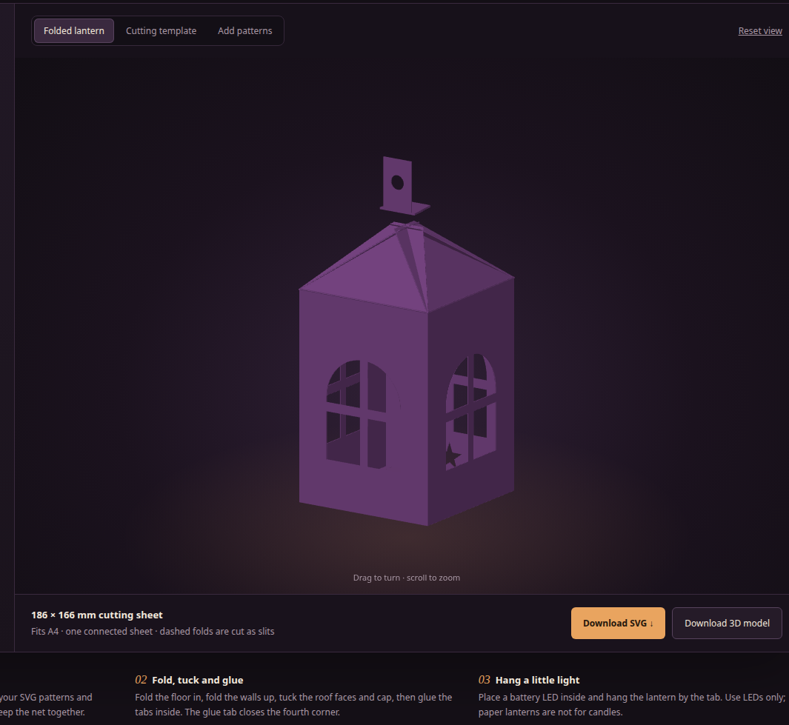
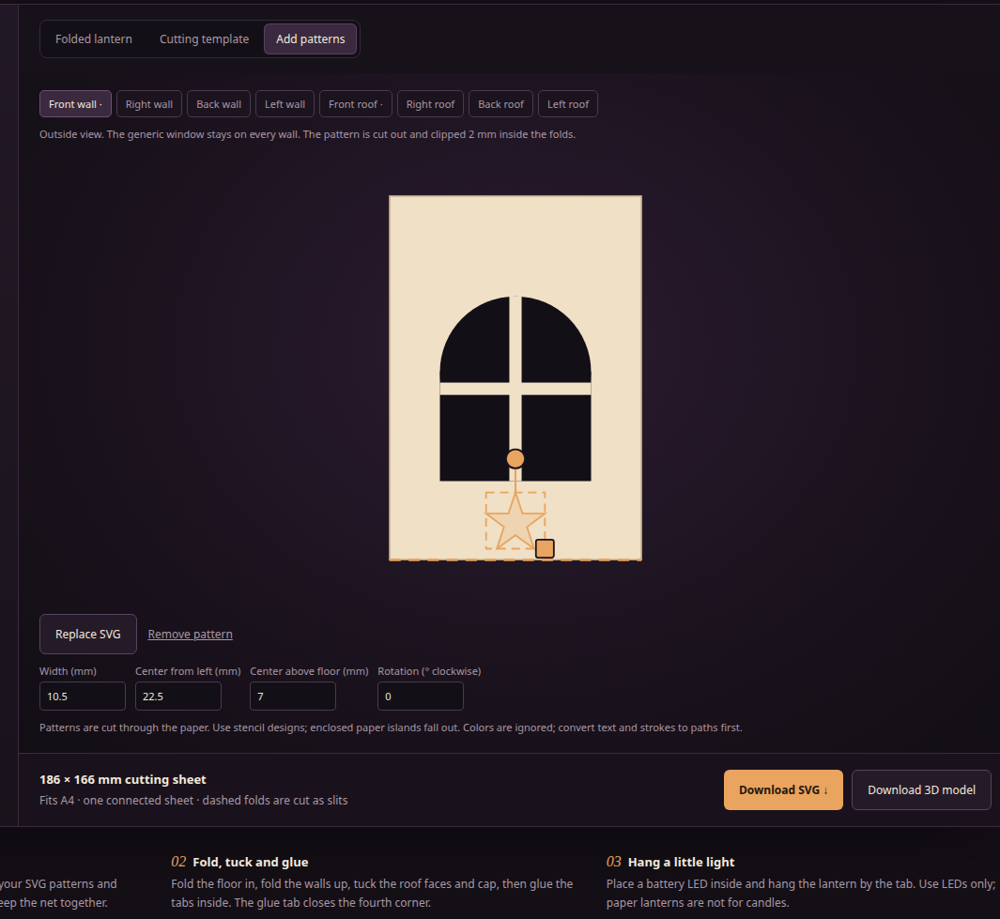
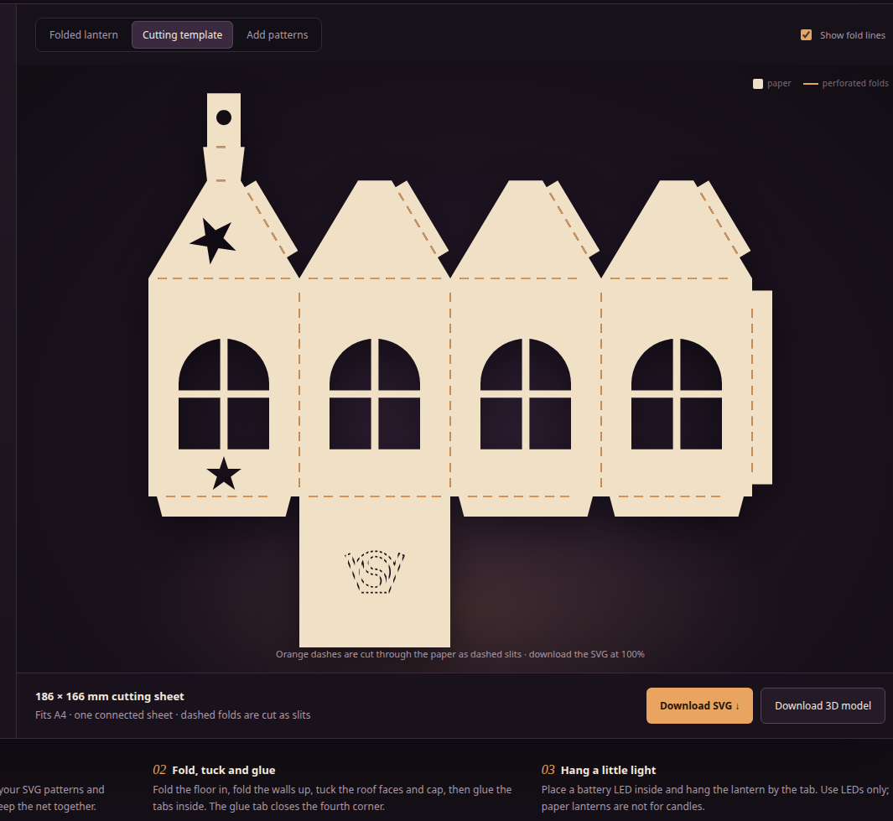

# Foldable paper haunted-house lantern

A parametric, one-piece paper lantern for a cutting machine, with a small local
web app that previews the folded lantern, the flat cutting template, and an
8-surface pattern editor. The template is an SVG; the folded model is rendered by
OpenSCAD and can be downloaded as STL.



The default lantern is a 45 × 45 mm square house with 65 mm walls, a 30 mm
pyramid roof and a **generic four-pane window on every side**. The roof faces are
plain; add your own SVG cut-out pattern to any wall or roof face in the app. The
flat net is **186 × 166 mm**, so it fits on A4 at 100 % scale. All dimensions are
in millimetres.

## What makes the template special

- **One connected sheet.** The net contains a floor, four walls, four roof
  faces, a hanger tab, a wall glue tab, three bottom flaps and four roof seam
  tabs. There is nothing to assemble from loose parts.
- **Cut-out fold lines.** Every fold is marked with a dashed line and the dashes
  are cut as thin slits. The small paper bridges between the slits keep the net
  connected while making the folds easy and accurate. There are no printed
  score guides that a cutter would ignore.
- **One generic window per side.** Every wall gets an arched four-pane window
  with a paper cross mullion. The roof has no built-in decoration.
- **Custom SVG cut-outs.** Upload a pattern, then drag, resize and rotate it
  directly on any of the eight faces. The pattern is cut through the paper and
  clipped 2 mm inside the folds. One pattern per surface is enough to make each
  wall and roof face different.
- **A real hanger.** The top of the pyramid has a square cap and a vertical tab
  with a round hanging hole.
- **VeryOS engraved.** A dashed engraving of the VeryOS mark is cut into the
  floor. Because the outline is broken into dashes, the logo remains attached
  and does not fall out. It can project a faint mark when a light is inside.



The screenshots use a sample star pattern on the front wall and front roof. The
default net has the generic windows only; no pattern is required.



## Run the web app

Requirements:

- **Node 18 or newer** (Node 22 is used for development)
- **OpenSCAD 2021 or newer** on your `PATH`

No packages, CDN assets, API keys or network access are needed. From this
project directory:

```sh
node server.js
```

Open **http://127.0.0.1:8055**. The server binds to loopback only. To use a
different port:

```sh
PORT=8060 node server.js
```

The app shows the folded model rendered from the real OpenSCAD mesh and the
cutting template generated from the same source. The controls, defaults and
ranges are read from [paper_folding_lantern.scad](paper_folding_lantern.scad);
the browser does not keep a second copy of the geometry.

- **Folded lantern** — drag to rotate, scroll to zoom. With the canvas focused,
  the arrow keys rotate and `+`/`-` zoom. **Reset view** restores the camera.
- **Cutting template** — cream paper, dark cutouts and orange perforated fold
  lines. The **Show fold lines** checkbox hides the orange overlay; the slits
  are still part of the cut SVG.
- **Add patterns** — pick one of the four walls or four roof faces, load an SVG,
  and place the cut-out pattern. See the section below.
- **Download SVG** saves the current flat cutting file, including the generic
  windows, every custom pattern and all perforated folds. **Download 3D model**
  saves the folded mesh as STL. Both are disabled while the preview is out of
  date.
- **Reset settings** restores every OpenSCAD default and removes all patterns.

A full update runs OpenSCAD, so it takes a few seconds. Switching between wall
and roof tabs in the pattern editor is instant.

## Place a custom SVG pattern

1. Switch to **Add patterns**.
2. Choose **Front wall**, **Right wall**, **Back wall**, **Left wall**, **Front
   roof**, **Right roof**, **Back roof** or **Left roof**. A small dot on a tab
   means that surface already has a pattern.
3. Click **+ Load SVG** and choose a file. Choose an SVG that already looks like
   the silhouette you want to cut: every filled shape becomes a hole.
4. Drag the pattern to move it. Drag the square corner handle to resize it with
   the aspect ratio locked, or drag the round handle above it to rotate. Hold
   Shift while rotating to snap to 15°.
5. Use the exact fields when you need them: **Width**, **Center from left**,
   **Center above floor** (walls) or **Center above eave** (roofs), and
   **Rotation** clockwise as seen from outside. With the editor focused, the
   arrow keys move the pattern by 0.5 mm; Shift + arrow moves it by 2 mm.
   Delete/Backspace or **Remove pattern** removes it.
6. Look at **Cutting template** or **Folded lantern**. The editor shows the
   uploaded pattern in translucent orange; the cut views show the actual hole.

**The generic window stays.** A wall pattern is additional to the window; if it
overlaps the window, the cut regions merge. The pattern is clipped 2 mm inside
the folds and outer edges so it cannot destroy a fold or the outer outline. The
orange selection box shows the whole pattern, including any part that falls
outside the cuttable area.

**One pattern per surface.** Uploading another SVG to the same surface replaces
the geometry while keeping its placement and size. The pattern belongs to the
current browser session; download the SVG/STL before reloading. **Reset
settings** clears all patterns.

### SVG rules

The browser sanitises the upload, then the server flattens it through OpenSCAD.
Supported geometry includes paths, curves, transforms, basic shapes and local
`<use>` references. Text must be converted to paths. Images, clipping, masks,
filters and active content are not supported. Stylesheets are ignored, so every
shape becomes a cut even if CSS would hide it.

- Use **stencil designs**. Enclosed paper islands inside a closed cut-out fall
  out unless you attach them to a backing sheet.
- Convert strokes and text to paths before uploading.
- Keep uploads below **500 KB** and avoid extremely detailed artwork.
- Colours are ignored. The shape is what matters.
- The app accepts one file per surface, so you can give each wall and each roof
  face its own design.

## Fold and glue

1. **Cut.** Import the SVG at 100 % scale in millimetres. Cut the outline, the
   generic windows, your SVG patterns, and the dashed fold slits. Keep the
   bridges between the slits; they hold the net together. The logo on the floor
   is also a set of dashed slits, not a loose insert.
2. **Pre-fold.** Gently fold every perforated line in both directions. The floor
   fold is the line between wall 1 and the square floor. The three other bottom
   lines are the bottom flaps. The four eave lines and the roof seam lines make
   the pyramid. The short lines at the top are the cap and hanger folds.
3. **Floor.** Fold the floor under wall 1 so it sits flat. Fold the bottom flaps
   of walls 0, 2 and 3 inward and glue them on top of the floor. The flaps are
   inset from the corners so they do not fight each other.
4. **Walls.** Fold the four walls up around the floor. The tab on the right edge
   of wall 3 folds inside wall 0 and glues there to close the fourth corner. Work
   around the corners and keep the last one open until the others are set.
5. **Roof.** Fold the four roof faces inward at the eaves. Each face has a glue
   tab on its right slant edge; fold it inside and glue it to the neighbouring
   face. The four truncated top edges form a small square opening. Fold the cap
   down over that opening and glue it to the top edges. Finally fold the hanger
   tab up so it stands vertically, with the round hole above the roof.
6. **Light.** Put a small battery-powered LED inside and hang the lantern by the
   tab. The cutouts and the floor engraving let the light out. **Use LEDs only;
   paper lanterns are not suitable for candles or other hot light sources.**

Start with a scrap-paper test to check your cutter’s kerf, the fold slits and the
glue clearance for your cardstock.

## OpenSCAD parameters

Open the `.scad` file in OpenSCAD and use the Customizer, or edit the top-level
parameters. No libraries are required.

| Parameter | Default | Range | Purpose |
| --- | ---: | --- | --- |
| `paper_thickness` | 0.3 | 0.1–0.8 | Thickness of the folded 3D model; does not change the SVG |
| `lantern_width` | 45 | 38–60 | Outside width of the square footprint |
| `wall_height` | 65 | 55–100 | Wall height from floor to eaves |
| `roof_height` | 30 | 10–60 | Height of the pyramid above the eaves |
| `window_width` | 27 | 10–45 | Generic window envelope width |
| `window_height` | 33 | 10–70 | Generic window envelope height |
| `hanger_width` | 10 | 6–20 | Side of the square roof opening and hanger tab width |
| `hanger_height` | 16 | 8–30 | Height of the vertical hanger tab |
| `hanger_hole` | 4.5 | 2–10 | Diameter of the hanging hole |
| `glue_tab` | 6 | 3–10 | Width of the wall tab, bottom flaps and roof seam tabs |
| `fold_slit_width` | 0.45 | 0.2–0.8 | Width of each fold slit; adjust for your cutter |
| `fold_dash_length` | 2.6 | 1–5 | Length of each fold dash |
| `fold_dash_gap` | 2 | 1–5 | Paper bridge between dashes |

`output` is internal: `flat` for a thin flat STL, `cut` for the 2D SVG/DXF,
`folded` for the assembled model, and `fold_lines` for the orange overlay. The
web app sets it automatically. Patterns are not a parameter; they live in the
app session and are passed to OpenSCAD as polygon data for the render.

Some individually valid settings are incompatible together. The app shows the
OpenSCAD assertion message when, for example, a window would eat through a
corner or a hanger hole would leave too little paper. Increasing the lantern,
wall or roof dimensions also increases the sheet size; the app reports whether
the template still fits A4.

## Export without the web app

Run from this project directory so the logo import resolves:

```sh
# Flat cutting template with the generic windows and fold slits.
openscad -o lantern.svg -D 'output="cut"' paper_folding_lantern.scad
openscad -o lantern.dxf -D 'output="cut"' paper_folding_lantern.scad

# Folded visualization model.
openscad -o lantern.stl -D 'output="folded"' paper_folding_lantern.scad

# Thin flat solid, useful for an STL-to-vector workflow.
openscad -o lantern_flat.stl -D 'output="flat"' paper_folding_lantern.scad
```

If you run from another directory, pass the logo explicitly:

```sh
openscad -o lantern.svg -D 'output="cut"' \
  -D 'logo_file="/absolute/path/to/veryos_logo.svg"' \
  /absolute/path/to/paper_folding_lantern.scad
```

**Custom patterns are app-side.** The command-line exports above contain the
generic windows only. To get a cutting file with your patterns, use **Download
SVG** in the app (or download the STL). The app writes the patterns into the
same OpenSCAD render.

For GUI export, press **F6 / Render** before exporting. The SVG/DXF contain the
cut slits for every fold. The orange guide overlay exists only in the app and in
the `fold_lines` debug output; it is never part of the downloaded cut file.

### Notes on the exports

- The **SVG downloaded from the app is the authoritative cutting file.** It uses
  millimetres and the exact net outline, including the perforated folds, generic
  windows, custom patterns and the VeryOS engraving. The command-line SVG/DXF
  contain the generic windows and folds only; use the app download if you need
  your custom patterns in the file.
- The **folded STL is a visualization model**, not a paper-cut file. It uses
  ideal folds and small overlaps at the glue joints so the result looks like a
  finished, glued lantern. It does not model paper bend radius or the thickness
  of glue.
- The **flat STL** is a thin extrusion of the same net and may help an
  STL-to-vector workflow. Preserve the window holes if you convert it.
- Do not scale the template in the cutter software. At the default settings the
  sheet is 186 × 166 mm; verify that size before cutting.

## Verify changes

The tests render the real OpenSCAD model, check the default A4 template, verify
the dashed slits and SVG dimensions, parse the folded mesh, import an SVG and
place it on all eight surfaces, exercise a resized lantern, check invalid
settings and test the API’s validation, same-origin rule and SVG import.

```sh
npm test
# equivalent:
node --test server_test.js
```

Requirements for the tests are the same as for the app: Node 18+ and OpenSCAD on
`PATH`. A run takes a few seconds because OpenSCAD actually renders the folded
model and the cutting template.

## Limitations

- **No physical cardstock assembly has been tested yet.** The geometry, cut file
  and folded mesh have been verified; cut a scrap-paper test before using good
  paper.
- The roof and floor use ideal folds. Real cardstock has a bend radius, and thick
  paper may need slightly wider glue tabs or a larger hanger opening.
- The fold slit width is a compromise: too narrow and the slits may not cut;
  too wide and the bridges become weak. `fold_slit_width = 0.45 mm` works in the
  default template preview; tune it for your machine and material.
- Patterns are cut-outs, not printed or engraved artwork. They are clipped 2 mm
  inside the folds; very detailed artwork may need path simplification. The
  pattern session is not saved to a database.
- The app is a local workshop tool, not a hosted service. It binds to
  `127.0.0.1`, writes only temporary files and keeps no database.

## Files

| File | Purpose |
| --- | --- |
| [paper_folding_lantern.scad](paper_folding_lantern.scad) | Parametric net, folded assembly, generic windows, fold slits, pattern cuts and logo import |
| [server.js](server.js) | Local Node server, OpenSCAD invocation, SVG import and mesh API |
| [svg_geometry.js](svg_geometry.js) | Sanitises uploaded SVGs and converts them to normalised cut polygons |
| [index.html](index.html), [app.js](app.js), [decorations.js](decorations.js) | Web interface, folded preview and 8-surface pattern editor |
| [veryos_logo.svg](veryos_logo.svg) | VeryOS mark, engraved into the floor |
| [server_test.js](server_test.js) | Integration tests against the real OpenSCAD model |
| [image.png](image.png) | Inspiration for the lantern shapes |

## License and brand

veryos stands for very open source: share the knowledge, the files and the
improvements openly. The project is licensed under the **GPL**. Every source file
starts with the project copyright line. The VeryOS logo is engraved into the
paper part as a dashed floor mark; no separate loose inlay is needed.

Inspiration: [image.png](image.png).
