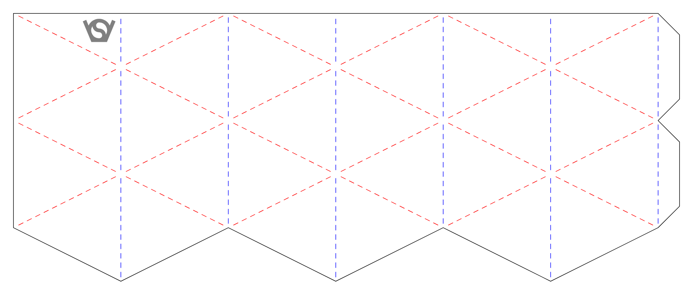

# Flextangle

A webapp that draws the net of a flextangle, a ring of six tetrahedra that turns through its own middle (a kaleidocycle), as an SVG to print or cut: the outline solid, the folds dashed, with dash and gap set in mm. The layout is the one of the Babble Dabble Do template in `inspiration/image.png`, drawn anew.

| Start | |
|---|---|
| `deno task start` in `paper_folding_shape/`, then http://127.0.0.1:8772 | the app; reachable from this computer only |
| `deno task start 8773` | on another port |
| `deno task test` | the net's checks, see Checks |
| `python3 rotation_check.py` | which triangle heights turn fully; about 80 s, needs numpy |

Needs [Deno](https://deno.com) and a browser. The page makes the SVG itself; `webapp/` works from any static web server.

## Settings

| Setting | Default | Range | Does |
|---|---|---|---|
| Triangle base | 40 mm | 10 to 300 | the hinges between the tetrahedra; the net is 6 × height + end tab wide, 2.5 × base high: 248 × 100 mm by default |
| Triangle height | 1 × base | 1 to 3 | 1 is the template's and the smallest that turns fully, see Geometry; higher makes longer tetrahedra and a bigger hole |
| End tab | 8 mm | 1 to base / 2 | how far the two tabs on the right reach; corners cut at 45°, so they fit inside the triangles they are glued to |
| Dash | 2 mm | 0.2 to 50 | length of each dash of a fold |
| Gap between dashes | 1.5 mm | 0.2 to 50 | between the dashes and at both ends of every fold: no dash touches the outline or another fold |
| Line width | 0.2 mm | 0.01 to 2 | stroke width of all lines |
| VeryOS logo on a glue tab | on | | in the first glue tab's square corner, base / 20 from its edges; hidden once glued |

- Dashes: as many as fit with the gaps, in the middle of the fold; a fold too short for one dash gets one shorter dash.
- Defaults: dash and gap as the template's printed dashes; base about the template's on Letter paper.

## SVG

| id | Colour | Is | Do |
|---|---|---|---|
| `outline` | black | one closed path, solid | cut |
| `fold_valley` | blue | dashes, the vertical lines: hinges, the glue tabs' and end tabs' folds | fold face to face |
| `fold_mountain` | red | dashes, the slanted lines | fold back to back |
| `logo` | grey fill | VeryOS logo | print or engrave; a cutter would cut it out |

- Size in mm at 1 : 1 (`width="258mm"`), 5 mm margin; the settings are in `<desc>`.
- Each dash is a line of its own (`M … L …`), not a `stroke-dasharray`: cutters and lasers cut the lines as drawn; the colours become layers, e.g. in LightBurn.
- File name: `flextangle_<base>mm_veryos.svg`.

## Folding

1. Cut the outline.
2. Crease the blue folds face to face and the red folds back to back, unfold.
3. Roll a tube: the glue tabs along the top go behind the bottom row, each bottom tip onto the point where a glue tab's folds meet. Glue.
4. Glue the two end tabs into the open end on the left: the ring closes.

## Geometry

| | |
|---|---|
| Ring | six tetrahedra, one per column of the net, four triangles each; the vertical lines are the hinges between neighbours |
| Tetrahedron | two hinges of the base's length, at right angles, √(height² − base² / 4) apart; four edges √(height² + base² / 4) |
| Closing | the six quarter turns between hinges add up to half a turn: the ring closes onto its first hinge turned end over end |
| Motion | one free motion; each hinge swings through 240° and back per turn of the ring |
| Height limit | height ≥ base: below, the tetrahedra run into each other during a turn (0.99: by 1 % of the base, 0.95: 6 %, 0.9: 12 %); at 1.0 six corners meet in the middle, nothing overlaps |
| Glue tabs | half triangles; rolled, each lies behind half of a bottom triangle |

## Checks

| Check | How | Result |
|---|---|---|
| Net | `deno task test`: outline area = 24 triangles + 6 half triangles + 2 end tabs; 15 valley and 24 mountain folds of the right lengths, inside the outline; end tabs inside the triangles they are glued to; logo base / 20 inside its tab; dashes on their folds, gaps at the ends and between, as many as fit; SVG size, viewBox, line counts | 24 pass, for the defaults, both ends of every range and an odd setting |
| Page | headless Chrome on a test port: every input, an empty and out-of-range value (message, Download off), the downloaded file | as expected, no errors |
| Ring | `rotation_check.py`: the motion traced in 1177 steps (closure error 3e-12), every pair of tetrahedra tested for overlap | table in Geometry |

## Open

| | |
|---|---|
| Not made yet | nothing cut, folded or printed; dash 2 / gap 1.5 not tried as a perforation on a cutter or laser |
| Paper thickness | not in the model; at height 1.0 the middle closes to a point, thick card may jam there (hypothesis) |
| `inspiration/` | the template and photos from the web, not in git |
