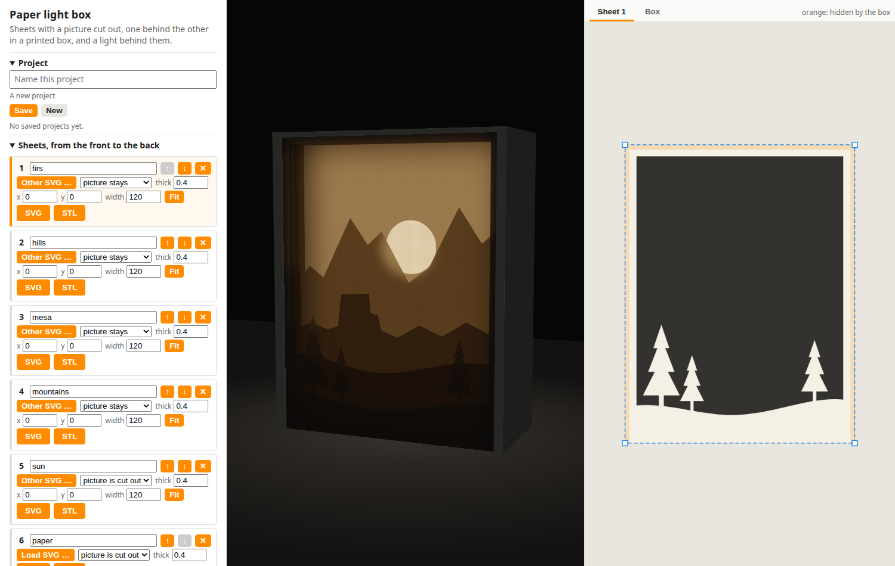
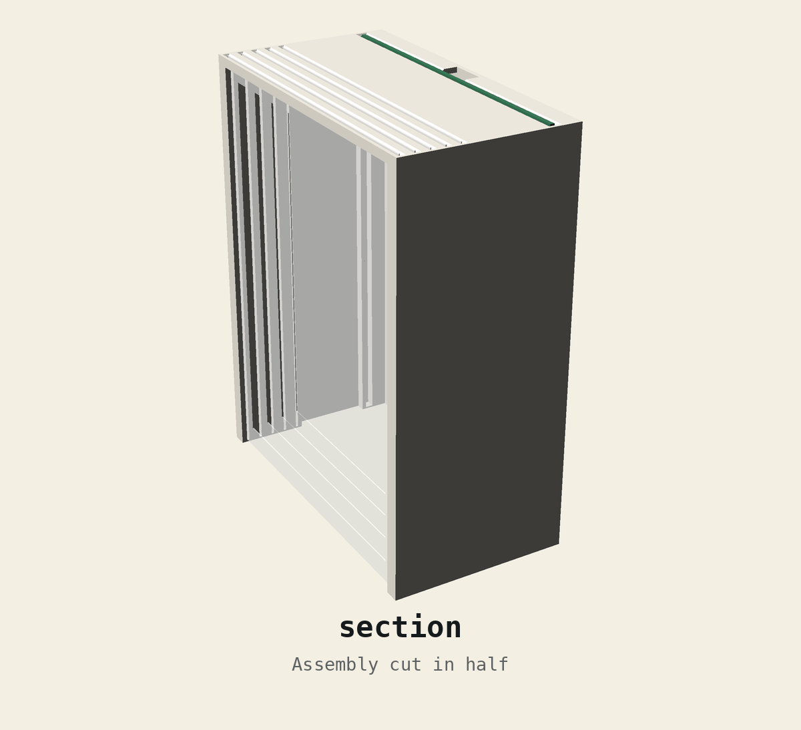
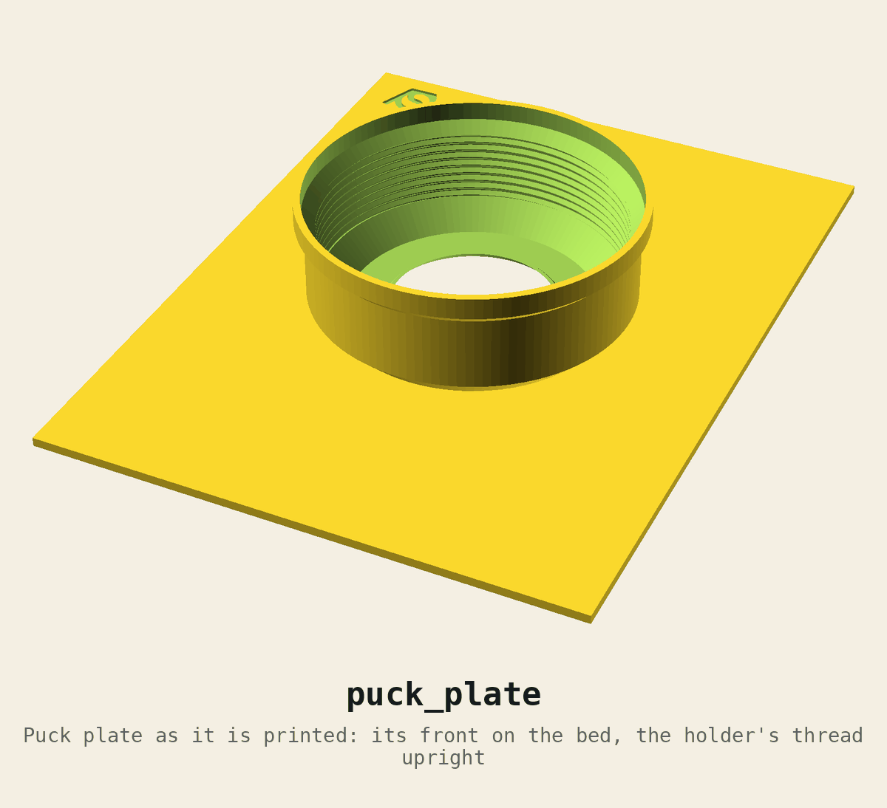

# Paper light box

A printed box with slits in its top; a sheet with a picture cut out slides into each, paper or a thin print, and a light behind the last one shines through them all. A webapp places the pictures, shows the box lit, keeps the projects, and gives a file for every sheet and for the box. Goal: `readme_hgc.md`. **Not printed, nothing cut. The board's fit is from a drawing, not from the part; the puck's thread is the printed holder's, the plate around it is new.**

| File | What |
|---|---|
| `webapp/`, `deno.json` | the app, see below; `webapp/project/` holds the saved projects |
| `paper_light_box_veryos_V2.scad` | the box and the puck plate, standalone, no libraries. `part`: `print` (default), `box`, `puck_plate`, `placed`, `assembly`, `section`. `light`: `board`, `puck` |
| `archive/paper_light_box_veryos_V1.scad` | V1: the puck dropped into a pocket, see below |
| `rendered_parts/` | the box for both lights and the puck plate, under the names used here |
| `inspiration/`, `LEDoptions/` | the user's pictures and links, not committed: third-party pictures |

## Webapp

| | |
|---|---|
| Start | `deno task start` in this folder, then http://127.0.0.1:8776 (another port: `deno task start 8777`) |
| Needs | Deno; OpenSCAD: `$OPENSCAD`, else `.gitignored/tools/OpenSCAD-nightly.AppImage`, else `openscad` on the PATH |
| Tests | `deno task test`: 17, of the outline tracing, the light model, the settings, the server with OpenSCAD, and the saved projects |
| Opens with | six sheets drawn by the app, to have something lit: three firs on a hill, hills, a mesa, mountains, a sun cut out, a plain sheet; load own pictures over it |
| Projects | all that is on screen under a name, kept by the server as `webapp/project/<name>/project.json`, for git to track: the script's settings, the frame, the preview's light, and per sheet its name, kind, thickness, picture (the SVG's text) and the picture's place |
| Reload | the address names the open project (`#name`) and a reload opens it again; without one the app opens with the mountains. Leaving with unsaved changes asks first |
| After an update | `serve.js` keeps the projects: stop the server and `deno task start` again, or the page says the server is an older one |

| Part of the page | Does |
|---|---|
| Project | the name, and under it `All changes saved`, `Unsaved changes`, `Not saved yet` or what went wrong. `Save` (also Ctrl+S, or Enter in the name): the open project under its own name; under another name a new project, and the open one stays as saved. `New`: the mountains again. The list: a click opens a project, `✕` deletes it with its folder, both after asking. A deleted project stays on screen: `Save` brings it back |
| Sheets | the list from the front to the back. Per sheet: name, `↑` `↓` order, `✕` remove, `Load SVG`, what the picture is, thickness (0.4), the picture's x, y and width in mm, `Fit`, files `SVG` and `STL` |
| `Add a sheet` | a new sheet behind the others; the number of sheets is the list's length |
| `frame` | kept all around every sheet, 6 mm: holds the sheet together and sits in the box's grooves |
| Start here | from the script: sheets' width and height, distance between two sheets, the light, its distance |
| Fit, Box, Backlight board, Puck light, Logo | the script's other settings, read from its Customizer comments. Not shown: the holder's own values, which stay those of the holder's script |
| Light in the preview | colour, brightness, the room's light, how much a sheet lets through; the preview only |
| Lit box (left) | the sheets at their depths, lit; drag turns it, double click looks straight at it |
| `Sheet n` (right) | the selected sheet flat, material light, holes dark, orange where the box hides it. Drag the picture to move it, a corner or the wheel to resize it |
| `Box` (right) | the box from OpenSCAD in 3D, with the puck light also its plate in place; below the settings the script's echo: size, window, slits |
| `Box STL` | the box as it is printed, upside down |
| `Puck plate STL` | with the puck light: the plate with the holder's thread, as it is printed, its front on the bed |

| Picture | Rule |
|---|---|
| File | any SVG the browser draws: fills, strokes, text, colours. Dark is ink, white and nothing are not (ink = 1 − brightness, cut at half) |
| `picture stays` | the sheet is the frame plus the ink: a silhouette |
| `picture is cut out` | the sheet is whole but for the ink inside the frame; without a picture a plain sheet, as the last one to spread the light |
| Loose pieces | counted and shown in red: material that does not hang on the rest falls out when cut |
| Sheet's SVG | 1 : 1 in mm, one path, even-odd; traced from up to 10 pixels per mm, points within 0.03 mm left out, specks under 0.05 mm² dropped, sharp corners cut by 0.05 |
| Sheet's STL | that SVG extruded by OpenSCAD to the sheet's thickness; lines thinner than the nozzle are the slicer's to drop |

| Lit preview | Model, not measured |
|---|---|
| A hole | shows what is behind it, sharp |
| Material | glows with the light on its back, blurred by 0.55 × the space behind it, times what it lets through: 0.45 for 0.4 mm, to the power of thickness / 0.4 |
| Colour | each sheet passed takes green to 0.88 and blue to 0.7: warmer towards the front |
| Board | 99 LEDs, 9 × 11, in a field 12 smaller than the board |
| Puck | a disc as wide as the window's edge on the lens, 36, sending as much in all as the board |
| Left out | light thrown back between the sheets; the holder behind the box in the lit picture |

## Box

| | |
|---|---|
| Print | upside down, the top wall with the slits on the bed; walls and grooves upright; no support |
| Bottom | open. Stops 0.6 high under the grooves carry the sheets; to take one out, lift the box and push it up from below |
| Slit | sheet + 0.4, at least 0.8, mouth chamfered 0.4; through the top wall into grooves 2.5 deep in both side walls |
| Between slits | solid; from 7.2 wide hollow between two 1.6 ribs |
| Window | sheet width + 0.5 − 2 × 2.5 wide; a bar hides the sheets' top 2.5; the bottom is open to the table |
| Sheets | flush with the top; a light taller than the sheets makes the box taller and the bar deeper |
| Logo | in the back of the box and of the puck plate, 0.6 deep; none on the sheets: no room beside the picture |
| Six sheets 120 × 156, distance 5 | board 124.5 × 57.2 × 156.6; puck 124.5 × 50.6 × 156.6, the holder 25.9 more behind it |

| `light` | Held | Open questions |
|---|---|---|
| `board`: Bambu CMYK backlight board 120 × 156, lit 108 × 144, USB-C, 99 LEDs, 5 W | slides into a slit 3 wide behind the last sheet, LEDs to the front; 6 room and a back wall with vents behind it; upright behind upright sheets, lying behind wide ones | thickness unmeasured. USB socket taken to be on the back at the middle of a short edge (two small marks in the store's picture): notch 14 wide in the top wall, or a window in the right side wall for a lying board. A retailer lists 70 °C in operation: PETG is safer than PLA |
| `puck`: RGBW puck light KC007 in the threaded holder of `../RGBW_pucklight_holder_ringclick` | the holder's top part is a plate as large as a sheet, `puck_plate`, in a slit 2.4 wide behind the last sheet; its cup reaches back through a slot in the back wall. The holder's screwin, the puck on it, screws into the cup from behind; its plunger is the button | the plate and its slit are untested; the cup's inside is the holder's, which prints and clicks (V6). A small light: `light_distance` 30 or more, or a bright middle |

| Puck plate | |
|---|---|
| Cup | cavity, internal thread 67.5 × 2 with 45° flanks, window and its edge on the lens copied from `RGBW_pucklight_holder_ringclickV8.scad`; the values are a group of their own in the script, to change in both |
| Screwin | not in this project: `screwin` of `../RGBW_pucklight_holder_ringclick` V6 to V8, or of `../pucklight_lamp_v2`; the same puck and screwin move between the lamp, the holder and this box |
| Plate | 2 thick, as large as a sheet, the cup's middle behind the sheets' middle; the lens stands up to 2.4 in front of the plate |
| Print | front on the bed, as the holder's top part: the thread upright, nothing over 45° |
| Box's back wall | a slot 72.7 wide for the cup, open to the top, its lower end a V: a roof in the print. Logo under the V, or beside the slot where the V leaves no room |
| Limits | sheets at least 76.2 wide and 94.2 high: 4 of back wall beside the slot, the cup within the plate |

- Sheets and light of different sizes: both stand on the stops and are centred sideways; the light's wall opens as wide as the narrower of the two.
- Board's data: retailers' listings found by web search 2026-11-25 ([Bambu store](https://asia.store.bambulab.com/products/bambu-cmyk-backlight-board), [MatterHackers](https://www.matterhackers.com/store/l/bambu-lab-cmyk-led-backlight-board), [3D Universe](https://shop3duniverse.com/collections/all/products/bambu-lab-cmyk-led-backlight-board), [3DJake](https://www.3djake.com/bambu-lab/cmyk-led-backlight-board-kit)); the EU store's page in `LEDoptions/` refused to be read.

## Checked

| What | Result |
|---|---|
| Box, both lights, upright, wide (156 × 120), large (150 × 200), small (100 × 100), sheets of 0.15 to 1.2 at distance 12, puck 80 × 96 and 200 × 120 | one closed body each, no zero-area triangles, in OpenSCAD 2021.01 and in 2026.09.16 with lazy union and Manifold; volumes equal within 2 ppm (2021.01's STL is that much small) |
| Puck plate 120 × 156, 80 × 96, 200 × 120 × 3, without logo | one closed body, the same volume in both builds. 2021.01's STL has 272 edges that meet at four digits where the thread runs out at the cavity's shoulder, exactly as the holder's own top part has; Manifold's has none |
| Sliced, six sheets, the disc launcher's Elegoo Centauri Carbon 2 settings (0.2 mm, 2 walls, 15 %, classic) | board 123 g in 5 h 41 min; puck 104 g in 4 h 26 min and its plate 56 g in 1 h 15 min; no support; bridges 0.4 m per box, none in the plate; slits free 1.6 in the first layer, 1.0 in the second, 0.8 above |
| Sheets from the app | the six it opens with: no loose piece, the frame and one hole each (the plain one no hole), 8 to 135 points; STL one closed body, volume = the SVG's area × 0.4 in both OpenSCAD builds. Before them a forest of bare trees, its front sheet 347 outlines and 4596 points, the same result |
| Page in headless Chrome | load, drag, corner, wheel, fit, order, add, remove, three loaded files (no viewBox, white background, not an SVG), both lights, wide and large sheets, all downloads, the plate in the 3D view. Projects: save, reload, change and save again, another name, a taken name, a name the server refuses, `New`, open, the question with all three answers, delete and keep, delete the open one and save it back, Ctrl+S, Enter, leaving with unsaved changes, a picture of one's own kept over a reload, the page on a server from before |
| Not checked | a print; a cut sheet; a real board in the box; a printed screwin in the plate; the lit preview against a real box; a touch screen; Firefox |

## My choices, not in the brief

| Choice | Instead of |
|---|---|
| Printed upside down with an open bottom | a floor: a bridge as wide as the box, or a top wall printed last |
| Sheets flush with the top, pushed out from below | sheets standing proud to grip |
| The picture's ink by darkness, two ways to use it per sheet, a frame of 6 | cutting along the SVG's own paths |
| Sheets traced from pixels | the SVG's curves: a cutter gets short straight lines, 0.03 mm from them |
| The box and the sheets' STL from OpenSCAD on the server | geometry made in the page |
| Projects as files kept by the server, the panel as in `../pucklight_lamp_v2/webapp` | the browser's own storage, which git does not see and another browser does not have |
| A project is one `project.json`, the pictures in it as text; 12 MB at most | the pictures as files beside it |
| The preview's light is part of a project | only what the box and the sheets are made from |
| Board held in a slit | screws |
| The holder's thread on a plate of its own that slides in | the thread in the box's back wall: it would lie in the print |
| The top part of the ringclick holder, V8 | `../RGBW_pucklight_holder` V4, whose ribs cross the light; its bottom screw has the same thread |
| The screwin left in its own project | a copy of it here |
| Light distance 15, slit 0.8, grooves 2.5, walls 2, plate 2 | |

## V2 against V1

| | V1 | V2 |
|---|---|---|
| puck held | dropped from above into a pocket behind the back wall, onto a V | on the holder's screwin, screwed into the cup of the puck plate |
| click | the puck pushed through a Ø30 hole against the edge of a slot; untested | the holder's plunger, as in the holder |
| parts for the puck | box | box, `puck_plate`, and the holder's screwin |
| box for the puck, six sheets | 124.5 × 71.5 × 156.6, 143 g sliced | 124.5 × 50.6 × 156.6, 104 g; plate 56 g |
| box for the board | | unchanged: the same mesh |
| `sheet_distance` | from 2 | from 2.5: below that the script refused it |
