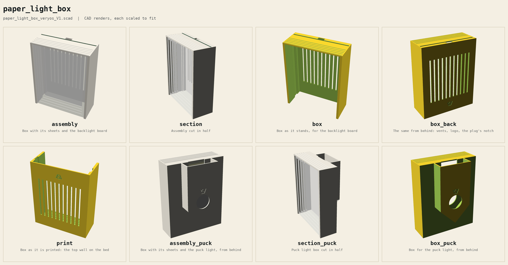

# Paper light box

A printed box with slits in its top; a sheet with a picture cut out slides into each, paper or a thin print, and a light behind the last one shines through them all. A webapp places the pictures, shows the box lit, and gives a file for every sheet and for the box. Goal: `readme_hgc.md`. **Not printed, nothing cut. The board's and the puck's fits are from drawings and a CAD model, not from the parts.**

| File | What |
|---|---|
| `webapp/`, `deno.json` | the app, see below |
| `paper_light_box_veryos_V1.scad` | the box, standalone, no libraries. `part`: `print` (default), `box`, `assembly`, `section`. `light`: `board`, `puck` |
| `rendered_parts/` | the box for both lights, under the names used here |
| `inspiration/`, `LEDoptions/` | the user's pictures and links, not committed: third-party pictures |

## Webapp

| | |
|---|---|
| Start | `deno task start` in this folder, then http://127.0.0.1:8776 (another port: `deno task start 8777`) |
| Needs | Deno; OpenSCAD: `$OPENSCAD`, else `.gitignored/tools/OpenSCAD-nightly.AppImage`, else `openscad` on the PATH |
| Tests | `deno task test`: 16, of the outline tracing, the light model, the settings, and the server with OpenSCAD |
| Opens with | a forest of six sheets drawn by the app, to have something lit; load own pictures over it |
| Not kept | the sheets live in the page: a reload starts again with the forest |

| Part of the page | Does |
|---|---|
| Sheets | the list from the front to the back. Per sheet: name, `↑` `↓` order, `✕` remove, `Load SVG`, what the picture is, thickness (0.4), the picture's x, y and width in mm, `Fit`, files `SVG` and `STL` |
| `Add a sheet` | a new sheet behind the others; the number of sheets is the list's length |
| `frame` | kept all around every sheet, 6 mm: holds the sheet together and sits in the box's grooves |
| Start here | from the script: sheets' width and height, distance between two sheets, the light, its distance |
| Fit, Box, Backlight board, Puck light, Logo | the script's other settings, read from its Customizer comments |
| Light in the preview | colour, brightness, the room's light, how much a sheet lets through; the preview only |
| Lit box (left) | the sheets at their depths, lit; drag turns it, double click looks straight at it |
| `Sheet n` (right) | the selected sheet flat, material light, holes dark, orange where the box hides it. Drag the picture to move it, a corner or the wheel to resize it |
| `Box` (right) | the box from OpenSCAD in 3D; below the settings the script's echo: size, window, slits |
| `Box STL` | the box as it is printed, upside down |

| Picture | Rule |
|---|---|
| File | any SVG the browser draws: fills, strokes, text, colours. Dark is ink, white and nothing are not (ink = 1 − brightness, cut at half) |
| `picture stays` | the sheet is the frame plus the ink: a silhouette |
| `picture is cut out` | the sheet is whole but for the ink inside the frame; without a picture a plain sheet, as the last one to spread the light |
| Loose pieces | counted and shown in red: material that does not hang on the rest falls out when cut |
| Sheet's SVG | 1 : 1 in mm, one path, even-odd; traced from up to 10 pixels per mm, points within 0.03 mm left out, specks under 0.05 mm² dropped, sharp corners cut by 0.05 |
| Sheet's STL | that SVG extruded by OpenSCAD to the sheet's thickness; lines thinner than the nozzle are the slicer's to drop |

| Lit preview | Model, not measured |
|---|---|
| A hole | shows what is behind it, sharp |
| Material | glows with the light on its back, blurred by 0.55 × the space behind it, times what it lets through: 0.45 for 0.4 mm, to the power of thickness / 0.4 |
| Colour | each sheet passed takes green to 0.88 and blue to 0.7: warmer towards the front |
| Board | 99 LEDs, 9 × 11, in a field 12 smaller than the board |
| Puck | a disc as wide as the lens's slot, sending as much in all as the board |
| Left out | light thrown back between the sheets; the puck's pocket in the picture of the box |

## Box

| | |
|---|---|
| Print | upside down, the top wall with the slits on the bed; walls and grooves upright; no support |
| Bottom | open. Stops 0.6 high under the grooves carry the sheets; to take one out, lift the box and push it up from below |
| Slit | sheet + 0.4, at least 0.8, mouth chamfered 0.4; through the top wall into grooves 2.5 deep in both side walls |
| Between slits | solid; from 7.2 wide hollow between two 1.6 ribs |
| Window | sheet width + 0.5 − 2 × 2.5 wide; a bar hides the sheets' top 2.5; the bottom is open to the table |
| Sheets | flush with the top; a light taller than the sheets makes the box taller and the bar deeper |
| Logo | in the back, 0.6 deep; none on the sheets: no room beside the picture |
| Six sheets 120 × 156, distance 5 | board 124.5 × 57.2 × 156.6; puck 124.5 × 71.5 × 156.6 |

| `light` | Held | Open questions |
|---|---|---|
| `board`: Bambu CMYK backlight board 120 × 156, lit 108 × 144, USB-C, 99 LEDs, 5 W | slides into a slit 3 wide behind the last sheet, LEDs to the front; 6 room and a back wall with vents behind it; upright behind upright sheets, lying behind wide ones | thickness unmeasured. USB socket taken to be on the back at the middle of a short edge (two small marks in the store's picture): notch 14 wide in the top wall, or a window in the right side wall for a lying board. A retailer lists 70 °C in operation: PETG is safer than PLA |
| `puck`: RGBW puck light KC007, 62 × 26.8 by its CAD model | drops into a pocket behind the back wall onto a 90° V; its lens looks through a slot 36 wide, open to the top | pushed from behind through the Ø30 hole, the lens meets the slot's edge and should click as in `../RGBW_pucklight_holder_ringclick`: play 0.7, untested. A small light: `light_distance` 30 or more, or a bright middle |

- Sheets and light of different sizes: both stand on the stops and are centred sideways; the light's wall opens as wide as the narrower of the two.
- Board's data: retailers' listings found by web search 2026-11-25 ([Bambu store](https://asia.store.bambulab.com/products/bambu-cmyk-backlight-board), [MatterHackers](https://www.matterhackers.com/store/l/bambu-lab-cmyk-led-backlight-board), [3D Universe](https://shop3duniverse.com/collections/all/products/bambu-lab-cmyk-led-backlight-board), [3DJake](https://www.3djake.com/bambu-lab/cmyk-led-backlight-board-kit)); the EU store's page in `LEDoptions/` refused to be read.

## Checked

| What | Result |
|---|---|
| Box, both lights, upright, wide (156 × 120), large (150 × 200), small (100 × 100), sheets of 0.15 to 1.2 at distance 12, puck 80 × 90 and 200 × 120 | one closed body each, no zero-area triangles, in OpenSCAD 2021.01 and in 2026.09.16 with lazy union and Manifold; volumes equal within 2 ppm (2021.01's STL is that much small) |
| Sliced, six sheets, the disc launcher's Elegoo Centauri Carbon 2 settings (0.2 mm, 2 walls, 15 %, classic) | board 123 g in 5 h 41 min, puck 143 g in 5 h 1 min; no support; bridges 0.4 and 0.6 m; slits free 1.6 in the first layer, 1.0 in the second, 0.8 above |
| Sheets from the app | the forest's front sheet: 347 outlines, 4596 points, STL one closed body, volume = the SVG's area × 0.4 in both OpenSCAD builds |
| Page in headless Chrome | load, drag, corner, wheel, fit, order, add, remove, three loaded files (no viewBox, white background, not an SVG), both lights, wide and large sheets, all downloads |
| Not checked | a print; a cut sheet; a real board or puck in the box; the lit preview against a real box; a touch screen; Firefox |

## My choices, not in the brief

| Choice | Instead of |
|---|---|
| Printed upside down with an open bottom | a floor: a bridge as wide as the box, or a top wall printed last |
| Sheets flush with the top, pushed out from below | sheets standing proud to grip |
| The picture's ink by darkness, two ways to use it per sheet, a frame of 6 | cutting along the SVG's own paths |
| Sheets traced from pixels | the SVG's curves: a cutter gets short straight lines, 0.03 mm from them |
| The box and the sheets' STL from OpenSCAD on the server | geometry made in the page |
| Board held in a slit, puck in a pocket to drop in | screws; the lamp's thread, which would lie in the print |
| Light distance 15, slit 0.8, grooves 2.5, walls 2 | |
