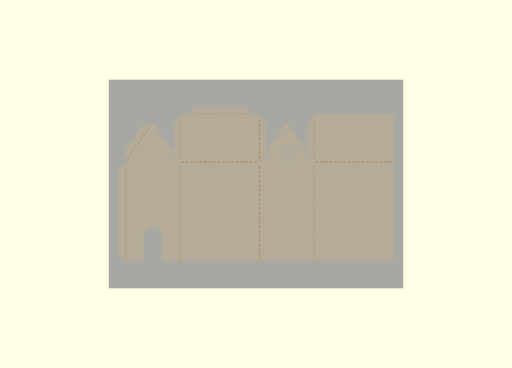
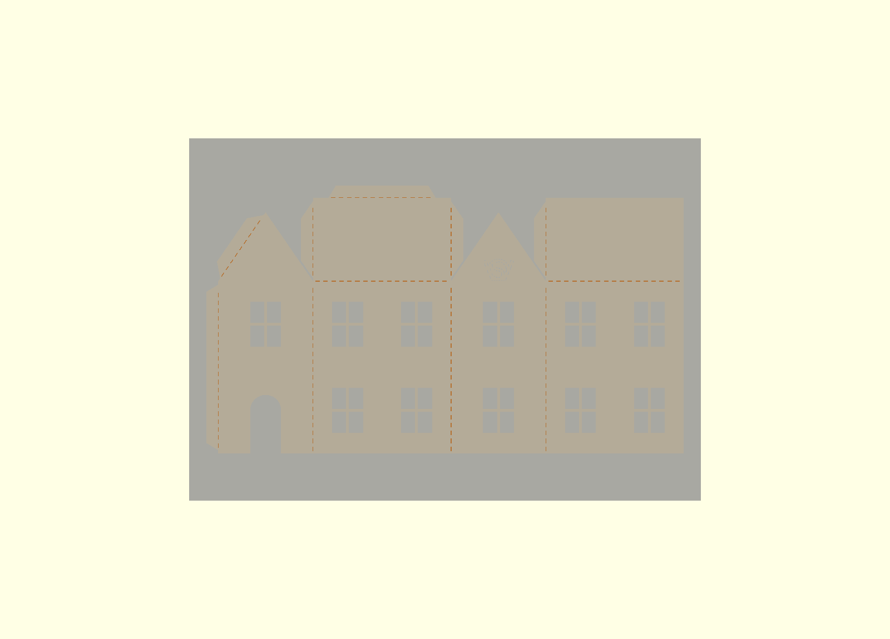
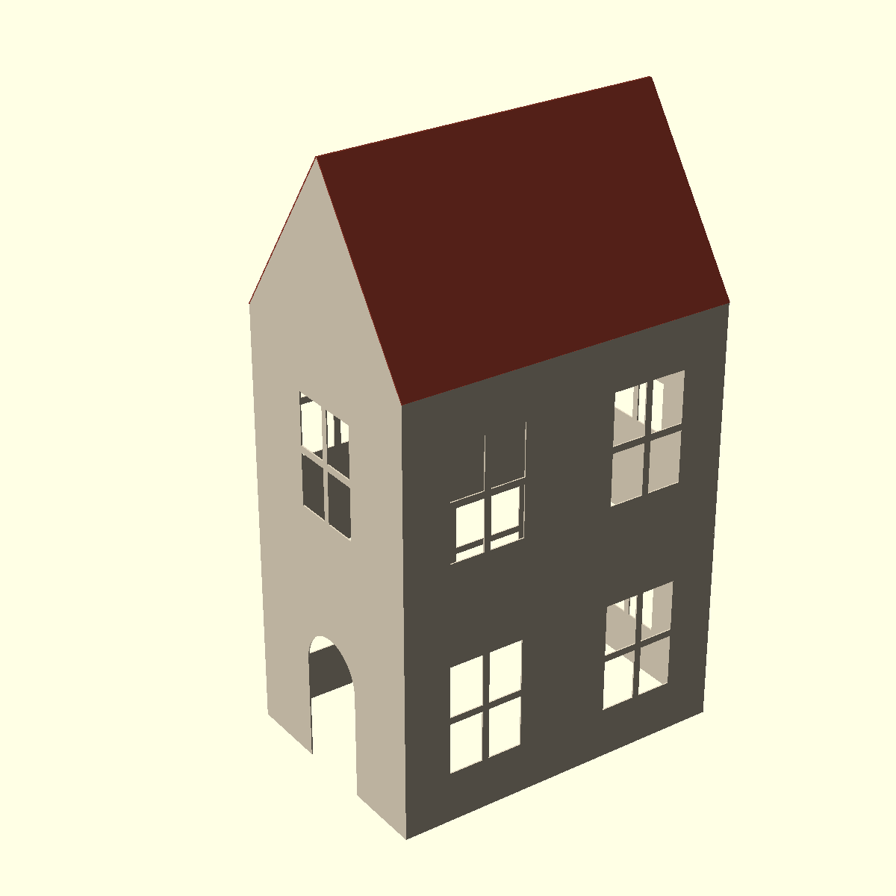

# Paper fold house 2 — one-row net for A4

[papercut_fold_house2.scad](papercut_fold_house2.scad) makes a flat, one-piece cutting template for a paper CNC cutter. Fold and glue it into a house with a gable roof. It replaces the cross-shaped net of [paper_folding_haunted_house](../paper_folding_haunted_house), inspired by [this net](image%20copy.png).




## Layout

| | Old cross net | This net |
|---|---|---|
| Shape | floor in the middle, 4 walls around it | 4 walls in one row, each roof half on top of its long wall |
| Floor | yes | no (open bottom) |
| Net height | 2 × (wall + roof) + floor | wall + one roof half + tab |
| Default net | 196 × 196 mm for a 50 × 50 × 73 mm house | 277 × 156 mm for an 80 × 55 × 140 mm house |

| Part | Where in the flat net | Glues to |
|---|---|---|
| Wall 0 (door) | left gable wall | – |
| Wall 1, roof 1 | long wall; roof half on top | roof 1 side tabs: inside the gables of walls 0 and 2 |
| Wall 2 (logo) | right gable wall | – |
| Wall 3, roof 3 | long wall; roof half on top | roof 3 side tab: inside the gable of wall 2 |
| Corner tab | left of wall 0 | inside the right end of wall 3 |
| Gable tab | left gable edge of wall 0 | under the free end of roof 3 |
| Ridge tab | top of roof 1 | under the top edge of roof 3 |

## Parameters

| Parameter | Default | Meaning |
|---|---|---|
| `output` | flat | `flat`: thin 3D sheet (STL); `cut`: 2D cutting template (SVG/DXF); `folded`: folded preview (view only, not a printable mesh) |
| `house_length` | 80 | Long walls (carry the roof) |
| `house_depth` | 55 | Gable walls |
| `wall_height` | 100 | Bottom edge to eaves |
| `roof_height` | 40 | Ridge above the eaves |
| `door_width`, `door_height` | 18, 34 | Arched door in wall 0 |
| `glue_tab` | 7 | Tab width; roof side tabs get narrower on steep, short roofs |
| `fold_slit_width`, `fold_dash_length`, `fold_dash_gap` | 0.45, 2.6, 2 | Perforation slits along the folds |
| `sheet_width`, `sheet_height`, `sheet_margin` | 297, 210, 5 | A4 landscape; fit check in the console, outline in the flat preview |

## Rules

- The console shows the net size and `fits` / `DOES NOT FIT` for the sheet. Width = `glue_tab + 2 × (house_depth + house_length)`.
- At the defaults, about 45 mm of A4 height is still free: raise `wall_height` up to ~145 for a taller house.
- The top face of the template becomes the outside of the house. Cut it face up.
- Folds are cut as dashed slits (perforations), not separate score lines; the net stays one piece.
- The VeryOS logo is a dashed engraving, high in the gable of wall 2, clear of the roof tabs glued inside.

## Version 3 with windows

[papercut_fold_house2_windows_V3.scad](papercut_fold_house2_windows_V3.scad): the same net and parameters, plus four-pane windows in every wall.





| Parameter | Default | Meaning |
|---|---|---|
| `floors`, `windows_per_floor` | 2, 2 | Window rows; windows per row on the long walls (gable walls: 1) |
| `window_width`, `window_height`, `window_bar` | 18, 26, 1.6 | Four-pane window |
| `door_width`, `door_height` | 18, 34 | The door replaces the ground-floor window of wall 0 and must fit below the first-floor window |

- Windows keep `glue_tab + 3` mm from the ends of the long walls (the corner tab glues there).
- The logo is left out (console message) if it has no room above the top windows.

## Export

```sh
openscad -D 'output="cut"' -o papercut_fold_house2.svg papercut_fold_house2.scad
openscad -D 'output="cut"' -o papercut_fold_house2.dxf papercut_fold_house2.scad
```

Import at 100 % in millimetres; check the size against the console output.

## Fold and glue

1. Crease all perforated folds; all folds go the same way, away from the top face.
2. Fold the four walls into a box. Glue the corner tab inside the right end of wall 3.
3. Fold roof 1 down. Glue its two side tabs inside the gables of walls 0 and 2.
4. Put glue on the gable tab and the ridge tab. Fold roof 3 down onto them. Glue its side tab inside the gable of wall 2.
5. Press the joints from inside through the open bottom. For light, use LEDs only, no candles.

Status: geometry checked in OpenSCAD (one-piece cut, folded model, tab clearances). Not yet cut or folded in paper.
