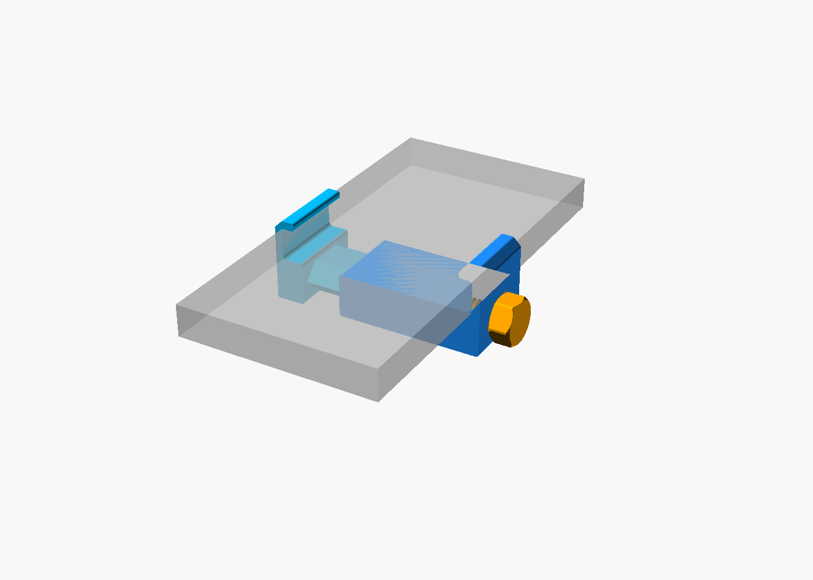
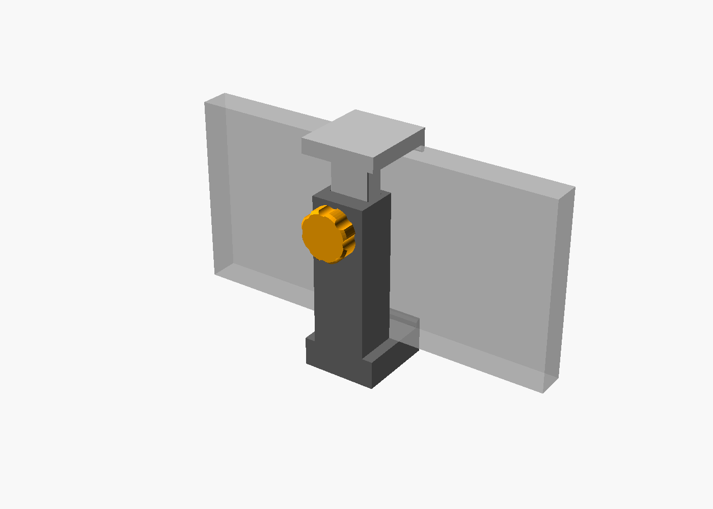

the goal is to create  a openSCAD script that can generate a phone holder that has a internal camera thread so that it can be threaded onto a camera tripod or ballhead.

# V2

`V2/phone_camera_thread_holderV2.scad` generates a hook clamp in the style of
`V2/inspiration`. Two brackets hook over the phone's long edges, and a screw
pulls one bracket into the other. The hooks have a flat back and a flat lip
over the phone's front with only small fillets in the corners
(`cavity_rounding`, 1.5 mm), so the phone can't ride out of them.

there are the following parts:
- body: a hook with a sleeve, which has a hexagonal guide channel and an end
  wall under the screw head
- slider: a hook with a guide bar that runs in the sleeve. The bar has the
  lock screw thread, and the slider's outer end has the 1/4"-20 UNC tripod
  thread.
- lock screw: a hex head screw through the body's end wall into the bar

## use

1. Push the slider's bar into the sleeve.
2. Put the screw through the end wall and start it in the bar.
3. Lay the phone between the hooks and tighten the screw until both hooks grip
   the phone's edges.
4. Screw the slider's outer end onto the tripod. The phone then stands in
   landscape, with the screw head on top.

## printing

Set `part = "print_layout"` to get all parts in their print orientation.
- body and slider: lying on their side, like the parts in the inspiration
  photo. Every layer is the hook profile, so the hooks are strong. The
  guide's 45 degree points face up and down, so the channel needs no support.
  The horizontal holes (tripod thread, bar thread, end wall hole) have a
  45 degree roof on top so they don't sag.
- lock screw: lying on a flat of its head, with the underside of the shank and
  head cut flat (`screw_cut`), as in `fdm_optimized_screws`. The layers then
  run along the shank, so it doesn't snap between them.

The bottom point of the guide bar hangs 2.2 mm above the bed, as in the
inspiration. If it prints rough, deburr it so the bar slides freely.

## sizes

The defaults clamp phones from 60 to 90 mm wide and up to 12 mm thick, case
included (`grip_min`, `grip_max`, `phone_thickness`). The guide bar, sleeve
and screw lengths follow from these. The lock thread is 8 mm with a 2 mm
pitch, as in `fdm_optimized_screws`, so the whole range takes 15 turns.

## thread fit

The tripod hole is 9 mm deep (`tripod_thread_depth`). That has to be more than
the length of the tripod screw. Print `part = "thread_test"` first. It is a
small block with the same thread, printed lying like the slider. If the tripod
screw is tight, raise `tripod_thread_clearance` (default 0.3 mm on the
diameter). If it is loose, lower it.

# V1

`V1/phone_camera_thread_holder.scad` generates a screw clamp phone holder with
a printed 1/4"-20 UNC thread in the underside of its base, the standard thread
of camera tripods and ball heads.

there are the following parts:
- body: the fixed bottom jaw with the tripod thread, and a tube that rises
  behind the phone
- slider: the top jaw on a bar that slides in the tube
- lock screw: a knob in the back of the tube

## use

1. Push the slider's bar into the tube from above.
2. Stand the phone in landscape in the bottom jaw, with the back of the phone
   against the tube.
3. Push the slider down onto the phone and tighten the lock screw. It presses
   the bar against the front wall of the tube.
4. Screw the holder onto the tripod. For portrait, tilt the ball head 90 degrees.

The jaws are 30 mm wide. Centre the phone so they don't press its side buttons.

## printing

Set `part = "print_layout"` to get all three parts in their print orientation.
None of them needs support.
- body: standing on its base, so the tripod thread prints upright
- slider: on the top face of its jaw, bar upwards
- lock screw: on its knob

Use fine layers (0.12-0.16 mm) for the tripod thread.

## sizes

The defaults clamp phones from 60 to 90 mm wide and up to 12 mm thick, case
included (`grip_min`, `grip_max`, `phone_thickness`). A narrower range gives a
shorter body and more bar in the tube.

## thread fit

The tripod hole is 9 mm deep (`tripod_thread_depth`). That has to be more than
the length of the tripod screw, or the holder won't sit flat on the plate.

Print `part = "thread_test"` first. It is a small cylinder with the same
thread. If the tripod screw is tight, raise `tripod_thread_clearance`
(default 0.3 mm on the diameter). If it is loose, lower it.

The lock screw uses the 45 degree FDM thread of the softbox screws
(`cuboid_video_light_softbox`), with the same 0.15 mm radial clearance.
