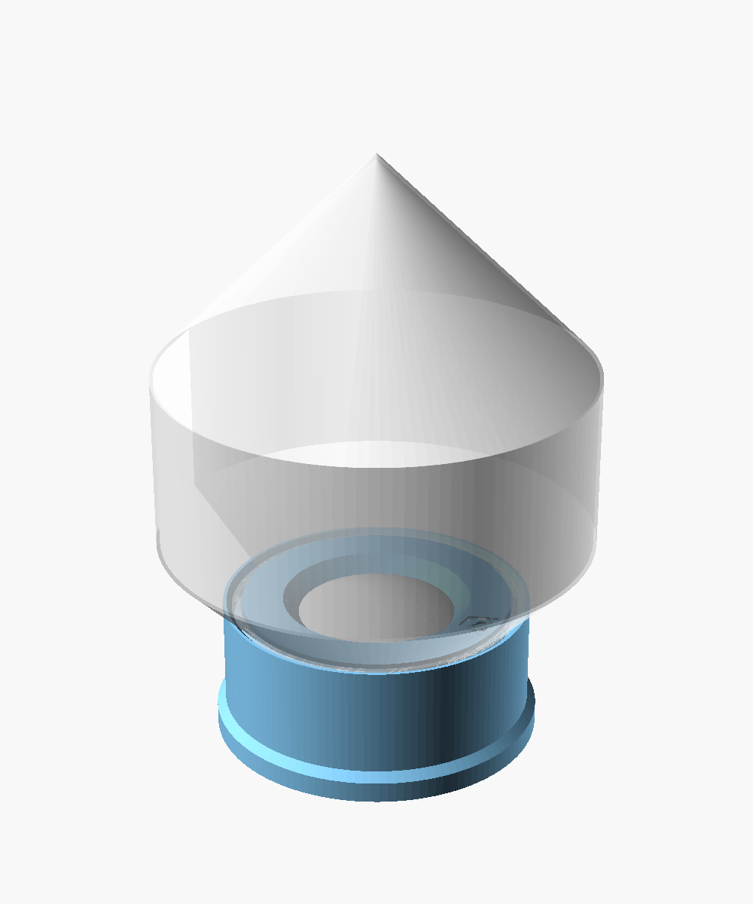
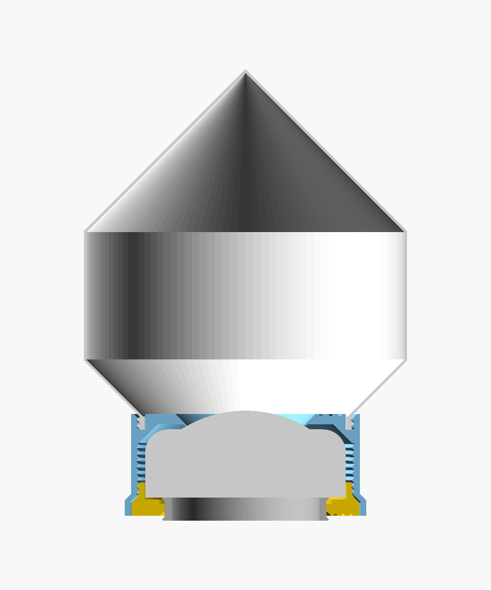
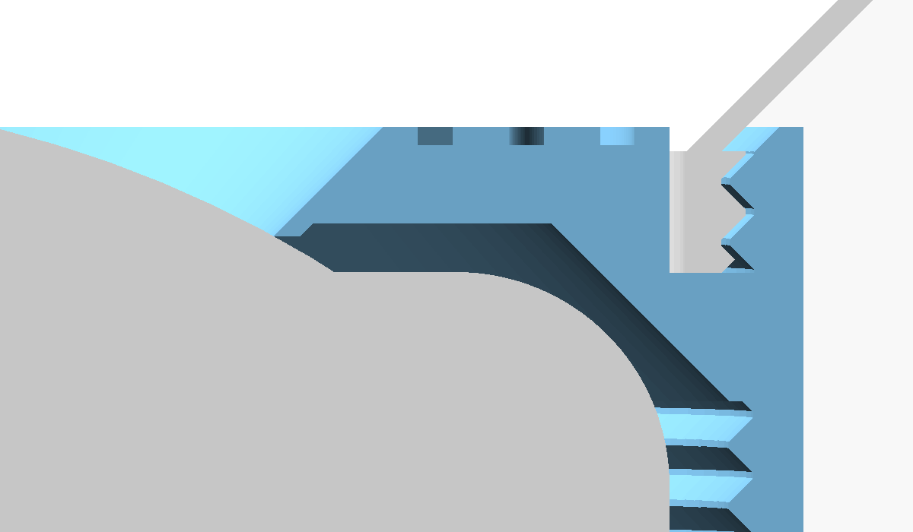
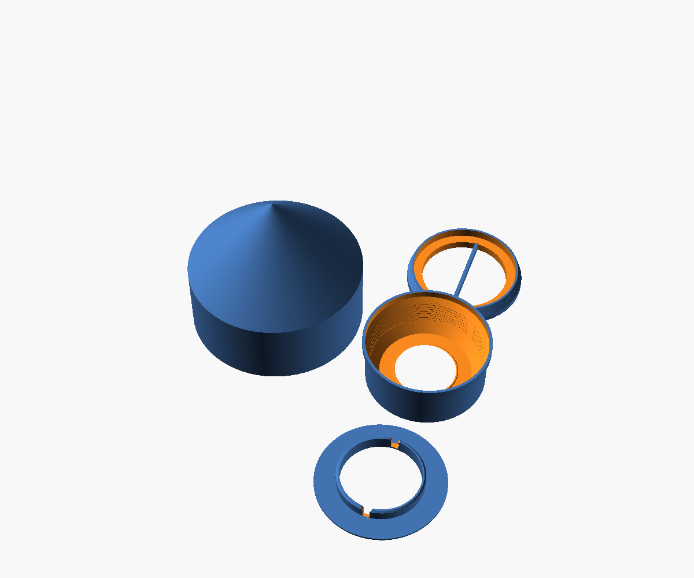
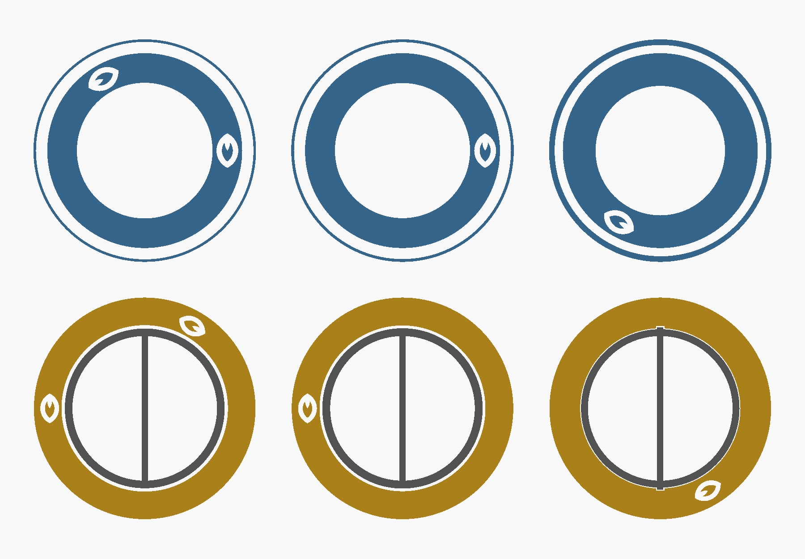
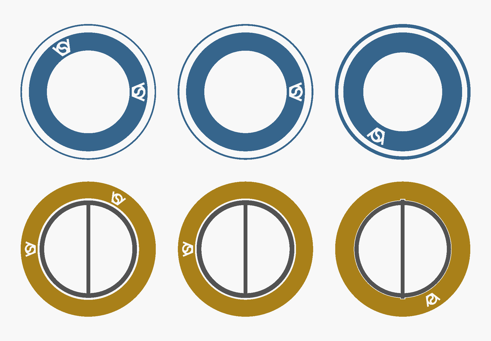

# Pucklight lamp V2

Lamp with the 62 mm RGBW puck light (KC007): the click holder of
`../RGBW_pucklight_holder_ringclick` V7 with a cup on top, and a simple
lampshade that screws into it. The cup has pucklight_sphere's thread, so the
spheres of `../pucklight_sphere` and the vases of `../pucklight_vase` fit too.

The lampshade's neck in the cup, and the window's edge on the lens:

| File | What |
|---|---|
| `pucklight_lamp_v2V3.scad` | the generator, standalone, no libraries |
| `pucklight_lamp_v2V3_TraceTrove.scad` | V3 with the TraceTrove logo instead of the VeryOS logo |
| `pucklight_lamp_v2V2.scad` | V2: without the fingerprint |
| `pucklight_lamp_v2V1.scad` | V1: ringclick V3's bottom screw and click base |

## TraceTrove version of V3

`pucklight_lamp_v2V3_TraceTrove.scad`: V3 with the TraceTrove logo V3 instead of the VeryOS logo, in a file of its own. Everything else is V3's; a change to V3 has to be made in both files.

| | V3 | V3 TraceTrove |
|---|---|---|
| logo | VeryOS, built in the script | TraceTrove logo V3, flat: the outline of `logo_final_flat` in tracetrove_branding's `branding/LOGO_V3/tracetrove_logo.scad`, copied into the script, so it still needs no libraries; compared with it in OpenSCAD: no difference |
| logo's size | by its width: top part 10, screw 8 | by its height: top part 11 (`toppart_logo_height`), screw 9.5 (`screw_logo_height`); 20 wide where it is 31.75 tall |
| logo's direction | top pointing outwards | along the ring, as in TraceTrove's pucklight_egg V1 |
| logo's strokes | 0.9 to 1.1 wide | 1.5 to 1.7 wide |
| fingerprint | the VeryOS logo as relief and as watermark | the TraceTrove logo as relief and as watermark, in the same places, as deep and as high: a copy shows which brand's file it came from |
| other geometry | | the same: the solids differ by the logos' volumes only; the plunger and the lampshade are identical |
| printed | untested | untested, not sliced |

The same sections as for the fingerprint below: 0.01 inside the face on the bed, 0.1 inside it, and through the watermark.

## V3 against V2: fingerprint

Proof of where a copy of the file comes from, not copy protection: ringclick V7's. The outside of the parts is V2's.

| | V2 | V3 |
|---|---|---|
| visible logos | top part's top face inside the cup, bottom of the screw's flange | the same |
| relief | | the logo once more in the same faces, a third of a turn further, 0.02 deep (`relief_depth`): in the file, not in the print |
| watermark | | the logo as a sealed void inside the solid, two thirds of a turn further, 0.4 high (`watermark_height`), 0.8 above the bed (`watermark_z`): prints as a hidden chamber |
| lampshade, plunger | | no mark: the shell is 0.8 thick; the plunger is in one file with the screw ring |
| printed | works (2026-11-12): the screwin, and the lampshade's thread in the cup | untested in print; sliced, see below |

Sections of the top part (blue, from above) and of the screwin (gold, from below). Left: 0.01 inside the face on the bed. Middle: 0.1 inside it, where a slicer cuts a 0.2 first layer. Right: through the watermark.

| Top part and screwin, sliced with Bambu Studio 2.9.1, A1, 0.2 layers, 15 % infill: ringclick V6's settings, not this lamp's Snapmaker U1 project | Result |
|---|---|
| V2 against V3 | 7 of 157 layers differ, 0.6 to 1.8 above the bed, all inside; outer walls differ only around the two voids; 37 s and 0.14 g more |
| the relief alone, what it survives, how to check a file | `../RGBW_pucklight_holder_ringclick`, V7 against V6 |

## V2 against V1

| | V1 | V2 |
|---|---|---|
| holder | ringclick V3's | ringclick V6's |
| below the top part | bottom screw and click base | the screwin: the screw ring with a plunger printed in place inside it, 0.2 around it (`slide_gap`), kept by a 45 degree lip at its top and at its bottom |
| stands on | the click base's Ø74.7 plate | the plunger's Ø50 tube; pressed down, the top part's bottom stands on the desk |
| lifts the puck | the base's tube, 6.8 above the plate: ringclick V3's, which barely clicked | the plunger, 7.2 (`tube_raise` 0.4): ringclick V5's, which clicks |
| turns the screw | the screw's bar | the plunger's bar, through two slots in the screw's opening |
| parts | four | three |
| all, solid PLA | 79 g | 75 g |
| top part, lampshade | | V1's, unchanged |

## Parts

| Part | `part =` | Prints | Solid volume |
|---|---|---|---|
| Lampshade | `lampshade` | on its neck | 25.0 cm³ |
| Top part | `toppart` | upside down, top face on the bed | 22.1 cm³ |
| Screwin | `screwin` | standing as used, the plunger inside in its pressed position | 13.5 cm³ |
| all, solid PLA | | | 75 g |

Also: `assembly`, `section`, `print_layout` (all three parts, 180 × 163 mm), `slide_test` (the screwin's fit at gaps 0.2, 0.3 and 0.4, as in ringclick V6).

## Lampshade

| Parameter | Default | Meaning |
|---|---|---|
| `lampshade_d` | 100 | outer diameter; at least `neck_d` + 10 |
| `lampshade_height` | 40 | the cylinder between the two cones |
| `shell` | 0.8 | two 0.4 lines; thinner glows more |
| `neck_wall` | 1.2 | inside the thread's root, as pucklight_sphere |

| Size | |
|---|---|
| lampshade | Ø100 × 111.3: neck 4, 45 degree cone 17.3, cylinder 40, 45 degree cone 50 to a point |
| lamp on the desk, released | 139.5 high |

| Slicer setting for the lampshade | Value | Why |
|---|---|---|
| Layer height | 0.2 mm | 0.28 mm for quick prototypes |
| Wall generator, walls | Arachne, 2 | 0.8 mm is two lines |
| Filament | white or a light colour | it glows |
| Brim | outer, 5 mm | the neck stands on a 1.2 mm ring |
| Support | off | nothing overhangs more than 45 degrees |

## Holder against RGBW_pucklight_holder_ringclick V7

| | ringclick V7 | here |
|---|---|---|
| top | 45 degree cone to a 56.7 top face | cylinder Ø70.8 up to the rim of a cup with a female Ø67 thread |
| inside the cup | | the core stands up to the rim around the window, Ø62 (`cup_core_d`), so the top part still prints upside down |
| top face | 30.1 | 31.5; the cup's floor 26.7 |
| ring above the flat ring around the lens | 1.8 | 3.2, the core |
| top part's logo | 9 wide | 10 wide, in the core's top face |
| top part, solid | 15.8 cm³ | 22.1 cm³ |
| unchanged | | cavity, window, lip, screwin; how it clicks, the plunger and its tuning: `../RGBW_pucklight_holder_ringclick` |

## Cup and fit

| | |
|---|---|
| thread | Ø67, 2 mm pitch, 45 degree flanks, right-handed, 2 turns, as pucklight_sphere V3 |
| male on | the lampshade's neck, chamfered 45 degrees at the bed; or a sphere's or a vase's |
| female in | the cup, Ø67.6: `neck_clearance` 0.3 radial |
| stop | the neck's bottom on the cup's floor |
| core | Ø62 inside the necks' Ø63 bore; a vase's single wall is further out |
| checked in OpenSCAD, with this lampshade and with pucklight_sphere V3's sphere | seated: no contact; 0.05 lower: only the neck's bottom on the floor; half a turn out: no contact; raised 1 without turning: the threads collide |

## Printing

| Part | Overhangs |
|---|---|
| `lampshade` | the two cones, 45 degrees; the thread's 45 degree flanks |
| `toppart` | the window's chamfer and the two outer cones, 45 degrees; the lip's outer 45 degree cone faces up; the cup's floor bridges 2 to 2.8 between the core and the cup's thread |
| `screwin` | 45 degree flange cone and thread; the plunger's lips and the opening's bottom chamfer, 45 degrees; nothing bridges. Push the plunger down once to free it |

Test the thread before a whole lampshade: in the slicer, print only the lampshade up to z = 10 and the top part up to z = 6, upside down as it lies on the bed.

## Assembly

1. Push the screwin's plunger down once to free it.
2. Put the puck into the top part from below, lens first.
3. Screw in the screwin by the plunger's bar until it is flush with the bottom; push the plunger up, so the bar's ends sit in the slots.
4. Hold the top part and screw the lampshade into the cup until it stops, about 2 turns.
5. Stand the lamp on the desk, on the plunger. Press it down to click the light; press near the top part, the shell is thin.

## Logo

The VeryOS logo is engraved 0.6 mm deep (`logo_depth`): 10 wide in the top face of the top part, inside the cup; 8 wide in the bottom of the screw's flange. The plunger has no room for one; the lampshade has none: its shell is 0.8 thick and its neck's bottom a 1.2 ring. V3 repeats the logo as a fingerprint in the top part and in the screw ring, see V3 above.

## Status

V2 printed (2026-11-12): works, with the lampshade's thread in the cup. V3 is V2 with the fingerprint: sliced, not printed.
