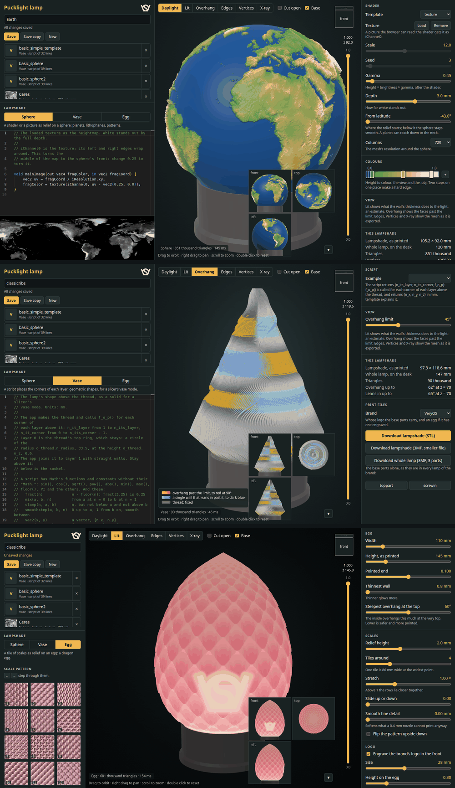

# Pucklight lamp webapp

One app for the lampshades of the pucklight lamp: it does what the three older apps did, each for one kind, and makes a lampshade of any loaded 3D object. A lamp is the base of a brand and a lampshade of one kind; the app keeps lamps under names and writes their print files.

| Start | |
|---|---|
| `deno task start` in `pucklight_lamp_v2/`, then http://127.0.0.1:8768 | everything; reachable from this computer only |
| `deno task start 8769` | on another port |
| `deno task test` | the tests, see Checks |
| `deno task part` | the base parts again, after a change to the `.scad` files; needs `openscad` |
| `deno task thumbnail` | the scale patterns' pictures again, after adding height maps; needs Python with numpy and Pillow |

Needs [Deno](https://deno.com) and a browser with WebGL2. The editor comes from the internet; without it a plain text box replaces it.

## Kinds of lampshade

| Kind | Made from | Is | Prints as | Was |
|---|---|---|---|---|
| Sphere | a shader, as in Shadertoy, or a loaded picture: a heightmap | relief on the outside of a Ø100 sphere, smooth inside: planets, lithophanes, patterns | walls, thick where it stands out | `pucklight_sphere/mathematical` |
| Vase | a script that places the corners of each layer | any shape above the thread | one wall, in a slicer's vase mode | `pucklight_lamps`, before `pucklight_vase` |
| Egg | a seamless tile of scales, sliders | relief on an egg, the brand's logo engraved if wanted: a dragon egg | walls, or one wall in vase mode | `rose_pink_translucent_lamp/dragon_egg_app` |
| Object | a loaded 3D object, STL or OBJ, placed with the mouse: no code | the object, hollowed to one wall thickness and joined to the neck, in the colours an OBJ has | walls; not in vase mode | new, 2026-11-13 |

- The older apps are in `../../01_published_or_archived/`, deprecated. Their saved projects are here in `project/`: 18 spheres, 14 vases.
- All kinds have one neck: the lampshade's of `../pucklight_lamp_v2V5.scad`, Ø67, 2 mm pitch. They screw into the lamp's cup, and into the sockel of the older lamps.

## Lamps

| | Control | On disk |
|---|---|---|
| Create | type a name, Save or Enter | `project/<name>/project.json` |
| Read | the list; the address `#<name>` opens it again after a reload | |
| Update | Save, or Ctrl+S, in the editor too; the line under the name says what is unsaved | `project.json`; a sphere's texture in `texture.png`; an object in `object.stl`, its colours in `object_color.bin` |
| Update | another name, Save | the folder moves, with what else lies in it |
| Copy | Save copy | `project/<name> copy/` |
| Delete | × on its row, asks first | the folder goes |
| Start over | New: a new lamp of the kind on screen | |

- A lamp holds its kind, its brand and that kind's settings. The view's settings and the kind last used are the browser's.
- The Lampshade buttons change the open lamp's kind. Each kind's settings stay while the page is open; saved are those of the kind on screen.
- A name has letters, digits, spaces, `_` and `-`, 64 at most, and is the folder's name.
- Before unsaved work is replaced, the app asks: Save first, Discard or Cancel. Closing the page asks too.
- After deleting the open lamp its settings stay on screen: Save brings it back.
- Saving a lamp as it is writes the same bytes: git stays clean. One saved by an older version is written once with what was added since.
- API: `GET /api/project`; `GET`, `POST`, `PUT`, `PATCH`, `DELETE /api/project/<name>`; `GET`, `PUT`, `DELETE /api/project/<name>/texture`, `/object` and `/color`.
- The server writes to `project/` only, listens on 127.0.0.1 only, and refuses requests from other web pages.

## Base and brand

| Part | From | Prints |
|---|---|---|
| Top part | `../pucklight_lamp_v2V5.scad`, `part = "toppart"` | upside down, its top face on the bed |
| Screwin | same, `part = "screwin"` | standing as used |
| TraceTrove's | `../pucklight_lamp_v2V5_TraceTrove.scad` | the same |

- Brand: VeryOS or TraceTrove. It chooses the base parts, and the logo an egg has engraved.
- The parts are in `part/<brand>/`, their measures in `part/lamp.json`: `deno task part` writes both.
- The view shows the lamp pressed down onto the desk. Released it stands 1.5 mm higher: the stat's height.

## View

| Control | Does |
|---|---|
| drag, right drag, wheel, double click | orbit, pan, zoom, back to the start |
| cube | turns with the lamp; a click on a side looks from there |
| Daylight | the lampshade in its colours: a sphere's heights, a vase's thread in gold, an egg in rose pink, an object in white or in its own colours |
| Lit | light through the wall: thin glows, thick stays dark. An estimate, with Brightness and the puck light's colour |
| Overhang | faces past the Overhang limit: overhangs orange to red; a single wall that leans in, blue; the thread grey |
| Edges, Vertices | the mesh's triangles and points on it |
| X-ray | shows through |
| Cut open | hides the front half |
| slider on the right | section: hides what is above its height of the lampshade, from 0.0 to 1.0 |
| Base | shows the top part and the screwin |
| ▼ | hides the small views: front, top, left |

- Sphere and vase are drawn with one normal per triangle, as exported. An egg and an object are drawn smooth.
- Through a cut a shell shows its cut wall in one colour; a single wall shows its inside, darker.

## Print files

| Button | File |
|---|---|
| Download lampshade (STL) | `<name>_<kind>.stl` |
| Download lampshade (3MF) | the same mesh, a smaller file |
| Download lampshade (OBJ) | a sphere, or an object in colours, with a colour per point: `v x y z r g b` |
| Download whole lamp (3MF) | lampshade, top part upside down and screwin, side by side as they print |
| toppart, screwin | the brand's base parts alone |

- A sphere and a vase are exported as shown, a vase also where its script uses `Math.random()`. An egg is built anew at its Mesh detail, an object at its Detail.

| Lampshade | Slicer setting | Why | Printed |
|---|---|---|---|
| Sphere, egg | walls enough to fill the wall at its thickest: thickest / line width, 8 for 3.2 mm; no supports | sparse infill inside a relief shows as a shadow when lit | hypothesis, from the egg's app |
| Object | walls for Wall / line width, 3 for 1.2 mm; not vase mode; supports inside only if Inside past 45° is large | a shell of two surfaces; its ceilings hang inside | hypothesis, not sliced |
| Object in colours | the OBJ; Bambu Studio asks at import which filament each colour is | the wall has one colour through, so it glows in it | by Bambu's wiki, not tried |
| Vase, egg in vase mode | spiral vase, **bottom layers 0**, outer wall line 0.6 mm, brim 5 mm | a floor closes the neck: no light | hypothesis, from the vase's app |
| all | 0.2 mm layers, white or a light filament | it glows | the `.scad` file's lampshade, 2026-11-12 |

## Sphere

| Control | Does |
|---|---|
| Template | puts a starting shader into the editor: `voronoi`, `texture`, `lithophane` |
| Texture | Load: PNG, JPEG, WebP, up to 4096 wide, as `iChannel0`; not TIFF |
| Scale, Seed | `iScale`, `iSeed`; off if the shader does not read them |
| Gamma | height = brightness ^ gamma, after the shader |
| Thinnest wall | where the map is black, and where there is no relief: 0.4 to 2 mm, 0.5 for a new lamp; the inside moves |
| Thickest wall | where the map is white: 0.8 to 6 mm, 3.2 for a new lamp; white stands out by the difference of the two |
| From latitude | where the relief starts: -19.7 by default, -43 for a planet |
| Columns | the mesh's resolution: 180 to 2048 |
| Colours | height to colour, for the view and the `.obj`; a click on a stop opens its picker |

| Shader name | Is |
|---|---|
| `mainImage(out vec4 fragColor, in vec2 fragCoord)` | as in Shadertoy, without buffers and `iChannel1` to `3` |
| `fragCoord / iResolution.xy` | longitude and latitude, 0 to 1; y = 1 at the top |
| `iChannel0` | the texture; its top is the sphere's top, it repeats from left to right |
| `sphereDir(uv)` | the point on the unit sphere: no seam, no squeezed cells at the top |
| `iTime`, `iFrame`, `iMouse` | always 0 |
| Map | 2048 x 1024, 8 bit, brightness = 0.299 r + 0.587 g + 0.114 b |

- Moves: the outside from From latitude to 80 degrees, fading in and out over 15. The thread, the neck, the inside and the poles stay.
- The thinnest wall is the sphere's wherever it has no relief: below From latitude down to the thread, and at the top. At 0.5 mm that is one line of a 0.4 mm nozzle.
- A thickest wall that is no thicker than the thinnest leaves the sphere smooth; the page says so.
- A lamp saved with `n_mm__depth` had a wall of 0.8, and the depth more where white: it opens as 0.8 and 0.8 + depth, the same sphere.
- A mistake shows in the status and the editor with its line; the last good shader stays.
- A texture on an unedited template that does not read `iChannel0` switches to the `texture` template.
- Overhang by planet and file sizes by columns: `../../01_published_or_archived/pucklight_sphere/mathematical/readme.md`.

## Vase

The editor holds the body of a function: it gets `o_thread`, sees `noise` and the functions below, and returns `{n_its_layer, n_its_corner, f_o_p}`, with `n_height_dome` for a dome on top.

| Name | Is |
|---|---|
| `n_its_layer`, `n_its_corner` | layers above the thread, from 1; corners of each layer, from 3; at most 2 000 000 points |
| `f_o_p(n_it_layer_nor, n_it_corner_nor, n_it_layer, n_it_corner)` | called for each corner of each layer; returns `{n_x, n_y, n_z}` in mm |
| `o_thread.n_radius`, `o_thread.n_z` | 33.5 and 6.6: the top ring of what is fixed, as it were layer 0 |
| `n_height_dome`, `n_overhang_dome` | optional: closes the last layer with a dome this high, which leans up to 60 degrees, or as given |
| `noise.simplex2`, `simplex3`, `perlin2`, `perlin3`, `noise.seed(n)` | noise from -1 to 1; a script starts on seed 0 |
| `sin()`, `cos()`, `PI` and the others | `Math`'s, without their `Math.` |
| `fract`, `mix`, `clamp`, `smoothstep`, `vec2`, `vec3`, `length`, `distance` | as in a shader |

- Fixed, gold in the view: the thread, z 0 to 4.8, and a collar Ø67 up to 6.6. Every `n_z` must be 6.6 or more.
- The last layer is closed flat, which vase mode leaves open, or with a dome.
- Example puts an example's script into the editor: `template` explains the script, the others are stlsculpter's vases.
- A mistake shows in the status and the editor with its line; the last good vase stays.
- The examples' numbers, the dome and the noise in detail: `../../01_published_or_archived/pucklight_lamps/readme.md`.

## Egg

| Is | How |
|---|---|
| Outline | Hügelschäffer's egg; Width without the relief, Height from the bed to the tip |
| Bottom | a 45 degree cone from the neck up to where the egg overhangs 45 degrees |
| Top | bends less and less, up to Steepest overhang at the tip |
| Scales | tiles keep their shape and get smaller towards the ends; the relief shrinks with them and fades out above the cup's rim |
| Walls | smooth inside; relief only adds to Thinnest wall |
| Logo | the brand's, on the front, off by default; leaves 0.4 mm of wall |
| Vase mode | the egg without its inside, for one wall that follows the scales |

- The app warns when more than 2.5 % of the outside overhangs past 60 degrees: Flip, less relief or fewer tiles help.
- Mesh detail is the print file's cell size; the view builds coarser while a slider moves.

## Object

| Control | Does |
|---|---|
| Load a 3D object…, or files dropped onto the page | STL, binary or text, or OBJ; with an OBJ its `.mtl`, if its colours are there; one object a lamp |
| at loading | its numbers are mm; below 20 or above 300 mm it becomes 120 mm; it stands in the middle, 2 mm into the stem |
| arrows in the view | move along x, y, z |
| rings in the view | turn around x, y, z |
| orange ring | resize: as many times larger as the pointer goes further from the middle |
| orange point in the middle | move across the screen |
| beside the gizmo | the view's own drag: orbit, pan, zoom |
| Turn around x, y, z | a quarter turn, then it stands on the stem again |
| Stand on the stem, To the middle, As loaded | lowest point 2 mm into the stem; x and y to 0; as it came |
| Size; x, y, z | the longest side and the middle's place as numbers, in mm |
| Wall | 0.8 to 3 mm, 1.2 by default |
| Stem | 0 to 40 mm: how high the neck goes on as a tube before a 45 degree cone closes it; shows only where the object is narrower |
| Detail | the print file's grid, 0.3 to 1.5 mm, 0.6 by default; the note below it says triangles and file size |

| Step | How |
|---|---|
| 1. Sample | lines of a grid along x, y and z through the triangles; inside is counted from what a line crosses, the three directions vote |
| 2. Join | with the stem; what does not hang together with it is left out, and told |
| 3. Distance | each grid point's distance to the surface, from the crossings and their directions; the stem's from its formula |
| 4. Surfaces | outside where the distance is 0, inside where the depth is Wall: they cannot cross |
| 5. Neck | both end on circles at z = 6.6 and are sewn to the thread all kinds have |

| Object | Result |
|---|---|
| a small hole, parts through each other, inside-out, several shells | taken as the solid they enclose |
| a hole so long that the grid's lines pass through it twice | a stray wall inside: a ball without a strip from pole to pole got 16 % more plastic |
| thinner than twice Wall | solid, no cavity |
| a hollow object | keeps its own hollow, closed in |
| loose parts, an object above the stem | left out; the stat says how much |
| finer than Detail | smoothed away; at 0.8 mm a box's sides and edges are up to 0.1 mm out, 0.2 mm in |
| inside overhangs | not changed: Inside past 45° says how much, Overhang with Cut open shows where |
| large: more than 16 million grid points | a coarser grid, told below Detail |

| Grid | For | Time, ball Ø110 of 1 million triangles |
|---|---|---|
| 1.6 mm | while a handle is dragged the object itself shows; the first lampshade after | 0.25 s |
| 0.8 mm, or Detail if coarser | the lampshade in the view, once the place is final | 0.7 s |
| Detail, 0.6 mm | the print file | 1.4 s, 1.2 million triangles |

| Colours of an OBJ | Read |
|---|---|
| a point's own, `v x y z r g b`, from 0 to 1 or from 0 to 255 | yes; this app's own OBJ is such a file |
| ZBrush's `#MRGB` lines | yes |
| a material's, `usemtl` with `Kd` in the `.mtl` | yes, if the `.mtl` is chosen or dropped together with the OBJ; else the page says where they are |
| a picture, `map_Kd` | no; the page says so |
| one colour alone | counts as none: the lampshade stays white |
| STL | has none |

| Where | Colour |
|---|---|
| outside | the object's where the grid's lines cross it: as fine as the grid |
| inside | the same, through the wall: a filament change colours the whole wall |
| over a hole in the object's surface | the colour around the hole |
| neck, stem | white |
| while it is placed | the object itself, in its colours |
| Lit | none: the wall's thickness alone |
| print file | the OBJ; STL and 3MF have no colours |
| `object_color.bin` | r, g, b, a byte each, for each corner of each triangle of `object.stl` |

- `object.stl` holds the object's triangles as they were loaded, an OBJ's too; where it stands is in `project.json` as place, turn and size.
- A lamp that becomes another kind gives up its `object.stl` at the next save.

## Scale patterns

| | |
|---|---|
| Where | `.gitignored/tile/`: seamless greyscale PNG height maps, 8 or 16 bit; bright is high |
| Not in git | the 55 patterns here are the texture pack `MG-Tile Scale`; its licence is not recorded here, so it stays out of the public repo |
| After adding | `deno task thumbnail` writes `thumbnail/<number>.jpg` and `index.json` there |
| Number | the last number in a file's name |
| Without them | no patterns to choose from, and an egg is smooth; the rest works |

## Files

| File | What |
|---|---|
| `index.html`, `style.css` | layout |
| `client.module.js` | the page: the lamp on screen, the worker, the view's controls, the print files |
| `kind_sphere.module.js`, `kind_vase.module.js`, `kind_egg.module.js`, `kind_object.module.js` | each kind's controls and what it tells the worker |
| `sphere.module.js`, `vase.module.js`, `egg.module.js`, `object.module.js` | each kind's mesh |
| `mesh_file.module.js`, `gizmo.module.js` | an object's file as triangles and colours; its place, the handles and what a drag of each does |
| `noise.module.js`, `vase_example.module.js` | a script's noise, public domain by its header; the example scripts |
| `heightmap.module.js`, `logo.module.js`, `color.module.js` | an egg's 16 bit PNGs; both logos as distance fields; the points' colours |
| `worker.module.js` | builds the lampshades and writes the print files, away from the page |
| `viewer.module.js` | the 3D view and its shaders |
| `editor.module.js`, `control.module.js`, `dom.module.js` | the editor; sliders, lists and tick boxes |
| `project.module.js` | the saved lamps' panel |
| `export.module.js` | STL, OBJ, 3MF |
| `serve.js` | the server: files and the lamps' API |
| `make_asset.py` | writes `part/` and the patterns' thumbnails |
| `project/` | the lamps, tracked by git |
| `test/` | the tests |

## Checks

| Check | Result |
|---|---|
| Meshes against the older apps' own files, one-off: 3 spheres with a relief, 8 examples and 14 projects of the vase, 6 eggs | the same points, faces and numbers, to the last bit |
| `test/lamp.test.js`: the neck against `../pucklight_lamp_v2V5.scad`'s own lampshade, in OpenSCAD | worst point 0.010 mm off |
| Same: the neck in the cup of both brands' top parts, by rays to the cup's wall | gap 0.29 to 0.31 mm all around, 0.3 by the generator |
| Same: both logos against their `.scad` files | areas within 0.3 %, same sizes |
| Same: STL, OBJ, 3MF; the worker with each kind, a script's mistake, a script with `Math.random()`, the whole lamp | hold the mesh; builds each, names the mistake's line; the print file is the vase built last; three parts, the top part upside down on z = 0 |
| `test/sphere.test.js`, `vase.test.js`, `egg.test.js` | closed, right way out, at the ends of every setting; only what may move moves; the older apps' tests of dome, noise and script functions |
| `test/sphere.test.js`: walls of 0.4 to 2 mm; lamps saved with a depth of 0.2 to 5 | the inside that much under Ø100, the outside and the thread unmoved, the wall at the thread's root no thinner; the same sphere as before, to the last bit |
| `test/object.test.js` | ball, box, ring, inside-out, holed, overlapping, loose, clipped, thin, large: closed, right way out; a ball's outside within 0.04 mm at 0.8; the neck the egg's; STL and OBJ read |
| Same, colours: a box with a colour a side, a ball in a gradient, a ball with a hole; OBJs with colours of points, `#MRGB`, materials, a picture | the sides exact, outside and inside; the gradient within 5 of 255 outside, 10 inside; the hole in the colour around it; read, or told why not |
| `test/gizmo.test.js` | place as matrix; each handle under the pointer; where a drag of each leads |
| `test/server.test.js` | create, read, update, rename, delete, texture, object and its colours; refuses bad names, bad lamps, other sites' `Origin` and `Host`, paths outside its folder |
| `test/viewer.test.js`, on Mesa's software renderer | every kind in every look, cut, section, small views; both logos upright; the object while placed, grey or in its colours, the gizmo's handles, a drag on one and beside them |
| The 30 lamps carried over first, in headless Chrome 154 | each opens, builds, counts as saved, and saves with the bytes it had |
| The 2 vases carried over later, `sphere_desert` and `sphereslayers` | built by `vase.module.js`: closed; not opened in the browser |
| The app in headless Chrome 154: lamps, texture, colours, editor, mistakes, Ctrl+S, questions, cube, drag, print files of each kind, start on each kind | works, console clean but for the refused names |
| Object in headless Chrome 154: load, drop, each handle by mouse, buttons, numbers, save, reopen, copy, other kind, STL, whole lamp, a file that is none | works, console clean |
| Object in colours, same: an OBJ with its points' colours, one with and without its `.mtl`, one with a picture; save, reopen, copy, the OBJ print file, an object without colours over it, other kind | works, console clean; the print file has the five colours |
| The 35 lamps in `project/` on 2026-11-13, same | each opens, builds, counts as saved; saved again it has the bytes it had, but for the 17 spheres' walls in place of their depth and an object's `b_color` |
| A sphere's wall, same: a new lamp, both sliders, a thickest below the thinnest, the Moon saved with a depth of 3 | 0.5 and 3.2; more plastic with a thicker wall; smooth and told; opens as 0.8 and 3.8, saved and opened again with 0.5 and 3.2 |
| The print files read back with numpy: STL of each kind, 3MF, OBJ | closed; top part 22.1 cm³ and screwin 13.5 cm³ as the generator's; the top part upside down on z = 0 |
| Without the internet | a text box replaces the editor, the rest works |

## Against the older apps

| | Before | Now |
|---|---|---|
| Sphere, vase: projects | a list with new, save, rename, delete and browser dialogs | the egg app's panel, for all kinds |
| Egg: lamps | numbered files, unsaved work kept over a reload | named folders; a reload asks first, and opens the lamp of the address |
| Egg: logo | TraceTrove's | the brand's: VeryOS or TraceTrove |
| Base | sockel, screwin, click base | `pucklight_lamp_v2`'s top part and screwin |
| Vase: overhang view | two steps, at 45 and 60 degrees | from the Overhang limit on, as the egg's |
| Sphere: wall | 0.8, and Depth more where white | Thinnest wall and Thickest wall, 0.5 and 3.2 for a new lamp |
| Sphere, vase: view | one light | the egg app's lights; Lit, Cut open and Base for all kinds |
| Egg: view | Daylight, Lit, Overhang | also Edges, Vertices, X-ray, the section, the cube and the small views |
| Lit | rose pink filament | rose pink for an egg, white for a sphere and a vase |
| Vase's message and `template` | "below is the sockel" | "below is the lamp's cup" |

## Not tested yet

- Not sliced, not printed from this app. The lampshade of the `.scad` file printed and fits (2026-11-12); these necks are its neck.
- Only on software WebGL in Chrome: no real GPU, no Firefox.
- Object: only test shapes of this app's own making, no model from the internet; no touch screen; not sliced.
- Object in colours: only OBJs the tests wrote, none from Nomad Sculpt, ZBrush, Blender or a slicer; the OBJ print file not opened in a slicer.
- A sphere's thinnest wall of 0.5 mm: not sliced, not printed; it also carries the sphere above the neck.
- A vase's single wall around the cup's core, Ø62 inside the neck's Ø63 bore: by the generator's numbers, not printed.

Licensed under GPL. The planets' textures in `project/` are NASA, USGS and Hubble OPAL data, see `../../01_published_or_archived/pucklight_sphere/planets/readme.md`.
